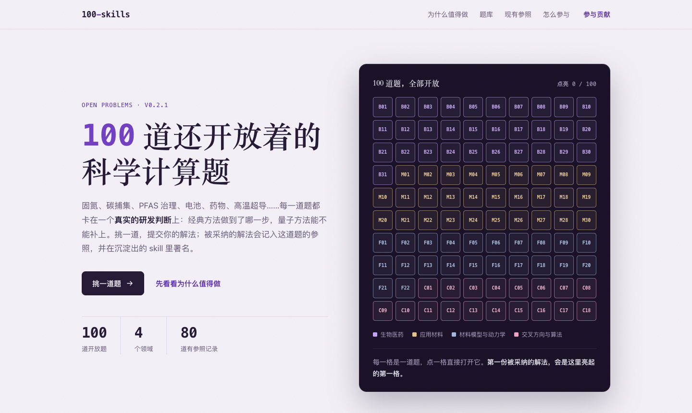

# 100-skills：量子计算与科学计算开放题

100 道来自真实研发场景的开放题，覆盖生物医药、应用材料、强关联模型与动力学，以及优化、量子机器学习和线性求解等交叉方向。我们把这些题目开放给量子开源社区：欢迎提交解法，也欢迎提交负结果。被采纳的解法会逐步沉淀为可复用的 skills。

## 展示页

[`release/promo/index.html`](release/promo/index.html) 是一页可以单独打开的展示页：100 道题按领域排成题板，点任意一格直接展开这道题的五段题面、验收标准和现有参照摘要，也可以按领域筛选或搜索。

- **怎么打开**：GitHub 不渲染 HTML，在仓库里点开看到的是源码。请下载这个文件（或克隆仓库）后用浏览器打开；它是自包含的单文件，不依赖其他本地文件。
- **页面里的链接**：「在 GitHub 查看完整题面」「开 issue 讨论这道题」「提交解法」都指向本仓库，需要有仓库访问权限。
- **发布稿**：配套的文字版见 [release/promo/发布稿.md](release/promo/发布稿.md)。

### 图文能力展示

[科学能力与 100 案例图文展示](release/showcase/index.html) 提供机制图卡片、场景入口、搜索与证据详情，适合演示与交流。含原版演示册的离线展示包不放入仓库，另行分发；版本与证据范围见 [展示说明](release/showcase/README.md)。

## 每道题都拆解清楚

| 环节 | 回答什么 |
|---|---|
| 研究体系 | 要算的到底是哪个分子、材料、模型或数据集 |
| 可观测量 | 用什么数值回答问题：能垒、谱峰、S 矩阵、ROC-AUC…… |
| 经典基线 | 同一问题上 DFT、CCSD(T)、DMRG、AFQMC、GNN 等经典方法能做到哪里 |
| 量子方法的角色 | QPE、VQE、SQD、量子核、退火、振幅估计等方法放在哪一步 |
| 研发决策 | 结果最终支撑哪一个判断 |

每题还有「什么算解」的五条验收标准，以及「现有参照」：100 题中有 80 题附有我们在经典计算机上完成的计算与模拟记录，包括没通过的检验。参照只用于对照和复用，不代表最优解。

举几个例子：

- [M01 Ru–Triphos 催化 CO₂ 制甲醇](problems/applied-materials/M01/PROBLEM.md)：关键中间体与过渡态的相对电子能和能垒，经典端为 DFT、CCSD(T) 与 DMRG，量子端为双因子化哈密顿量加 QPE。
- [B12 药物性质与活性](problems/biomedicine/B12/PROBLEM.md)：量子核与变分模型必须在同一切分、同一指标下跨过 RF/XGBoost、GNN 与 Transformer 基线。
- [F16 态到态反应散射](problems/model-dynamics/F16/PROBLEM.md)：H + H₂ 的复数 S 矩阵和分支概率，判断哪些产物通道被打开、是否存在共振。

## 题库

| 领域 | 目录 | 题数 | 有执行记录 |
|---|---|---|---|
| 生物医药 | [problems/biomedicine](problems/biomedicine/INDEX.md) | 31 | 26 |
| 应用材料 | [problems/applied-materials](problems/applied-materials/INDEX.md) | 29 | 22 |
| 材料模型与动力学 | [problems/model-dynamics](problems/model-dynamics/INDEX.md) | 22 | 17 |
| 交叉方向与算法 | [problems/extensions](problems/extensions/INDEX.md) | 18 | 15 |

## 怎么参与

1. 挑一道题，读它的 `PROBLEM.md`；
2. 按 [CONTRIBUTING.md](CONTRIBUTING.md) 把解法放进 `solutions/<题号>/<你的名字>-<短名>/`；
3. 运行 `python3 -I release/tools/check_submissions.py --root .`，然后开 PR。

解法经过审核、独立复现、采纳三步。同一类方法积累到足够多的采纳解法后，会按 [skills/README.md](skills/README.md) 提炼为 skill，并署名所有来源作者。

## 证据口径

- 现有参照全部来自经典计算机上的计算与模拟，不包含真机结果，也不声称量子优势。
- 按项目当前记录，原应用目标完成数为 0：这些题目都还开放着。
- 原始数据、大型数组和第三方数据集不随题库发布；相应内容标注为「本地证据，未随题库发布」，`evidence.json` 记录来源文件的 SHA-256。

## 许可

题面、图示和文档采用 CC BY 4.0（[LICENSE-CONTENT](LICENSE-CONTENT)）；代码采用 Apache-2.0（[LICENSE](LICENSE)）。贡献需要 DCO 签名。

## 维护者说明

`problems/` 与 `release/stats.json` 由 `release/tools/build_problems.py` 从维护者本地的研究目录确定性生成，不能手改。研究原件约 207G，不入库。

展示页 `release/promo/index.html` 由 `release/tools/build_promo.py` 从 `problems/` 生成，同样不能手改；`release/tools/verify_promo.mjs` 做三种宽度的浏览器检查。首屏截图 `release/promo/preview.png` 不是自动产物，页面首屏变化后需要重新截取。

## English

**100-skills** publishes 100 open research problems in quantum and scientific computing, drawn from real R&D settings across drug discovery, applied materials, strongly correlated models and dynamics, and cross-cutting algorithms (optimization, quantum machine learning, linear solvers). Each problem states the physical system, the target observable, the classical baselines, the intended role of quantum methods, and the decision the result should support. It also gives five acceptance criteria and our existing reference runs (80 of 100, all classical computation or simulation, failures included). Contributions, including negative results, are welcome: see [CONTRIBUTING.md](CONTRIBUTING.md). Accepted solutions will be distilled into reusable skills under `skills/`. Problem statements are currently in Chinese; English versions are planned for the next release. Content is CC BY 4.0; code is Apache-2.0.
