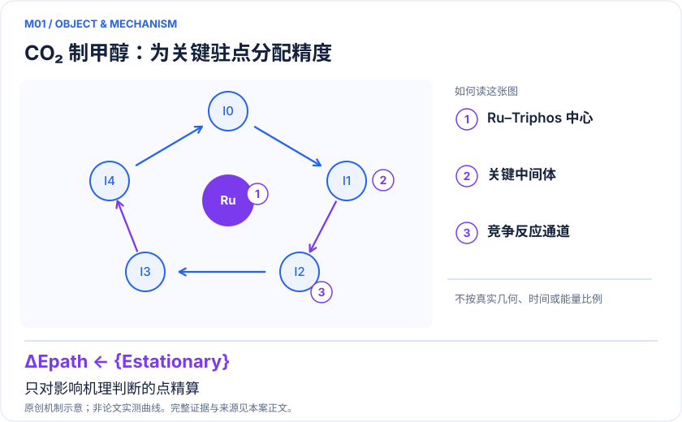
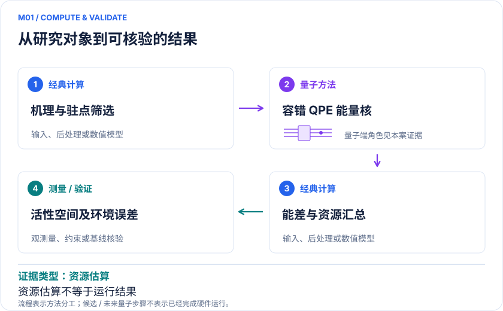

<!-- 由 release/tools/build_problems.py 自 tasks/M01-ru-co2-methanol/README.md 与 tasks/catalog.json 生成，勿手改 -->

# M01 · Ru–Triphos 催化 CO₂ 制甲醇：把量子资源投向决定机理的驻点

> 开放题 · 应用材料 · 催化与绿色化学
> 难度：前沿（[分级说明](../../../starters/README.md#难度分级)） · 背景：量子化学

## 题面

| 环节 | 内容 |
|---|---|
| 研究体系 | Ru–Triphos均相CO₂加氢循环中的关键中间体和过渡态 |
| 可观测量 | 相对电子能、ΔE‡、反应能与误差传播后的路径排序 |
| 经典基线 | DFT多泛函、CCSD(T)适用区、DMRG/选定CI及动态关联修正 |
| 量子方法的角色 | 双因子化哈密顿量结合qubitization/QPE求驻点电子能 |
| 研发决策 | 确定影响甲醇选择性与周转的竞争路径，再判断哪些驻点值得高精度校正。 |

## 基准输入

解法默认使用下列输入，以便与现有参照和其他解法直接比较；改用其他输入时请说明理由。「原文」指作者或原论文公开的材料，「参照」指本项目参照运行自行冻结的选择。

| 项目 | 内容 | 出处 |
|---|---|---|
| 哈密顿量 | 作者公开的八个驻点积分，每个驻点三档 defCD 活性空间 | [原文](https://zenodo.org/records/4769113) |
| 论文与 SI | von Burg 等 2021，arXiv:2007.14460v2；官方 SI | [原文](https://zenodo.org/records/7262118) |
| 参照所用模型 | 中间体 II 的 34e26o 与过渡态 TS 的 38e29o 完整活性空间 | 参照 |

**尚未公开或需注意：**原文 V 中间体空间应为 32e24o（参照已订正）；溶剂、零点与热修正不在积分内。

## 什么算解

一份解法满足以下五点即可提交审核。负结果同样接受，只要过程可复现、结论有依据。

1. **模型对应**：说明所用模型或数据如何对应「Ru–Triphos均相CO₂加氢循环中的关键中间体和过渡态」，列出简化与近似。
2. **可观测量**：报告「相对电子能、ΔE‡、反应能与误差传播后的路径排序」，附单位与不确定度。
3. **经典对照**：在同一模型或数据上，与「DFT多泛函、CCSD(T)适用区、DMRG/选定CI及动态关联修正」中至少一种方法比较。
4. **可复现**：提供代码、环境、随机种子、输入来源与哈希，以及计算资源和成本；用到 QPU 时注明设备与 shots。
5. **研发决策**：说明结果能否支撑「确定影响甲醇选择性与周转的竞争路径，再判断哪些驻点值得高精度校正。」，以及还缺什么证据。

本题的细化标准欢迎在 issue 中讨论；被采纳的讨论结论会写入后续版本。

## 现有参照

本项目已有数值执行记录（经典计算机上的计算与模拟），供对照与复用，不代表最优解。

- 原应用目标：未完成（incomplete）
- 最新研究报告：[REFERENCE.md](REFERENCE.md)
- 其余证据指针见 evidence.json（本地证据，未随题库发布）

### 原案例说明

### M01 · Ru–Triphos 催化 CO₂ 制甲醇：把量子资源投向决定机理的驻点

<!-- VISUALS:START -->
#### 可视化导读

**图 1 · CO₂ 制甲醇：为关键驻点分配精度。** 只对影响机理判断的点精算。相对电子能、ΔE‡、反应能与误差传播后的路径排序。图形为依据本案文献重绘的概念关系，不表示实际原子坐标、实测曲线或数值比例。

**图 2 · 计算与验证路径。** 双因子化哈密顿量结合qubitization/QPE求驻点电子能。**证据边界：** 资源估算不等于已运行；活性空间之外的关联与溶剂、热熵项仍影响速率。

图解依据：[R1 · Quantum computing enhanced computational catalysis](https://journals.aps.org/prresearch/abstract/10.1103/PhysRevResearch.3.033055)；[R2 · Evaluating the evidence for exponential quantum advantage in ground-state quantum chemistry](https://www.nature.com/articles/s41467-023-37587-6)。解释性连线与图形布局由本库整理，未复制论文原图。

[机制图 SVG](mechanism.svg) · [流程图 SVG](workflow.svg) · 机制图 PNG（本地证据，未随题库发布） · 流程图 PNG（本地证据，未随题库发布） · 图解说明 JSON（本地证据，未随题库发布）
<!-- VISUALS:END -->

> **已有明确催化循环的容错资源研究；尚无量子硬件筛出更优Ru催化剂的证据。**
>
> 编研日期：2026-10-04。证据类别：资源估算。建议优先级：重点储备（编辑判断）。本目录为文献研究与试点设计，没有执行所列量子、经典或材料实验。

#### 研发决策与价值

**要支持的决策：**确定影响甲醇选择性与周转的竞争路径，再判断哪些驻点值得高精度校正。

本例把高价值定义为少做无效催化剂合成：先判断改变配体或反应条件能否降低真正控制循环的自由能跨度。Ru配合物是具有具体机理来源的基准，不应直接把其能量精度换算为CO₂减排量。商业减排还取决于氢来源、分离与能耗，这些不在电子求解器内。

#### 物理系统与规模边界

- **系统：**Ru–Triphos均相CO₂加氢循环中的关键中间体和过渡态。
- **规模：**分子活性空间随驻点与动态关联要求扩大；不是整个反应器的量子模拟。
- **目标观测量：**相对电子能、ΔE‡、反应能与误差传播后的路径排序。

这里的规模以原文或docs规定的有限模型为准，不把完整样品、活性空间、系统量子比特、逻辑辅助比特及纠错物理比特混为一个数字。[R1]

#### docs 来源与本次扩展

- 量子计算如何研究材料问题与药物研发_研究方法与应用综述.md: 催化反应路径与经典比较
- 量子计算问题库_飞书多维表格导入版.xlsx: 问题库M09均相过渡金属催化；M14聚合/解聚局部步骤；文献S07

这些文件提供问题线索；文中研究事实以本页可核验原始来源为准，下面的试点、比较和停止条件是本次提出的研究设计。

#### 数学与计算目标

建议冻结一条主循环和一条竞争支路。每个驻点以同一原子守恒、荷电与自旋约定计算 E_el；ΔE‡=E_TS−E_R。只有补齐零点、热、溶剂和浓度修正后才输出ΔG‡。通过微观动力学灵敏度分析，找出能量误差最可能改变周转频率或选择性的几个点，而不是平均分配QPU预算。

#### 量子—经典工作流

**量子职责：**双因子化哈密顿量结合qubitization/QPE求驻点电子能。[R1]

经典结构搜索和频率计算先确认极小值/过渡态，沿路径连续选择金属d、配体及成键轨道。以同一积分输入DMRG和量子资源估计器；检查双因子化截断对相对能的影响，再为QPE分配相位精度、初态重叠与失败概率。最终返回可比较的驻点能量表，交由经典动力学层计算速率和条件依赖。

#### 已发表工作：实际完成了什么

原论文提出双因子化算法并对Ru催化驻点做资源估算，较此前量子算法大幅降本。[R1]

**证据限制：**资源估算不等于已运行；活性空间之外的关联与溶剂、热熵项仍影响速率。

“硬件演示”只代表原论文运行过所述有限任务；“资源估算”只代表给定算法与假设下的预算。两者都不能替代与强经典方法、真实实验和完整成本的比较。

#### 经典比较与资源核算

**建议基线：**DFT多泛函、CCSD(T)适用区、DMRG/选定CI及动态关联修正。

应分别比较三件事：在相同有限哈密顿量上的求解误差；增大活性空间后的模型变化；包括积分生成、初态制备、纠错与重复测量的总成本。若CCSD(T)与收敛DMRG在关键能差上已一致，量子方案的当前价值是未来资源规划，不能宣传为已解决经典瓶颈。R2提醒优势判断必须包含初态和经典启发式。

#### 可复现试点设计（建议，尚未执行）

输入：两条路径的坐标、频率、自旋、基组/ECP、共同轨道追踪规则和积分哈希。步骤：①核对反应计量与TS唯一虚频；②用两档活性空间和两种经典相关求解器检查能差；③仅对经典分歧超出预设决策阈值的点做QPE资源表；④将误差区间传入微观动力学。验收：可独立重建每个相对能，关键路径排名在合理模型扩展下稳定。停止：环境或动态关联修正大于所需精度且没有收敛证据时，先补建模；不以增加比特替代收敛。

交付时至少保留输入来源与版本、完整参数、原始/后处理结果、收敛轨迹、随机种子、实际计算成本和失败记录。验收阈值应在目标数据解盲前冻结；只有固定模型上的解达到标准，仍应单独标明模型到实验的剩余误差。

#### 解读与下一步

适合作为计算催化与容错算法团队的联合任务。近期可完成的是验证集和资源预算，长期候选是机理分歧的裁决。不要把与旧量子算法的资源降幅当成与最佳经典催化工作流的加速比。

**最小下一步：**先交付同轨道同几何的驻点积分集和误差敏感性表，再运行资源估算。

#### 文献与读取范围

- **[R1] [Quantum computing enhanced computational catalysis](https://journals.aps.org/prresearch/abstract/10.1103/PhysRevResearch.3.033055)**（2021；期刊论文；读取层级 `abstract`）。支持：Ru催化CO2转甲醇关键驻点的容错算法资源研究；2020预印本、2021期刊。

- **[R2] [Evaluating the evidence for exponential quantum advantage in ground-state quantum chemistry](https://www.nature.com/articles/s41467-023-37587-6)**（2023；期刊论文；读取层级 `full_text`）。支持：态制备与强经典启发式共同约束基态任务的优势判断。

全文层级表示读到原始正文页面，不表示已逐项复算或完整审计全部补充材料；若页面转换缺失，已在来源说明或正文注明。摘要/检索摘录层级不支持未见的精确实验细节。相同工作的预印本与期刊版不计为独立复现。

## 如何提交

按 [CONTRIBUTING.md](../../../CONTRIBUTING.md) 把解法放在 `solutions/M01/<你的名字>-<短名>/`，格式见 [解法模板](../../../solutions/_template/SOLUTION.md)。被采纳的解法会按 [沉淀规则](../../../skills/README.md) 提炼为可复用的 skill。
