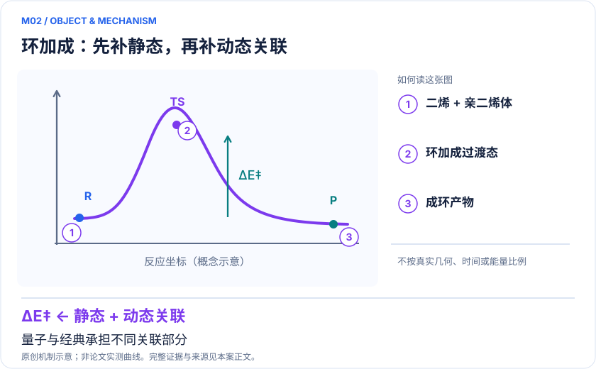
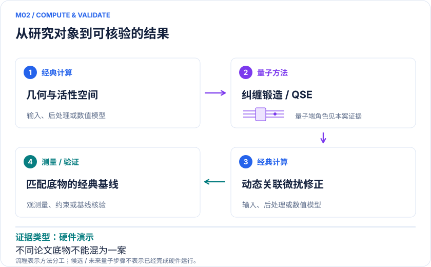

<!-- 由 release/tools/build_problems.py 自 tasks/M02-diels-alder-barrier/README.md 与 tasks/catalog.json 生成，勿手改 -->

# M02 · Diels–Alder 环加成势垒：把静态与动态关联接入合成路线判断

> 开放题 · 应用材料 · 反应路径与聚合材料
> 难度：进阶（[分级说明](../../../starters/README.md#难度分级)） · 背景：量子化学

## 题面

| 环节 | 内容 |
|---|---|
| 研究体系 | 乙烯+环戊二烯环加成；辅以呋喃+乙烯的极化环境算法对照 |
| 可观测量 | 反应物到TS的电子活化能、轨道占据和环境诱导势垒变化 |
| 经典基线 | 同活性空间CASCI/CASSCF、收敛耦合簇及经典微扰后处理 |
| 量子方法的角色 | 纠缠锻造制备关联信息，QSE扩展子空间，再经典微扰恢复动态关联 |
| 研发决策 | 在合成和可逆交联设计前，判断反应温区与候选路径是否受电子关联误差影响。 |

## 基准输入

解法默认使用下列输入，以便与现有参照和其他解法直接比较；改用其他输入时请说明理由。「原文」指作者或原论文公开的材料，「参照」指本项目参照运行自行冻结的选择。

| 项目 | 内容 | 出处 |
|---|---|---|
| 几何 | 乙烯、环戊二烯与 TS1A，取自 Levandowski/Houk 2015 官方 SI（原量子方法明确引用） | [原文](https://acs.figshare.com/articles/journal_contribution/Theoretical_Analysis_of_Reactivity_Patterns_in_Diels_Alder_Reactions_of_Cyclopentadiene_Cyclohexadiene_and_Cycloheptadiene_with_Symmetrical_and_Unsymmetrical_Dienophiles/2180551) |
| 基组 | aug-cc-pVTZ（原方法设置） | [原文](https://arxiv.org/html/2403.08107v1) |
| 参照所用活性空间 | MP2 自然轨道取 HONO/LUNO 附近：乙烯 CAS(2e,2o)、环戊二烯 CAS(4e,4o)、TS CAS(6e,6o)；密度拟合积分 | 参照 |

**尚未公开或需注意：**原作者未拟合积分未公开；呋喃+乙烯极化环境对照的输入未整理。

## 什么算解

一份解法满足以下五点即可提交审核。负结果同样接受，只要过程可复现、结论有依据。

1. **模型对应**：说明所用模型或数据如何对应「乙烯+环戊二烯环加成；辅以呋喃+乙烯的极化环境算法对照」，列出简化与近似。
2. **可观测量**：报告「反应物到TS的电子活化能、轨道占据和环境诱导势垒变化」，附单位与不确定度。
3. **经典对照**：在同一模型或数据上，与「同活性空间CASCI/CASSCF、收敛耦合簇及经典微扰后处理」中至少一种方法比较。
4. **可复现**：提供代码、环境、随机种子、输入来源与哈希，以及计算资源和成本；用到 QPU 时注明设备与 shots。
5. **研发决策**：说明结果能否支撑「在合成和可逆交联设计前，判断反应温区与候选路径是否受电子关联误差影响。」，以及还缺什么证据。

本题的细化标准欢迎在 issue 中讨论；被采纳的讨论结论会写入后续版本。

## 现有参照

本项目已有数值执行记录（经典计算机上的计算与模拟），供对照与复用，不代表最优解。

- 原应用目标：未完成（incomplete）
- 最新研究报告：[REFERENCE.md](REFERENCE.md)
- 其余证据指针见 evidence.json（本地证据，未随题库发布）

### 原案例说明

### M02 · Diels–Alder 环加成势垒：把静态与动态关联接入合成路线判断

<!-- VISUALS:START -->
#### 可视化导读

**图 1 · 环加成：先补静态，再补动态关联。** 量子与经典承担不同关联部分。反应物到TS的电子活化能、轨道占据和环境诱导势垒变化。图形为依据本案文献重绘的概念关系，不表示实际原子坐标、实测曲线或数值比例。

**图 2 · 计算与验证路径。** 纠缠锻造制备关联信息，QSE扩展子空间，再经典微扰恢复动态关联。**证据边界：** 两篇底物不同，不能拼成同一个实验；势垒不是完整自由能，也没有生产级聚合材料预测。

图解依据：[R1 · Simulation of a Diels-Alder Reaction on a Quantum Computer](https://arxiv.org/html/2403.08107v1)；[R2 · The variational quantum eigensolver self-consistent field method within a polarizable embedded framework](https://pubmed.ncbi.nlm.nih.gov/38533884/)。解释性连线与图形布局由本库整理，未复制论文原图。

[机制图 SVG](mechanism.svg) · [流程图 SVG](workflow.svg) · 机制图 PNG（本地证据，未随题库发布） · 流程图 PNG（本地证据，未随题库发布） · 图解说明 JSON（本地证据，未随题库发布）
<!-- VISUALS:END -->

> **最多8比特的混合流程演示了势垒计算；动态关联的经典修正是结果的一部分。**
>
> 编研日期：2026-10-04。证据类别：硬件演示。建议优先级：近期验证（编辑判断）。本目录为文献研究与试点设计，没有执行所列量子、经典或材料实验。

#### 研发决策与价值

**要支持的决策：**在合成和可逆交联设计前，判断反应温区与候选路径是否受电子关联误差影响。

材料关联是用环加成实现成键、交联或热可逆单元时的反应性选择。本例只支持原型分子的反应势垒流程，不支持直接预测凝胶点、自修复效率或宏观寿命。对药物合成也可复用同一物理任务，因此按反应决策归类，不另计一个医药案例。

#### 物理系统与规模边界

- **系统：**乙烯+环戊二烯环加成；辅以呋喃+乙烯的极化环境算法对照。
- **规模：**论文硬件最多8比特；仅活性电子部分，非整个溶液或聚合物网络。
- **目标观测量：**反应物到TS的电子活化能、轨道占据和环境诱导势垒变化。

这里的规模以原文或docs规定的有限模型为准，不把完整样品、活性空间、系统量子比特、逻辑辅助比特及纠错物理比特混为一个数字。[R1]

#### docs 来源与本次扩展

- 量子计算如何研究材料问题与药物研发_研究方法与应用综述.md: 催化与反应路径
- 量子计算问题库_飞书多维表格导入版.xlsx: 问题库M14聚合/解聚催化局部化学步骤（原型扩展）

这些文件提供问题线索；文中研究事实以本页可核验原始来源为准，下面的试点、比较和停止条件是本次提出的研究设计。

#### 数学与计算目标

目标首先是ΔE‡及误差区间，继而检验ΔG‡是否足以区分工艺候选。过渡态的轨道混合与反应物不同，若分别随意选择活性轨道，能差可能主要反映空间不平衡。应沿成键坐标检查自然占据和轨道重叠，保证R与TS包含相容的电子自由度。

#### 量子—经典工作流

**量子职责：**纠缠锻造制备关联信息，QSE扩展子空间，再经典微扰恢复动态关联。[R1]

建议从论文的固定几何和基组开始。经典预处理给出轨道与Schmidt分解/初态；量子段提供纠缠锻造及QSE矩阵所需测量；经典段解广义本征值问题并施加与原文相同的微扰修正。环境扩展单独增加PE自洽，验证极化收敛后才将溶剂解释纳入结果。

#### 已发表工作：实际完成了什么

2024原论文在IBM硬件实施纠缠锻造/QSE/微扰组合计算；另一研究在模拟器测试极化嵌入VQE-SCF。[R1,R2]

**证据限制：**两篇底物不同，不能拼成同一个实验；势垒不是完整自由能，也没有生产级聚合材料预测。

“硬件演示”只代表原论文运行过所述有限任务；“资源估算”只代表给定算法与假设下的预算。两者都不能替代与强经典方法、真实实验和完整成本的比较。

#### 经典比较与资源核算

**建议基线：**同活性空间CASCI/CASSCF、收敛耦合簇及经典微扰后处理。

保留裸活性空间、子空间扩展后、动态关联修正后三层能量，逐项展示误差来自哪里。经典对照必须使用相同轨道和相同修正。仅比较混合最终结果与未修正VQE会高估量子部分贡献。QSE重叠矩阵的小本征值截断也需要敏感性分析，否则噪声可造成虚假低能态。

#### 可复现试点设计（建议，尚未执行）

输入：R/TS/P坐标、基组、活性空间、粒子数、锻造配置和测量预算。步骤：①精确求解小模型；②复现无噪声VQE/锻造/QSE；③注入采样和读出误差并固定矩阵正则规则；④若已有硬件许可，再用同电路真机复测。验收：势垒与参考的差异及置信区间均可审计，拆出微扰增益和QPU增量。停止：TS身份错误、轨道丢失、微扰项不稳定或环境未收敛时停止硬件扩展。

交付时至少保留输入来源与版本、完整参数、原始/后处理结果、收敛轨迹、随机种子、实际计算成本和失败记录。验收阈值应在目标数据解盲前冻结；只有固定模型上的解达到标准，仍应单独标明模型到实验的剩余误差。

#### 解读与下一步

这是适合训练“从能量到反应势垒”完整流程的近期案例。需要真实材料决策时，应增加取代基系列和实验动力学盲测；是否值得做取决于经典模型的具体分歧，不取决于Diels–Alder名称的知名度。

**最小下一步：**选固定小反应的R/TS/P三点，做有无微扰、有无极化的因子对照。

#### 文献与读取范围

- **[R1] [Simulation of a Diels-Alder Reaction on a Quantum Computer](https://arxiv.org/html/2403.08107v1)**（2024；预印本；读取层级 `full_text`）。支持：乙烯与环戊二烯势垒，纠缠锻造、QSE、微扰修正，最多8比特硬件。

- **[R2] [The variational quantum eigensolver self-consistent field method within a polarizable embedded framework](https://pubmed.ncbi.nlm.nih.gov/38533884/)**（2024；期刊论文；读取层级 `abstract`）。支持：PE-VQE-SCF模拟器及呋喃-乙烯反应势垒示例。

全文层级表示读到原始正文页面，不表示已逐项复算或完整审计全部补充材料；若页面转换缺失，已在来源说明或正文注明。摘要/检索摘录层级不支持未见的精确实验细节。相同工作的预印本与期刊版不计为独立复现。

## 如何提交

按 [CONTRIBUTING.md](../../../CONTRIBUTING.md) 把解法放在 `solutions/M02/<你的名字>-<短名>/`，格式见 [解法模板](../../../solutions/_template/SOLUTION.md)。被采纳的解法会按 [沉淀规则](../../../skills/README.md) 提炼为可复用的 skill。
