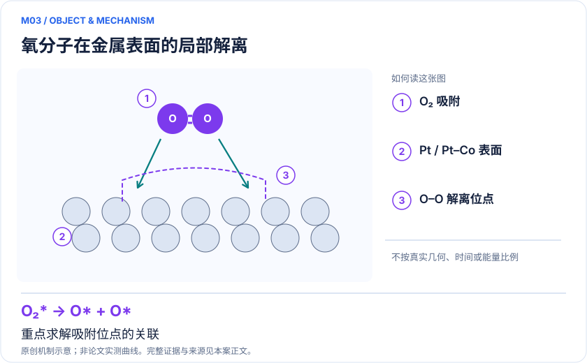
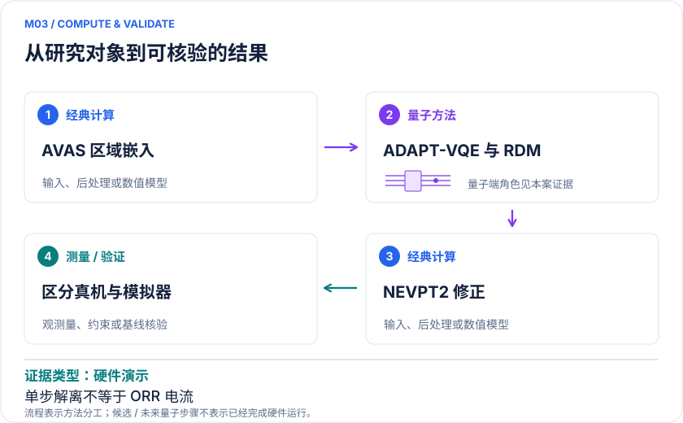

<!-- 由 release/tools/build_problems.py 自 tasks/M03-ptco-oxygen-reduction/README.md 与 tasks/catalog.json 生成，勿手改 -->

# M03 · Pt/Pt–Co 燃料电池催化：氧分子解离的嵌入量子化学

> 开放题 · 应用材料 · 电催化与燃料电池

## 题面

| 环节 | 内容 |
|---|---|
| 研究体系 | Pt(111)与Pt包覆Co表面的O₂→2O局部解离步骤 |
| 可观测量 | ΔE解离、ΔE‡、局域磁性及轨道占据 |
| 经典基线 | 周期DFT/NEB、同空间FCI/CASSCF、扩大空间的DMRG或选定CI |
| 量子方法的角色 | AVAS区域嵌入+ADAPT-VQE/RDM测量+经典NEVPT2 |
| 研发决策 | 判断Pt覆盖层和Co环境如何影响局部氧解离，定位值得继续实验的催化构型。 |

## 什么算解

一份解法满足以下五点即可提交审核。负结果同样接受，只要过程可复现、结论有依据。

1. **模型对应**：说明所用模型或数据如何对应「Pt(111)与Pt包覆Co表面的O₂→2O局部解离步骤」，列出简化与近似。
2. **可观测量**：报告「ΔE解离、ΔE‡、局域磁性及轨道占据」，附单位与不确定度。
3. **经典对照**：在同一模型或数据上，与「周期DFT/NEB、同空间FCI/CASSCF、扩大空间的DMRG或选定CI」中至少一种方法比较。
4. **可复现**：提供代码、环境、随机种子、输入来源与哈希，以及计算资源和成本；用到 QPU 时注明设备与 shots。
5. **研发决策**：说明结果能否支撑「判断Pt覆盖层和Co环境如何影响局部氧解离，定位值得继续实验的催化构型。」，以及还缺什么证据。

本题的细化标准欢迎在 issue 中讨论；被采纳的讨论结论会写入后续版本。

## 现有参照

本项目已有数值执行记录（经典计算机上的计算与模拟），供对照与复用，不代表最优解。

- 原应用目标：未完成（incomplete）
- 最新研究报告：[REFERENCE.md](REFERENCE.md)
- 其余证据指针见 evidence.json（本地证据，未随题库发布）

### 原案例说明

### M03 · Pt/Pt–Co 燃料电池催化：氧分子解离的嵌入量子化学

<!-- VISUALS:START -->
#### 可视化导读

**图 1 · 氧分子在金属表面的局部解离。** 重点求解吸附位点的关联。ΔE解离、ΔE‡、局域磁性及轨道占据。图形为依据本案文献重绘的概念关系，不表示实际原子坐标、实测曲线或数值比例。

**图 2 · 计算与验证路径。** AVAS区域嵌入+ADAPT-VQE/RDM测量+经典NEVPT2。**证据边界：** 不能把Pt/Co模拟器写成真机；单个O₂解离步骤不能直接推出ORR全电流和耐久性。

图解依据：[R1 · Platinum-based Catalysts for Oxygen Reduction Reaction simulated with a Quantum Computer](https://arxiv.org/html/2307.15823v2)；[R2 · Quantum hardware calculations of the activation and dissociation of nitrogen on iron clusters and surfaces](https://pubmed.ncbi.nlm.nih.gov/38315092/)。解释性连线与图形布局由本库整理，未复制论文原图。

[机制图 SVG](mechanism.svg) · [流程图 SVG](workflow.svg) · 机制图 PNG（本地证据，未随题库发布） · 流程图 PNG（本地证据，未随题库发布） · 图解说明 JSON（本地证据，未随题库发布）
<!-- VISUALS:END -->

> **Pt真机与Pt/Co模拟器展示流程；强相关和几何/动态关联误差决定后续价值。**
>
> 编研日期：2026-10-04。证据类别：硬件演示。建议优先级：近期验证（编辑判断）。本目录为文献研究与试点设计，没有执行所列量子、经典或材料实验。

#### 研发决策与价值

**要支持的决策：**判断Pt覆盖层和Co环境如何影响局部氧解离，定位值得继续实验的催化构型。

本例对应降低贵金属使用量和改善氧还原催化的局部建模需求。原始工作只处理解离支路中的有限驻点；应保留电位、溶剂、覆盖度、质子耦合支路以及表面重构这些应用边界。作为拓展，R2研究Fe表面N₂活化，说明表面局部相关求解可迁移，但不是Pt结果的独立重复。

#### 物理系统与规模边界

- **系统：**Pt(111)与Pt包覆Co表面的O₂→2O局部解离步骤。
- **规模：**Pt活性空间(2e,3o)/6比特；Pt/Co(4e,4o)/8比特；晶片与片段由经典处理。
- **目标观测量：**ΔE解离、ΔE‡、局域磁性及轨道占据。

这里的规模以原文或docs规定的有限模型为准，不把完整样品、活性空间、系统量子比特、逻辑辅助比特及纠错物理比特混为一个数字。[R1]

#### docs 来源与本次扩展

- 量子计算如何研究材料问题与药物研发_研究方法与应用综述.md: 催化反应路径
- 量子计算问题库_飞书多维表格导入版.xlsx: 问题库M10异相表面；M11多金属ORR/OER/HER

这些文件提供问题线索；文中研究事实以本页可核验原始来源为准，下面的试点、比较和停止条件是本次提出的研究设计。

#### 数学与计算目标

建议用E_TS−E_O2*和E_2O*−E_O2*作为首期指标，同时记录基态自旋和局域电荷。若最终目标是极化曲线，还要计算各电化学步骤的自由能、速率常数、覆盖度和质量传输，不能从一条电子势垒曲线跳到燃料电池功率。

#### 量子—经典工作流

**量子职责：**AVAS区域嵌入+ADAPT-VQE/RDM测量+经典NEVPT2。[R1]

经典周期优化与NEB提供表面驻点；局域化轨道和AVAS选择保留O–Pt与Co诱导的相关部分；QPU或模拟器求活性态、测RDM；NEVPT2处理空间外关联。推荐对各层输出单独存档，尤其要记录表面是否弛豫、Pt层数、Co磁序与边界钝化。

#### 已发表工作：实际完成了什么

研究实现Pt的H1硬件和Pt/Co的H1-E模拟；Pt静态关联较弱，动态关联修正很大，Pt/Co显示更强相关性。[R1]

**证据限制：**不能把Pt/Co模拟器写成真机；单个O₂解离步骤不能直接推出ORR全电流和耐久性。

“硬件演示”只代表原论文运行过所述有限任务；“资源估算”只代表给定算法与假设下的预算。两者都不能替代与强经典方法、真实实验和完整成本的比较。

#### 经典比较与资源核算

**建议基线：**周期DFT/NEB、同空间FCI/CASSCF、扩大空间的DMRG或选定CI。

该案例值得研究的关键反而是误差归因。若小活性空间VQE与HF相近，但NEVPT2巨大，则扩大QPU采样不一定改善最终势垒。应与同空间精确解比较求解器，再与更大嵌入比较模型。NEB几何若来自另一理论层级，要估算重新优化的影响，避免将几何不一致误判为相关能贡献。

#### 可复现试点设计（建议，尚未执行）

输入：完整晶片和片段坐标、R/TS/P、磁态、基组/ECP、AVAS投影与NEB收敛。步骤：①复核纯Pt与Pt/Co各自三点；②逐层扩大片段和轨道；③以精确求解器替代VQE形成消融；④对最稳定且仍有经典分歧的一组做采样复现。验收：能差趋势在环境/空间扩展下稳定，RDM误差传递至NEVPT2的区间明确。停止：微扰校正或表面弛豫改变结论超过阈值时，返回经典建模。

交付时至少保留输入来源与版本、完整参数、原始/后处理结果、收敛轨迹、随机种子、实际计算成本和失败记录。验收阈值应在目标数据解盲前冻结；只有固定模型上的解达到标准，仍应单独标明模型到实验的剩余误差。

#### 解读与下一步

推荐近期作为“表面模型闭包”项目。与产业交流时交付的是有证据边界的催化位点比较表，而非声称量子计算已找到优于现有Pt合金的新催化剂。

**最小下一步：**先对R/TS/P比较片段大小、活性空间与几何层级，再讨论硬件采样。

#### 文献与读取范围

- **[R1] [Platinum-based Catalysts for Oxygen Reduction Reaction simulated with a Quantum Computer](https://arxiv.org/html/2307.15823v2)**（2024；预印本；读取层级 `full_text`）。支持：Pt及Pt/Co嵌入ORR；区分H1真机和H1-E模拟器；2023首发2024修订。

- **[R2] [Quantum hardware calculations of the activation and dissociation of nitrogen on iron clusters and surfaces](https://pubmed.ncbi.nlm.nih.gov/38315092/)**（2024；期刊论文；读取层级 `abstract`）。支持：Fe表面N₂活化的独立混合硬件流程，作为表面嵌入迁移参照。

全文层级表示读到原始正文页面，不表示已逐项复算或完整审计全部补充材料；若页面转换缺失，已在来源说明或正文注明。摘要/检索摘录层级不支持未见的精确实验细节。相同工作的预印本与期刊版不计为独立复现。

## 如何提交

按 [CONTRIBUTING.md](../../../CONTRIBUTING.md) 把解法放在 `solutions/M03/<你的名字>-<短名>/`，格式见 [解法模板](../../../solutions/_template/SOLUTION.md)。被采纳的解法会按 [沉淀规则](../../../skills/README.md) 提炼为可复用的 skill。
