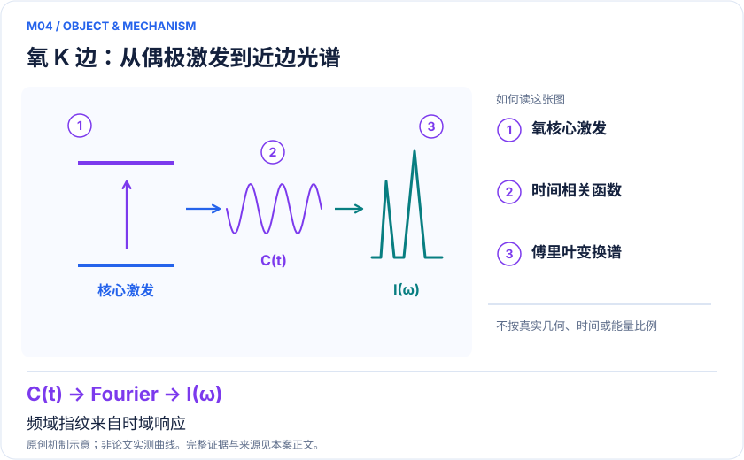
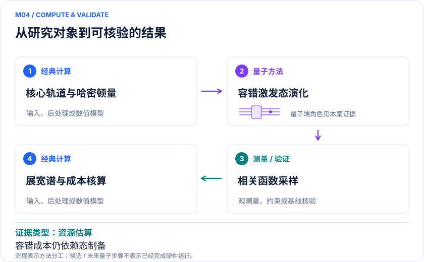

<!-- 由 release/tools/build_problems.py 自 tasks/M04-battery-xas/README.md 与 tasks/catalog.json 生成，勿手改 -->

# M04 · 富锂正极 XAS：用氧 K 边指纹区分氧化还原与结构退化

> 开放题 · 应用材料 · 电池谱学与退化

## 题面

| 环节 | 内容 |
|---|---|
| 研究体系 | 富锂锰氧化物中的Li₄Mn₂O局域团簇与氧K边 |
| 可观测量 | XAS截面σ(ω)、峰位、相对强度、谱权重和机理判别置信度 |
| 经典基线 | TDDFT/ΔSCF作低成本参照；RAS/多参考响应和适当张量网络作强参照 |
| 量子方法的角色 | 制备偶极激发态并时间演化，测相关函数，经典傅里叶变换得展宽谱 |
| 研发决策 | 判断充电后的谱变化来自氧空穴、O–O成键还是过渡金属电子重排，选择后续原位实验。 |

## 基准输入

原文输入没有公开，也没有可直接运行的替代输入，解法需要自建模型并写明来源与哈希。下表只列出已知的公开材料。「原文」指作者或原论文公开的材料，「参照」指本项目参照运行自行冻结的选择。

| 项目 | 内容 | 出处 |
|---|---|---|
| 晶体 | 原文指定 Materials Project mp-1173926（数据库 v2023.11.1），提取裸 Li₄Mn₂O（7 原子） | [原文](https://arxiv.org/html/2405.11015v1) |
| 模型设置 | cc-pVDZ/HF + AVAS；资源目标 CAS(22e,18o)，2025 谱模拟用 CAS(14e,11o) | [原文](https://arxiv.org/abs/2506.15784v2) |

**尚未公开或需注意：**7 原子坐标、去锂选择、簇电荷/自旋、AVAS 阈值、积分与偶极矩阵均未公开。

## 什么算解

一份解法满足以下五点即可提交审核。负结果同样接受，只要过程可复现、结论有依据。

1. **模型对应**：说明所用模型或数据如何对应「富锂锰氧化物中的Li₄Mn₂O局域团簇与氧K边」，列出简化与近似。
2. **可观测量**：报告「XAS截面σ(ω)、峰位、相对强度、谱权重和机理判别置信度」，附单位与不确定度。
3. **经典对照**：在同一模型或数据上，与「TDDFT/ΔSCF作低成本参照；RAS/多参考响应和适当张量网络作强参照」中至少一种方法比较。
4. **可复现**：提供代码、环境、随机种子、输入来源与哈希，以及计算资源和成本；用到 QPU 时注明设备与 shots。
5. **研发决策**：说明结果能否支撑「判断充电后的谱变化来自氧空穴、O–O成键还是过渡金属电子重排，选择后续原位实验。」，以及还缺什么证据。

本题的细化标准欢迎在 issue 中讨论；被采纳的讨论结论会写入后续版本。

## 现有参照

本项目已有数值执行记录（经典计算机上的计算与模拟），供对照与复用，不代表最优解。

- 原应用目标：状态未记录
- 最新研究报告：[REFERENCE.md](REFERENCE.md)
- 其余证据指针见 evidence.json（本地证据，未随题库发布）

### 原案例说明

### M04 · 富锂正极 XAS：用氧 K 边指纹区分氧化还原与结构退化

<!-- VISUALS:START -->
#### 可视化导读

**图 1 · 氧 K 边：从偶极激发到近边光谱。** 频域指纹来自时域响应。XAS截面σ(ω)、峰位、相对强度、谱权重和机理判别置信度。图形为依据本案文献重绘的概念关系，不表示实际原子坐标、实测曲线或数值比例。

**图 2 · 计算与验证路径。** 制备偶极激发态并时间演化，测相关函数，经典傅里叶变换得展宽谱。**证据边界：** 无真实容错硬件应用结果；2025同版本摘要写T门、HTML正文写Toffoli门，精确门成本需以PDF/作者澄清。

图解依据：[R1 · Fast simulations of X-ray absorption spectroscopy for battery materials on a quantum computer](https://arxiv.org/html/2506.15784v2)；[R2 · Simulating X-ray absorption spectroscopy of battery materials on a quantum computer](https://arxiv.org/abs/2405.11015)。解释性连线与图形布局由本库整理，未复制论文原图。

[机制图 SVG](mechanism.svg) · [流程图 SVG](workflow.svg) · 机制图 PNG（本地证据，未随题库发布） · 流程图 PNG（本地证据，未随题库发布） · 图解说明 JSON（本地证据，未随题库发布）
<!-- VISUALS:END -->

> **谱学可只求目标响应；2025优化将指定局域模型压到约100工作逻辑比特的资源量级。**
>
> 编研日期：2026-10-04。证据类别：资源估算。建议优先级：重点储备（编辑判断）。本目录为文献研究与试点设计，没有执行所列量子、经典或材料实验。

#### 研发决策与价值

**要支持的决策：**判断充电后的谱变化来自氧空穴、O–O成键还是过渡金属电子重排，选择后续原位实验。

该场景的价值是帮助电池团队决定下一轮应研究氧稳定化、金属位点调控还是结构保护。核心接口为实验峰形，而不是一个漂亮的基态总能量。材料包含多个局域环境时，单团簇谱只是一项组成，需要与结构分布和实验展宽一起解释。

#### 物理系统与规模边界

- **系统：**富锂锰氧化物中的Li₄Mn₂O局域团簇与氧K边。
- **规模：**CAS(22e,18o)是局域活性空间；100为工作逻辑比特，绝非现有100物理比特即可执行。
- **目标观测量：**XAS截面σ(ω)、峰位、相对强度、谱权重和机理判别置信度。

这里的规模以原文或docs规定的有限模型为准，不把完整样品、活性空间、系统量子比特、逻辑辅助比特及纠错物理比特混为一个数字。[R1]

#### docs 来源与本次扩展

- 量子计算如何研究材料问题与药物研发_研究方法与应用综述.md: 工作流A
- 量子计算问题库_飞书多维表格导入版.xlsx: 问题库M18阴离子氧化还原；M37核心激发谱；文献S11

这些文件提供问题线索；文中研究事实以本页可核验原始来源为准，下面的试点、比较和停止条件是本次提出的研究设计。

#### 数学与计算目标

以Cμ(t)=〈ψ₀|μ†exp(−i(H−E₀)t)μ|ψ₀〉为计算对象，经带寿命展宽的傅里叶变换得到σ(ω)。应预先规定目标能窗和仪器分辨率；过度追求比实验窄很多的线宽会大幅增加演化时间，却未必改善机制判断。芯空穴、初态和环境误差需要单列。

#### 量子—经典工作流

**量子职责：**制备偶极激发态并时间演化，测相关函数，经典傅里叶变换得展宽谱。[R1]

建议由经典周期/团簇建模提出竞争构型，选择包含必要芯与价轨道的哈密顿量。量子模块处理选定响应，经典部分分配时间点、测量预算、傅里叶变换与混合谱拟合。先用同一有限模型核对谱峰，再研究结构模型是否足够真实。不能用人为平移每条理论谱的方式掩盖能标误差。

#### 已发表工作：实际完成了什么

2024给出三个XAS量子方案；2025给出时域优化、模拟器谱验证和指定模型的容错资源估算。[R1,R2]

**证据限制：**无真实容错硬件应用结果；2025同版本摘要写T门、HTML正文写Toffoli门，精确门成本需以PDF/作者澄清。

“硬件演示”只代表原论文运行过所述有限任务；“资源估算”只代表给定算法与假设下的预算。两者都不能替代与强经典方法、真实实验和完整成本的比较。

#### 经典比较与资源核算

**建议基线：**TDDFT/ΔSCF作低成本参照；RAS/多参考响应和适当张量网络作强参照。

对比必须固定基组、芯价分离近似、展宽和时间窗。评价峰位置、积分权重、相邻峰可区分性及机理分类错误率；不能只展示视觉相似。2025资源表的门种口径存在文本差异，本库保留问题而不把T和Toffoli视为相同单位，也不将工作寄存器规模当完整纠错机器规模。

#### 可复现试点设计（建议，尚未执行）

输入：候选局域坐标、电荷/自旋、芯价轨道、跃迁算符和一份保留盲测谱。步骤：①小空间精确响应；②时域算法重建并扫描最大演化时间；③固定展宽验证抽样误差；④只将能区分机制的模型进入容错成本表。验收：峰位误差小于预先冻结的实验可辨阈值，谱权重和分类结果有置信区间，所有预处理可复现。停止：不同嵌入产生的谱差大于竞争机理差、或观测峰对候选机制不敏感时停止QPU投入。

交付时至少保留输入来源与版本、完整参数、原始/后处理结果、收敛轨迹、随机种子、实际计算成本和失败记录。验收阈值应在目标数据解盲前冻结；只有固定模型上的解达到标准，仍应单独标明模型到实验的剩余误差。

#### 解读与下一步

这是未来容错谱学的优先储备题，因为输出与原位表征直接相连。近期应交付结构—谱指纹—决策表和门成本敏感性，尚不能交付已经改善循环寿命的材料。

**最小下一步：**冻结两个可区分机制的结构与实验分辨率，从小空间完整谱重建开始。

#### 文献与读取范围

- **[R1] [Fast simulations of X-ray absorption spectroscopy for battery materials on a quantum computer](https://arxiv.org/html/2506.15784v2)**（2025；预印本；读取层级 `full_text`）。支持：CAS(22e,18o)谱学资源及优化；HTML有缺失且门种口径与摘要冲突。

- **[R2] [Simulating X-ray absorption spectroscopy of battery materials on a quantum computer](https://arxiv.org/abs/2405.11015)**（2024；预印本；读取层级 `abstract`）。支持：电池局域XAS三个量子算法及谱学任务定位。

全文层级表示读到原始正文页面，不表示已逐项复算或完整审计全部补充材料；若页面转换缺失，已在来源说明或正文注明。摘要/检索摘录层级不支持未见的精确实验细节。相同工作的预印本与期刊版不计为独立复现。

## 如何提交

按 [CONTRIBUTING.md](../../../CONTRIBUTING.md) 把解法放在 `solutions/M04/<你的名字>-<短名>/`，格式见 [解法模板](../../../solutions/_template/SOLUTION.md)。被采纳的解法会按 [沉淀规则](../../../skills/README.md) 提炼为可复用的 skill。
