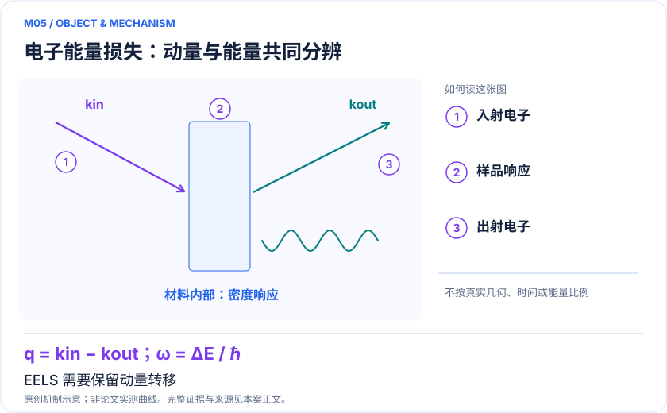

<!-- 由 release/tools/build_problems.py 自 tasks/M05-battery-eels/README.md 与 tasks/catalog.json 生成，勿手改 -->

# M05 · Li₂MnO₃ 的 EELS：解析纳米尺度氧化还原与界面异质性

> 开放题 · 应用材料 · 电池谱学与显微分析
> 难度：前沿（[分级说明](../../../starters/README.md#难度分级)） · 背景：量子化学

## 题面

| 环节 | 内容 |
|---|---|
| 研究体系 | Li₂MnO₃氧中心团簇的O K-edge EELS/ELNES |
| 可观测量 | S(q,ω)、各方向响应交叉项、近边峰形及空间结构指纹 |
| 经典基线 | 含芯空穴的DFT/TDDFT/BSE、RAS和同模型精确小空间响应 |
| 量子方法的角色 | 量子演化获得非对角时域Green函数；经典构造动量分辨散射响应 |
| 研发决策 | 定位充电后哪类局域配位或界面区域发生氧电子态变化，指导表面保护或结构调控。 |

## 基准输入

原文输入没有公开，也没有可直接运行的替代输入，解法需要自建模型并写明来源与哈希。下表只列出已知的公开材料。「原文」指作者或原论文公开的材料，「参照」指本项目参照运行自行冻结的选择。

| 项目 | 内容 | 出处 |
|---|---|---|
| 晶体与簇 | Materials Project mp-18988（C2/m），作者封端模型 Li₄Mn₂O₁₉H₂₆（51 原子） | [原文](https://arxiv.org/html/2508.15935v1) |
| 模型设置 | unrestricted PBE0/ANO-RCC-VDZP，broken-symmetry Sz=0，AVAS；Fig. 4 小模型 CAS(8e,7o) | [原文](https://doi.org/10.1063/5.0300557) |

**尚未公开或需注意：**51 原子坐标（尤其 26 个封端 H）、总电荷、CAS 积分、三个偶极矩阵与 CVS mask 未公开。

## 什么算解

一份解法满足以下五点即可提交审核。负结果同样接受，只要过程可复现、结论有依据。

1. **模型对应**：说明所用模型或数据如何对应「Li₂MnO₃氧中心团簇的O K-edge EELS/ELNES」，列出简化与近似。
2. **可观测量**：报告「S(q,ω)、各方向响应交叉项、近边峰形及空间结构指纹」，附单位与不确定度。
3. **经典对照**：在同一模型或数据上，与「含芯空穴的DFT/TDDFT/BSE、RAS和同模型精确小空间响应」中至少一种方法比较。
4. **可复现**：提供代码、环境、随机种子、输入来源与哈希，以及计算资源和成本；用到 QPU 时注明设备与 shots。
5. **研发决策**：说明结果能否支撑「定位充电后哪类局域配位或界面区域发生氧电子态变化，指导表面保护或结构调控。」，以及还缺什么证据。

本题的细化标准欢迎在 issue 中讨论；被采纳的讨论结论会写入后续版本。

## 现有参照

本项目已有数值执行记录（经典计算机上的计算与模拟），供对照与复用，不代表最优解。

- 原应用目标：状态未记录
- 最新研究报告：[REFERENCE.md](REFERENCE.md)
- 其余证据指针见 evidence.json（本地证据，未随题库发布）

### 原案例说明

### M05 · Li₂MnO₃ 的 EELS：解析纳米尺度氧化还原与界面异质性

<!-- VISUALS:START -->
#### 可视化导读

**图 1 · 电子能量损失：动量与能量共同分辨。** EELS 需要保留动量转移。S(q,ω)、各方向响应交叉项、近边峰形及空间结构指纹。图形为依据本案文献重绘的概念关系，不表示实际原子坐标、实测曲线或数值比例。

**图 2 · 计算与验证路径。** 量子演化获得非对角时域Green函数；经典构造动量分辨散射响应。**证据边界：** 成本不是总实验时间；EELS电子束损伤、厚度、多重散射和几何并未被电子哈密顿量自动消除。

图解依据：[R1 · Quantum Simulation of Electron Energy Loss Spectroscopy for Battery Materials](https://arxiv.org/html/2508.15935v1)；[R2 · Simulating X-ray absorption spectroscopy of battery materials on a quantum computer](https://arxiv.org/abs/2405.11015)。解释性连线与图形布局由本库整理，未复制论文原图。

[机制图 SVG](mechanism.svg) · [流程图 SVG](workflow.svg) · 机制图 PNG（本地证据，未随题库发布） · 流程图 PNG（本地证据，未随题库发布） · 图解说明 JSON（本地证据，未随题库发布）
<!-- VISUALS:END -->

> **动态结构因子算法把量子响应连接到带动量信息的EELS，仍是算法与资源验证。**
>
> 编研日期：2026-10-04。证据类别：资源估算。建议优先级：重点储备（编辑判断）。本目录为文献研究与试点设计，没有执行所列量子、经典或材料实验。

#### 研发决策与价值

**要支持的决策：**定位充电后哪类局域配位或界面区域发生氧电子态变化，指导表面保护或结构调控。

与M04的区别是决策接口：XAS常用于体平均的元素局域化学解释，EELS与STEM结合可定位缺陷、界面和局域变化。本例不是把同一谱换一个名称；需要处理q依赖和不同笛卡尔分量的交叉响应。二者能共享结构与积分数据，但测试任务和资源不能混合计数。

#### 物理系统与规模边界

- **系统：**Li₂MnO₃氧中心团簇的O K-edge EELS/ELNES。
- **规模：**18活性轨道的模型资源约100逻辑比特；论文报单电路3.25×10⁸ T门和约10⁴ shots。
- **目标观测量：**S(q,ω)、各方向响应交叉项、近边峰形及空间结构指纹。

这里的规模以原文或docs规定的有限模型为准，不把完整样品、活性空间、系统量子比特、逻辑辅助比特及纠错物理比特混为一个数字。[R1]

#### docs 来源与本次扩展

- 量子计算如何研究材料问题与药物研发_研究方法与应用综述.md: 工作流A与EELS
- 量子计算问题库_飞书多维表格导入版.xlsx: 问题库M37核心激发谱（动量/空间分辨扩展）

这些文件提供问题线索；文中研究事实以本页可核验原始来源为准，下面的试点、比较和停止条件是本次提出的研究设计。

#### 数学与计算目标

目标动态结构因子可写作S(q,ω)=Σf|〈f|ρq|0〉|²δ(ω−Ef+E0)。在采用偶极或其他展开近似时，应明确适用的动量与能区，并保留交叉分量。理论指纹最终需要和电子束入射/收集几何卷积后比较，单峰高低本身不是氧价态的唯一证明。

#### 量子—经典工作流

**量子职责：**量子演化获得非对角时域Green函数；经典构造动量分辨散射响应。[R1]

推荐先选两个局部配位假说和一组匹配的STEM位置。经典生成初态及有效积分，量子模块计算所需相关函数矩阵；经典转换为可观测散射谱，再拟合多个结构贡献。通过改变q或收集角检验能否减少单一谱线拟合的歧义，这才体现本例相对XAS的增量。

#### 已发表工作：实际完成了什么

2025原文给出DSF量子算法及Li₂MnO₃模型成本，推广了仅标量吸收谱的响应接口。[R1]

**证据限制：**成本不是总实验时间；EELS电子束损伤、厚度、多重散射和几何并未被电子哈密顿量自动消除。

“硬件演示”只代表原论文运行过所述有限任务；“资源估算”只代表给定算法与假设下的预算。两者都不能替代与强经典方法、真实实验和完整成本的比较。

#### 经典比较与资源核算

**建议基线：**含芯空穴的DFT/TDDFT/BSE、RAS和同模型精确小空间响应。

基线应包含相同谱分辨率和相同q网格；比较时记录哪种方法忽略芯空穴、交叉项或多参考效应。不能以“谱复杂”推断所有经典方法均失效。单电路门成本还需要乘上采样与多个结构、多个几何的总工作量，并加初态制备、纠错和后处理。

#### 可复现试点设计（建议，尚未执行）

输入：O中心团簇、有效积分、ρq/偶极算符、q采样、能窗、实验几何元数据。步骤：①精确验证对角和非对角相关函数；②检验厄米关系与总谱非负；③固定窗口/展宽重建；④对候选结构做留一盲判。验收：交叉项实现正确，角度积分后的峰形及判别性能可复核，报告最难辨识结构对。停止：束流损伤或厚度不确定性支配差异时先改善实验输入；不要用更多shots修补错误实验模型。

交付时至少保留输入来源与版本、完整参数、原始/后处理结果、收敛轨迹、随机种子、实际计算成本和失败记录。验收阈值应在目标数据解盲前冻结；只有固定模型上的解达到标准，仍应单独标明模型到实验的剩余误差。

#### 解读与下一步

适合与电子显微、原位电化学团队共建数据集。近期最有用的交付物是哪些谱特征能够区分候选机制，以及需要什么实验角度/能量分辨率，而非独立的量子总能排行榜。

**最小下一步：**把XAS和EELS共用电子模型，但单独冻结散射动量、收集角和观测算符。

#### 文献与读取范围

- **[R1] [Quantum Simulation of Electron Energy Loss Spectroscopy for Battery Materials](https://arxiv.org/html/2508.15935v1)**（2025；预印本；读取层级 `full_text`）。支持：Li2MnO3氧K边、动态结构因子、18轨道资源估算。

- **[R2] [Simulating X-ray absorption spectroscopy of battery materials on a quantum computer](https://arxiv.org/abs/2405.11015)**（2024；预印本；读取层级 `abstract`）。支持：电池局域XAS三个量子算法及谱学任务定位。

全文层级表示读到原始正文页面，不表示已逐项复算或完整审计全部补充材料；若页面转换缺失，已在来源说明或正文注明。摘要/检索摘录层级不支持未见的精确实验细节。相同工作的预印本与期刊版不计为独立复现。

## 如何提交

按 [CONTRIBUTING.md](../../../CONTRIBUTING.md) 把解法放在 `solutions/M05/<你的名字>-<短名>/`，格式见 [解法模板](../../../solutions/_template/SOLUTION.md)。被采纳的解法会按 [沉淀规则](../../../skills/README.md) 提炼为可复用的 skill。
