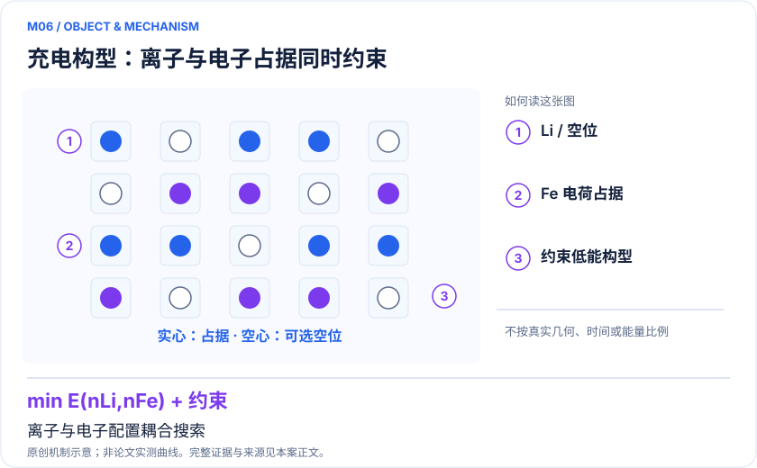
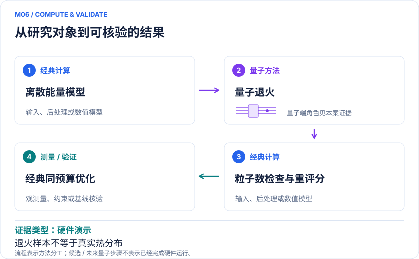

<!-- 由 release/tools/build_problems.py 自 tasks/M06-lfp-annealing/README.md 与 tasks/catalog.json 生成，勿手改 -->

# M06 · 磷酸铁锂的电离子占据：量子退火搜索低能充电构型

> 开放题 · 应用材料 · 电池构型优化

## 题面

| 环节 | 内容 |
|---|---|
| 研究体系 | LiₓFePO₄中的Li离子与redox电子占据配置 |
| 可观测量 | 最低模型能量、有效低能样本、充电曲线与成功概率/成本 |
| 经典基线 | 精确枚举小系统、混合整数求解、模拟退火、并行回火和局域搜索 |
| 量子方法的角色 | 量子退火求含粒子数约束的离散优化；经典构造能量模型与重评分 |
| 研发决策 | 筛选不同锂含量下值得继续第一性原理计算的低能排布，解释充电曲线与相分离趋势。 |

## 什么算解

一份解法满足以下五点即可提交审核。负结果同样接受，只要过程可复现、结论有依据。

1. **模型对应**：说明所用模型或数据如何对应「LiₓFePO₄中的Li离子与redox电子占据配置」，列出简化与近似。
2. **可观测量**：报告「最低模型能量、有效低能样本、充电曲线与成功概率/成本」，附单位与不确定度。
3. **经典对照**：在同一模型或数据上，与「精确枚举小系统、混合整数求解、模拟退火、并行回火和局域搜索」中至少一种方法比较。
4. **可复现**：提供代码、环境、随机种子、输入来源与哈希，以及计算资源和成本；用到 QPU 时注明设备与 shots。
5. **研发决策**：说明结果能否支撑「筛选不同锂含量下值得继续第一性原理计算的低能排布，解释充电曲线与相分离趋势。」，以及还缺什么证据。

本题的细化标准欢迎在 issue 中讨论；被采纳的讨论结论会写入后续版本。

## 现有参照

本项目已有数值执行记录（经典计算机上的计算与模拟），供对照与复用，不代表最优解。

- 原应用目标：未完成（incomplete）
- 最新研究报告：[REFERENCE.md](REFERENCE.md)
- 其余证据指针见 evidence.json（本地证据，未随题库发布）

### 原案例说明

### M06 · 磷酸铁锂的电离子占据：量子退火搜索低能充电构型

<!-- VISUALS:START -->
#### 可视化导读

**图 1 · 充电构型：离子与电子占据同时约束。** 离子与电子配置耦合搜索。最低模型能量、有效低能样本、充电曲线与成功概率/成本。图形为依据本案文献重绘的概念关系，不表示实际原子坐标、实测曲线或数值比例。

**图 2 · 计算与验证路径。** 量子退火求含粒子数约束的离散优化；经典构造能量模型与重评分。**证据边界：** 退火样本有效温度依赖问题；不能视为真实材料热分布，也未确立同预算的量子加速。

图解依据：[R1 · Simulating charging characteristics of lithium iron phosphate by electro-ionic optimization on a quantum annealer](https://arxiv.org/abs/2503.10581)；[R2 · Optimization of ionic configurations in battery materials by quantum annealing](https://arxiv.org/abs/2401.02165)。解释性连线与图形布局由本库整理，未复制论文原图。

[机制图 SVG](mechanism.svg) · [流程图 SVG](workflow.svg) · 机制图 PNG（本地证据，未随题库发布） · 流程图 PNG（本地证据，未随题库发布） · 图解说明 JSON（本地证据，未随题库发布）
<!-- VISUALS:END -->

> **D-Wave退火被用于Li与氧化还原电子的联合占据优化，能量模型仍为点电荷近似。**
>
> 编研日期：2026-10-04。证据类别：硬件演示。建议优先级：近期验证（编辑判断）。本目录为文献研究与试点设计，没有执行所列量子、经典或材料实验。

#### 研发决策与价值

**要支持的决策：**筛选不同锂含量下值得继续第一性原理计算的低能排布，解释充电曲线与相分离趋势。

本例是优化问题，不是波函数量子模拟。其高价值在于大量候选排布中发现低能结构，减少后续昂贵DFT标签数。退火器只知道写入的代价函数，无法自动补足共价性、结构弛豫或交换关联；因此低代价不必然是实际晶体低自由能。

#### 物理系统与规模边界

- **系统：**LiₓFePO₄中的Li离子与redox电子占据配置。
- **规模：**二进制占据变量映射为QUBO/Ising；物理退火比特随嵌入链增加，不等于电子轨道数。
- **目标观测量：**最低模型能量、有效低能样本、充电曲线与成功概率/成本。

这里的规模以原文或docs规定的有限模型为准，不把完整样品、活性空间、系统量子比特、逻辑辅助比特及纠错物理比特混为一个数字。[R1]

#### docs 来源与本次扩展

- 量子计算如何研究材料问题与药物研发_研究方法与应用综述.md: 经典基线与完整成本
- 量子计算问题库_飞书多维表格导入版.xlsx: 问题库M17电池电压的构型层扩展（新增量子退火文献）

这些文件提供问题线索；文中研究事实以本页可核验原始来源为准，下面的试点、比较和停止条件是本次提出的研究设计。

#### 数学与计算目标

以占据变量xi∈{0,1}表达能量E(x)=Σhixi+ΣJijxixj，并加入Li数、电子数、电中性约束。巨正则变换E−μN改变优化形貌，需在返回固定组分时恢复原始能量排序。目标可定义为给定预算内找到参考低能集的概率，而不是挑一个最低样本展示。

#### 量子—经典工作流

**量子职责：**量子退火求含粒子数约束的离散优化；经典构造能量模型与重评分。[R1]

经典预处理生成晶格与电荷模型，选择粒子数/化学势及惩罚系数。将QUBO嵌入设备图，运行不同规范变换和退火设置；经典解链、剔除不合法配置并按原模型重评分。最后选结构做DFT弛豫，测试代理模型的低能排序是否传递到更可信能量。

#### 已发表工作：实际完成了什么

2025工作将Li与电子联合配置通过巨正则变换映射到退火器；2024前序工作研究离子占据优化。[R1,R2]

**证据限制：**退火样本有效温度依赖问题；不能视为真实材料热分布，也未确立同预算的量子加速。

“硬件演示”只代表原论文运行过所述有限任务；“资源估算”只代表给定算法与假设下的预算。两者都不能替代与强经典方法、真实实验和完整成本的比较。

#### 经典比较与资源核算

**建议基线：**精确枚举小系统、混合整数求解、模拟退火、并行回火和局域搜索。

把建模成本、minor embedding、网络排队、退火、读出和重复运行全部纳入计时。小系统精确枚举提供最优值；大系统至少比较模拟退火、并行回火和通用组合优化。固定组分可行率与解链失败率必须并列报告，否则惩罚项调参可能让最优能量看起来变好却损失合法样本。

#### 可复现试点设计（建议，尚未执行）

输入：晶胞与点电荷、变量索引、组分约束、完整Q矩阵、随机种子及设备嵌入。步骤：①逐个构型核对原能量与QUBO等价；②小系统获得严格最优；③同总预算运行量子和经典多个随机种子；④对去重候选做同级DFT复评。验收：报告time-to-target、可行率、低能集召回和DFT排名保持率。停止：代理能量与DFT无稳定排序关系，或经典求解器已低成本覆盖目标低能集时，优先改善模型。

交付时至少保留输入来源与版本、完整参数、原始/后处理结果、收敛轨迹、随机种子、实际计算成本和失败记录。验收阈值应在目标数据解盲前冻结；只有固定模型上的解达到标准，仍应单独标明模型到实验的剩余误差。

#### 解读与下一步

近期可实施性较强，适合与组合优化团队共用测试集。应向电池研发交付高质量候选结构和成本曲线，避免用量子退火器的比特数宣传已经完成强关联电子结构求解。

**最小下一步：**先复制小晶胞QUBO，检验守恒与低能构型，再做同总预算求解器竞赛。

#### 文献与读取范围

- **[R1] [Simulating charging characteristics of lithium iron phosphate by electro-ionic optimization on a quantum annealer](https://arxiv.org/abs/2503.10581)**（2025；期刊论文；读取层级 `abstract`）。支持：LFP点电荷模型、电离子联合优化与退火输出统计。

- **[R2] [Optimization of ionic configurations in battery materials by quantum annealing](https://arxiv.org/abs/2401.02165)**（2024；期刊论文；读取层级 `abstract`）。支持：巨正则变换降低有效耦合、离子配置量子退火。

全文层级表示读到原始正文页面，不表示已逐项复算或完整审计全部补充材料；若页面转换缺失，已在来源说明或正文注明。摘要/检索摘录层级不支持未见的精确实验细节。相同工作的预印本与期刊版不计为独立复现。

## 如何提交

按 [CONTRIBUTING.md](../../../CONTRIBUTING.md) 把解法放在 `solutions/M06/<你的名字>-<短名>/`，格式见 [解法模板](../../../solutions/_template/SOLUTION.md)。被采纳的解法会按 [沉淀规则](../../../skills/README.md) 提炼为可复用的 skill。
