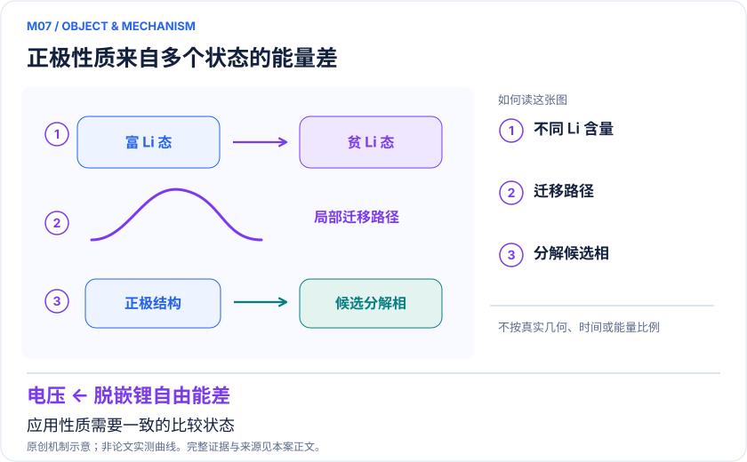
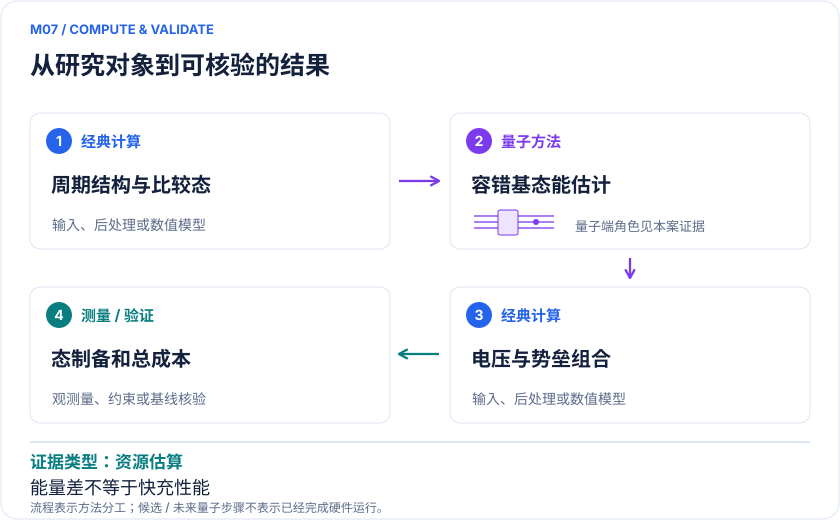

<!-- 由 release/tools/build_problems.py 自 tasks/M07-lithium-silicate-qpe/README.md 与 tasks/catalog.json 生成，勿手改 -->

# M07 · Li₂FeSiO₄ 正极：电压、离子迁移与热稳定性的容错成本

> 开放题 · 应用材料 · 电池电子结构

## 题面

| 环节 | 内容 |
|---|---|
| 研究体系 | 硅酸亚铁锂Li₂FeSiO₄及不同锂含量/迁移路径构型 |
| 可观测量 | 平均插锂电压、迁移电子势垒、分解反应能；温度性质另加自由能 |
| 经典基线 | 收敛DFT+U/混合泛函、NEB、适用周期耦合簇或QMC、相图凸包 |
| 量子方法的角色 | 以qubitization/QPE求周期材料基态能，经典组合成应用性质 |
| 研发决策 | 判断未来高精度周期电子能是否能解决电压、扩散或分解稳定性的关键误差。 |

## 什么算解

一份解法满足以下五点即可提交审核。负结果同样接受，只要过程可复现、结论有依据。

1. **模型对应**：说明所用模型或数据如何对应「硅酸亚铁锂Li₂FeSiO₄及不同锂含量/迁移路径构型」，列出简化与近似。
2. **可观测量**：报告「平均插锂电压、迁移电子势垒、分解反应能；温度性质另加自由能」，附单位与不确定度。
3. **经典对照**：在同一模型或数据上，与「收敛DFT+U/混合泛函、NEB、适用周期耦合簇或QMC、相图凸包」中至少一种方法比较。
4. **可复现**：提供代码、环境、随机种子、输入来源与哈希，以及计算资源和成本；用到 QPU 时注明设备与 shots。
5. **研发决策**：说明结果能否支撑「判断未来高精度周期电子能是否能解决电压、扩散或分解稳定性的关键误差。」，以及还缺什么证据。

本题的细化标准欢迎在 issue 中讨论；被采纳的讨论结论会写入后续版本。

## 现有参照

本项目已有数值执行记录（经典计算机上的计算与模拟），供对照与复用，不代表最优解。

- 原应用目标：未完成（incomplete）
- 最新研究报告：[REFERENCE.md](REFERENCE.md)
- 其余证据指针见 evidence.json（本地证据，未随题库发布）

### 原案例说明

### M07 · Li₂FeSiO₄ 正极：电压、离子迁移与热稳定性的容错成本

<!-- VISUALS:START -->
#### 可视化导读

**图 1 · 正极性质来自多个状态的能量差。** 应用性质需要一致的比较状态。平均插锂电压、迁移电子势垒、分解反应能；温度性质另加自由能。图形为依据本案文献重绘的概念关系，不表示实际原子坐标、实测曲线或数值比例。

**图 2 · 计算与验证路径。** 以qubitization/QPE求周期材料基态能，经典组合成应用性质。**证据边界：** 只做能量差不能自动得到导电率、快充性能或热失控安全；态制备成功率是成本组成。

图解依据：[R1 · Simulating key properties of lithium-ion batteries with a fault-tolerant quantum computer](https://arxiv.org/abs/2204.11890)；[R2 · Evaluating the evidence for exponential quantum advantage in ground-state quantum chemistry](https://www.nature.com/articles/s41467-023-37587-6)；[R3 · Quantum simulation of battery materials using ionic pseudopotentials](https://quantum-journal.org/papers/q-2023-07-10-1049/)。解释性连线与图形布局由本库整理，未复制论文原图。

[机制图 SVG](mechanism.svg) · [流程图 SVG](workflow.svg) · 机制图 PNG（本地证据，未随题库发布） · 流程图 PNG（本地证据，未随题库发布） · 图解说明 JSON（本地证据，未随题库发布）
<!-- VISUALS:END -->

> **已有从周期模型到三类电池性质的端到端算法路线；结果主要是容错资源估算。**
>
> 编研日期：2026-10-04。证据类别：资源估算。建议优先级：重点储备（编辑判断）。本目录为文献研究与试点设计，没有执行所列量子、经典或材料实验。

#### 研发决策与价值

**要支持的决策：**判断未来高精度周期电子能是否能解决电压、扩散或分解稳定性的关键误差。

同一组高精度电子能可服务三种不同决策，但不能把三种性质混成一个“电池性能”分数。电压是组分间热力学差，迁移是路径鞍点问题，热稳定性是多种产物竞争。先选择其中一个决策并界定经典分歧，再决定未来量子资源是否合理。

#### 物理系统与规模边界

- **系统：**硅酸亚铁锂Li₂FeSiO₄及不同锂含量/迁移路径构型。
- **规模：**第一量子化周期电子与平面波表示；完整逻辑/物理成本依基组和精度变化。
- **目标观测量：**平均插锂电压、迁移电子势垒、分解反应能；温度性质另加自由能。

这里的规模以原文或docs规定的有限模型为准，不把完整样品、活性空间、系统量子比特、逻辑辅助比特及纠错物理比特混为一个数字。[R1]

#### docs 来源与本次扩展

- 量子计算如何研究材料问题与药物研发_研究方法与应用综述.md: 总能量到可观测量
- 量子计算问题库_飞书多维表格导入版.xlsx: 问题库M17电池正极电压；文献S09,S10

这些文件提供问题线索；文中研究事实以本页可核验原始来源为准，下面的试点、比较和停止条件是本次提出的研究设计。

#### 数学与计算目标

例如平均电压可从插锂反应自由能除以转移电荷获得；零温电子能近似需要明确标记。迁移势垒是路径最大能量相对初态的差；分解稳定性需枚举竞争相并作原子守恒反应。三种任务对系统误差的抵消程度不同，不能统一套用总能量每原子误差。

#### 量子—经典工作流

**量子职责：**以qubitization/QPE求周期材料基态能，经典组合成应用性质。[R1]

经典确定结构、磁序、平面波截断及赝势/全电子约定，准备近似多电子态；量子估计单点能；经典进行相同基准下的组分差、NEB或反应凸包分析。每种性质都要列出需要多少个单点，以及何种初态重叠、成功率与测量精度能支持最终决策。

#### 已发表工作：实际完成了什么

2022 PRA论文给出制备周期近似初态及性质计算路线，并以真实候选正极估算资源。[R1] 后续赝势研究对三种富锂材料降低同精度量子算法门成本；其材料与Li₂FeSiO₄不同，作为路线扩展收录。[R3]

**证据限制：**只做能量差不能自动得到导电率、快充性能或热失控安全；态制备成功率是成本组成。

“硬件演示”只代表原论文运行过所述有限任务；“资源估算”只代表给定算法与假设下的预算。两者都不能替代与强经典方法、真实实验和完整成本的比较。

#### 经典比较与资源核算

**建议基线：**收敛DFT+U/混合泛函、NEB、适用周期耦合簇或QMC、相图凸包。

与DFT的比较应覆盖U、泛函和磁序敏感性，而不是挑一个偏差最大的参数。对可处理的小周期模型用强经典方法检查相关误差。R2只提供一般基态优势评估边界：模型维数增长快不等于实际经典算法已经失败，更不等于未来QPE初态制备免费。

#### 可复现试点设计（建议，尚未执行）

输入：两种锂含量的晶体、Li参考相、电子数、磁序、周期边界、积分/平面波参数。步骤：①核对插锂计量；②对晶胞、k点与基组收敛；③以同一目标电压误差反推每个能量的预算；④输出QPE含初态重复的资源敏感性表。验收：电压符号、单位和参考相正确，模型误差与求解误差分开。停止：磁序/结构/竞争相变化比目标误差大而尚未定案时，不升级门数。

交付时至少保留输入来源与版本、完整参数、原始/后处理结果、收敛轨迹、随机种子、实际计算成本和失败记录。验收阈值应在目标数据解盲前冻结；只有固定模型上的解达到标准，仍应单独标明模型到实验的剩余误差。

#### 解读与下一步

这是供容错路线规划的材料问题，近期产物是可重用周期基准与资源阈值。若团队需求是立刻改进循环寿命，XAS/EELS机制验证或经典采样通常是更接近决策的起点。

**最小下一步：**从一个插锂能差开始冻结原子、电子和基组约定，再外推资源。

#### 文献与读取范围

- **[R1] [Simulating key properties of lithium-ion batteries with a fault-tolerant quantum computer](https://arxiv.org/abs/2204.11890)**（2022；期刊论文；读取层级 `abstract`）。支持：Li2FeSiO4电压、迁移、热稳定性与第一量子化资源；PRA106,032428。

- **[R2] [Evaluating the evidence for exponential quantum advantage in ground-state quantum chemistry](https://www.nature.com/articles/s41467-023-37587-6)**（2023；期刊论文；读取层级 `full_text`）。支持：态制备与强经典启发式共同约束基态任务的优势判断。

- **[R3] [Quantum simulation of battery materials using ionic pseudopotentials](https://quantum-journal.org/papers/q-2023-07-10-1049/)**（2023；期刊论文；读取层级 `abstract`）。支持：富锂锰/镍锰氧化物及氧氟化物的赝势容错量子成本，不是Li2FeSiO4同例复现。

全文层级表示读到原始正文页面，不表示已逐项复算或完整审计全部补充材料；若页面转换缺失，已在来源说明或正文注明。摘要/检索摘录层级不支持未见的精确实验细节。相同工作的预印本与期刊版不计为独立复现。

## 如何提交

按 [CONTRIBUTING.md](../../../CONTRIBUTING.md) 把解法放在 `solutions/M07/<你的名字>-<短名>/`，格式见 [解法模板](../../../solutions/_template/SOLUTION.md)。被采纳的解法会按 [沉淀规则](../../../skills/README.md) 提炼为可复用的 skill。
