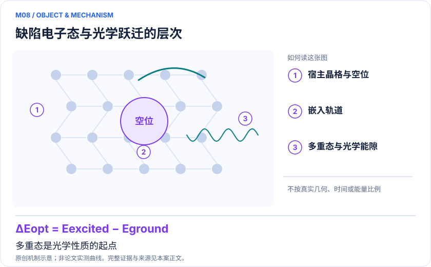

<!-- 由 release/tools/build_problems.py 自 tasks/M08-nv-sic-multiplets/README.md 与 tasks/catalog.json 生成，勿手改 -->

# M08 · NV⁻ 与 SiC 双空位：可验证的缺陷多重态和光学能级

> 开放题 · 应用材料 · 缺陷与量子器件材料

## 题面

| 环节 | 内容 |
|---|---|
| 研究体系 | 金刚石NV⁻；4H-SiC双空位为同类扩展 |
| 可观测量 | ³A₂、¹E、¹A₁、³E的能隙、〈S²〉、简并子空间投影与扰动响应 |
| 经典基线 | 同积分精确对角化及扩大空间多参考嵌入；光谱层另用经典振电子方法 |
| 量子方法的角色 | 嵌入有效哈密顿量上的VQE+QSE/多态变分，约束粒子数并做噪声缓解 |
| 研发决策 | 确认单重/三重态顺序及扰动下的能级分裂，支撑缺陷光学模型选择。 |

## 什么算解

一份解法满足以下五点即可提交审核。负结果同样接受，只要过程可复现、结论有依据。

1. **模型对应**：说明所用模型或数据如何对应「金刚石NV⁻；4H-SiC双空位为同类扩展」，列出简化与近似。
2. **可观测量**：报告「³A₂、¹E、¹A₁、³E的能隙、〈S²〉、简并子空间投影与扰动响应」，附单位与不确定度。
3. **经典对照**：在同一模型或数据上，与「同积分精确对角化及扩大空间多参考嵌入；光谱层另用经典振电子方法」中至少一种方法比较。
4. **可复现**：提供代码、环境、随机种子、输入来源与哈希，以及计算资源和成本；用到 QPU 时注明设备与 shots。
5. **研发决策**：说明结果能否支撑「确认单重/三重态顺序及扰动下的能级分裂，支撑缺陷光学模型选择。」，以及还缺什么证据。

本题的细化标准欢迎在 issue 中讨论；被采纳的讨论结论会写入后续版本。

## 现有参照

本项目已有数值执行记录（经典计算机上的计算与模拟），供对照与复用，不代表最优解。

- 原应用目标：未完成（incomplete）
- 最新研究报告：[REFERENCE.md](REFERENCE.md)
- 其余证据指针见 evidence.json（本地证据，未随题库发布）

### 原案例说明

### M08 · NV⁻ 与 SiC 双空位：可验证的缺陷多重态和光学能级

<!-- VISUALS:START -->
#### 可视化导读

**图 1 · 缺陷电子态与光学跃迁的层次。** 多重态是光学性质的起点。³A₂、¹E、¹A₁、³E的能隙、〈S²〉、简并子空间投影与扰动响应。图形为依据本案文献重绘的概念关系，不表示实际原子坐标、实测曲线或数值比例。

**图 2 · 计算与验证路径。** 嵌入有效哈密顿量上的VQE+QSE/多态变分，约束粒子数并做噪声缓解。**证据边界：** 最小模型可被经典轻松求解；垂直能隙不是零声子线，不能推导T₂或非辐射捕获率。

图解依据：[R1 · Simulating the electronic structure of spin defects on quantum computers](https://arxiv.org/abs/2112.04435)；[R2 · Optical properties of a diamond NV color center from capped embedded multiconfigurational correlated wavefunction theory](https://doi.org/10.1038/s41524-026-01987-1)；[R3 · Quantum simulations of materials on near-term quantum computers](https://arxiv.org/abs/2002.11173)。解释性连线与图形布局由本库整理，未复制论文原图。

[机制图 SVG](mechanism.svg) · [流程图 SVG](workflow.svg) · 机制图 PNG（本地证据，未随题库发布） · 流程图 PNG（本地证据，未随题库发布） · 图解说明 JSON（本地证据，未随题库发布）
<!-- VISUALS:END -->

> **固体环境经嵌入转为小型多体问题，已有VQE/QSE硬件研究；赛题积分仍缺失。**
>
> 编研日期：2026-10-04。证据类别：硬件演示。建议优先级：近期验证（编辑判断）。本目录为文献研究与试点设计，没有执行所列量子、经典或材料实验。

#### 研发决策与价值

**要支持的决策：**确认单重/三重态顺序及扰动下的能级分裂，支撑缺陷光学模型选择。

本例把“用于量子器件的材料”与“用量子计算求材料”分开。NV和SiC是被研究的固体缺陷，QPU只是求解器之一。PDF已经明确了小模型的可验收边界：组织方提供冻结积分，研究者比较多态算法；本次文献整理不会把尚未取得积分的赛题写成可直接运行实验包。

#### 物理系统与规模边界

- **系统：**金刚石NV⁻；4H-SiC双空位为同类扩展。
- **规模：**docs DEF-NV最小(4e,3o)为6比特、固定N维度15；完整晶体并未装入寄存器。
- **目标观测量：**³A₂、¹E、¹A₁、³E的能隙、〈S²〉、简并子空间投影与扰动响应。

这里的规模以原文或docs规定的有限模型为准，不把完整样品、活性空间、系统量子比特、逻辑辅助比特及纠错物理比特混为一个数字。[R1]

#### docs 来源与本次扩展

- 晓梦_Quantum_Science_Challenge_六方向赛题说明书.pdf: 第17–19页 DEF-NV
- 量子计算在材料计算与药物研发中的具体案例库.html: 原M10
- 量子计算如何研究材料问题与药物研发_研究方法与应用综述.md: 缺陷激发态
- 量子计算问题库_飞书多维表格导入版.xlsx: 问题库M29色心缺陷光学态（相关主题）；PDF DEF-NV

这些文件提供问题线索；文中研究事实以本页可核验原始来源为准，下面的试点、比较和停止条件是本次提出的研究设计。

#### 数学与计算目标

首期按PDF定义ΔE_G=E_G−E_³A₂。在不含自旋轨道耦合的版本中，单重态〈S²〉=0、三重态=2。E态内部可作任意基变换，因此比较整个简并子空间投影与态群能量，而不逐个比较本征矢符号。若不同态位于不同对称性扇区，tapering必须逐扇区保留覆盖。

#### 量子—经典工作流

**量子职责：**嵌入有效哈密顿量上的VQE+QSE/多态变分，约束粒子数并做噪声缓解。[R1]

经典DFT/嵌入产生屏蔽h、v与常数项；精确对角化生成验证真值；量子模块求参考态并测QSE矩阵或多态目标。对δ(neₓ−neᵧ)扫描轨道扰动，利用子空间重叠跟踪态身份。没有弹性或声子标定时，δ只能称为模型扰动，不是某个真实应变百分比。

#### 已发表工作：实际完成了什么

2022研究对NV⁻和SiC双空位用混合VQE/QSE求基/激发态，结合零噪外推和电子占据约束。[R1]

**证据限制：**最小模型可被经典轻松求解；垂直能隙不是零声子线，不能推导T₂或非辐射捕获率。

“硬件演示”只代表原论文运行过所述有限任务；“资源估算”只代表给定算法与假设下的预算。两者都不能替代与强经典方法、真实实验和完整成本的比较。

#### 经典比较与资源核算

**建议基线：**同积分精确对角化及扩大空间多参考嵌入；光谱层另用经典振电子方法。

经典对照分两层：15维小空间必须数值精确；扩大活性区与环境后检验有效哈密顿量的准确性。2026光学论文提供经典嵌入参照而非QPU优势证据。将测量复用与逐态独立求解比成本时，要同时计QSE矩阵处理、正则化及所有扇区测量。

#### 可复现试点设计（建议，尚未执行）

输入：h/v/常数、单位、轨道基、N=4、自旋和对称性表。步骤：①验证Hermiticity与经典本征残差；②覆盖四组态；③按PDF扫描δ=−0.10、−0.05、0、0.05、0.10 eV；④有限shots预跑后冻结简并/自旋容差。验收：PDF建议能隙误差≤0.03 eV，态归属完整，报告各δ下投影重叠和置信区间。停止：缺积分来源、任何目标态被约简删除、或正则化显著改变态序时停止计分。

交付时至少保留输入来源与版本、完整参数、原始/后处理结果、收敛轨迹、随机种子、实际计算成本和失败记录。验收阈值应在目标数据解盲前冻结；只有固定模型上的解达到标准，仍应单独标明模型到实验的剩余误差。

#### 解读与下一步

这是本库最适合小规模近期实施的材料验证题之一，但价值是多态算法正确性与测量效率。要服务实际缺陷设计，下一阶段应增加几何弛豫、声子及自旋轨道项，并重新冻结光学任务。

**最小下一步：**先取得有来源的嵌入积分；若只能拟合，应标NV-inspired并公开拟合目标。

#### 文献与读取范围

- **[R1] [Simulating the electronic structure of spin defects on quantum computers](https://arxiv.org/abs/2112.04435)**（2022；期刊论文；读取层级 `abstract`）。支持：NV负色心及4H-SiC双空位VQE/QSE硬件；PRX Quantum 3,010339。

- **[R2] [Optical properties of a diamond NV color center from capped embedded multiconfigurational correlated wavefunction theory](https://doi.org/10.1038/s41524-026-01987-1)**（2026；期刊论文；读取层级 `full_text`）。支持：经典嵌入多参考光学计算对照；不是量子硬件成果。

- **[R3] [Quantum simulations of materials on near-term quantum computers](https://arxiv.org/abs/2002.11173)**（2020；期刊论文；读取层级 `abstract`）。支持：固体缺陷局域有效哈密顿量和经典/量子嵌入验证。

全文层级表示读到原始正文页面，不表示已逐项复算或完整审计全部补充材料；若页面转换缺失，已在来源说明或正文注明。摘要/检索摘录层级不支持未见的精确实验细节。相同工作的预印本与期刊版不计为独立复现。

## 如何提交

按 [CONTRIBUTING.md](../../../CONTRIBUTING.md) 把解法放在 `solutions/M08/<你的名字>-<短名>/`，格式见 [解法模板](../../../solutions/_template/SOLUTION.md)。被采纳的解法会按 [沉淀规则](../../../skills/README.md) 提炼为可复用的 skill。
