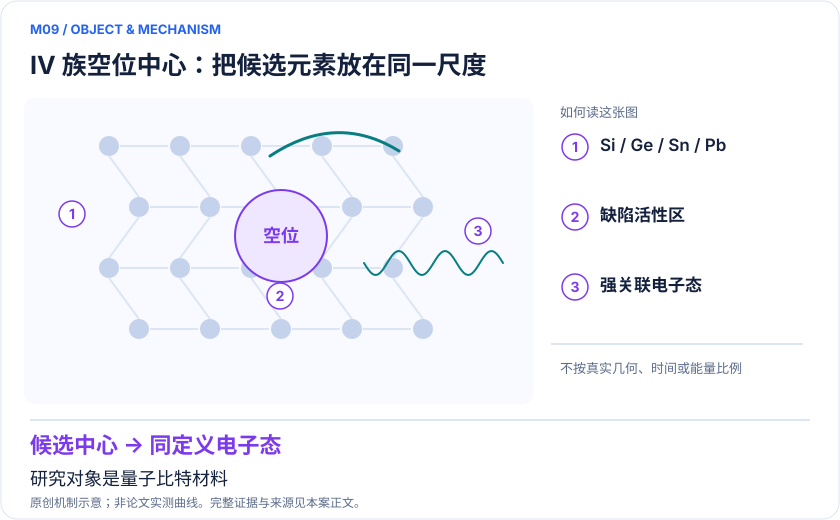

<!-- 由 release/tools/build_problems.py 自 tasks/M09-group-iv-vacancy/README.md 与 tasks/catalog.json 生成，勿手改 -->

# M09 · 金刚石 IV 族空位中心：筛选可光学操控的强关联缺陷

> 开放题 · 应用材料 · 缺陷候选筛选
> 难度：进阶（[分级说明](../../../starters/README.md#难度分级)） · 背景：量子化学

## 题面

| 环节 | 内容 |
|---|---|
| 研究体系 | 金刚石中中性group-IV vacancy complexes |
| 可观测量 | 垂直激发能、态排序、多重度、对称性与候选间趋势 |
| 经典基线 | QDET+FCI、经典多参考嵌入、适用TDDFT和实验谱 |
| 量子方法的角色 | 量子嵌入构造可由经典或未来QPU求解的有效哈密顿量 |
| 研发决策 | 比较不同杂原子缺陷的单重/三重激发态排列，为光学操控候选选择提供物理依据。 |

## 基准输入

原文输入没有公开，也没有可直接运行的替代输入，解法需要自建模型并写明来源与哈希。下表只列出已知的公开材料。「原文」指作者或原论文公开的材料，「参照」指本项目参照运行自行冻结的选择。

| 项目 | 内容 | 出处 |
|---|---|---|
| 模型规模 | 原 SI 给出最小模型 16 电子、9 空间轨道及扩展模型 | [原文](https://www.rsc.org/suppdata/d0/cp/d0cp04585c/d0cp04585c1.pdf) |
| 后续修正 | QDET 双计数修正 | [原文](https://arxiv.org/html/2203.05493v2) |

**尚未公开或需注意：**四类中性 IV 族缺陷的有效一、二体积分、几何与屏蔽定义未取得。

## 什么算解

一份解法满足以下五点即可提交审核。负结果同样接受，只要过程可复现、结论有依据。

1. **模型对应**：说明所用模型或数据如何对应「金刚石中中性group-IV vacancy complexes」，列出简化与近似。
2. **可观测量**：报告「垂直激发能、态排序、多重度、对称性与候选间趋势」，附单位与不确定度。
3. **经典对照**：在同一模型或数据上，与「QDET+FCI、经典多参考嵌入、适用TDDFT和实验谱」中至少一种方法比较。
4. **可复现**：提供代码、环境、随机种子、输入来源与哈希，以及计算资源和成本；用到 QPU 时注明设备与 shots。
5. **研发决策**：说明结果能否支撑「比较不同杂原子缺陷的单重/三重激发态排列，为光学操控候选选择提供物理依据。」，以及还缺什么证据。

本题的细化标准欢迎在 issue 中讨论；被采纳的讨论结论会写入后续版本。

## 现有参照

本项目已有数值执行记录（经典计算机上的计算与模拟），供对照与复用，不代表最优解。

- 原应用目标：未完成（incomplete）
- 最新研究报告：[REFERENCE.md](REFERENCE.md)
- 其余证据指针见 evidence.json（本地证据，未随题库发布）

### 原案例说明

### M09 · 金刚石 IV 族空位中心：筛选可光学操控的强关联缺陷

<!-- VISUALS:START -->
#### 可视化导读

**图 1 · IV 族空位中心：把候选元素放在同一尺度。** 研究对象是量子比特材料。垂直激发能、态排序、多重度、对称性与候选间趋势。图形为依据本案文献重绘的概念关系，不表示实际原子坐标、实测曲线或数值比例。

**图 2 · 计算与验证路径。** 量子嵌入构造可由经典或未来QPU求解的有效哈密顿量。**证据边界：** 被研究对象本身是自旋量子比特材料，不代表结果由量子硬件完成；能级不能单独保证亮度与相干。

图解依据：[R1 · First-principles Studies of Strongly Correlated States in Defect Spin Qubits in Diamond](https://arxiv.org/abs/2008.13283)；[R2 · Quantum simulations of materials on near-term quantum computers](https://arxiv.org/abs/2002.11173)。解释性连线与图形布局由本库整理，未复制论文原图。

[机制图 SVG](mechanism.svg) · [流程图 SVG](workflow.svg) · 机制图 PNG（本地证据，未随题库发布） · 流程图 PNG（本地证据，未随题库发布） · 图解说明 JSON（本地证据，未随题库发布）
<!-- VISUALS:END -->

> **SiV/GeV/SnV/PbV类中性缺陷已有嵌入多体态预测，主要证据是经典材料计算。**
>
> 编研日期：2026-10-04。证据类别：经典验证。建议优先级：重点储备（编辑判断）。本目录为文献研究与试点设计，没有执行所列量子、经典或材料实验。

#### 研发决策与价值

**要支持的决策：**比较不同杂原子缺陷的单重/三重激发态排列，为光学操控候选选择提供物理依据。

本例与M08不同：M08先验证固定NV小模型，M09面向跨化学元素的缺陷候选排序。高价值是减少不具备目标能级条件的生长、注入和光学表征尝试，而不是用一个能隙预测完整器件性能。候选不同，环境屏蔽、重元素效应和局域几何也可能不同。

#### 物理系统与规模边界

- **系统：**金刚石中中性group-IV vacancy complexes。
- **规模：**完整周期缺陷环境用经典处理；局域缺陷有效空间供多体求解，空间大小需逐缺陷核验。
- **目标观测量：**垂直激发能、态排序、多重度、对称性与候选间趋势。

这里的规模以原文或docs规定的有限模型为准，不把完整样品、活性空间、系统量子比特、逻辑辅助比特及纠错物理比特混为一个数字。[R1]

#### docs 来源与本次扩展

- 量子计算在材料计算与药物研发中的具体案例库.html: 原M09
- 量子计算问题库_飞书多维表格导入版.xlsx: 问题库M29色心缺陷光学态；原HTML M09

这些文件提供问题线索；文中研究事实以本页可核验原始来源为准，下面的试点、比较和停止条件是本次提出的研究设计。

#### 数学与计算目标

建议先规定哪种态排序是实验可操控的必要条件，再比较ΔE及可信区间。需要分清中性与带电缺陷、垂直与绝热激发以及自旋纯态与自旋轨道混合态。若目标是发射波长，则还需激发态弛豫和振动修正；若目标是循环跃迁，需额外跃迁矩阵元与非辐射通道。

#### 量子—经典工作流

**量子职责：**量子嵌入构造可由经典或未来QPU求解的有效哈密顿量。[R1]

经典生成统一超胞和缺陷几何，收敛屏蔽响应并提取局域轨道。先用精确或收敛经典多体解核对态标签，再把完全同一哈密顿量交给量子模拟器。QPU候选价值应出现在更大活性空间或更丰富动态关联带来可验证差异的阶段，而不是可精确对角化的小模型上。

#### 已发表工作：实际完成了什么

2020原始研究给出IV族空位缺陷单重和三重强关联激发态预测。[R1]

**证据限制：**被研究对象本身是自旋量子比特材料，不代表结果由量子硬件完成；能级不能单独保证亮度与相干。

“硬件演示”只代表原论文运行过所述有限任务；“资源估算”只代表给定算法与假设下的预算。两者都不能替代与强经典方法、真实实验和完整成本的比较。

#### 经典比较与资源核算

**建议基线：**QDET+FCI、经典多参考嵌入、适用TDDFT和实验谱。

跨候选比较不能只保留某种方法最有利的基组和空间。应做一致的超胞、活性区及介电处理，并报告不同缺陷的近简并性。经典FCI在小空间是强真值，不应故意换成HF来制造改善。R2支持嵌入接口与硬件可行性，但不是R1全套候选的真机复现。

#### 可复现试点设计（建议，尚未执行）

输入：两个中性缺陷结构、统一基准方法、屏蔽/双计数约定、目标态表和实验待判条件。步骤：①收敛局域环境；②计算单重/三重能级图并追踪身份；③扩大空间检验排序；④仅对稳定困难子问题做量子成本分析。验收：候选筛选规则事先固定，结论在主要建模变化下保持，指出无法分辨的候选对。停止：电荷稳定性、SOC或几何弛豫改变排序而未处理时，不给最终推荐。

交付时至少保留输入来源与版本、完整参数、原始/后处理结果、收敛轨迹、随机种子、实际计算成本和失败记录。验收阈值应在目标数据解盲前冻结；只有固定模型上的解达到标准，仍应单独标明模型到实验的剩余误差。

#### 解读与下一步

适合缺陷材料设计团队作为模型准备项目。若近期只具备小规模QPU，可把它降为方法校准，不应承诺比成熟经典嵌入更快筛选全部色心。

**最小下一步：**选择两个缺陷和相同电荷态，以同一嵌入收敛标准比较排序。

#### 文献与读取范围

- **[R1] [First-principles Studies of Strongly Correlated States in Defect Spin Qubits in Diamond](https://arxiv.org/abs/2008.13283)**（2020；期刊论文；读取层级 `abstract`）。支持：中性IV族空位复合体单重/三重激发态的第一性原理预测。

- **[R2] [Quantum simulations of materials on near-term quantum computers](https://arxiv.org/abs/2002.11173)**（2020；期刊论文；读取层级 `abstract`）。支持：固体缺陷局域有效哈密顿量和经典/量子嵌入验证。

全文层级表示读到原始正文页面，不表示已逐项复算或完整审计全部补充材料；若页面转换缺失，已在来源说明或正文注明。摘要/检索摘录层级不支持未见的精确实验细节。相同工作的预印本与期刊版不计为独立复现。

## 如何提交

按 [CONTRIBUTING.md](../../../CONTRIBUTING.md) 把解法放在 `solutions/M09/<你的名字>-<短名>/`，格式见 [解法模板](../../../solutions/_template/SOLUTION.md)。被采纳的解法会按 [沉淀规则](../../../skills/README.md) 提炼为可复用的 skill。
