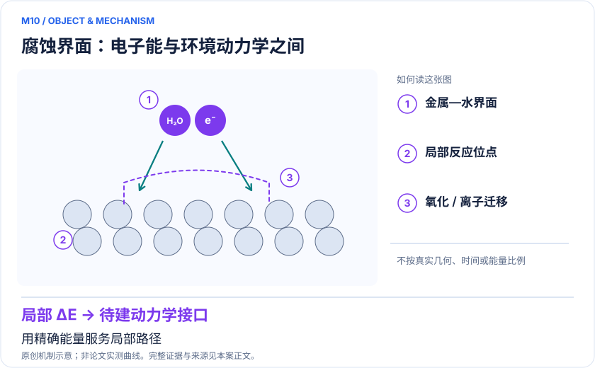
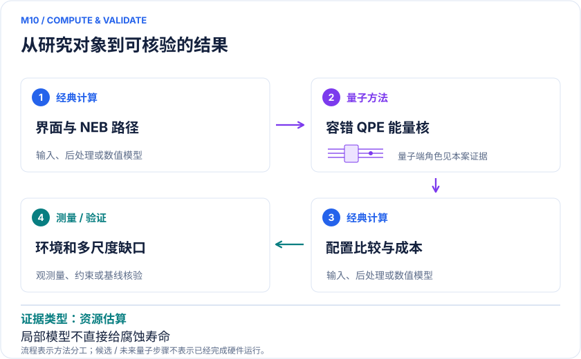

<!-- 由 release/tools/build_problems.py 自 tasks/M10-corrosion-mg-niobium/README.md 与 tasks/catalog.json 生成，勿手改 -->

# M10 · Mg 水界面与 Nb 合金氧化：腐蚀机制的量子工作流成本

> 开放题 · 应用材料 · 腐蚀与航空材料

## 题面

| 环节 | 内容 |
|---|---|
| 研究体系 | Mg/Mg–Al与水的析氢反应；Nb富集难熔合金中高温氧迁移 |
| 可观测量 | 界面反应势垒、氧迁移/占位能差及速率模型的误差传播 |
| 经典基线 | 周期DFT/NEB、AIMD、合金模型与适用高层相关参照 |
| 量子方法的角色 | QPE电子基态估计嵌入经典NEB/合金配置工作流 |
| 研发决策 | 判断防腐涂层/合金设计中哪段界面反应或扩散势垒需要更高精度电子能。 |

## 什么算解

一份解法满足以下五点即可提交审核。负结果同样接受，只要过程可复现、结论有依据。

1. **模型对应**：说明所用模型或数据如何对应「Mg/Mg–Al与水的析氢反应；Nb富集难熔合金中高温氧迁移」，列出简化与近似。
2. **可观测量**：报告「界面反应势垒、氧迁移/占位能差及速率模型的误差传播」，附单位与不确定度。
3. **经典对照**：在同一模型或数据上，与「周期DFT/NEB、AIMD、合金模型与适用高层相关参照」中至少一种方法比较。
4. **可复现**：提供代码、环境、随机种子、输入来源与哈希，以及计算资源和成本；用到 QPU 时注明设备与 shots。
5. **研发决策**：说明结果能否支撑「判断防腐涂层/合金设计中哪段界面反应或扩散势垒需要更高精度电子能。」，以及还缺什么证据。

本题的细化标准欢迎在 issue 中讨论；被采纳的讨论结论会写入后续版本。

## 现有参照

本项目已有数值执行记录（经典计算机上的计算与模拟），供对照与复用，不代表最优解。

- 原应用目标：未完成（incomplete）
- 最新研究报告：[REFERENCE.md](REFERENCE.md)
- 其余证据指针见 evidence.json（本地证据，未随题库发布）

### 原案例说明

### M10 · Mg 水界面与 Nb 合金氧化：腐蚀机制的量子工作流成本

<!-- VISUALS:START -->
#### 可视化导读

**图 1 · 腐蚀界面：电子能与环境动力学之间。** 用精确能量服务局部路径。界面反应势垒、氧迁移/占位能差及速率模型的误差传播。图形为依据本案文献重绘的概念关系，不表示实际原子坐标、实测曲线或数值比例。

**图 2 · 计算与验证路径。** QPE电子基态估计嵌入经典NEB/合金配置工作流。**证据边界：** 逻辑比特和T门均为资源估算；模型到长期腐蚀速率还需环境、电化学和多尺度动力学。

图解依据：[R1 · Quantum computing for corrosion simulation: workflow and resource analysis](https://www.nature.com/articles/s41534-025-01171-1)；[R2 · Quantum computing for corrosion-resistant materials and anti-corrosive coatings design](https://arxiv.org/abs/2406.18759)。解释性连线与图形布局由本库整理，未复制论文原图。

[机制图 SVG](mechanism.svg) · [流程图 SVG](workflow.svg) · 机制图 PNG（本地证据，未随题库发布） · 流程图 PNG（本地证据，未随题库发布） · 图解说明 JSON（本地证据，未随题库发布）
<!-- VISUALS:END -->

> **完整腐蚀子流程已经拆到量子能量核，但逻辑资源仍巨大且不含全部态制备。**
>
> 编研日期：2026-10-04。证据类别：资源估算。建议优先级：重点储备（编辑判断）。本目录为文献研究与试点设计，没有执行所列量子、经典或材料实验。

#### 研发决策与价值

**要支持的决策：**判断防腐涂层/合金设计中哪段界面反应或扩散势垒需要更高精度电子能。

将Mg水界面和Nb氧化放在同一个案例中，是因为主文把它们作为两条资源规划工作流，避免把一篇资源论文包装成多个独立应用成功。二者决策有区别：前者关注水环境下析氢/腐蚀局部反应，后者关注高温氧扩散与合金稳定性。正式实施应选择一个分支。

#### 物理系统与规模边界

- **系统：**Mg/Mg–Al与水的析氢反应；Nb富集难熔合金中高温氧迁移。
- **规模：**2026文给出2292–38598逻辑比特、约(1.04–1962)×10¹³ T门范围，依具体模型；非已运行。
- **目标观测量：**界面反应势垒、氧迁移/占位能差及速率模型的误差传播。

这里的规模以原文或docs规定的有限模型为准，不把完整样品、活性空间、系统量子比特、逻辑辅助比特及纠错物理比特混为一个数字。[R1]

#### docs 来源与本次扩展

- 量子计算如何研究材料问题与药物研发_研究方法与应用综述.md: 催化路径与误差预算
- 量子计算问题库_飞书多维表格导入版.xlsx: 问题库M16腐蚀钝化与表面电子转移

这些文件提供问题线索；文中研究事实以本页可核验原始来源为准，下面的试点、比较和停止条件是本次提出的研究设计。

#### 数学与计算目标

量子输出限定为固定几何与边界条件下的电子能量。Mg分支由R/TS/P组成反应势垒；Nb分支将氧位置和合金环境对应能差交给扩散模型。扩散系数和腐蚀速率依赖温度、前因子、微观缺陷和界面状态，不能由单个基态能直接得出。

#### 量子—经典工作流

**量子职责：**QPE电子基态估计嵌入经典NEB/合金配置工作流。[R1]

经典材料建模负责晶片、晶界、水层和构型搜索，NEB/AIMD识别候选关键点；量子化学人员冻结周期哈密顿量与基组；资源工具将精度映射到QPE门和逻辑比特；工程层将误差传给目标速率。逐核成本表比一个汇总总门数更利于发现最值得降本的部分。

#### 已发表工作：实际完成了什么

2026期刊给出两类工程工作流及逻辑资源表；2024预印本范围不同，不应混成单一数字。[R1,R2]

**证据限制：**逻辑比特和T门均为资源估算；模型到长期腐蚀速率还需环境、电化学和多尺度动力学。

“硬件演示”只代表原论文运行过所述有限任务；“资源估算”只代表给定算法与假设下的预算。两者都不能替代与强经典方法、真实实验和完整成本的比较。

#### 经典比较与资源核算

**建议基线：**周期DFT/NEB、AIMD、合金模型与适用高层相关参照。

资源摘要是指定第一量子化/平面波编码下的估算，不能作为所有算法不可突破的下界。期刊表注明单次QPE且不含初态制备，估价要增加成功概率和多构型重复。2024预印本与2026期刊数值跨度不同，实际方案应以指定版本、具体模型和一致精度重算。

#### 可复现试点设计（建议，尚未执行）

输入：一个Mg水界面或Nb含氧超胞、R/TS/P或扩散位置、周期参数、精度、初态假设。步骤：①复现经典基线并定位泛函/有限尺寸误差；②只替换能量核；③分别审计单次QPE和全路径成本；④用误差区间重算机理排名。验收：同一坐标与精度可生成可追踪资源表，说明实际吞吐与所需硬件差距。停止：水层采样或边界改变机理、或预计成本远超可用预算时转为离线模型工作。

交付时至少保留输入来源与版本、完整参数、原始/后处理结果、收敛轨迹、随机种子、实际计算成本和失败记录。验收阈值应在目标数据解盲前冻结；只有固定模型上的解达到标准，仍应单独标明模型到实验的剩余误差。

#### 解读与下一步

该案例对航空/防腐团队的当前价值是把量子愿景转成可采购、可否决的能力需求。只有局域能量误差确实控制决策时，未来硬件能力提升才可能转成应用收益。

**最小下一步：**先选择Mg水解一个驻点对，做模型误差预算和资源核查。

#### 文献与读取范围

- **[R1] [Quantum computing for corrosion simulation: workflow and resource analysis](https://www.nature.com/articles/s41534-025-01171-1)**（2026；期刊论文；读取层级 `full_text`）。支持：Mg与Nb腐蚀的流程、模型和逻辑资源；2026发表，非DOI中2025。

- **[R2] [Quantum computing for corrosion-resistant materials and anti-corrosive coatings design](https://arxiv.org/abs/2406.18759)**（2024；预印本；读取层级 `abstract`）。支持：同研究早期版本的两工业问题与端到端资源背景；不作为独立复现。

全文层级表示读到原始正文页面，不表示已逐项复算或完整审计全部补充材料；若页面转换缺失，已在来源说明或正文注明。摘要/检索摘录层级不支持未见的精确实验细节。相同工作的预印本与期刊版不计为独立复现。

## 如何提交

按 [CONTRIBUTING.md](../../../CONTRIBUTING.md) 把解法放在 `solutions/M10/<你的名字>-<短名>/`，格式见 [解法模板](../../../solutions/_template/SOLUTION.md)。被采纳的解法会按 [沉淀规则](../../../skills/README.md) 提炼为可复用的 skill。
