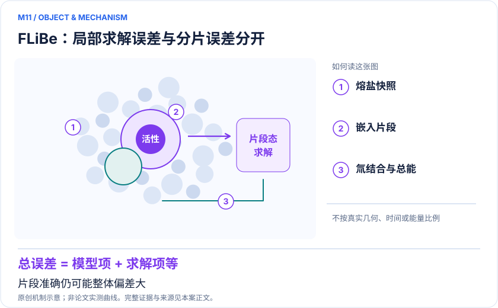
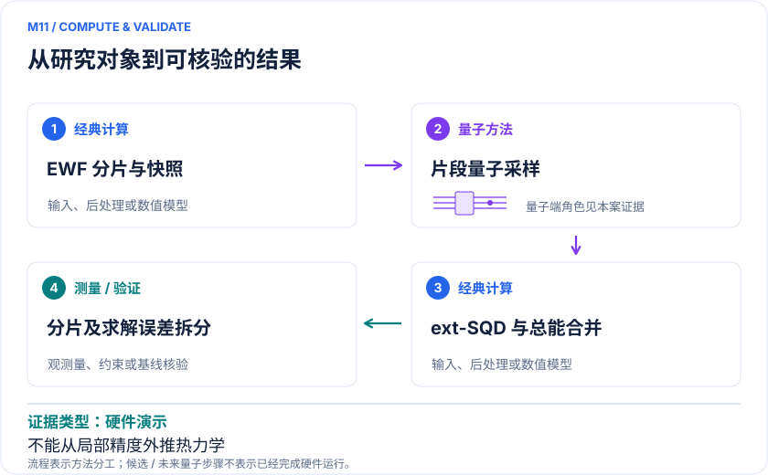

<!-- 由 release/tools/build_problems.py 自 tasks/M11-flibe-tritium/README.md 与 tasks/catalog.json 生成，勿手改 -->

# M11 · 聚变包层 FLiBe：氚结合能与分片误差的严格拆分

> 开放题 · 应用材料 · 熔盐与聚变材料

## 题面

| 环节 | 内容 |
|---|---|
| 研究体系 | 2LiF–BeF₂熔盐AIMD抽取的中性、含F⁻和含氚团簇 |
| 可观测量 | 同参考构象相对能ΔE、固定几何氚电子结合能和模型误差 |
| 经典基线 | 相同EWF的FCI/TCI/CCSD；未分片CCSD与DLPNO-CCSD(T)；同任务HCI |
| 量子方法的角色 | EWF分片，较大片段由QPU采样+ext-SQD，经典重构总能与RDM |
| 研发决策 | 判断氚局域化学形态计算是否足以支持回收热力学，而不是仅证明片段解得准。 |

## 什么算解

一份解法满足以下五点即可提交审核。负结果同样接受，只要过程可复现、结论有依据。

1. **模型对应**：说明所用模型或数据如何对应「2LiF–BeF₂熔盐AIMD抽取的中性、含F⁻和含氚团簇」，列出简化与近似。
2. **可观测量**：报告「同参考构象相对能ΔE、固定几何氚电子结合能和模型误差」，附单位与不确定度。
3. **经典对照**：在同一模型或数据上，与「相同EWF的FCI/TCI/CCSD；未分片CCSD与DLPNO-CCSD(T)；同任务HCI」中至少一种方法比较。
4. **可复现**：提供代码、环境、随机种子、输入来源与哈希，以及计算资源和成本；用到 QPU 时注明设备与 shots。
5. **研发决策**：说明结果能否支撑「判断氚局域化学形态计算是否足以支持回收热力学，而不是仅证明片段解得准。」，以及还缺什么证据。

本题的细化标准欢迎在 issue 中讨论；被采纳的讨论结论会写入后续版本。

## 现有参照

本项目已有数值执行记录（经典计算机上的计算与模拟），供对照与复用，不代表最优解。

- 原应用目标：未完成（incomplete）
- 最新研究报告：[REFERENCE.md](REFERENCE.md)
- 其余证据指针见 evidence.json（本地证据，未随题库发布）

### 原案例说明

### M11 · 聚变包层 FLiBe：氚结合能与分片误差的严格拆分

<!-- VISUALS:START -->
#### 可视化导读

**图 1 · FLiBe：局部求解误差与分片误差分开。** 片段准确仍可能整体偏差大。同参考构象相对能ΔE、固定几何氚电子结合能和模型误差。图形为依据本案文献重绘的概念关系，不表示实际原子坐标、实测曲线或数值比例。

**图 2 · 计算与验证路径。** EWF分片，较大片段由QPU采样+ext-SQD，经典重构总能与RDM。**证据边界：** 分片/未分片差约12 kcal/mol（构象）和110 kcal/mol（氚结合）；不能由局部准确声称整体热力学准确。

图解依据：[R1 · Quantum Computations on Fusion Blanket Molten Salts](https://arxiv.org/html/2606.30402v1)；[R2 · Chemistry Beyond the Scale of Exact Diagonalization on a Quantum-Centric Supercomputer](https://arxiv.org/abs/2405.05068)。解释性连线与图形布局由本库整理，未复制论文原图。

[机制图 SVG](mechanism.svg) · [流程图 SVG](workflow.svg) · 机制图 PNG（本地证据，未随题库发布） · 流程图 PNG（本地证据，未随题库发布） · 图解说明 JSON（本地证据，未随题库发布）
<!-- VISUALS:END -->

> **量子求解可接近同嵌入参考，但整体分片偏差远大于求解误差，当前首要任务是模型收敛。**
>
> 编研日期：2026-10-04。证据类别：硬件演示。建议优先级：近期验证（编辑判断）。本目录为文献研究与试点设计，没有执行所列量子、经典或材料实验。

#### 研发决策与价值

**要支持的决策：**判断氚局域化学形态计算是否足以支持回收热力学，而不是仅证明片段解得准。

本例是对工业研发非常有用的误差定位案例。氚结合的工程意义在于聚变包层的形态分布与回收，但原文的固定几何电子能还不是自由能、扩散系数或回收率。QPU解决了指定片段的问题，并不保证所选片段代表实际离子熔盐中的屏蔽和长程极化。

#### 物理系统与规模边界

- **系统：**2LiF–BeF₂熔盐AIMD抽取的中性、含F⁻和含氚团簇。
- **规模：**九个构型；中性团簇21原子，另有22/23原子带电配对；13–33轨道片段不等于整块熔盐。
- **目标观测量：**同参考构象相对能ΔE、固定几何氚电子结合能和模型误差。

这里的规模以原文或docs规定的有限模型为准，不把完整样品、活性空间、系统量子比特、逻辑辅助比特及纠错物理比特混为一个数字。[R1]

#### docs 来源与本次扩展

- quantum_applications_roadmap_2021-2026.md: 3.4 FLiBe
- 量子计算如何研究材料问题与药物研发_研究方法与应用综述.md: 全流程误差

这些文件提供问题线索；文中研究事实以本页可核验原始来源为准，下面的试点、比较和停止条件是本次提出的研究设计。

#### 数学与计算目标

应区分两个差：同一嵌入下量子与经典求解器差，和嵌入与未分片模型差。结合能按论文为含氚团簇减去移除裸T⁺后的对应阴离子，需完整记录电荷及参考。资料摘要把0.7称作片段能量精度，但正文/图5支持的是相对能差；本库采用较窄的正文口径。

#### 量子—经典工作流

**量子职责：**EWF分片，较大片段由QPU采样+ext-SQD，经典重构总能与RDM。[R1]

建议将AIMD快照冻结，建立全团簇和多个浴阈值版本。每一版本先用同一个经典求解器构成可比较模型，再仅替换大片段为ext-SQD。按完全相同的RDM聚合公式重建总能，避免把分片定义、求解器与后处理同时更换。原始SQD文献为接口背景，不是FLiBe独立复现实验。

#### 已发表工作：实际完成了什么

图5同EWF构象相对能的最大差0.7、MAD0.3 kcal/mol；绝对总能存在+2.1至+2.9 kcal/mol偏移。[R1]

**证据限制：**分片/未分片差约12 kcal/mol（构象）和110 kcal/mol（氚结合）；不能由局部准确声称整体热力学准确。

“硬件演示”只代表原论文运行过所述有限任务；“资源估算”只代表给定算法与假设下的预算。两者都不能替代与强经典方法、真实实验和完整成本的比较。

#### 经典比较与资源核算

**建议基线：**相同EWF的FCI/TCI/CCSD；未分片CCSD与DLPNO-CCSD(T)；同任务HCI。

不能只与FCI超算内存比较，因为同哈密顿量的HCI或其他选定CI可能便宜很多。成本需包括QPU、经典配置恢复、子空间对角化和多片段RDM处理。对带电结合差，分片误差可能不抵消，应在结合双方成对做阈值扫描；一条平均误差不能替代逐构型检查。

#### 可复现试点设计（建议，尚未执行）

输入：原文九构型或合法可得坐标、6-31+G*及电荷、浴阈值、片段定义和积分。步骤：①重算一组中性与含氚配对的经典参考；②逐步降低浴截断；③画逐构型嵌入误差与求解误差；④模型稳定后才评估重加权自由能的样本重叠。验收：准确复原论文能差定义，单独报告绝对偏移、构象差与结合差。停止：浴截断尚未收敛、带电参考不一致、或采样有效样本数不足时，不发布氚形态概率。

交付时至少保留输入来源与版本、完整参数、原始/后处理结果、收敛轨迹、随机种子、实际计算成本和失败记录。验收阈值应在目标数据解盲前冻结；只有固定模型上的解达到标准，仍应单独标明模型到实验的剩余误差。

#### 解读与下一步

推荐近期验证的含义是优先做误差审计而非马上购买QPU时间。若嵌入收敛后强经典求解器依然足够，保留其作为生产方案；量子分支的价值需要等预算替代试验进一步证明。

**最小下一步：**先复核同一构型不同浴截断的收敛，暂不启动昂贵扩展硬件采样。

#### 文献与读取范围

- **[R1] [Quantum Computations on Fusion Blanket Molten Salts](https://arxiv.org/html/2606.30402v1)**（2026；预印本；读取层级 `full_text`）。支持：FLiBe ext-SQD与分片误差；图5相对能和绝对能必须区分。

- **[R2] [Chemistry Beyond the Scale of Exact Diagonalization on a Quantum-Centric Supercomputer](https://arxiv.org/abs/2405.05068)**（2025；期刊论文；读取层级 `abstract`）。支持：SQD采样与经典对角化接口；2024预印本2025期刊。

全文层级表示读到原始正文页面，不表示已逐项复算或完整审计全部补充材料；若页面转换缺失，已在来源说明或正文注明。摘要/检索摘录层级不支持未见的精确实验细节。相同工作的预印本与期刊版不计为独立复现。

## 如何提交

按 [CONTRIBUTING.md](../../../CONTRIBUTING.md) 把解法放在 `solutions/M11/<你的名字>-<短名>/`，格式见 [解法模板](../../../solutions/_template/SOLUTION.md)。被采纳的解法会按 [沉淀规则](../../../skills/README.md) 提炼为可复用的 skill。
