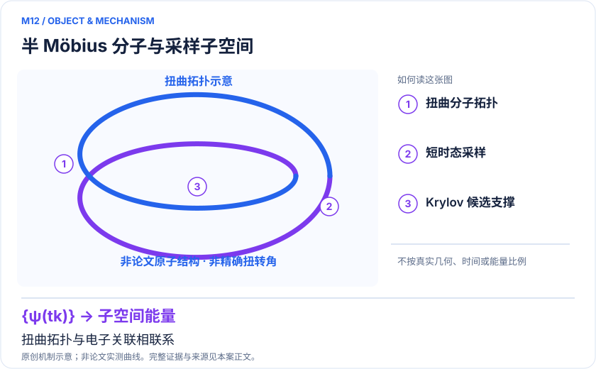
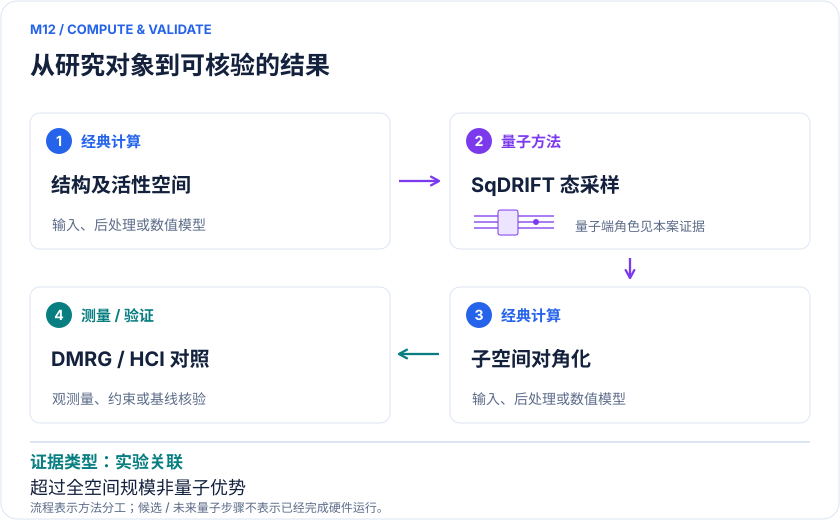

<!-- 由 release/tools/build_problems.py 自 tasks/M12-half-mobius-molecule/README.md 与 tasks/catalog.json 生成，勿手改 -->

# M12 · 半 Möbius 分子：把量子子空间计算接到真实分子表征

> 开放题 · 应用材料 · 新型分子材料与拓扑

## 题面

| 环节 | 内容 |
|---|---|
| 研究体系 | 2026报道的半Möbius碳环分子；需固定实验构象与电子态 |
| 可观测量 | 相对能、电子附着态/轨道特征、相关描述及空间收敛 |
| 经典基线 | 同积分DMRG/选定CI、匹配规模经典构型生成、实验STM/AFM表征 |
| 量子方法的角色 | SqDRIFT随机短时演化采样构造Krylov候选，经典子空间对角化 |
| 研发决策 | 判断测得的分子结构/电子特征是否支持半Möbius拓扑解释，并检查活性空间扩大后结论稳定性。 |

## 什么算解

一份解法满足以下五点即可提交审核。负结果同样接受，只要过程可复现、结论有依据。

1. **模型对应**：说明所用模型或数据如何对应「2026报道的半Möbius碳环分子；需固定实验构象与电子态」，列出简化与近似。
2. **可观测量**：报告「相对能、电子附着态/轨道特征、相关描述及空间收敛」，附单位与不确定度。
3. **经典对照**：在同一模型或数据上，与「同积分DMRG/选定CI、匹配规模经典构型生成、实验STM/AFM表征」中至少一种方法比较。
4. **可复现**：提供代码、环境、随机种子、输入来源与哈希，以及计算资源和成本；用到 QPU 时注明设备与 shots。
5. **研发决策**：说明结果能否支撑「判断测得的分子结构/电子特征是否支持半Möbius拓扑解释，并检查活性空间扩大后结论稳定性。」，以及还缺什么证据。

本题的细化标准欢迎在 issue 中讨论；被采纳的讨论结论会写入后续版本。

## 现有参照

本项目已有数值执行记录（经典计算机上的计算与模拟），供对照与复用，不代表最优解。

- 原应用目标：未完成（incomplete）
- 最新研究报告：[REFERENCE.md](REFERENCE.md)
- 其余证据指针见 evidence.json（本地证据，未随题库发布）

### 原案例说明

### M12 · 半 Möbius 分子：把量子子空间计算接到真实分子表征

<!-- VISUALS:START -->
#### 可视化导读

**图 1 · 半 Möbius 分子与采样子空间。** 扭曲拓扑与电子关联相联系。相对能、电子附着态/轨道特征、相关描述及空间收敛。图形为依据本案文献重绘的概念关系，不表示实际原子坐标、实测曲线或数值比例。

**图 2 · 计算与验证路径。** SqDRIFT随机短时演化采样构造Krylov候选，经典子空间对角化。**证据边界：** 超越全空间精确对角化不等于优于DMRG/HCI；电子拓扑也不自动代表可用拓扑器件。

图解依据：[R1 · A molecule with half-Möbius topology](https://ora.ox.ac.uk/objects/uuid%3Aab54a73f-6ee8-4afa-8997-541e6de6cc5d/files/s70795b17p)；[R2 · Exploring pathways towards quantum advantage in quantum chemistry: the case of a molecule with half-Möbius topology](https://arxiv.org/html/2603.08696v2)。解释性连线与图形布局由本库整理，未复制论文原图。

[机制图 SVG](mechanism.svg) · [流程图 SVG](workflow.svg) · 机制图 PNG（本地证据，未随题库发布） · 流程图 PNG（本地证据，未随题库发布） · 图解说明 JSON（本地证据，未随题库发布）
<!-- VISUALS:END -->

> **已合成分子的电子拓扑研究与72–100比特扩展工作相互关联，但属于不同论文与不同证据层。**
>
> 编研日期：2026-10-04。证据类别：实验关联。建议优先级：近期验证（编辑判断）。本目录为文献研究与试点设计，没有执行所列量子、经典或材料实验。

#### 研发决策与价值

**要支持的决策：**判断测得的分子结构/电子特征是否支持半Möbius拓扑解释，并检查活性空间扩大后结论稳定性。

这一例子的独特性是计算与真实新分子表征相连，而不是增加一项标准小分子总能量演示。应用价值首先是科学发现和解释：验证何种电子描述与实验一致。把它进一步转化为电子器件、储能或光学功能，仍需独立功能指标与稳定性实验。

#### 物理系统与规模边界

- **系统：**2026报道的半Möbius碳环分子；需固定实验构象与电子态。
- **规模：**原始研究量子部分72比特；方法扩展36–50轨道对应72–100比特。
- **目标观测量：**相对能、电子附着态/轨道特征、相关描述及空间收敛。

这里的规模以原文或docs规定的有限模型为准，不把完整样品、活性空间、系统量子比特、逻辑辅助比特及纠错物理比特混为一个数字。[R1]

#### docs 来源与本次扩展

- quantum_applications_roadmap_2021-2026.md: 3.1半Möbius与S14
- 量子计算在材料计算与药物研发中的具体案例库.html: 新分子材料方向扩展

这些文件提供问题线索；文中研究事实以本页可核验原始来源为准，下面的试点、比较和停止条件是本次提出的研究设计。

#### 数学与计算目标

建议把验证目标分为几何身份、电子态身份和关联收敛三项。电子拓扑特征的比较必须注明轨道/附着态的定义，避免把基组旋转产生的可视差异当作物理改变。活性空间变大时，既检查能量，也检查支撑拓扑解释的目标量是否保持。

#### 量子—经典工作流

**量子职责：**SqDRIFT随机短时演化采样构造Krylov候选，经典子空间对角化。[R1]

经典步骤从实验候选几何和轨道构建模型；SqDRIFT在量子设备产生不同短时演化的构型样本；经典恢复物理粒子数并对选定子空间对角化。模型空间、样本生成、配置恢复和对角化各自可改变结果，实施时每次只改变一个因素并保留完整种子。

#### 已发表工作：实际完成了什么

2026 Science报告新分子；独立方法稿v2展示扩大到50轨道/100比特的混合计算。[R1,R2]

**证据限制：**超越全空间精确对角化不等于优于DMRG/HCI；电子拓扑也不自动代表可用拓扑器件。

“硬件演示”只代表原论文运行过所述有限任务；“资源估算”只代表给定算法与假设下的预算。两者都不能替代与强经典方法、真实实验和完整成本的比较。

#### 经典比较与资源核算

**建议基线：**同积分DMRG/选定CI、匹配规模经典构型生成、实验STM/AFM表征。

公平对照应给经典HCI/DMRG或构型生成器相同输入，并比较目标误差下的总耗时与内存。72与100比特意味着不同轨道空间，不能把规模提升直接解读成固定任务加速；也不能把同一团队的方法扩展视为对原实验的完全独立复现。

#### 可复现试点设计（建议，尚未执行）

输入：指定论文版本、几何、轨道/基组、电子数、有效积分、被解释的实验特征。步骤：①选可精确或高精度经典验证的空间；②复现采样子空间方法；③固定对角化维度替换量子/经典样本；④扩展空间并检查目标量。验收：结果可追到输入哈希与版本，实验解释在合理方法变化下稳定，失败样本和重复运行方差公开。停止：只有总能改善但目标拓扑量不稳定、或经典同预算更优时，不宣称优势。

交付时至少保留输入来源与版本、完整参数、原始/后处理结果、收敛轨迹、随机种子、实际计算成本和失败记录。验收阈值应在目标数据解盲前冻结；只有固定模型上的解达到标准，仍应单独标明模型到实验的剩余误差。

#### 解读与下一步

检索发现docs采用的是v1旧题名“A note on large-scale…”，当前v2题名已改，本库保留新标题与版本。Science全文入口本次未成功打开，机构稿仅检到摘录；具体实验细节因此不作超出可见证据的复述。

**最小下一步：**从论文可获得积分选一档空间，比较量子样本与等预算经典配置。

#### 文献与读取范围

- **[R1] [A molecule with half-Möbius topology](https://ora.ox.ac.uk/objects/uuid%3Aab54a73f-6ee8-4afa-8997-541e6de6cc5d/files/s70795b17p)**（2026；期刊论文；读取层级 `search_excerpt`）。支持：Science DOI10.1126/science.aea3321；实验分子与72比特研究；本次仅检索到机构稿摘录。

- **[R2] [Exploring pathways towards quantum advantage in quantum chemistry: the case of a molecule with half-Möbius topology](https://arxiv.org/html/2603.08696v2)**（2026；预印本；读取层级 `full_text`）。支持：SqDRIFT活性空间扩展至50轨道100比特；v2更改标题。

全文层级表示读到原始正文页面，不表示已逐项复算或完整审计全部补充材料；若页面转换缺失，已在来源说明或正文注明。摘要/检索摘录层级不支持未见的精确实验细节。相同工作的预印本与期刊版不计为独立复现。

## 如何提交

按 [CONTRIBUTING.md](../../../CONTRIBUTING.md) 把解法放在 `solutions/M12/<你的名字>-<短名>/`，格式见 [解法模板](../../../solutions/_template/SOLUTION.md)。被采纳的解法会按 [沉淀规则](../../../skills/README.md) 提炼为可复用的 skill。
