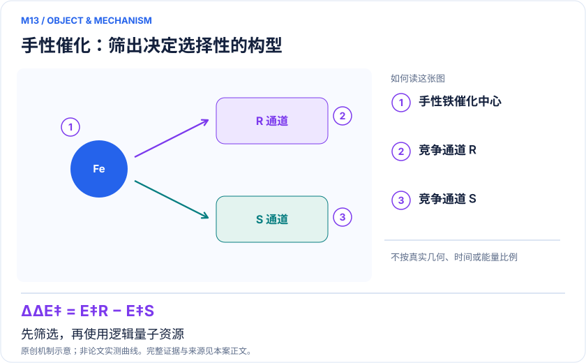
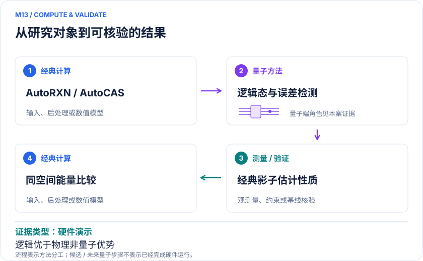

<!-- 由 release/tools/build_problems.py 自 tasks/M13-logical-chiral-catalysis/README.md 与 tasks/catalog.json 生成，勿手改 -->

# M13 · 手性铁催化的 HPC＋逻辑比特流程：识别值得量子计算的少数构型

> 开放题 · 应用材料 · 催化自动化与逻辑量子计算

## 题面

| 环节 | 内容 |
|---|---|
| 研究体系 | 苯乙酮与P–N–N–P铁催化体系 |
| 可观测量 | 选定构型基态能和性质；最终所需为竞争对映路径ΔΔG‡ |
| 经典基线 | 同一小空间精确对角化、未编码物理电路和经典高层能量校正 |
| 量子方法的角色 | AutoRXN/AutoCAS筛选→逻辑态制备与误差检测→classical shadows性质估计 |
| 研发决策 | 在庞大催化网络中找到对对映选择性敏感且经典诊断困难的构型，避免无差别上QPU。 |

## 什么算解

一份解法满足以下五点即可提交审核。负结果同样接受，只要过程可复现、结论有依据。

1. **模型对应**：说明所用模型或数据如何对应「苯乙酮与P–N–N–P铁催化体系」，列出简化与近似。
2. **可观测量**：报告「选定构型基态能和性质；最终所需为竞争对映路径ΔΔG‡」，附单位与不确定度。
3. **经典对照**：在同一模型或数据上，与「同一小空间精确对角化、未编码物理电路和经典高层能量校正」中至少一种方法比较。
4. **可复现**：提供代码、环境、随机种子、输入来源与哈希，以及计算资源和成本；用到 QPU 时注明设备与 shots。
5. **研发决策**：说明结果能否支撑「在庞大催化网络中找到对对映选择性敏感且经典诊断困难的构型，避免无差别上QPU。」，以及还缺什么证据。

本题的细化标准欢迎在 issue 中讨论；被采纳的讨论结论会写入后续版本。

## 现有参照

本题暂无本项目的数值执行记录，下面只有文献整理。

### 原案例说明

### M13 · 手性铁催化的 HPC＋逻辑比特流程：识别值得量子计算的少数构型

<!-- VISUALS:START -->
#### 可视化导读

**图 1 · 手性催化：筛出决定选择性的构型。** 先筛选，再使用逻辑量子资源。选定构型基态能和性质；最终所需为竞争对映路径ΔΔG‡。图形为依据本案文献重绘的概念关系，不表示实际原子坐标、实测曲线或数值比例。

**图 2 · 计算与验证路径。** AutoRXN/AutoCAS筛选→逻辑态制备与误差检测→classical shadows性质估计。**证据边界：** 小空间精确态可经典准备，逻辑优于物理不等于量子优于经典；未完成量子改进实际对映选择性的证明。

图解依据：[R1 · End-to-End Quantum Simulation of a Chemical System](https://arxiv.org/html/2409.05835v1)；[R2 · Evaluating the evidence for exponential quantum advantage in ground-state quantum chemistry](https://www.nature.com/articles/s41467-023-37587-6)。解释性连线与图形布局由本库整理，未复制论文原图。

[机制图 SVG](mechanism.svg) · [流程图 SVG](workflow.svg) · 机制图 PNG（本地证据，未随题库发布） · 流程图 PNG（本地证据，未随题库发布） · 图解说明 JSON（本地证据，未随题库发布）
<!-- VISUALS:END -->

> **真实反应网络经过经典筛选后，只将一个很小的相关活性问题送入逻辑电路。**
>
> 编研日期：2026-10-04。证据类别：硬件演示。建议优先级：近期验证（编辑判断）。本目录为文献研究与试点设计，没有执行所列量子、经典或材料实验。

#### 研发决策与价值

**要支持的决策：**在庞大催化网络中找到对对映选择性敏感且经典诊断困难的构型，避免无差别上QPU。

本例最值得迁移的是“先找到需要高精度的少数点”。手性催化的商业价值与药物、农化中间体的对映体控制相关，但原研究的证据只是工作流与小活性点求解。不能因为网络由大量HPC计算得到，就把整个网络规模当成逻辑QPU完成的化学规模。

#### 物理系统与规模边界

- **系统：**苯乙酮与P–N–N–P铁催化体系。
- **规模：**经典网络3150构型/2227基元步；演示量子核心约简为两逻辑比特，不是整个网络量子计算。
- **目标观测量：**选定构型基态能和性质；最终所需为竞争对映路径ΔΔG‡。

这里的规模以原文或docs规定的有限模型为准，不把完整样品、活性空间、系统量子比特、逻辑辅助比特及纠错物理比特混为一个数字。[R1]

#### docs 来源与本次扩展

- quantum_applications_roadmap_2021-2026.md: 其他团队逻辑化学工作流与S25
- 量子计算如何研究材料问题与药物研发_研究方法与应用综述.md: AI/量子/经典分工

这些文件提供问题线索；文中研究事实以本页可核验原始来源为准，下面的试点、比较和停止条件是本次提出的研究设计。

#### 数学与计算目标

最终决策依赖两条竞争路径的自由能差ΔΔG‡；产物比例对小能差敏感，因此必须平衡两个对映路径的构象、溶剂、热修正和轨道空间。单个相关中间体能量更准确，仅是可能帮助的条件，尚不足以确定产物选择性。

#### 量子—经典工作流

**量子职责：**AutoRXN/AutoCAS筛选→逻辑态制备与误差检测→classical shadows性质估计。[R1]

经典AutoRXN探索网络并用相关诊断筛选，AutoCAS确定局部空间；QPU在编码空间执行制备和测量；经典影子等后处理估计性质。建议保存全部候选筛选理由，避免事后只选择量子结果最好的点。原HTML后半部分不完整，未核实的精确误差率和线路资源不写成定量结论。

#### 已发表工作：实际完成了什么

2024预印本演示HPC、逻辑量子与AI/测量处理的集成，比较逻辑和物理电路表现。[R1]

**证据限制：**小空间精确态可经典准备，逻辑优于物理不等于量子优于经典；未完成量子改进实际对映选择性的证明。

“硬件演示”只代表原论文运行过所述有限任务；“资源估算”只代表给定算法与假设下的预算。两者都不能替代与强经典方法、真实实验和完整成本的比较。

#### 经典比较与资源核算

**建议基线：**同一小空间精确对角化、未编码物理电路和经典高层能量校正。

至少做三个对照：同小空间精确解验证科学目标；同设备未编码线路检验逻辑编码；同预算纯经典工作流检验应用价值。三者回答不同问题，不能合并为一个“优势”。如果量子初态来自经典精确解，应明确这是硬件准确性测试，不是未知基态发现。

#### 可复现试点设计（建议，尚未执行）

输入：固定反应网络快照、诊断阈值、选中构型积分、编码电路及接受/拒绝规则。步骤：①经典重算选中点；②核对逻辑与未编码同目标线路；③统计后选择接受率与每个有效样本成本；④将能量区间传到左右两条路径。验收：编码后的实际改善在同shots/同成本两种口径均报告，区分编译态误差和观测误差。停止：目标点不影响路径选择，或大量后选择使总成本不可接受时，回到候选筛选。

交付时至少保留输入来源与版本、完整参数、原始/后处理结果、收敛轨迹、随机种子、实际计算成本和失败记录。验收阈值应在目标数据解盲前冻结；只有固定模型上的解达到标准，仍应单独标明模型到实验的剩余误差。

#### 解读与下一步

对软件团队，这是设计“高价值困难点路由”的好案例；对化学团队，下一步应验证筛选出的相关点是否真的改变对映选择性的判断。逻辑比特演示本身并不构成研发效率收益。

**最小下一步：**按原小哈密顿量复核编/解码收益，再对真正决定选择性的双路径误差预算。

#### 文献与读取范围

- **[R1] [End-to-End Quantum Simulation of a Chemical System](https://arxiv.org/html/2409.05835v1)**（2024；预印本；读取层级 `full_text`）。支持：手性铁催化HPC筛选和两逻辑比特演示；HTML正文后段缺失。

- **[R2] [Evaluating the evidence for exponential quantum advantage in ground-state quantum chemistry](https://www.nature.com/articles/s41467-023-37587-6)**（2023；期刊论文；读取层级 `full_text`）。支持：态制备与强经典启发式共同约束基态任务的优势判断。

全文层级表示读到原始正文页面，不表示已逐项复算或完整审计全部补充材料；若页面转换缺失，已在来源说明或正文注明。摘要/检索摘录层级不支持未见的精确实验细节。相同工作的预印本与期刊版不计为独立复现。

## 如何提交

按 [CONTRIBUTING.md](../../../CONTRIBUTING.md) 把解法放在 `solutions/M13/<你的名字>-<短名>/`，格式见 [解法模板](../../../solutions/_template/SOLUTION.md)。被采纳的解法会按 [沉淀规则](../../../skills/README.md) 提炼为可复用的 skill。
