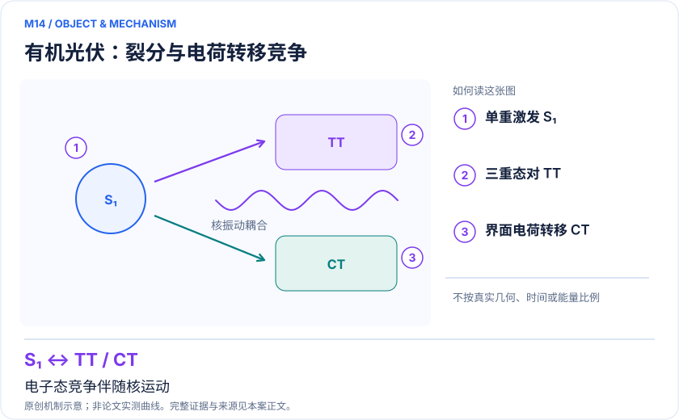
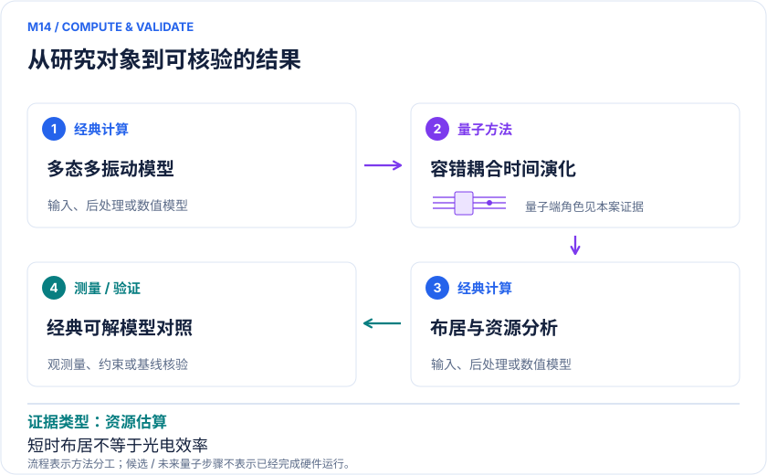

<!-- 由 release/tools/build_problems.py 自 tasks/M14-organic-photovoltaic-vibronics/README.md 与 tasks/catalog.json 生成，勿手改 -->

# M14 · 有机光伏单重态裂分与界面电荷转移：高维振电动力学

> 开放题 · 应用材料 · 光伏与光化学材料

## 题面

| 环节 | 内容 |
|---|---|
| 研究体系 | 蒽二聚体激子/三重态过程；蒽–富勒烯界面电荷转移 |
| 可观测量 | 态布居Pα(t)、三重态对/CT形成、相关函数和100 fs内短时动力学 |
| 经典基线 | MCTDH/ML-MCTDH、张量网络传播、严格小模型波包动力学及适用半经典方法 |
| 量子方法的角色 | 实空间编码多电子态与核模式，用乘积公式实现耦合时间演化 |
| 研发决策 | 判断分子堆积与界面耦合如何影响激子转化和电荷分离，筛选后续超快谱实验。 |

## 什么算解

一份解法满足以下五点即可提交审核。负结果同样接受，只要过程可复现、结论有依据。

1. **模型对应**：说明所用模型或数据如何对应「蒽二聚体激子/三重态过程；蒽–富勒烯界面电荷转移」，列出简化与近似。
2. **可观测量**：报告「态布居Pα(t)、三重态对/CT形成、相关函数和100 fs内短时动力学」，附单位与不确定度。
3. **经典对照**：在同一模型或数据上，与「MCTDH/ML-MCTDH、张量网络传播、严格小模型波包动力学及适用半经典方法」中至少一种方法比较。
4. **可复现**：提供代码、环境、随机种子、输入来源与哈希，以及计算资源和成本；用到 QPU 时注明设备与 shots。
5. **研发决策**：说明结果能否支撑「判断分子堆积与界面耦合如何影响激子转化和电荷分离，筛选后续超快谱实验。」，以及还缺什么证据。

本题的细化标准欢迎在 issue 中讨论；被采纳的讨论结论会写入后续版本。

## 现有参照

本项目已有数值执行记录（经典计算机上的计算与模拟），供对照与复用，不代表最优解。

- 原应用目标：未完成（incomplete）
- 最新研究报告：[REFERENCE.md](REFERENCE.md)
- 其余证据指针见 evidence.json（本地证据，未随题库发布）

### 原案例说明

### M14 · 有机光伏单重态裂分与界面电荷转移：高维振电动力学

<!-- VISUALS:START -->
#### 可视化导读

**图 1 · 有机光伏：裂分与电荷转移竞争。** 电子态竞争伴随核运动。态布居Pα(t)、三重态对/CT形成、相关函数和100 fs内短时动力学。图形为依据本案文献重绘的概念关系，不表示实际原子坐标、实测曲线或数值比例。

**图 2 · 计算与验证路径。** 实空间编码多电子态与核模式，用乘积公式实现耦合时间演化。**证据边界：** 是容错资源与算法研究，不是已优化光伏器件；短时布居不是稳态电流或太阳能转换效率。

图解依据：[R1 · Quantum Algorithm for Vibronic Dynamics: Case Study on Singlet Fission Solar Cell Design](https://arxiv.org/abs/2411.13669v3)；[R2 · Quantum algorithms for quantum dynamics](https://www.nature.com/articles/s43588-022-00374-2)；[R3 · Modeling singlet fission on a quantum computer](https://arxiv.org/abs/2301.05752)。解释性连线与图形布局由本库整理，未复制论文原图。

[机制图 SVG](mechanism.svg) · [流程图 SVG](workflow.svg) · 机制图 PNG（本地证据，未随题库发布） · 流程图 PNG（本地证据，未随题库发布） · 图解说明 JSON（本地证据，未随题库发布）
<!-- VISUALS:END -->

> **同一振电算法覆盖蒽二聚体与蒽–富勒烯界面；有明确时间/状态/模式资源口径。**
>
> 编研日期：2026-10-04。证据类别：资源估算。建议优先级：重点储备（编辑判断）。本目录为文献研究与试点设计，没有执行所列量子、经典或材料实验。

#### 研发决策与价值

**要支持的决策：**判断分子堆积与界面耦合如何影响激子转化和电荷分离，筛选后续超快谱实验。

这两种模型处于有机光伏流程不同位置：二聚体关注光激发后的激子/三重态相关过程，供受体界面关注电荷转移。本库合并为一个算法驱动的应用案例，同时保留不同决策量，避免把同一资源论文重复当作两次独立应用成功。

#### 物理系统与规模边界

- **系统：**蒽二聚体激子/三重态过程；蒽–富勒烯界面电荷转移。
- **规模：**v3二聚体6态21模/154比特；界面4态246模/1053比特；均为振电离散编码而非原子数。
- **目标观测量：**态布居Pα(t)、三重态对/CT形成、相关函数和100 fs内短时动力学。

这里的规模以原文或docs规定的有限模型为准，不把完整样品、活性空间、系统量子比特、逻辑辅助比特及纠错物理比特混为一个数字。[R1]

#### docs 来源与本次扩展

- 量子计算在材料计算与药物研发中的具体案例库.html: 原M07和M08（合并同篇）
- 量子计算如何研究材料问题与药物研发_研究方法与应用综述.md: 振电与非绝热动力学
- 量子计算问题库_飞书多维表格导入版.xlsx: 问题库M24单线态裂分；M25有机光伏激子；文献S13

这些文件提供问题线索；文中研究事实以本页可核验原始来源为准，下面的试点、比较和停止条件是本次提出的研究设计。

#### 数学与计算目标

目标是给定振电哈密顿量H=Σαβ|α〉Hαβ(Q,P)〈β|后的Pα(t)，其中核模式与电子态共同传播。参数误差、diabatic态选择、模式截断、振动网格边界和传播误差均会影响布居。最终要比较的是改变堆积/耦合后可实验辨识的动态趋势，而非能量低一点。

#### 量子—经典工作流

**量子职责：**实空间编码多电子态与核模式，用乘积公式实现耦合时间演化。[R1]

经典电子结构与振动分析拟合势能面和非绝热耦合，确定初始核波包；量子编码模式坐标与电子态并分步传播；经典重建态布居/相关信号并与超快谱比较。面向太阳能器件还需要激子扩散、复合、取向分布和电荷抽取层，不能由100 fs封闭模型代替。

#### 已发表工作：实际完成了什么

2025 v3估算100 fs二聚体传播2.76×10⁶ Toffoli；界面全模模型2.66×10⁷ Toffoli。[R1] 2023另有线性H₄的硬件裂分能量条件模型，属于原型验证，不能当作蒽二聚体动力学已上真机。[R3]

**证据限制：**是容错资源与算法研究，不是已优化光伏器件；短时布居不是稳态电流或太阳能转换效率。

“硬件演示”只代表原论文运行过所述有限任务；“资源估算”只代表给定算法与假设下的预算。两者都不能替代与强经典方法、真实实验和完整成本的比较。

#### 经典比较与资源核算

**建议基线：**MCTDH/ML-MCTDH、张量网络传播、严格小模型波包动力学及适用半经典方法。

小模型应与严格波包传播比较；高维模型使用ML-MCTDH或张量网络检查纠缠/模式排序收敛。与半经典轨迹的差异可能来自核量子模型，不必然来自量子硬件。资源必须绑定v3，因为早期v1的模式数、比特与Toffoli成本不同，不能从不同版本各挑最有利数值。

#### 可复现试点设计（建议，尚未执行）

输入：公开模型参数、单位、电子态标签、正常模频率/耦合、初始波包、网格和100 fs时间窗。步骤：①两态少模精确对照；②增加到论文目标态数；③分别收敛时间步与振动截断；④对一个材料可调参数做敏感性分析与盲留测试。验收：总布居守恒、能量/边界误差受控，关键转移趋势在两种经典参照下可复核。停止：参数拟合或模式截断误差大于算法误差，或目标实验不能区分预测时，先改模型。

交付时至少保留输入来源与版本、完整参数、原始/后处理结果、收敛轨迹、随机种子、实际计算成本和失败记录。验收阈值应在目标数据解盲前冻结；只有固定模型上的解达到标准，仍应单独标明模型到实验的剩余误差。

#### 解读与下一步

适合长期容错动态模拟储备，并可近期完成模型质量和算法资源研究。把成果交给材料团队时应突出哪些振动模式和电子耦合最值得测量或调控，明确尚未证明器件效率改善。

**最小下一步：**用二聚体缩减模型复核初态、模式截断和时间步，再比较全模资源。

#### 文献与读取范围

- **[R1] [Quantum Algorithm for Vibronic Dynamics: Case Study on Singlet Fission Solar Cell Design](https://arxiv.org/abs/2411.13669v3)**（2025；预印本；读取层级 `abstract`）。支持：2025修订版两种光伏振电模型资源；2024首次公开。

- **[R2] [Quantum algorithms for quantum dynamics](https://www.nature.com/articles/s43588-022-00374-2)**（2023；综述；读取层级 `abstract`）。支持：量子动力学算法应用/局限背景；在线2022、卷年2023；只读取摘要。

- **[R3] [Modeling singlet fission on a quantum computer](https://arxiv.org/abs/2301.05752)**（2023；期刊论文；读取层级 `abstract`）。支持：线性H4的裂分能量条件硬件原型；不是蒽或实际光伏器件。

全文层级表示读到原始正文页面，不表示已逐项复算或完整审计全部补充材料；若页面转换缺失，已在来源说明或正文注明。摘要/检索摘录层级不支持未见的精确实验细节。相同工作的预印本与期刊版不计为独立复现。

## 如何提交

按 [CONTRIBUTING.md](../../../CONTRIBUTING.md) 把解法放在 `solutions/M14/<你的名字>-<短名>/`，格式见 [解法模板](../../../solutions/_template/SOLUTION.md)。被采纳的解法会按 [沉淀规则](../../../skills/README.md) 提炼为可复用的 skill。
