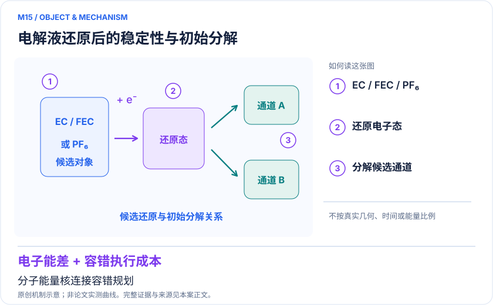
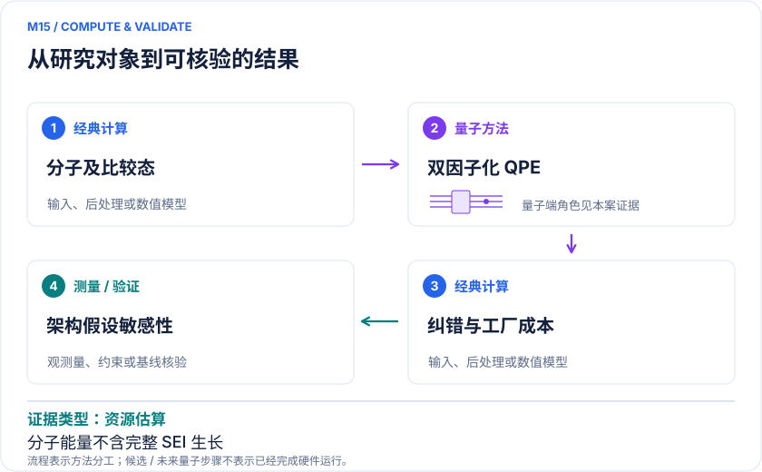

<!-- 由 release/tools/build_problems.py 自 tasks/M15-electrolyte-fault-tolerant/README.md 与 tasks/catalog.json 生成，勿手改 -->

# M15 · 锂电电解液分子：还原稳定性与 SEI 初始反应的容错规划

> 开放题 · 应用材料 · 电解液与界面反应

## 题面

| 环节 | 内容 |
|---|---|
| 研究体系 | EC、FEC、PF₆⁻及其含Li变体LEC、LFEC、LiPF₆、LREC |
| 可观测量 | 还原/电离相关能差、候选断键势垒；最终SEI与循环性能须另建模型 |
| 经典基线 | DFT溶剂化/反应网络、耦合簇或多参考能量校正、经典基组收敛 |
| 量子方法的角色 | 双因子化QPE电子能核，结合纠错、魔法态工厂与架构并行成本 |
| 研发决策 | 判断溶剂/添加剂的竞争电子反应是否值得高层校正，以及未来硬件的实际吞吐能否承担筛选。 |

## 什么算解

一份解法满足以下五点即可提交审核。负结果同样接受，只要过程可复现、结论有依据。

1. **模型对应**：说明所用模型或数据如何对应「EC、FEC、PF₆⁻及其含Li变体LEC、LFEC、LiPF₆、LREC」，列出简化与近似。
2. **可观测量**：报告「还原/电离相关能差、候选断键势垒；最终SEI与循环性能须另建模型」，附单位与不确定度。
3. **经典对照**：在同一模型或数据上，与「DFT溶剂化/反应网络、耦合簇或多参考能量校正、经典基组收敛」中至少一种方法比较。
4. **可复现**：提供代码、环境、随机种子、输入来源与哈希，以及计算资源和成本；用到 QPU 时注明设备与 shots。
5. **研发决策**：说明结果能否支撑「判断溶剂/添加剂的竞争电子反应是否值得高层校正，以及未来硬件的实际吞吐能否承担筛选。」，以及还缺什么证据。

本题的细化标准欢迎在 issue 中讨论；被采纳的讨论结论会写入后续版本。

## 现有参照

本项目已有数值执行记录（经典计算机上的计算与模拟），供对照与复用，不代表最优解。

- 原应用目标：状态未记录
- 最新研究报告：[REFERENCE.md](REFERENCE.md)
- 其余证据指针见 evidence.json（本地证据，未随题库发布）

### 原案例说明

### M15 · 锂电电解液分子：还原稳定性与 SEI 初始反应的容错规划

<!-- VISUALS:START -->
#### 可视化导读

**图 1 · 电解液还原后的稳定性与初始分解。** 分子能量核连接容错规划。还原/电离相关能差、候选断键势垒；最终SEI与循环性能须另建模型。图形为依据本案文献重绘的概念关系，不表示实际原子坐标、实测曲线或数值比例。

**图 2 · 计算与验证路径。** 双因子化QPE电子能核，结合纠错、魔法态工厂与架构并行成本。**证据边界：** 架构加速是估计、部分并行方案未完整仿真；单分子能量不含电极电位、成膜和长期衰退。

图解依据：[R1 · Fault-tolerant resource estimate for quantum chemical simulations: Case study on Li-ion battery electrolyte molecules](https://arxiv.org/html/2104.10653v2)；[R2 · Simulating key properties of lithium-ion batteries with a fault-tolerant quantum computer](https://arxiv.org/abs/2204.11890)。解释性连线与图形布局由本库整理，未复制论文原图。

[机制图 SVG](mechanism.svg) · [流程图 SVG](workflow.svg) · 机制图 PNG（本地证据，未随题库发布） · 流程图 PNG（本地证据，未随题库发布） · 图解说明 JSON（本地证据，未随题库发布）
<!-- VISUALS:END -->

> **电解液分子有硬件架构相关的容错成本研究；尚未由量子计算验证配方寿命改善。**
>
> 编研日期：2026-10-04。证据类别：资源估算。建议优先级：重点储备（编辑判断）。本目录为文献研究与试点设计，没有执行所列量子、经典或材料实验。

#### 研发决策与价值

**要支持的决策：**判断溶剂/添加剂的竞争电子反应是否值得高层校正，以及未来硬件的实际吞吐能否承担筛选。

这是未来容错化学的具体工业问题，不是“量子电池”装置。高价值来自辨认哪种溶剂或添加剂在工作电位下优先反应，生成的初始产物是否有利于保护界面。文献证明有可分析的分子资源任务，但本页不把其算法研究写成量子设计了新的商业电解液。

#### 物理系统与规模边界

- **系统：**EC、FEC、PF₆⁻及其含Li变体LEC、LFEC、LiPF₆、LREC。
- **规模：**原文包含全部电子（含芯），非小活性空间；不同高斯基组到逻辑电路和光子fusion-based架构逐级预算。
- **目标观测量：**还原/电离相关能差、候选断键势垒；最终SEI与循环性能须另建模型。

这里的规模以原文或docs规定的有限模型为准，不把完整样品、活性空间、系统量子比特、逻辑辅助比特及纠错物理比特混为一个数字。[R1]

#### docs 来源与本次扩展

- 量子计算问题库_飞书多维表格导入版.xlsx: 问题库M19电解液分解与SEI初始反应
- 量子计算如何研究材料问题与药物研发_研究方法与应用综述.md: 从电子能到反应决策

这些文件提供问题线索；文中研究事实以本页可核验原始来源为准，下面的试点、比较和停止条件是本次提出的研究设计。

#### 数学与计算目标

建议首期限定为一个分子的中性/还原态能量差及一条断键通道。计算必须明确垂直还是绝热还原、气相还是溶液、电子参考和电极电位约定。若比较添加剂优先反应，两个候选必须以相同溶剂化、基组和热力学约定计算；不同参考下的电子亲和能不可直接比较。

#### 量子—经典工作流

**量子职责：**双因子化QPE电子能核，结合纠错、魔法态工厂与架构并行成本。[R1]

原文这些分子并非强关联例子，采用全电子基组为资源测试。建议的经典构象采样和电子结构生成候选，并判断单参考是否适用；高精度电子核可采用QPE资源模型，返回的能量差进入经典反应网络。容错资源进一步分解为逻辑空间、非Clifford操作、纠错开销、光子资源态发生器和延迟线/并行策略。设备架构假设必须和化学误差预算一起冻结。

#### 已发表工作：实际完成了什么

2022 PRR研究电解液分子的容错光子架构成本，并提出并行消耗魔法态以降低估算运行时间。[R1]

**证据限制：**架构加速是估计、部分并行方案未完整仿真；单分子能量不含电极电位、成膜和长期衰退。

“硬件演示”只代表原论文运行过所述有限任务；“资源估算”只代表给定算法与假设下的预算。两者都不能替代与强经典方法、真实实验和完整成本的比较。

#### 经典比较与资源核算

**建议基线：**DFT溶剂化/反应网络、耦合簇或多参考能量校正、经典基组收敛。

应先与适用耦合簇和多参考方法比较，不因分子属于电池就假定经典难。R2是周期正极的关联路线，用于说明电池性质需要能量差而非孤立总能，但不是电解液结果的独立验证。并行魔法态相对串行架构的节约也不是相对经典电子结构的加速。

#### 可复现试点设计（建议，尚未执行）

输入：两个候选或一个反应对的坐标、电荷、自旋、基组、溶剂/电位参考、反应通道与失败概率。步骤：①精确核对小基组；②基组和溶剂化收敛；③诊断经典相关误差；④给定实际目标精度计算QPE及架构成本；⑤将能量误差传给竞争速率。验收：每个结论绑定具体分子/通道而非泛称电解液，报告总吞吐及初态成本。停止：溶剂、电极边界或构象导致的变化更大时，先做环境模型。

交付时至少保留输入来源与版本、完整参数、原始/后处理结果、收敛轨迹、随机种子、实际计算成本和失败记录。验收阈值应在目标数据解盲前冻结；只有固定模型上的解达到标准，仍应单独标明模型到实验的剩余误差。

#### 解读与下一步

近期适合完成可审计的电解液反应验证集与硬件能力预算。若需要SEI组成、气体析出或寿命结论，必须增加表面、反应网络和实验验证；单分子电子能不能作为配方推荐的充分依据。

**最小下一步：**选择EC/FEC一组明确电荷变化或断键通道，冻结溶剂模型与能量定义。

#### 文献与读取范围

- **[R1] [Fault-tolerant resource estimate for quantum chemical simulations: Case study on Li-ion battery electrolyte molecules](https://arxiv.org/html/2104.10653v2)**（2022；期刊论文；读取层级 `full_text`）。支持：电解液分子容错资源与光子架构；期刊2022，预印本2021/修订2023。

- **[R2] [Simulating key properties of lithium-ion batteries with a fault-tolerant quantum computer](https://arxiv.org/abs/2204.11890)**（2022；期刊论文；读取层级 `abstract`）。支持：Li2FeSiO4电压、迁移、热稳定性与第一量子化资源；PRA106,032428。

全文层级表示读到原始正文页面，不表示已逐项复算或完整审计全部补充材料；若页面转换缺失，已在来源说明或正文注明。摘要/检索摘录层级不支持未见的精确实验细节。相同工作的预印本与期刊版不计为独立复现。

## 如何提交

按 [CONTRIBUTING.md](../../../CONTRIBUTING.md) 把解法放在 `solutions/M15/<你的名字>-<短名>/`，格式见 [解法模板](../../../solutions/_template/SOLUTION.md)。被采纳的解法会按 [沉淀规则](../../../skills/README.md) 提炼为可复用的 skill。
