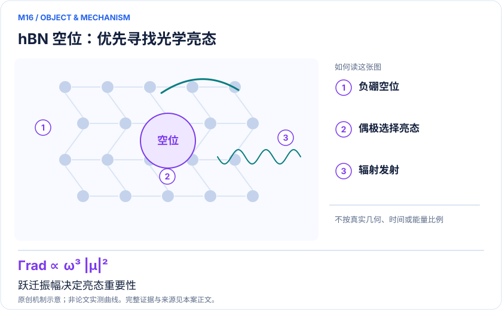
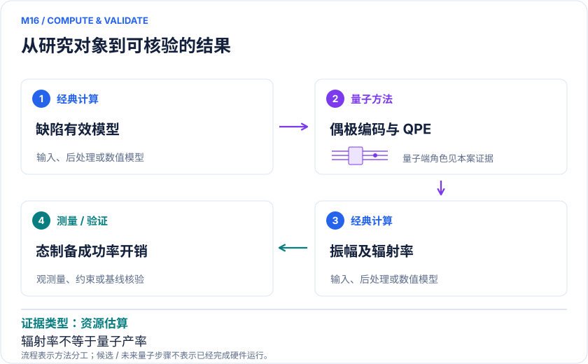

<!-- 由 release/tools/build_problems.py 自 tasks/M16-hbn-defect-emission/README.md 与 tasks/catalog.json 生成，勿手改 -->

# M16 · hBN 负硼空位：直接面向亮态与辐射发射率的容错算法

> 开放题 · 应用材料 · 二维缺陷与量子传感
> 难度：前沿（[分级说明](../../../starters/README.md#难度分级)） · 背景：量子化学

## 题面

| 环节 | 内容 |
|---|---|
| 研究体系 | 六方氮化硼团簇中的带负电硼空位V_B⁻ |
| 可观测量 | 光学活性激发态、／〈f／μ／i〉／²、跃迁频率与模型辐射发射率 |
| 经典基线 | QDET+FCI/多参考响应、合适TDDFT，以及实验PL/ODMR资料 |
| 量子方法的角色 | 偶极算符block encoding＋QPE，选择性采样具有较强跃迁振幅的态 |
| 研发决策 | 判断缺陷候选是否具有足够强的光学跃迁，并识别需要实验进一步检验的亮态。 |

## 基准输入

原文输入没有公开，也没有可直接运行的替代输入，解法需要自建模型并写明来源与哈希。下表只列出已知的公开材料。「原文」指作者或原论文公开的材料，「参照」指本项目参照运行自行冻结的选择。

| 项目 | 内容 | 出处 |
|---|---|---|
| 模型规模 | 原文最大活性空间 34 电子、18 空间轨道（两个空穴） | [原文](https://arxiv.org/html/2405.13115v1) |

**尚未公开或需注意：**有效一二体积分、三轴偶极算符与基态定义未公开；论文表 I 偶极列定义与寿命计算不一致。

## 什么算解

一份解法满足以下五点即可提交审核。负结果同样接受，只要过程可复现、结论有依据。

1. **模型对应**：说明所用模型或数据如何对应「六方氮化硼团簇中的带负电硼空位V_B⁻」，列出简化与近似。
2. **可观测量**：报告「光学活性激发态、|〈f|μ|i〉|²、跃迁频率与模型辐射发射率」，附单位与不确定度。
3. **经典对照**：在同一模型或数据上，与「QDET+FCI/多参考响应、合适TDDFT，以及实验PL/ODMR资料」中至少一种方法比较。
4. **可复现**：提供代码、环境、随机种子、输入来源与哈希，以及计算资源和成本；用到 QPU 时注明设备与 shots。
5. **研发决策**：说明结果能否支撑「判断缺陷候选是否具有足够强的光学跃迁，并识别需要实验进一步检验的亮态。」，以及还缺什么证据。

本题的细化标准欢迎在 issue 中讨论；被采纳的讨论结论会写入后续版本。

## 现有参照

本项目已有数值执行记录（经典计算机上的计算与模拟），供对照与复用，不代表最优解。

- 原应用目标：状态未记录
- 最新研究报告：[REFERENCE.md](REFERENCE.md)
- 其余证据指针见 evidence.json（本地证据，未随题库发布）

### 原案例说明

### M16 · hBN 负硼空位：直接面向亮态与辐射发射率的容错算法

<!-- VISUALS:START -->
#### 可视化导读

**图 1 · hBN 空位：优先寻找光学亮态。** 跃迁振幅决定亮态重要性。光学活性激发态、|〈f|μ|i〉|²、跃迁频率与模型辐射发射率。图形为依据本案文献重绘的概念关系，不表示实际原子坐标、实测曲线或数值比例。

**图 2 · 计算与验证路径。** 偶极算符block encoding＋QPE，选择性采样具有较强跃迁振幅的态。**证据边界：** 原文未计入完整基态制备和1/p₀重叠开销；资源分析不是硬件测量，辐射率也不是量子产率或ODMR对比度。

图解依据：[R1 · Simulating optically-active spin defects with a quantum computer](https://arxiv.org/html/2405.13115v1)；[R2 · Quantum simulations of materials on near-term quantum computers](https://arxiv.org/abs/2002.11173)。解释性连线与图形布局由本库整理，未复制论文原图。

[机制图 SVG](mechanism.svg) · [流程图 SVG](workflow.svg) · 机制图 PNG（本地证据，未随题库发布） · 流程图 PNG（本地证据，未随题库发布） · 图解说明 JSON（本地证据，未随题库发布）
<!-- VISUALS:END -->

> **算法按偶极跃迁强度选择光学活性态，比只按最低激发能筛选更贴近缺陷光学设计。**
>
> 编研日期：2026-10-04。证据类别：资源估算。建议优先级：重点储备（编辑判断）。本目录为文献研究与试点设计，没有执行所列量子、经典或材料实验。

#### 研发决策与价值

**要支持的决策：**判断缺陷候选是否具有足够强的光学跃迁，并识别需要实验进一步检验的亮态。

与M08/M09的差异在于直接计算光学强度。最低激发态可能是暗态，对量子发光或传感没有足够用处；因此把所有激发态等成本求出可能浪费资源。该算法将光学目标纳入初态与采样设计，适合讨论量子计算如何围绕研发观测量而不是总能量组织。

#### 物理系统与规模边界

- **系统：**六方氮化硼团簇中的带负电硼空位V_B⁻。
- **规模：**缺陷超胞经QDET降维；具体活性空间、辅助比特、纠错开销分层核算。
- **目标观测量：**光学活性激发态、|〈f|μ|i〉|²、跃迁频率与模型辐射发射率。

这里的规模以原文或docs规定的有限模型为准，不把完整样品、活性空间、系统量子比特、逻辑辅助比特及纠错物理比特混为一个数字。[R1]

#### docs 来源与本次扩展

- 量子计算问题库_飞书多维表格导入版.xlsx: 文献证据S12；问题库M29色心缺陷光学态与辐射性质
- 量子计算如何研究材料问题与药物研发_研究方法与应用综述.md: 缺陷与目标可观测量

这些文件提供问题线索；文中研究事实以本页可核验原始来源为准，下面的试点、比较和停止条件是本次提出的研究设计。

#### 数学与计算目标

首期同时计算跃迁能ωfi和偶极强度Sfi=|〈f|μ|i〉|²。在规定电磁环境与近似下，辐射率与ω³S相关；环境折射率、局域场和振动结构必须另行说明。实际PL量子产率还受到非辐射过程影响，因此“辐射跃迁强”只能作为筛选的一项必要条件。

#### 量子—经典工作流

**量子职责：**偶极算符block encoding＋QPE，选择性采样具有较强跃迁振幅的态。[R1]

经典建立缺陷几何、屏蔽有效哈密顿量与偶极算符，准备初始电子态；量子段施加偶极块编码并用QPE分辨响应态，经典统计概率、校正归一化并换算目标强度。输入的跃迁算符应与嵌入轨道一致，否则哈密顿量解得再准也会得到错误光学强度。

#### 已发表工作：实际完成了什么

2024 PRA论文构造亮态/辐射率容错算法，并对hBN负硼空位给出资源分析。[R1]

**证据限制：**原文未计入完整基态制备和1/p₀重叠开销；资源分析不是硬件测量，辐射率也不是量子产率或ODMR对比度。

“硬件演示”只代表原论文运行过所述有限任务；“资源估算”只代表给定算法与假设下的预算。两者都不能替代与强经典方法、真实实验和完整成本的比较。

#### 经典比较与资源核算

**建议基线：**QDET+FCI/多参考响应、合适TDDFT，以及实验PL/ODMR资料。

在小空间以FCI逐态谱作为真值，检验强度总和、暗态抑制及近简并态的聚合。在较大空间比较多参考响应，不仅比较能量。载入已知经典态和量子准备态的成本路线应分开；如果初态、偶极范数或成功概率很差，稀有亮态的采样可能抵消表面上的线路节约。

#### 可复现试点设计（建议，尚未执行）

输入：V_B⁻局域几何、荷电/自旋、嵌入h/v、三个方向偶极矩阵和目标光学能窗。步骤：①检查算符基与单位；②精确计算全部目标态；③模拟偶极加权采样与QPE分辨率；④扫描屏蔽与活性区，分解模型/采样/分辨误差。验收：对预设亮态集合的召回、强度误差和归一化正确，给出目标精度下总调用量。停止：亮暗判别随嵌入变化而不稳定、或非辐射通道主导而未建模时，不给器件性能结论。

交付时至少保留输入来源与版本、完整参数、原始/后处理结果、收敛轨迹、随机种子、实际计算成本和失败记录。验收阈值应在目标数据解盲前冻结；只有固定模型上的解达到标准，仍应单独标明模型到实验的剩余误差。

#### 解读与下一步

这是补齐资料库S12最直接的案例。它是hBN容错光学算法，不是NV六比特赛题，也不是已得到更长相干时间的材料发现；后续应与缺陷实验团队商定可核验的峰位和辐射寿命指标。

**最小下一步：**先冻结小缺陷模型和偶极矩阵，用精确对角化检验亮态采样概率。

#### 文献与读取范围

- **[R1] [Simulating optically-active spin defects with a quantum computer](https://arxiv.org/html/2405.13115v1)**（2024；期刊论文；读取层级 `full_text`）。支持：PRA110,032606；QDET、偶极block encoding、QPE、hBN资源。

- **[R2] [Quantum simulations of materials on near-term quantum computers](https://arxiv.org/abs/2002.11173)**（2020；期刊论文；读取层级 `abstract`）。支持：固体缺陷局域有效哈密顿量和经典/量子嵌入验证。

全文层级表示读到原始正文页面，不表示已逐项复算或完整审计全部补充材料；若页面转换缺失，已在来源说明或正文注明。摘要/检索摘录层级不支持未见的精确实验细节。相同工作的预印本与期刊版不计为独立复现。

## 如何提交

按 [CONTRIBUTING.md](../../../CONTRIBUTING.md) 把解法放在 `solutions/M16/<你的名字>-<短名>/`，格式见 [解法模板](../../../solutions/_template/SOLUTION.md)。被采纳的解法会按 [沉淀规则](../../../skills/README.md) 提炼为可复用的 skill。
