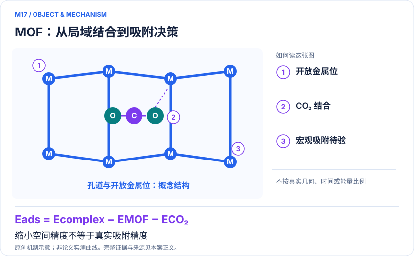
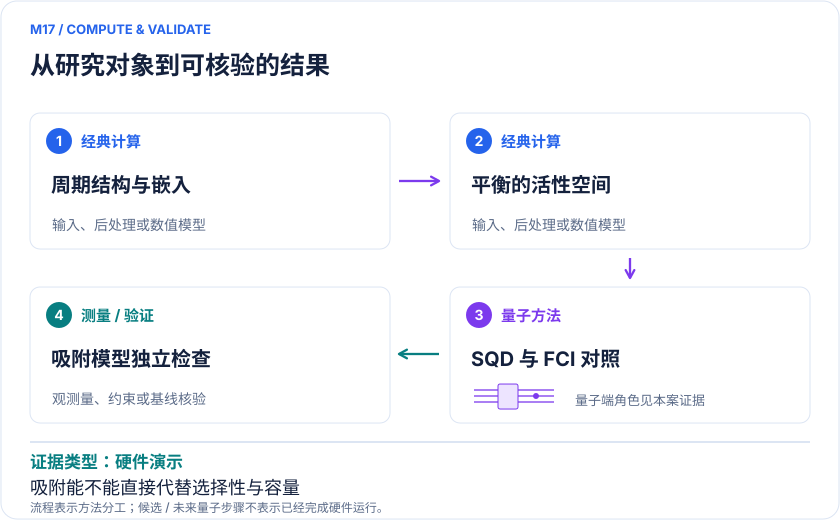

<!-- 由 release/tools/build_problems.py 自 tasks/M17-mof-carbon-capture/README.md 与 tasks/catalog.json 生成，勿手改 -->

# M17 · MOF 碳捕集：从开放金属位结合能到吸附剂筛选

> 开放题 · 应用材料 · 吸附分离与碳捕集
> 难度：进阶（[分级说明](../../../starters/README.md#难度分级)） · 背景：量子化学

## 题面

| 环节 | 内容 |
|---|---|
| 研究体系 | Fe-MOF-74开放Fe(II)位点上的CO₂吸附（周期晶胞，每晶胞一分子CO₂） |
| 可观测量 | 平衡活性空间中的吸附能及其关联能贡献随NO阈值的收敛，对照实验估计36.8 kJ/mol；误差向等温线和选择性的传播 |
| 经典基线 | 缩小空间同H FCI；平衡空间HF+MP2（作者VASP阈值阶梯，约28 kJ/mol）及CCSD(T)、DMRG或SHCI；Fe-MOF-74与Mg-MOF-74六种泛函的周期DFT吸附能；实验估计Fe 36.8、Mg 47.3 kJ/mol（已扣除零点能与热校正） |
| 量子方法的角色 | 周期Wannier与MP2自然轨道降维后，先在缩小空间做QNP采样与SQD（求解器测试）；下一级在论文表2中NO阈值1e-4及以上、三体系平衡的活性空间上用SQD或相位估计求关联能贡献 |
| 研发决策 | 识别值得进入湿气选择性和再生能耗验证的金属位点与配体方案。 |

## 基准输入

解法默认使用下列输入，以便与现有参照和其他解法直接比较；改用其他输入时请说明理由。「原文」指作者或原论文公开的材料，「参照」指本项目参照运行自行冻结的选择。

| 项目 | 内容 | 出处 |
|---|---|---|
| 求解器测试：缩小空间哈密顿量 | 作者公开三套 reduced Hamiltonian（CO₂ 4e4o、Fe-MOF-74 10e10o、Fe-MOF-74+CO₂ 14e14o）、周期配对结构与固定 QNP 参数，commit ad3c665；本项目参照运行已复现。子块直接截取积分，不含其余占据轨道的平均场 | [原文](https://github.com/qcware/quantum_simulation_MOF/tree/ad3c6658f3d32167b6c0462af2451e5b0e062c2a/fullci_reference_pyscf) |
| 求解器测试：作者 FCIDUMP | 同一 commit 的 `FCIDUMP.CO2/MOF/MOFCO2`（16e26o、22e40o、26e42o，即 52/80/84 比特），缩小空间按轨道编号从这里截取。它们是论文表 2 中阈值 1e-4 空间的再截断：只保留最高 8/11/13 个占据和最低 18/29/29 个虚轨道（表 2 为 8/23/31 个占据），论文正文没有描述这一层；三体系轨道不平衡，能量差不能直接作为吸附能 | [原文](https://github.com/qcware/quantum_simulation_MOF/tree/ad3c6658f3d32167b6c0462af2451e5b0e062c2a/fullci_reference_pyscf/singlet) |
| 第二级目标：平衡活性空间 | 论文表 2：三体系用同一 MP2 自然轨道阈值，占据与虚轨道数相加相等。阈值 1e-4 为 CO₂(16,62)、MOF(46,151)、CO₂@MOF(62,214)，1e-5 为 (16,116)、(46,300)、(62,418)。作者仓库 `active_space_generation_vasp/` 公开了各阈值的 VASP 输入与 MP2 输出，没有公开这一层的 FCIDUMP，需要按其 INCAR.fci 自行导出 | [原文](https://arxiv.org/html/2510.02550v1) |
| 经典对照：平衡空间 MP2 | 320 与 420 eV、阈值 1e-3 到 1e-7 的 `OUTCAR.mp2`；关联项在 320 eV 下为 0.160/9.17/10.1/10.2/10.5 kJ/mol，周期 HF 吸附能为 18.0（320 eV）、18.7（420 eV）kJ/mol，HF+MP2 约 28 kJ/mol | [原文](https://github.com/qcware/quantum_simulation_MOF/tree/ad3c6658f3d32167b6c0462af2451e5b0e062c2a/active_space_generation_vasp) |
| 经典对照：周期 DFT | Mg-MOF-74 与 Fe-MOF-74 的 VASP 输入和 OUTCAR，三体系各用 PBE-D3、vdW-DF2、SCAN-rVV10（这三种对 Fe 加 U = 4 eV）、HSE-D3、HSE-D3(BJ)、B3LYP-D3 计算，与论文表 1 逐项一致；Mg²⁺ 为闭壳层，用来区分泛函误差与 Fe 自旋问题 | [原文](https://github.com/qcware/quantum_simulation_MOF/tree/ad3c6658f3d32167b6c0462af2451e5b0e062c2a/Mg-MOF-74-vasp) |
| 实验锚点 | 论文表 1：Fe-MOF-74 36.8 kJ/mol、Mg-MOF-74 47.3 kJ/mol（Queen 等 2014 年低覆盖吸附热，已用 DFT 零点能与热校正换算为吸附能），Mg − Fe 为 10.5 kJ/mol；实验误差与校正误差未单独给出 | [原文](https://arxiv.org/html/2510.02550v1) |
| 论文 | arXiv:2510.02550v1，正式版 Digital Discovery | [原文](https://doi.org/10.1039/d6dd00023a) |

**尚未公开或需注意：**平衡空间（表 2）的 FCIDUMP 未公开，需自行导出；表 2 本身也是按 MP2 自然轨道阈值截断的结果，嵌入在 HF 中，不是完整周期体系。积分来自自旋限制 HF，只有单重态 FCIDUMP，Fe 高自旋与晶格磁序未纳入（三重态、五重态只有缩小空间，见论文 SI 表 S2）。Mg-MOF-74 只有 DFT，没有活性空间积分。计算值未含零点能与热校正，实验锚点的换算依赖 DFT 校正；等温线不在输入内。

## 什么算解

一份解法满足以下五点即可提交审核。负结果同样接受，只要过程可复现、结论有依据。

1. **模型对应**：说明所用模型或数据如何对应「Fe-MOF-74开放Fe(II)位点上的CO₂吸附（周期晶胞，每晶胞一分子CO₂）」，列出简化与近似。
2. **可观测量**：报告「平衡活性空间中的吸附能及其关联能贡献随NO阈值的收敛，对照实验估计36.8 kJ/mol；误差向等温线和选择性的传播」，附单位与不确定度。
3. **经典对照**：在同一模型或数据上，与「缩小空间同H FCI；平衡空间HF+MP2（作者VASP阈值阶梯，约28 kJ/mol）及CCSD(T)、DMRG或SHCI；Fe-MOF-74与Mg-MOF-74六种泛函的周期DFT吸附能；实验估计Fe 36.8、Mg 47.3 kJ/mol（已扣除零点能与热校正）」中至少一种方法比较。
4. **可复现**：提供代码、环境、随机种子、输入来源与哈希，以及计算资源和成本；用到 QPU 时注明设备与 shots。
5. **研发决策**：说明结果能否支撑「识别值得进入湿气选择性和再生能耗验证的金属位点与配体方案。」，以及还缺什么证据。

本题的细化标准欢迎在 issue 中讨论；被采纳的讨论结论会写入后续版本。

## 现有参照

本项目已有数值执行记录（经典计算机上的计算与模拟），供对照与复用，不代表最优解。

- 原应用目标：未完成（incomplete）
- 最新研究报告：[REFERENCE.md](REFERENCE.md)
- 其余证据指针见 evidence.json（本地证据，未随题库发布）

### 原案例说明

### M17 · MOF 碳捕集：从开放金属位结合能到吸附剂筛选

<!-- VISUALS:START -->
#### 可视化导读

**图 1 · MOF：从局域结合到吸附决策。** 缩小空间精度不等于真实吸附精度。固定模型吸附能、关联能贡献、误差向等温线和选择性的传播。图形为依据本案文献重绘的概念关系，不表示实际原子坐标、实测曲线或数值比例。

**图 2 · 计算与验证路径。** DMET/VQE或周期Wannier降维后的QNP采样与SQD求解局域关联能。**证据边界：** 强截断空间不预期定量准确；恢复需要经典计算，水竞争和再生循环未由量子任务验证。

图解依据：[R1 · Quantum simulation of carbon capture in periodic metal-organic frameworks](https://arxiv.org/html/2510.02550v1)；[R2 · Modelling carbon capture on metal-organic frameworks with quantum computing](https://link.springer.com/article/10.1140/epjqt/s40507-022-00155-w)；[R3 · Ab initio carbon capture in open-site metal–organic frameworks](https://www.nature.com/articles/nchem.1432)；[R4 · Quantum simulation of CO2 chemisorption in an amine-functionalized metal-organic framework](https://arxiv.org/abs/2504.17453v2)。解释性连线与图形布局由本库整理，未复制论文原图。

[机制图 SVG](mechanism.svg) · [流程图 SVG](workflow.svg) · 机制图 PNG（本地证据，未随题库发布） · 流程图 PNG（本地证据，未随题库发布） · 图解说明 JSON（本地证据，未随题库发布）
<!-- VISUALS:END -->

> Fe-MOF-74 的 28 比特 SQD 演示在缩小活性空间内接近 FCI；尚非定量预测真实吸附容量。
>
> 编研日期：2026-10-04。第二轮扩展；证据类别：硬件演示；优先级：近期验证（编辑判断）。本目录为文献整理与建议试点，没有执行量子、经典或材料实验。

#### 研发决策与价值

碳捕集材料需要在结合足够强、可以低代价再生、对水和氮气具有选择性之间取得平衡。本案建议把量子任务放在“局域结合能是否改变候选排序”的位置：先用成熟经典流程筛选，再对误差可能改变决策的金属位点做高层校正。仅比较某一总能量更低，不能回答一吨材料可以循环捕集多少碳。

#### 物理系统、规模与原文结果

R1研究Fe-MOF-74，使用周期平面波结构、Wannier轨道及MP2自然轨道降维，再取更小空间执行量子任务。20/28比特的ibm_torino采样经过SQD配置恢复后，相对同空间FCI的总能误差分别为0.42/0.28 kJ/mol；这是求解器验证。作者明确指出硬件缩小空间并不预期产生定量准确的物理吸附能，且恢复消耗经典计算。[R1]

R2在Al-fumarate上建立DMET分片与VQE流程；硬件噪声部分是仿真。R4采用胺功能化MOF的分子类似物，v2空间为(6e,6o)、(8e,8o)、(10e,10o)，对应12、16、20比特，全部是GPU量子电路模拟；结合能会受两端相关能恢复不平衡影响。[R2,R4] 这两篇只作方法背景，不把更换金属、配体或求解器算成新案例。

#### 题面范围与两级量子任务（2026-10-28 收窄，同日按论文逐项对照修订）

研究体系收窄为Fe-MOF-74开放Fe(II)位点上的CO₂吸附，以R1作者仓库（qcware/quantum_simulation_MOF，commit ad3c665）的公开输入为唯一基准。Al-fumarate与胺功能化MOF不再属于本题体系。

第一级是作者的缩小空间4e4o/10e10o/14e14o（8/20/28比特），本项目参照运行已复现原QNP线路与同H FCI。它只作求解器测试：论文称其不是物理上严格的子空间、不预期定量准确；作者脚本截取子块时也没有保留其余占据轨道的平均场，按标准冻结芯方式补上后，同一组轨道的FCI吸附能从−43.4变为+32 kJ/mol（不结合）。

作者仓库另有三份FCIDUMP：CO₂ 16e26o、Fe-MOF-74 22e40o（冻结142个轨道）、Fe-MOF-74+CO₂ 26e42o（冻结148个轨道），对应52/80/84比特，缩小空间就是按轨道编号从这里截取的。但这三份FCIDUMP本身是论文表2中NO阈值1e-4空间的再截断：只保留最高8/11/13个占据和最低18/29/29个虚轨道，而表2中三体系为8/23/31个占据，论文正文没有描述这一层。它们的轨道在三体系之间不平衡，能量差不能直接作为吸附能：即使把占据数和虚轨道数对齐，CCSD(T)结合能仍随虚轨道的分法在+139到−69 kJ/mol之间变化。因此它们也只作求解器测试。

第二级目标改为论文表2的平衡活性空间：三体系用同一MP2自然轨道阈值，占据与虚轨道数相加相等，能量差中的截断误差相互抵消。阈值1e-4为CO₂(16,62)、MOF(46,151)、CO₂@MOF(62,214)，即124/302/428比特；1e-5为(16,116)、(46,300)、(62,418)。作者公开了各阈值的VASP输入与MP2输出，没有公开这一层的FCIDUMP，需要按其INCAR.fci自行导出。现有的平衡参照是HF+MP2：关联项在320 eV下随阈值为0.160/9.17/10.1/10.2/10.5 kJ/mol，周期HF吸附能18.0（320 eV）/18.7（420 eV）kJ/mol，合计约28 kJ/mol。下一步先在平衡空间建立CCSD(T)、DMRG或SHCI参照，再判断SQD或相位估计能否在数百比特规模改进三体系关联能之差。平衡空间仍是MP2自然轨道按阈值截断、嵌入在HF中的结果，积分来自自旋限制HF，只有单重态，不能当作完整周期体系或Fe高自旋基态。

实验锚点取论文表1：Fe-MOF-74 36.8 kJ/mol、Mg-MOF-74 47.3 kJ/mol，来自Queen等2014年的低覆盖吸附热，已用DFT零点能（Fe 1.7、Mg 2.2 kJ/mol）与297 K热能（Fe 1.9、Mg 1.6 kJ/mol）校正换算为吸附能，可与E_ads直接比较；实验误差与校正误差没有单独给出。HF+MP2的约28 kJ/mol比实验弱约9 kJ/mol，论文把差距归因于MP2本身、只嵌入HF、可能需要更多原子的轨道和自旋限制。

经典对照使用同一仓库的周期DFT：Fe-MOF-74与Mg-MOF-74各有PBE-D3、vdW-DF2、SCAN-rVV10、HSE-D3、HSE-D3(BJ)、B3LYP-D3六套三体系计算，前三种对Fe的d轨道加U = 4 eV。本库从OUTCAR末步自由能按E(CO₂@MOF)−E(MOF)−E(CO₂)直接相减（每晶胞一分子CO₂，未含零点能与热校正），12个值与论文表1逐项一致到0.1 kJ/mol：Mg约−40.5至−60.0 kJ/mol，Fe约−31.0至−50.8 kJ/mol；每种泛函下Mg均比Fe结合更强，差4.7至10.1 kJ/mol，实验为10.5 kJ/mol。Mg²⁺为闭壳层，可以把泛函误差与Fe的自旋和磁序问题分开；Mg-MOF-74没有活性空间积分，只作DFT层面的对照。

#### docs 来源与去重判据

本案来自第二轮原始文献检索，沿用docs《量子计算如何研究材料问题与药物研发_研究方法与应用综述.md》的“观测量—决策”思路，但不声称docs已经列出这些论文。M01问CO₂变成甲醇的反应通道，本案问CO₂停留在孔道位点的可逆结合；M03问氧还原速率；M10问腐蚀稳定性。共同使用嵌入并不意味着应用重复。

#### 数学与计算目标

建议统一采用E_ads=E(CO₂@MOF)−E(MOF)−E(CO₂)，负值表示有利结合；引用采用正结合能的论文时必须转换符号。三项必须保持几何参考、基组、电子数及环境一致。若体系与吸附态分别选择自然轨道，应检查空间不平衡造成的误差，而不能只看到各自优化已收敛。真实比较还需区分冻结几何相互作用能、含结构弛豫的吸附能、零点能和有限温度吸附焓。

#### 量子—经典分工

建议的闭环分四层。经典周期计算生成孔道结构和吸附构型，记录磁序、色散泛函及几何误差；局域空间生成器保留金属d轨道、气体和关键配体；量子电路产生相关配置，经典SQD恢复并对角化；最后由经典统计力学把局域势能送入多位点吸附模型。量子电路既不直接装载整块多孔材料，也不替代气体混合物采样。

R3提供重要的经典应用基线：高层电子结构信息可以先变成力场，再连接蒙特卡洛吸附热力学。[R3] 因此需要同时比较“量子对同空间求解器的贡献”和“高层校正对吸附预测的贡献”。即使前者成功，若实验误差主要来自缺陷、水占位或孔道柔性，材料排序仍可能不变。

#### 强经典对照与误差预算

建议先建立三个参照：同一缩小哈密顿量的FCI用于分离硬件误差；更大空间的MP2、适用耦合簇和多参考嵌入用于检查截断；独立测得吸附焓或等温线用于检查材料模型。不能把纯DFT当作唯一竞争者，也不能把28比特Hilbert空间大当作经典不可解的证明。成本计入轨道生成、参数优化、测量、配置恢复、矩阵对角化和多构型次数。

#### 可执行试点（本库建议，尚未运行）

输入包应包含公开结构来源、净电荷和自旋、吸附位点坐标、三种空间规则、积分及核排斥常数、气体参考、每次采样的设备校准与随机种子。第一轮只选一个位点和一条结合曲线，加入远离位点的解离参照；不得一开始就把不同MOF的所有结构差异混入算法验证。

步骤为：①固定轨道后重现FCI曲线；②经典扩空间确定空间误差；③用相同电路分别执行理想模拟、噪声模拟和可用硬件；④比较直接后选择与配置恢复，并加同预算经典配置选择；⑤以局域势能校正经典吸附模型，报告候选排序是否改变。每步都保存原始与后处理结果，避免只保留最优随机批次。

验收应提前冻结：小空间求解达到预定误差、能差随空间扩大稳定、正负号和参考一致、候选排序对误差扰动稳健。停止条件包括空间误差超过候选差、磁序不确定、纯经典已以较小预算达到同等精度，或水竞争信息缺失而目标却是湿烟气分离。此时结果可保留为算法验证，不能升级为新吸附剂推荐。

#### 从局域能量到材料选择的验收接口

建议应用方先提供真正会改变筛选的门槛：例如两种候选的吸附热差，是否大于实验样品批间差和模型区间。然后对局域势能做有界扰动，检查干气排序与加入水竞争后的排序是否同时稳定。若只有单组分低覆盖能量可用，输出应明确写为“低覆盖局域结合参考”，不能直接生成工业烟气优选名次。吸附选择性、容量与再生代价应各自有数据字段；把三者合成总分前必须说明权重和条件，避免较强结合被自动等同于较好材料。

#### 解读与下一步

优先级“近期验证”指局域量子—经典接口可以审计，不表示近期具有工业量子优势。最小下一步是完成同位点三种空间的能差误差表；只有看到电子相关误差确实能改变筛选，才把工作推进到竞争气体与循环条件。

#### 文献与读取范围

- **[R1] [Quantum simulation of carbon capture in periodic metal-organic frameworks](https://arxiv.org/html/2510.02550v1)**（2026；期刊论文；读取层级 `full_text`）。支持：预印本2025全文，期刊2026；缩小空间QNP/SQD硬件和物理截断边界。DOI：10.1039/d6dd00023a。

- **[R2] [Modelling carbon capture on metal-organic frameworks with quantum computing](https://link.springer.com/article/10.1140/epjqt/s40507-022-00155-w)**（2022；期刊论文；读取层级 `full_text`）。支持：Al-fumarate DMET、VQE、噪声模拟而非真实硬件。DOI：10.1140/epjqt/s40507-022-00155-w。

- **[R3] [Ab initio carbon capture in open-site metal–organic frameworks](https://www.nature.com/articles/nchem.1432)**（2012；期刊论文；读取层级 `abstract`）。支持：高层电子结构导出力场并与吸附热力学联系的经典基线。DOI：10.1038/nchem.1432。

- **[R4] [Quantum simulation of CO2 chemisorption in an amine-functionalized metal-organic framework](https://arxiv.org/abs/2504.17453v2)**（2025；预印本；读取层级 `abstract`）。支持：v2为12/16/20比特GPU模拟；活性空间不平衡造成结合能变化。DOI：10.48550/arXiv.2504.17453。

## 如何提交

按 [CONTRIBUTING.md](../../../CONTRIBUTING.md) 把解法放在 `solutions/M17/<你的名字>-<短名>/`，格式见 [解法模板](../../../solutions/_template/SOLUTION.md)。被采纳的解法会按 [沉淀规则](../../../skills/README.md) 提炼为可复用的 skill。
