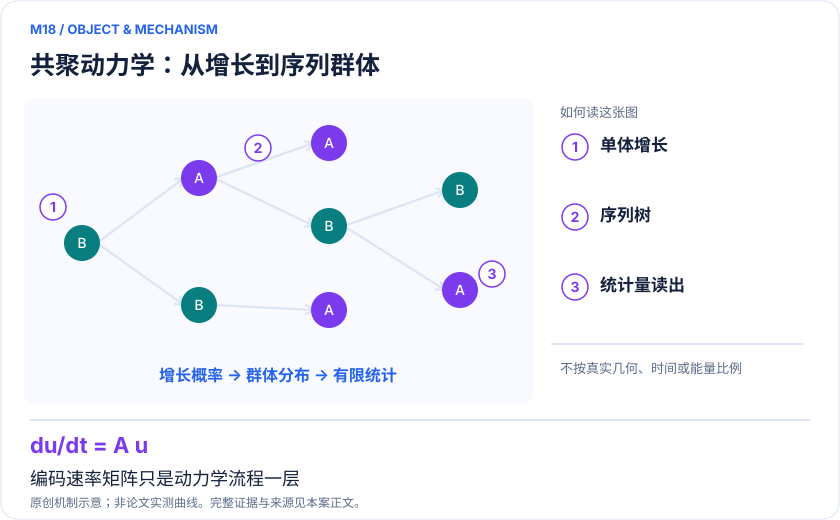
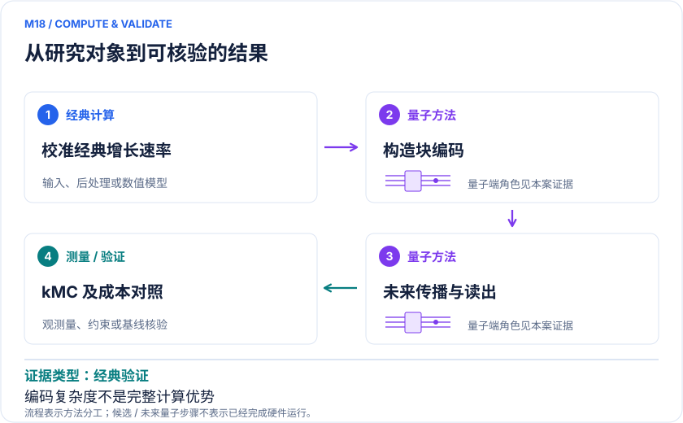

<!-- 由 release/tools/build_problems.py 自 tasks/M18-copolymerization-dynamics/README.md 与 tasks/catalog.json 生成，勿手改 -->

# M18 · 活性共聚动力学：保留单体序列的分子量分布模拟

> 开放题 · 应用材料 · 聚合物与反应动力学

## 题面

| 环节 | 内容 |
|---|---|
| 研究体系 | 单单体活性聚合与二单体配位共聚的序列分辨速率模型 |
| 可观测量 | 链长分布、指定序列/嵌段事件概率、分子量矩 |
| 经典基线 | 稀疏矩阵指数、解析活性聚合、kMC/Gillespie、矩方法和转移矩阵 |
| 量子方法的角色 | 将非幺正稀疏速率矩阵嵌入量子电路，为ODE求解提供oracle |
| 研发决策 | 比较给定反应性比和进料条件下聚合物更接近随机还是嵌段序列。 |

## 基准输入

原文输入没有完全公开。下表是参照运行实际使用的替代输入，解法可以沿用以便直接比较；取得原文输入或改用其他输入时请说明理由。「原文」指作者或原论文公开的材料，「参照」指本项目参照运行自行冻结的选择。

| 项目 | 内容 | 出处 |
|---|---|---|
| 模型 | 原文公开的 Model B 速率模型 | [原文](https://arxiv.org/html/2609.08432v1) |
| 参照所用截断 | N=8：催化剂、全部长度 1/2 物种及首个长度 3 物种 | 参照 |

**尚未公开或需注意：**更长链与真实聚合条件下的速率参数未整理。

## 什么算解

一份解法满足以下五点即可提交审核。负结果同样接受，只要过程可复现、结论有依据。

1. **模型对应**：说明所用模型或数据如何对应「单单体活性聚合与二单体配位共聚的序列分辨速率模型」，列出简化与近似。
2. **可观测量**：报告「链长分布、指定序列/嵌段事件概率、分子量矩」，附单位与不确定度。
3. **经典对照**：在同一模型或数据上，与「稀疏矩阵指数、解析活性聚合、kMC/Gillespie、矩方法和转移矩阵」中至少一种方法比较。
4. **可复现**：提供代码、环境、随机种子、输入来源与哈希，以及计算资源和成本；用到 QPU 时注明设备与 shots。
5. **研发决策**：说明结果能否支撑「比较给定反应性比和进料条件下聚合物更接近随机还是嵌段序列。」，以及还缺什么证据。

本题的细化标准欢迎在 issue 中讨论；被采纳的讨论结论会写入后续版本。

## 现有参照

本项目已有数值执行记录（经典计算机上的计算与模拟），供对照与复用，不代表最优解。

- 原应用目标：未完成（incomplete）
- 最新研究报告：[REFERENCE.md](REFERENCE.md)
- 其余证据指针见 evidence.json（本地证据，未随题库发布）

### 原案例说明

### M18 · 活性共聚动力学：保留单体序列的分子量分布模拟

<!-- VISUALS:START -->
#### 可视化导读

**图 1 · 共聚动力学：从增长到序列群体。** 编码速率矩阵只是动力学流程一层。链长分布、指定序列/嵌段事件概率、分子量矩。图形为依据本案文献重绘的概念关系，不表示实际原子坐标、实测曲线或数值比例。

**图 2 · 计算与验证路径。** 将非幺正稀疏速率矩阵嵌入量子电路，为ODE求解提供oracle。**证据边界：** 恒定单体浓度和线性反应模型；制态、ODE查询、完整分布读出、终止/转移与非线性未端到端估算。

图解依据：[R1 · Explicit block encodings of rate matrices for simulating polymerization kinetics on quantum computers](https://arxiv.org/html/2609.08432v1)；[R2 · Random ethene/propene copolymerization from a catalyst system based on a “constrained geometry” half-sandwich complex](https://doi.org/10.1002/%28SICI%291521-3927%2819990401%2920%3A4%3C214%3A%3AAID-MARC214%3E3.0.CO%3B2-A)；[R3 · Exact stochastic simulation of coupled chemical reactions](https://pubs.acs.org/doi/10.1021/j100540a008)。解释性连线与图形布局由本库整理，未复制论文原图。

[机制图 SVG](mechanism.svg) · [流程图 SVG](workflow.svg) · 机制图 PNG（本地证据，未随题库发布） · 流程图 PNG（本地证据，未随题库发布） · 图解说明 JSON（本地证据，未随题库发布）
<!-- VISUALS:END -->

> 2026预印本给出活性聚合速率矩阵的显式量子block encoding，验证短链数值演化；完整求解和读出成本尚待补齐。
>
> 编研日期：2026-10-04。第二轮扩展；证据类别：经典验证；优先级：重点储备（编辑判断）。本目录为文献整理与建议试点，没有执行量子、经典或材料实验。

#### 研发决策与价值

聚合物材料的性质不仅取决于平均单体组成，还取决于链长和单体排列。本案面向“同样总体配比，产生的链更随机还是更成段”的计算决策。建议的应用入口是比较已测或已校准反应性比的候选，而不是让量子算法凭空预测聚合催化剂的全部反应速率。它为配方与工艺筛选提供分布层的信息，价值成立的条件是这些细节确实影响拟优化的材料属性。

#### 研究对象与直接证据

R1于2026年9月提交。作者为单单体活性聚合及双单体共聚速率矩阵构造稀疏oracle与LCU电路，验证短链数值演化和编码矩阵；未执行工业聚合硬件实验。所报约10³系统比特、10⁴–10⁵门是编码层资源，不能写成完整动力学计算总成本。该模型固定单体浓度、使用线性一阶反应，后续求解器查询、制态和分布读出尚未端到端计入。[R1]

R2是乙烯/丙烯共聚的原始实验研究，其出版社检索摘要给出接近随机分布的反应性比。它提供真实化学参数来源，不是量子方法的独立优势证明；直接文章打开失败，本次未审核全部实验细节。[R2] R3给出经典随机模拟的基础原始方法，可作为轨迹级对照入口。[R3]

#### docs 来源与新颖性

本案由第二轮检索补充。docs的化学反应工作流为问题拆解提供背景，但该2026预印本是新增来源。与B10短肽折叠的优化变量不同，这里每个状态表示已经生成的一条聚合物序列；与C09晶体搜索不同，这里计算的是时间依赖的群体分布；与M14振动态传播不同，这里传播的是经典化学速率方程的浓度向量。不能因为都使用量子态编码就合并问题。

#### 计算目标与输出约定

核心模型为du/dt=A u，u含每个序列的浓度，A是由增长反应构造的非对称速率矩阵。量子电路嵌入A/α而不是直接把化学反应当幺正演化。必须同时保存浓度总量、归一化状态与浓度恢复因子；量子测量所得振幅平方不能未经转换就当作原始浓度。

建议首期只要求两个可用观测量：链长超过阈值的质量比例，以及含至少一段指定长度同单体序列的比例。若用户只要数均和重均分子量，应先使用矩方法；要求输出指数多个序列的完整列表，会失去紧凑量子编码带来的存储好处。这是任务规格选择，不是把读出成本藏进后处理。

#### 量子—经典工作流

建议由经典系统读取四个增长速率与固定进料浓度，生成截断状态映射和边界漏出规则；编译器利用序列树结构构造稀疏oracle或LCU；选定量子微分方程算法传播；最终只估计冻结的事件或低阶矩。单次编码正确不意味着传播正确，传播正确也不意味着分布统计能经济读出，三层需分别验收。

反应性比及其误差来自实验或独立动力学拟合。量子算法不能补偿错误的终端模型，也不能从增长过程自动得到熔点、模量或生物相容性。若要判断材料性能，序列分布应继续传入经验证的结构—性能模型，此部分属于独立验证链。

#### 强经典基线与资源

小系统使用稀疏矩阵指数或高精度ODE作精确参照，单单体模型增加解析分布核对。大系统使用保留完整序列的kMC、矩方法以及适用的转移矩阵或生成函数。尤其是二元终端模型，指数多的序列名目不一定带来指数计算难度；若目标是有限个统计量，经典算法可能直接求得。需要比较相同输出、置信区间和墙钟，而不是比较“显式枚举所有链”的人为低效基线。

资源表应同时包含编码门数、求解器查询次数、演化时间、截断误差、条件数/稳定性因子、成功概率、振幅估计或抽样读出、容错物理开销。电路规模的外推只有在这些项完整时才可转化为实际吞吐。

#### 可执行试点与停止条件（建议，未运行）

输入需要速率常数及单位、单体浓度、初始活性链数、末端依赖规则、链长上限、演化时刻、目标观测量和参数不确定度。先设计一个近随机参数组和一个成段偏好组，两组仅用于算法验证，不声称预测了新聚合材料。

步骤：①检查速率矩阵每列守恒及截断边界；②对小矩阵直接重建量子编码块；③同一初态比较经典指数传播与量子模拟；④计算两个冻结事件并检验归一化恢复；⑤把链长增大，比较稀疏ODE、kMC和简化统计算法的实际成本；⑥若仍有缺口，才构建容错资源预算。

验收建议采用预注册绝对概率误差和归一化误差，同时要求预测的随机/成段判断不被速率参数误差推翻。若上边界漏出不可忽略、单体消耗令线性模型失效、目标统计已有廉价闭式解，或读出主导总成本，应停止扩大量子规模。保留负结果可以防止把数学编码压缩误读为材料研发加速。

#### 解读与下一步

这是一项新的聚合反应网络接口，证据成熟度低于直接电子结构硬件演示。下一步优先形成可比较的事件统计基准，而不是寻找最大比特数；待加入转移、终止或非恒定浓度后，应重新判断模型是否仍适用。

#### 文献与读取范围

- **[R1] [Explicit block encodings of rate matrices for simulating polymerization kinetics on quantum computers](https://arxiv.org/html/2609.08432v1)**（2026；预印本；读取层级 `full_text`）。支持：2026-09-08；单体与二元活性聚合编码、数值验证及未完成端到端成本。DOI：10.48550/arXiv.2609.08432。

- **[R2] [Random ethene/propene copolymerization from a catalyst system based on a “constrained geometry” half-sandwich complex](https://doi.org/10.1002/%28SICI%291521-3927%2819990401%2920%3A4%3C214%3A%3AAID-MARC214%3E3.0.CO%3B2-A)**（1999；期刊论文；读取层级 `search_excerpt`）。支持：出版社检索摘要核验实验反应性比；直接打开失败，未读全文。DOI：10.1002/(SICI)1521-3927(19990401)20:4<214::AID-MARC214>3.0.CO;2-A。

- **[R3] [Exact stochastic simulation of coupled chemical reactions](https://pubs.acs.org/doi/10.1021/j100540a008)**（1977；期刊论文；读取层级 `search_excerpt`）。支持：经典随机反应轨迹原始基线；出版社检索核验，公开PDF打开超时。DOI：10.1021/j100540a008。

## 如何提交

按 [CONTRIBUTING.md](../../../CONTRIBUTING.md) 把解法放在 `solutions/M18/<你的名字>-<短名>/`，格式见 [解法模板](../../../solutions/_template/SOLUTION.md)。被采纳的解法会按 [沉淀规则](../../../skills/README.md) 提炼为可复用的 skill。
