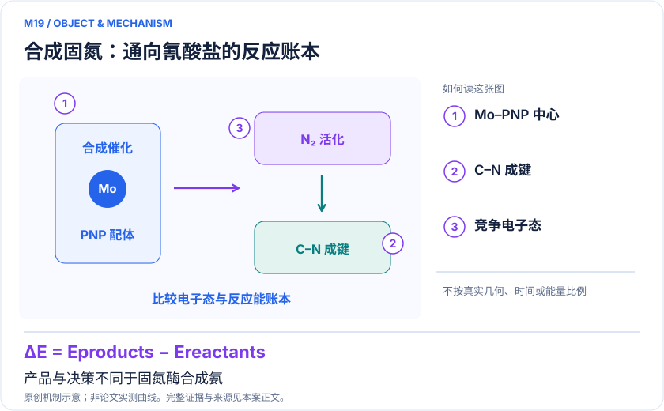
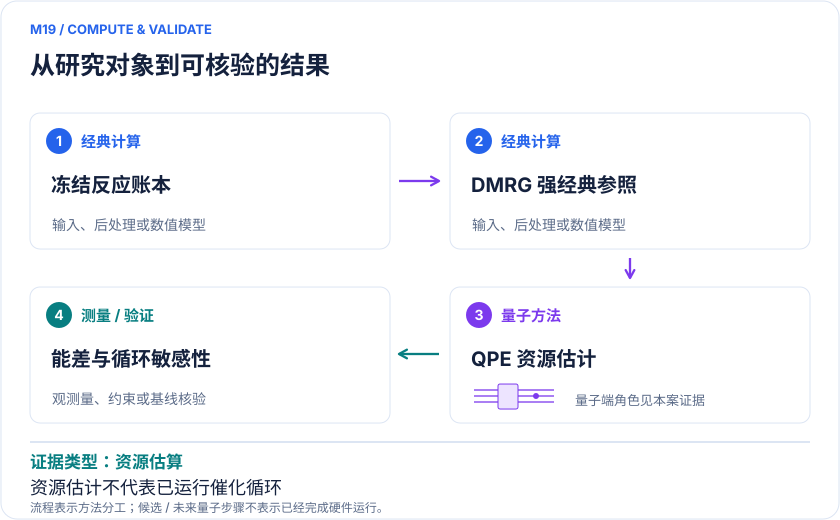

<!-- 由 release/tools/build_problems.py 自 tasks/M19-dinitrogen-cyanate-catalysis/README.md 与 tasks/catalog.json 生成，勿手改 -->

# M19 · 合成固氮到氰酸根：钼钳形配合物的竞争自旋与反应能

> 开放题 · 应用材料 · 工业均相催化
> 难度：进阶（[分级说明](../../../starters/README.md#难度分级)） · 背景：量子化学

## 题面

| 环节 | 内容 |
|---|---|
| 研究体系 | PNP钳形配体钼配合物生成氰酸根的两个关键步骤 |
| 可观测量 | 反应物、过渡态、产物的相对能和不同自旋态能差 |
| 经典基线 | 同空间DMRG、收敛多参考计算；独立DFT溶剂热校正及实验反应机制 |
| 量子方法的角色 | AVAS活性空间与双因子化QPE能量估计，结合初态和容错资源模型 |
| 研发决策 | 判断钼钳形配体及还原步骤的电子结构校正是否改变C–N成键和产物释放通道排序。 |

## 基准输入

原文输入没有完全公开。下表是参照运行实际使用的替代输入，解法可以沿用以便直接比较；取得原文输入或改用其他输入时请说明理由。「原文」指作者或原论文公开的材料，「参照」指本项目参照运行自行冻结的选择。

| 项目 | 内容 | 出处 |
|---|---|---|
| 几何 | RC、TS、PC 三点的公开 87 原子坐标（原文 SI 与 qb-gsee-benchmark 问题实例） | [原文](https://github.com/isi-usc-edu/qb-gsee-benchmark/tree/a196aebd624420311872d22da62734c7960a9e54) |
| 论文 | arXiv:2406.06335 | [原文](https://arxiv.org/abs/2406.06335v1) |
| 参照所用模型 | 真空、电荷 0、单重态；Mo/I/Cl 用 def2-SVP（Mo、I 带 ECP），其余 6-31G(d)，683 AO、344 电子；AVAS 选 44e31o | 参照 |

**尚未公开或需注意：**原基准 UUID 对应的积分未取得，参照模型与原模型的一致性未闭合；溶剂与活性空间收敛未处理。

## 什么算解

一份解法满足以下五点即可提交审核。负结果同样接受，只要过程可复现、结论有依据。

1. **模型对应**：说明所用模型或数据如何对应「PNP钳形配体钼配合物生成氰酸根的两个关键步骤」，列出简化与近似。
2. **可观测量**：报告「反应物、过渡态、产物的相对能和不同自旋态能差」，附单位与不确定度。
3. **经典对照**：在同一模型或数据上，与「同空间DMRG、收敛多参考计算；独立DFT溶剂热校正及实验反应机制」中至少一种方法比较。
4. **可复现**：提供代码、环境、随机种子、输入来源与哈希，以及计算资源和成本；用到 QPU 时注明设备与 shots。
5. **研发决策**：说明结果能否支撑「判断钼钳形配体及还原步骤的电子结构校正是否改变C–N成键和产物释放通道排序。」，以及还缺什么证据。

本题的细化标准欢迎在 issue 中讨论；被采纳的讨论结论会写入后续版本。

## 现有参照

本项目已有数值执行记录（经典计算机上的计算与模拟），供对照与复用，不代表最优解。

- 原应用目标：状态未记录
- 最新研究报告：[REFERENCE.md](REFERENCE.md)
- 其余证据指针见 evidence.json（本地证据，未随题库发布）

### 原案例说明

### M19 · 合成固氮到氰酸根：钼钳形配合物的竞争自旋与反应能

<!-- VISUALS:START -->
#### 可视化导读

**图 1 · 合成固氮：通向氰酸盐的反应账本。** 产品与决策不同于固氮酶合成氨。反应物、过渡态、产物的相对能和不同自旋态能差。图形为依据本案文献重绘的概念关系，不表示实际原子坐标、实测曲线或数值比例。

**图 2 · 计算与验证路径。** AVAS活性空间与双因子化QPE能量估计，结合初态和容错资源模型。**证据边界：** 初态、活性空间与动力学假设影响预算；电子能不能独立证明自旋交叉速率或催化周转。

图解依据：[R1 · Feasibility of accelerating homogeneous catalyst discovery with fault-tolerant quantum computers](https://arxiv.org/html/2406.06335v1)；[R2 · Direct synthesis of cyanate anion from dinitrogen catalysed by molybdenum complexes bearing pincer-type ligand](https://pmc.ncbi.nlm.nih.gov/articles/PMC9592615/)。解释性连线与图形布局由本库整理，未复制论文原图。

[机制图 SVG](mechanism.svg) · [流程图 SVG](workflow.svg) · 机制图 PNG（本地证据，未随题库发布） · 流程图 PNG（本地证据，未随题库发布） · 图解说明 JSON（本地证据，未随题库发布）
<!-- VISUALS:END -->

> 容错研究把已实验建立的N₂到NCO⁻循环转为明确能量任务，并与DMRG成本比较。
>
> 编研日期：2026-10-04。第二轮扩展；证据类别：资源估算；优先级：重点储备（编辑判断）。本目录为文献整理与建议试点，没有执行量子、经典或材料实验。

#### 研发决策与价值

本案把固氮的目标从氨扩展到可形成C–N键的含氮化学原料。拟支持的决策是：钼配合物的配体和氧化还原状态改变后，哪一步真正阻碍产物形成，是否需要更昂贵的电子相关计算才能区分机制。近期价值在于把催化循环拆成能够审计的能量差与成本问题，而不是直接推荐一种新工业生产工艺。

#### 物理对象及原始证据

R2报告PNP钳形配体钼配合物介导、并进一步催化N₂生成氰酸根的实验体系，结合经典机理计算。R1选择其中两个步骤，把反应物、过渡态及产物转成量子能量估计实例；大空间包含例如101电子75轨道的物种。其氰酸根任务预算约139000 QPU-hours，对应DMRG估算约400000 CPU-hours，均是模型下的成本分析，单位不同，不能直接相除宣称加速。[R1,R2]

原文另含Schrock和双钼合成氨例子。本案仅把它们视为同一研究的背景，不另建三个案例；重点保留NCO⁻这一产品和伴随C–N成键、还原断键与自旋变化的新决策。没有量子硬件测得真实催化周转，也没有由量子计算发现并实验验证更优配体。

#### docs 来源与现有案例的差别

第二轮检索从工业均相催化出发补充原文，docs《量子计算与量子模拟研究生物和化学反应.md》提供反应路径与速率的总体问题框架。B01的FeMoco是酶活性中心及生物合成氨；M01是Ru催化CO₂转化；M13是手性催化的逻辑比特验证。本案对象、产物和研发动作均不同，不以“也用了QPE”作为重复理由，也不把同一固氮论文的每个中间体算成新案例。

#### 数学目标与反应路径闭包

建议先冻结一个步骤，定义ΔE_rxn=E_P−E_R和ΔE‡=E_TS−E_R。若一侧的还原态多一个电子，必须给出电子或还原剂参考；若产物释放一个离子，必须把该离子计入能量账本。不同自旋态各自收敛后才能比较，不能通过直接拼接最低总能生成一条假想绝热路径。

化学决策往往需要自由能而非电子能。建议把几何、振动、溶剂和标准态校正单独列出，再检查电子核的改进是否大于其余误差。对双重态与四重态的交叉，至少需要交叉区域和耦合信息；只算两条曲线的最低点并不足以声称自旋翻转速率已预测。

#### 量子—经典工作流

经典计算负责结构和候选机制生成，按统一规则建立AVAS空间并输出积分；收敛DMRG生成强经典参照并可提供候选初态；QPE在固定有效哈密顿量内估能；经典热化学与微观动力学把能差连接回循环判断。容错层再把逻辑电路转为物理资源，记录门误差、纠错周期、魔法态吞吐和失败概率。

这一分工要求将“原始化学体系”与“提交给QPE的模型”分别存档。完整配体可能通过几何和静电影响反应，即使量子空间只保留部分轨道，也应验证配体截断不会改变通道排序。可以先用小空间检验算法，但不能把小空间的毫Hartree精度直接解释为完整配体的化学精度。

#### 强经典比较与预算公平性

R1本身包含DMRG比较，说明“过渡金属复杂”不足以证明经典失效。[R1] 建议按bond dimension、轨道排序和弃权重外推建立DMRG收敛证据，辅以适用多参考扰动或选态CI，单参考区域同时检查耦合簇。若能差已经收敛且成本可接受，应使用经典结果完成当前化学判断。

QPE预算要计入基态重叠、重复制备、全部物种和全部竞争自旋，不只取最便宜单点。不同CPU型号、并行效率、QPU物理假设和队列开销都应记录。原论文对经济效用的建模不是已实现的收益或当前采购报价；本案只把它作为选择高价值能量任务的示例。

#### 可复现试点（建议，尚未执行）

输入至少包含R/TS/P坐标及频率、总电荷和多重度、基组与赝势、完整配体和截断对照、溶剂模型、标准态、原子到活性轨道映射、电子/离子参考和积分校验值。反应物组合方式要固定，防止碎片和超分子描述混用。

执行顺序为：①核对原论文结构和化学计量；②在小空间用FCI或充分收敛DMRG验证各态；③统一轨道选择逐步扩空间；④将同一哈密顿量送入资源估计器；⑤把能差误差传播到竞争路径和敏感性分析；⑥分别列出可作机制结论与仍需实验的部分。所有步骤保存失败态、轨道占据和自旋诊断。

验收应要求相对能对空间扩展、轨道排序和溶剂扰动稳定，过渡态身份及反应连接正确，并且资源预算覆盖整个决策。若方法改变了态身份、不同自旋无法可靠关联、配体截断改变排序，或非电子误差足以淹没校正，应暂停量子规模扩展。若经典已解决目标问题，则把结果归为经典基线成功，保持研究结论真实。

#### 反应账本的独立核对

建议把每个物种的原子总数、电荷和电子数列成可机器检查的表。反应物和产物必须在总体系层面守恒；外加还原剂和离子不能在一端遗漏。对于配体改造后的比较，先建立同构的轨道与自旋标签，再将几何效应、电子效应和溶剂效应分开报告。这样才能回答改造究竟改善了哪一步，而不是只得到几个不可直接比较的绝对总能量。若两个方法给出的反应身份不同，先解决态对应问题，再解释能差。

#### 解读与下一步

这是具有直接实验化学锚点的容错储备任务，适合用于规划何种能量核值得未来QPU。下一步应先交付一个完整反应步骤的输入闭包与经典误差条，而非直接接受资源估算中的经济收益。

#### 文献与读取范围

- **[R1] [Feasibility of accelerating homogeneous catalyst discovery with fault-tolerant quantum computers](https://arxiv.org/html/2406.06335v1)**（2024；预印本；读取层级 `full_text`）。支持：三组合成固氮任务、氰酸根子任务活性空间和QPE/DMRG预算。DOI：10.48550/arXiv.2406.06335。

- **[R2] [Direct synthesis of cyanate anion from dinitrogen catalysed by molybdenum complexes bearing pincer-type ligand](https://pmc.ncbi.nlm.nih.gov/articles/PMC9592615/)**（2022；期刊论文；读取层级 `full_text`）。支持：实验建立钼PNP介导的氰酸根循环，结合经典反应机制。DOI：10.1038/s41467-022-33809-5。

## 如何提交

按 [CONTRIBUTING.md](../../../CONTRIBUTING.md) 把解法放在 `solutions/M19/<你的名字>-<短名>/`，格式见 [解法模板](../../../solutions/_template/SOLUTION.md)。被采纳的解法会按 [沉淀规则](../../../skills/README.md) 提炼为可复用的 skill。
