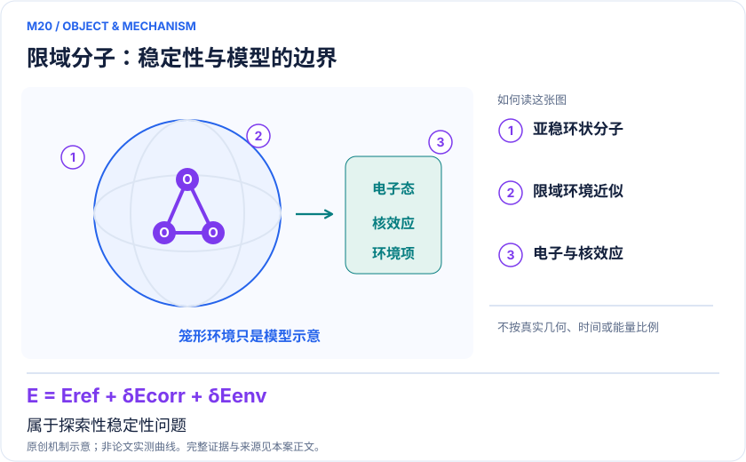
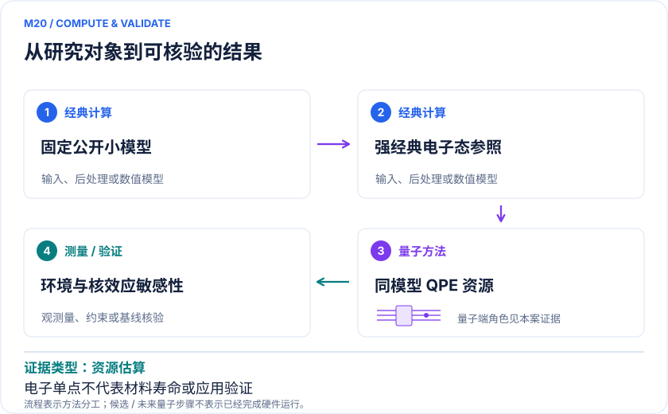

<!-- 由 release/tools/build_problems.py 自 tasks/M20-confined-cyclic-ozone/README.md 与 tasks/catalog.json 生成，勿手改 -->

# M20 · 富勒烯限域环状臭氧：分子稳定性与容错计算可行性

> 开放题 · 应用材料 · 限域分子与亚稳材料

## 题面

| 环节 | 内容 |
|---|---|
| 研究体系 | 富勒烯环境中的环状/开链臭氧及局域嵌入模型 |
| 可观测量 | 固定模型相对电子能、模型偏差与计算成本；材料稳定性仍需额外动力学证据 |
| 经典基线 | SHCI、CASSCF/MRCI与多层嵌入及经典核动力学；环境结构误差独立评估 |
| 量子方法的角色 | 双因子化或双平面波QPE资源估算，为经典稳定性模型提供电子能校正 |
| 研发决策 | 判断限域分子稳定性问题是否值得高层电子结构校正，以及容错成本是否可承受。 |

## 什么算解

一份解法满足以下五点即可提交审核。负结果同样接受，只要过程可复现、结论有依据。

1. **模型对应**：说明所用模型或数据如何对应「富勒烯环境中的环状/开链臭氧及局域嵌入模型」，列出简化与近似。
2. **可观测量**：报告「固定模型相对电子能、模型偏差与计算成本；材料稳定性仍需额外动力学证据」，附单位与不确定度。
3. **经典对照**：在同一模型或数据上，与「SHCI、CASSCF/MRCI与多层嵌入及经典核动力学；环境结构误差独立评估」中至少一种方法比较。
4. **可复现**：提供代码、环境、随机种子、输入来源与哈希，以及计算资源和成本；用到 QPU 时注明设备与 shots。
5. **研发决策**：说明结果能否支撑「判断限域分子稳定性问题是否值得高层电子结构校正，以及容错成本是否可承受。」，以及还缺什么证据。

本题的细化标准欢迎在 issue 中讨论；被采纳的讨论结论会写入后续版本。

## 现有参照

本项目已有数值执行记录（经典计算机上的计算与模拟），供对照与复用，不代表最优解。

- 原应用目标：未完成（incomplete）
- 最新研究报告：[REFERENCE.md](REFERENCE.md)
- 其余证据指针见 evidence.json（本地证据，未随题库发布）

### 原案例说明

### M20 · 富勒烯限域环状臭氧：分子稳定性与容错计算可行性

<!-- VISUALS:START -->
#### 可视化导读

**图 1 · 限域分子：稳定性与模型的边界。** 属于探索性稳定性问题。固定模型相对电子能、模型偏差与计算成本；材料稳定性仍需额外动力学证据。图形为依据本案文献重绘的概念关系，不表示实际原子坐标、实测曲线或数值比例。

**图 2 · 计算与验证路径。** 双因子化或双平面波QPE资源估算，为经典稳定性模型提供电子能校正。**证据边界：** 应用价值属远期假设；高精度单点不等于寿命或器件性能；环境嵌入与初态假设未被全面验证。

图解依据：[R1 · Fullerene-encapsulated Cyclic Ozone for the Next Generation of Nano-sized Propellants via Quantum Computation](https://arxiv.org/html/2408.13244v1)；[R2 · Excited States of Methylene, Polyenes, and Ozone from Heat-Bath Configuration Interaction](https://arxiv.org/abs/1803.05941)；[R3 · Theoretical Prediction on the Thermal Stability of Cyclic Ozone and Strong Oxygen Tunneling](https://lab409chem.ccu.edu.tw/var/file/80/1080/img/1544/ja203428x_si_001.pdf)。解释性连线与图形布局由本库整理，未复制论文原图。

[机制图 SVG](mechanism.svg) · [流程图 SVG](workflow.svg) · 机制图 PNG（本地证据，未随题库发布） · 流程图 PNG（本地证据，未随题库发布） · 图解说明 JSON（本地证据，未随题库发布）
<!-- VISUALS:END -->

> 文献为限域臭氧异构化的高精度电子能建立QPE成本模型；没有量子验证稳定材料或推进性能。
>
> 编研日期：2026-10-04。第二轮扩展；证据类别：资源估算；优先级：探索观察（编辑判断）。本目录为文献整理与建议试点，没有执行量子、经典或材料实验。

#### 研发决策与价值等级

本案定位为限域亚稳分子的基础稳定性探索。拟支持的决策是：在一个明确的环境模型下，电子相关误差是否大到值得使用更高层方法，以及未来容错计算是否可能承担所需能量任务。原论文以推进材料为远期动机；本库不将这种动机写成已经制得材料、实现稳定封装、获得性能提升或具备产业成熟度。[R1]

#### 研究对象与已完成的工作

R1研究富勒烯环境内的环状与开链臭氧问题，给出局域基组、静电嵌入和双平面波等表示下的QPE资源分析；逻辑门与纠错物理成本随模型选择变化很大。论文的主体证据是计算任务和资源估算，不是容错硬件运行，也不是量子计算测定实际材料寿命。[R1]

R2使用半随机热浴组态相互作用SHCI研究包括孤立臭氧在内的电子态，提供不能忽略的强经典对照。R3结合高层电子结构与核量子效应研究孤立体系；本次读取的是作者公开补充资料，并未获得其期刊正文。[R2,R3] 孤立分子的结论不能直接外推到限域复合体系，但足以说明“分子特殊”并不自动意味着经典方法无能为力。

#### docs 来源与不重复性

此案由第二轮原始文献扩展而来，docs中的反应计算框架仅作为背景。M12关注半莫比乌斯分子的拓扑与关联电子结构；F07关注非绝热动力学的模型演示；M15研究电解液还原与成膜初期。本案问环境限制如何改变亚稳分子的理论稳定性，以及资源估算是否闭合，研究对象和应用判断均不同。

#### 计算目标和可解释边界

建议将目标限定为固定模型的相对能及误差传递，不把完整材料设计混入首轮。可写成E_high=E_reference+δE_correlation+δE_environment，其中每个校正都带独立不确定度。该关系式是本库建议的误差账本，并非某项已发表性能规律。若环境表示不可靠，即使量子电子核的统计误差很小，也不能保证稳定性判断可靠。

稳定性同时涉及电子态、核运动、环境构型和耦合。电子能只构成其中一层。文献中将高层能量连接经典动力学的思路值得借鉴，但不应从“能量更准确”直接跳到“储存寿命更长”。高层计算也只能在所选基组、有效哈密顿量和边界条件内精确。

#### 量子与经典分工

建议经典方法负责建立公开小分子基准和固定环境模型、输出电子积分、评估单参考与多参考特征；量子算法只针对冻结哈密顿量估能或生成资源账本；经典程序检查不同近似的差异和结果不确定度。对环境部分，可以比较有限簇、冻结密度和静电嵌入，但必须把它们视为不同近似，不能将资源最小的一种自动认定为化学上足够。

资源分析应分开记录空间轨道、系统逻辑比特、辅助逻辑比特、非Clifford操作、纠错物理比特以及重复次数。原文不同编码和不同分子规模的成本对照不是严格同任务的算法加速。[R1] 若比较两个表示，需先证明它们在同一观测量和目标误差下具有等价化学含义。

#### 强经典对照与模型验证

首期应保留SHCI、收敛多参考CI和适用耦合簇的对照，报告选态阈值、外推、基组和态跟踪。原文已有SHCI相关原始工作，因此用HF或低层DFT作唯一对手会高估量子价值。[R2] 同时需要独立比较环境对轨道和态排序的影响；若改变环境边界造成的差异远大于相关能误差，研究重点应回到环境模型。

经典核动力学与电子结构成本要分账。资源估算中的一次QPE并不包括所有构型、所有电子态或所有重复制态，也不能包含尚未验证的基态重叠收益。应报告乐观、中性和保守初态假设，避免以单个理想点支撑可行性结论。

#### 可执行验证（理论基准建议，尚未运行）

输入限于公开的孤立小分子或固定外场模型、规范化电子积分、核排斥常数、基组、总电荷、自旋与对称性、活性空间以及目标能差。第一步用独立经典求解器检查哈密顿量与能量零点；第二步改变选态阈值和基组，确认经典误差；第三步以完全相同模型核算量子逻辑成本；第四步扫描初态成功概率和纠错假设，给出成本区间。

验收关注三个问题：相对能是否对经典求解器和空间截断稳定；不同编码是否以相同误差定义比较；资源区间是否把初态、重复和辅助空间算全。所有坐标及积分只作为论文基准复核，不在本案中开展材料制备、配方优化或装置验证。

若状态跟踪不稳定、基组误差不可控、环境模型未经验证，或资源比较依赖未证实的初态重叠，应停止向材料稳定性外推。若小分子已经由经典方法可靠求解，应明确说明量子部分只是未来预算。原文的产业动机不能替代这些停止条件。

#### 解读与下一步

该例的研究价值在于展示从应用愿景到具体计算成本之间有多少必须验证的层次。近期可交付的是模型误差与成本敏感性报告，成熟度应维持“探索观察”。只有独立环境和动力学证据建立后，才可能讨论更接近材料层面的稳定性结论。

#### 文献与读取范围

- **[R1] [Fullerene-encapsulated Cyclic Ozone for the Next Generation of Nano-sized Propellants via Quantum Computation](https://arxiv.org/html/2408.13244v1)**（2024；预印本；读取层级 `full_text`）。支持：限域异构化任务与QPE成本；应用设想不等于稳定材料或推进验证。DOI：10.48550/arXiv.2408.13244。

- **[R2] [Excited States of Methylene, Polyenes, and Ozone from Heat-Bath Configuration Interaction](https://arxiv.org/abs/1803.05941)**（2018；期刊论文；读取层级 `abstract`）。支持：SHCI原始强经典基线，包含孤立臭氧的相关电子态。DOI：10.1021/acs.jpca.8b01554。

- **[R3] [Theoretical Prediction on the Thermal Stability of Cyclic Ozone and Strong Oxygen Tunneling](https://lab409chem.ccu.edu.tw/var/file/80/1080/img/1544/ja203428x_si_001.pdf)**（2011；期刊论文；读取层级 `full_text`）。支持：本次读取作者公开26页SI而非期刊正文；多参考电子结构与核量子效应方法依据。DOI：10.1021/ja203428x。

## 如何提交

按 [CONTRIBUTING.md](../../../CONTRIBUTING.md) 把解法放在 `solutions/M20/<你的名字>-<短名>/`，格式见 [解法模板](../../../solutions/_template/SOLUTION.md)。被采纳的解法会按 [沉淀规则](../../../skills/README.md) 提炼为可复用的 skill。
