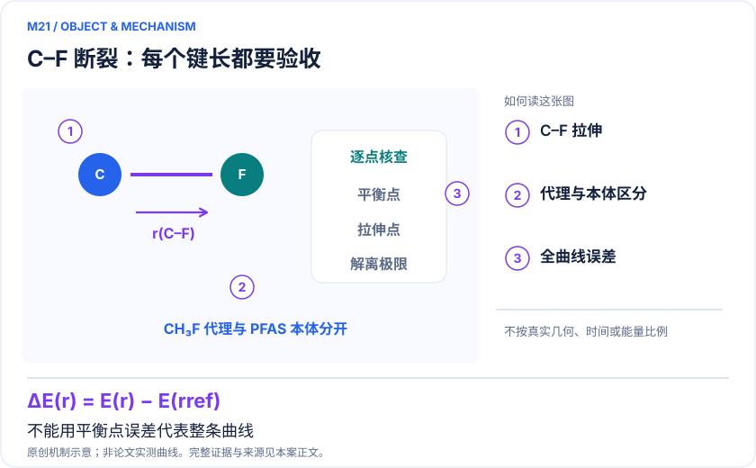
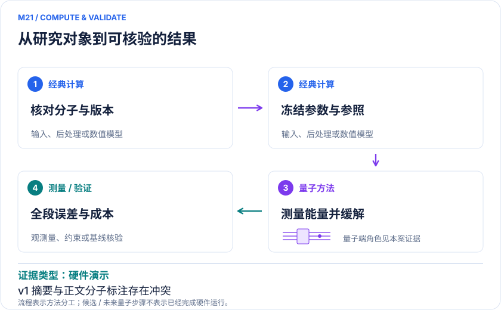

<!-- 由 release/tools/build_problems.py 自 tasks/M21-pfas-defluorination/README.md 与 tasks/catalog.json 生成，勿手改 -->

# M21 · PFAS 脱氟：C–F 断裂曲线与治理机理的电子结构接口

> 开放题 · 应用材料 · 环境材料与污染物转化

## 题面

| 环节 | 内容 |
|---|---|
| 研究体系 | TFA等PFAS模拟，以及正文明确标注的CH₃F C–F断裂代理硬件模型 |
| 可观测量 | 固定电荷/几何定义的断键势能曲线及相对能，不等于水处理效率 |
| 经典基线 | 同模型FCI/pair-CI、iFCI、SHCI/DMRG及多参考方法；溶液自由能和实验脱氟另层验证 |
| 量子方法的角色 | HPC优化VQE参数，IonQ Aria执行最终能量测量，配合对称性后选择与阈值缓解 |
| 研发决策 | 判断PFAS降解候选通道的电子相关校正是否改变断键顺序或路径优先级。 |

## 什么算解

一份解法满足以下五点即可提交审核。负结果同样接受，只要过程可复现、结论有依据。

1. **模型对应**：说明所用模型或数据如何对应「TFA等PFAS模拟，以及正文明确标注的CH₃F C–F断裂代理硬件模型」，列出简化与近似。
2. **可观测量**：报告「固定电荷/几何定义的断键势能曲线及相对能，不等于水处理效率」，附单位与不确定度。
3. **经典对照**：在同一模型或数据上，与「同模型FCI/pair-CI、iFCI、SHCI/DMRG及多参考方法；溶液自由能和实验脱氟另层验证」中至少一种方法比较。
4. **可复现**：提供代码、环境、随机种子、输入来源与哈希，以及计算资源和成本；用到 QPU 时注明设备与 shots。
5. **研发决策**：说明结果能否支撑「判断PFAS降解候选通道的电子相关校正是否改变断键顺序或路径优先级。」，以及还缺什么证据。

本题的细化标准欢迎在 issue 中讨论；被采纳的讨论结论会写入后续版本。

## 现有参照

本题暂无本项目的数值执行记录，下面只有文献整理。

### 原案例说明

### M21 · PFAS 脱氟：C–F 断裂曲线与治理机理的电子结构接口

<!-- VISUALS:START -->
#### 可视化导读

**图 1 · C–F 断裂：每个键长都要验收。** 不能用平衡点误差代表整条曲线。固定电荷/几何定义的断键势能曲线及相对能，不等于水处理效率。图形为依据本案文献重绘的概念关系，不表示实际原子坐标、实测曲线或数值比例。

**图 2 · 计算与验证路径。** HPC优化VQE参数，IonQ Aria执行最终能量测量，配合对称性后选择与阈值缓解。**证据边界：** 摘要称TFA而正文/表格为CH₃F；只核查v1，未发现可核验正式版；小基组、配对近似、经典参数优化限制解释。

图解依据：[R1 · Pushing the Limits of Quantum Computing for Simulating PFAS Chemistry](https://arxiv.org/html/2311.01242v1)；[R2 · Breaking down per- and polyfluoroalkyl substances (PFAS): tackling multitudes of correlated electrons](https://pmc.ncbi.nlm.nih.gov/articles/PMC12483100/)。解释性连线与图形布局由本库整理，未复制论文原图。

[机制图 SVG](mechanism.svg) · [流程图 SVG](workflow.svg) · 机制图 PNG（本地证据，未随题库发布） · 流程图 PNG（本地证据，未随题库发布） · 图解说明 JSON（本地证据，未随题库发布）
<!-- VISUALS:END -->

> QPFAS展示量子化学工作流；所核查v1正文硬件为CH₃F代理而摘要写TFA，需保守解释。
>
> 编研日期：2026-10-04。第二轮扩展；证据类别：硬件演示；优先级：近期验证（编辑判断）。本目录为文献整理与建议试点，没有执行量子、经典或材料实验。

#### 研发决策与价值

PFAS治理中的材料与工艺研究需要判断哪些化学键和电子转移步骤控制降解。本案建议用量子电子结构作为候选路径的局部校正接口：选择一条明确的C–F断裂通道，判断相关效应是否改变路径排序，再决定是否值得建立更昂贵的溶液或催化界面模型。断键能既不等于反应势垒，也不直接等于装置脱氟率、矿化率或能耗。

#### 原始证据及必须保留的版本差异

本次核查arXiv:2311.01242v1，摘要页版本史仅列2023-11-02的v1，精确题名检索未找到可核验正式期刊版。该版摘要称11比特TFA，但正文III-B及表I/II标明CH₃F。正文使用经典优化参数，IonQ Aria只执行最终能量测量；11比特、56纠缠门。[R1] 本案按正文保守归类为含氟代理分子的硬件演示，不把差异推广到未知后续版本。

按原表相减，平衡点缓解后与表列exact相差0.00108 Hartree，拉伸点为0.04858 Hartree，即1.08与48.58 mHa。这是本库对表中数值的算术核对，不是本次复现实验，也不能把平衡点精度推广整条曲线。TFA相关计算属于论文模拟路线，不能由有争议的摘要句认定其已在相同硬件完成。[R1]

R2在2025年以经典iFCI研究TFA、PFBA、PFOA的断键；最大PFOA处理150电子330轨道，并使用大规模云并行。这说明PFAS确有高级电子结构需求，也说明经典前沿比小基组DFT强得多。不能把其全空间计算与11比特代理直接比较时间或精度。[R2]

#### docs 来源与去重

本案是第二轮环境化学检索新增，docs中的电子能、反应曲线和应用决策框架作为背景。M15面向电解液在电池中的还原与成膜；C02面向光刻胶的光致电离和断裂；B17面向药物相关属性。这里的目标是污染物转化机制，研究对象、外部环境和验收观测量均不同。TFA、PFBA、PFOA及CH₃F代理保留为同一案例的证据层，不按链长拆分。

#### 模型与可观测量

建议把目标写为ΔE(r)=E(r)−E(r_ref)，并在模型清单中固定电荷、自旋、伸长方式及其他原子的弛豫规则。若研究水合电子还原，还要明确初始电荷和溶剂条件；若研究均裂，不能用异裂产物能量作终点。分子拉伸扫描不是已经找到最小自由能反应路径，反应速率更需要过渡区与核采样。

硬件配对ansatz、冻结芯和小基组会改变所求模型。建议并列四层参照：配对限制下的精确解、同一活性空间的无配对FCI、更大空间的相关计算、包含环境的化学模型。只有明确表中exact究竟对应哪一层，才能判断误差究竟来自设备、ansatz还是模型。

#### 量子—经典工作流

经典HPC生成分子与几何扫描、积分和优化参数；量子设备测量冻结电路；后选择与阈值策略处理测量结果；经典程序汇总能差和不确定度。参数由经典优化与硬件能量读出必须分别标注，不称为完整硬件VQE闭环。阈值选择也应使用训练数据冻结，不能根据已知exact选择最优阈值再宣称未知体系精确。

若将电子结构结果用于治理研发，后续还需把竞争反应、溶剂、界面和产物去向纳入独立模型。本案不据此指定水处理方案；其直接价值是为一条化学通道建立可靠输入，并判断量子子任务是否有机会减少最影响决策的误差。

#### 强经典基线与公平资源

R2应作为现状更新的重要锚点。[R2] 实际试点建议小模型用FCI、pair-CI与收敛选态CI，大模型使用适用iFCI、DMRG或多参考方法。iFCI的截断阶数与筛选也需要收敛检查，不能把任何近似结果称为无条件真值。与量子任务比较时冻结同一几何、基组、电子空间和目标观测量，另列“更大物理模型”的结果。

完整资源包含经典积分、优化迭代、shots、阈值/对称性筛选保留率、设备执行、误差缓解及扫描点数。最优单点不代表曲线可靠；对断键而言，远离平衡处的失效恰好最重要。能差应按相关误差估计，不能简单把各点统计误差视为完全独立。

#### 可执行试点与停止条件（建议，未运行）

输入包首先建立版本核验表：论文版本、分子名称/结构、电荷、自旋、基组、映射、配对限制、门数和表格位置逐一对应。随后准备一个CH₃F代理核对组与一个最小TFA理论组，明确二者不共享化学结论。保存完整扫描定义、随机种子、设备校准和未缓解数据。

步骤为：①独立重建正文模型并验证粒子数；②经典求解平衡与拉伸模型，识别配对误差；③复核缓解规则在保留验证点上的稳定性；④在相同shots预算下比较不同测量和后处理；⑤扩大基组/空间并检查曲线形状；⑥仅在电子模型可信后讨论环境校正。结果必须报告所有几何点，禁止仅展示达到mHa的点。

验收以预注册能差阈值、整段曲线最大误差和方法稳定性为准。若分子/表格来源仍无法闭合、拉伸态出现不可控多参考误差、缓解使能量产生非物理偏差、环境变化大于目标校正，或强经典以更小预算完成同任务，应停止升级硬件规模。纠正证据边界本身就是有效研究结果。

#### 结果发布时的最小证据表

建议每一行对应一个具体几何，列出分子标识、输入哈希、表中参照的定义、原始能量、后处理能量、保留样本比例和独立误差区间。平衡点与拉伸点应一起呈现，并另列曲线相对能的误差；摘要上的单一精度数字不应替代这张表。对尚未确认的TFA硬件身份保留“待核验”，后续若获得作者说明或正式修订，应保留原版本记录并增加修订关联，避免直接覆盖证据历史。

#### 解读与下一步

“近期验证”仅指工作流和有限模型可复核，未声称量子方法解决PFAS治理。最小下一步是完成版本与哈密顿量对照表，再建立能沿断键曲线稳定工作的经典参照；只有在此基础上，量子测量的增量价值才可评估。

#### 文献与读取范围

- **[R1] [Pushing the Limits of Quantum Computing for Simulating PFAS Chemistry](https://arxiv.org/html/2311.01242v1)**（2023；预印本；读取层级 `full_text`）。支持：只针对v1：摘要/正文分子不一致，III-B硬件参数与表I/II误差。DOI：10.48550/arXiv.2311.01242。

- **[R2] [Breaking down per- and polyfluoroalkyl substances (PFAS): tackling multitudes of correlated electrons](https://pmc.ncbi.nlm.nih.gov/articles/PMC12483100/)**（2025；期刊论文；读取层级 `full_text`）。支持：TFA/PFBA/PFOA的iFCI强经典断键研究，PFOA150电子330轨道。DOI：10.1039/d5sc03019f。

## 如何提交

按 [CONTRIBUTING.md](../../../CONTRIBUTING.md) 把解法放在 `solutions/M21/<你的名字>-<短名>/`，格式见 [解法模板](../../../solutions/_template/SOLUTION.md)。被采纳的解法会按 [沉淀规则](../../../skills/README.md) 提炼为可复用的 skill。
