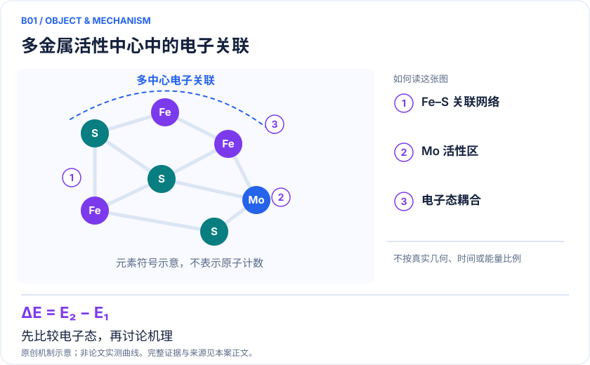
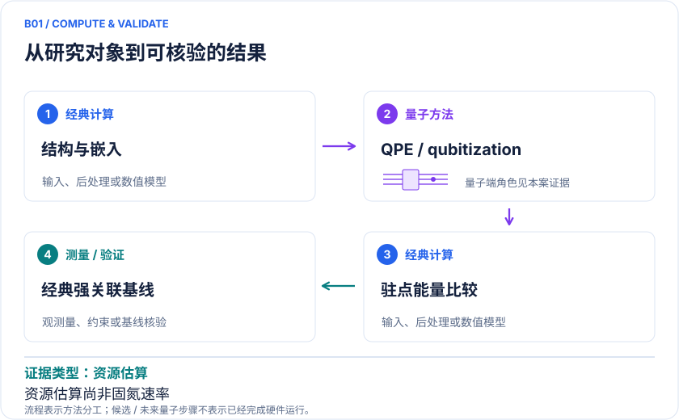

<!-- 由 release/tools/build_problems.py 自 tasks/B01-femoco-nitrogenase/README.md 与 tasks/catalog.json 生成，勿手改 -->

# B01 · 氮化酶 FeMoco：固氮机理与多金属电子关联

> 开放题 · 生物医药 · 生物催化 / 容错资源
> 难度：前沿（[分级说明](../../../starters/README.md#难度分级)） · 背景：量子化学

## 题面

| 环节 | 内容 |
|---|---|
| 研究体系 | 氮化酶FeMo辅因子局域活性中心；不包括完整蛋白构象与催化循环 |
| 可观测量 | 相对电子能、低能自旋态、各候选中间体排序 |
| 经典基线 | DMRG、选态CI、AFQMC或多参考方法；同一积分、同一态及动态关联修正 |
| 量子方法的角色 | 未来QPE/qubitization求强关联活性空间能量；经典负责结构、嵌入和反应路径 |
| 研发决策 | 决定哪些中间体和自旋态值得投入高精度计算，为仿生固氮催化剂排除错误机制。 |

## 基准输入

解法默认使用下列输入，以便与现有参照和其他解法直接比较；改用其他输入时请说明理由。「原文」指作者或原论文公开的材料，「参照」指本项目参照运行自行冻结的选择。

| 项目 | 内容 | 出处 |
|---|---|---|
| 哈密顿量 | Reiher 2017 结构 1 的 54e54o 积分 eri_reiher.h5（OpenFermion 固定 commit），S=0、电荷 +3 | [原文](https://github.com/quantumlib/OpenFermion/blob/60a6e1ab3362b6e580a3a96ebf24e42680c78799/src/openfermion/resource_estimates/integrals/eri_reiher.h5) |
| 论文 | Reiher 等 2017，arXiv:1605.03590 | [原文](https://arxiv.org/abs/1605.03590) |

**尚未公开或需注意：**Li 等 2019 指出该空间缺少代表性开壳层；不要与 113e76o 输入混用。

## 什么算解

一份解法满足以下五点即可提交审核。负结果同样接受，只要过程可复现、结论有依据。

1. **模型对应**：说明所用模型或数据如何对应「氮化酶FeMo辅因子局域活性中心；不包括完整蛋白构象与催化循环」，列出简化与近似。
2. **可观测量**：报告「相对电子能、低能自旋态、各候选中间体排序」，附单位与不确定度。
3. **经典对照**：在同一模型或数据上，与「DMRG、选态CI、AFQMC或多参考方法；同一积分、同一态及动态关联修正」中至少一种方法比较。
4. **可复现**：提供代码、环境、随机种子、输入来源与哈希，以及计算资源和成本；用到 QPU 时注明设备与 shots。
5. **研发决策**：说明结果能否支撑「决定哪些中间体和自旋态值得投入高精度计算，为仿生固氮催化剂排除错误机制。」，以及还缺什么证据。

本题的细化标准欢迎在 issue 中讨论；被采纳的讨论结论会写入后续版本。

## 现有参照

本项目已有数值执行记录（经典计算机上的计算与模拟），供对照与复用，不代表最优解。

- 原应用目标：未完成（incomplete）
- 最新研究报告：[REFERENCE.md](REFERENCE.md)
- 其余证据指针见 evidence.json（本地证据，未随题库发布）

### 原案例说明

### B01 · 氮化酶 FeMoco：固氮机理与多金属电子关联

<!-- VISUALS:START -->
#### 可视化导读

**图 1 · 多金属活性中心中的电子关联。** 先比较电子态，再讨论机理。相对电子能、低能自旋态、各候选中间体排序。图形为依据本案文献重绘的概念关系，不表示实际原子坐标、实测曲线或数值比例。

**图 2 · 计算与验证路径。** 未来QPE/qubitization求强关联活性空间能量；经典负责结构、嵌入和反应路径。**证据边界：** 资源估算没有得到完整固氮速率或证明现有硬件优势。

图解依据：[R1 · Elucidating Reaction Mechanisms on Quantum Computers](https://arxiv.org/abs/1605.03590)；[R2 · Reducing the runtime of fault-tolerant quantum simulations in chemistry through symmetry-compressed double factorization](https://arxiv.org/abs/2403.03502)。解释性连线与图形布局由本库整理，未复制论文原图。

[机制图 SVG](mechanism.svg) · [流程图 SVG](workflow.svg) · 机制图 PNG（本地证据，未随题库发布） · 流程图 PNG（本地证据，未随题库发布） · 图解说明 JSON（本地证据，未随题库发布）
<!-- VISUALS:END -->

> 更新：2026-10-04｜重点储备｜证据：资源估算
> 本文为文献研究与试点建议；未执行计算复现、硬件实验或生物实验。优先级是编辑判断。

**核心发现：** FeMoco是机制研究和容错资源设计的代表靶标，尚非已完成的工业固氮优势。

| 维度 | 内容 |
|---|---|
| 研发决策 | 决定哪些中间体和自旋态值得投入高精度计算，为仿生固氮催化剂排除错误机制。 |
| 体系 | 氮化酶FeMo辅因子局域活性中心；不包括完整蛋白构象与催化循环 |
| 规模口径 | 原子、电子、空间轨道、逻辑比特、物理比特必须分列；活性空间模型不能称为全酶模拟 |
| 目标量 | 相对电子能、低能自旋态、各候选中间体排序 |
| 量子角色 | 未来QPE/qubitization求强关联活性空间能量；经典负责结构、嵌入和反应路径 |
| 经典基线 | DMRG、选态CI、AFQMC或多参考方法；同一积分、同一态及动态关联修正 |
| 主要限制 | 资源估算没有得到完整固氮速率或证明现有硬件优势。 |

#### 决策与价值
本例把商业问题收敛到“哪一个反应中间体或自旋分支应保留”，再讨论降低固氮能耗的远期价值。量子求解器若能消除候选机制间的电子能歧义，可减少后续合成和谱学验证的方向；能量更精确本身并不说明已经找到高效催化剂。跨领域归属是生物催化，也连接材料催化。

#### 体系、输入与 docs 来源
原案例库B09使用2016预印本时间，本条同时保留2017期刊发表时间。研究对象是FeMo辅因子周围的局域多金属电子问题，候选态的电荷、质子化、配位方式和自旋必须明确。不同论文的轨道数与哈密顿量并不必然相同，因此不能将一篇的资源数与另一篇的难度结论直接拼接。[R1][R2]

#### 计算目标与混合流程
目标是比较同一建模规范下的能差 ΔEᵢⱼ=Eᵢ−Eⱼ，而非独立追求某个巨大负总能量。经典部分生成几何和分子积分、选择活性空间、处理蛋白电场和外围动态关联；容错部分准备目标态并做相位估计；经典后处理将能差放回候选反应网络。需要另外计算的谱学参数与势垒不应从一次基态能量计算中推断。

#### 已有文献的实际完成范围
Reiher等把复杂生物催化活性中心转成量子资源问题，奠定了这一用例的代表性。后续SCDF针对哈密顿量因式分解和对称性移位减少模拟成本，结果属于数值与资源分析，不是设备执行的氮化酶反应。[R1][R2] 本次未重新运行其积分或代码，亦不将原论文关于未来能力的预期列为今日性能。

#### 经典比较与资源边界
适当基线是收敛的DMRG或选态CI等近似高精度求解器，而不是只比较全CI指数空间。首先检查目标态是否确实多参考，再检查轨道截断是否漏掉关键动态关联。经典方法能否解决当前实例与某一类问题最坏情形的复杂度是不同判断。容错预算还必须包含态准备成功概率、重复次数、误差校正及魔态工厂；只报数据逻辑比特不足以订购硬件。

#### 建议试点：输入、步骤、验收与停止
1. 选择公开文献中的一个确定电荷和自旋模型，保存几何、轨道系数、FCIDUMP及来源版本；对另一中间体采用相同选轨规则。
2. 用至少两档DMRG键维或选态阈值建立收敛区间，再检查可用的动态关联修正。任何跨方法差异都记录原因。
3. 在同一积分上比较双因式分解、THC与SCDF，分别记录积分近似误差和QPE误差预算，不预先指定哪条路线获胜。
4. 验收是目标能差的不确定区间足以改变或稳定候选机制排序，并给出完整量子资源账本。精度阈值应根据候选态间隔预注册。
5. 若活性空间变化改变结论大于求解器改进，停止硬件规划，先修模型；若经典基线已能低成本达到所需精度，将该实例归为验证集。

#### 解读与下一步
这是长期价值密度较高的靶标，但近期最有用产出是可审计的经典难度地图与资源敏感性分析。优先交付固定模型的机制判别任务书；不把氮化酶天然温和条件下固氮的能力转述为量子计算已实现的工艺优势。

#### 已核实来源与访问层级

- **[R1]** [Elucidating Reaction Mechanisms on Quantum Computers](https://arxiv.org/abs/1605.03590)，2017，期刊论文。访问：`abstract`。支持：氮化酶活性中心的量子资源估算；预印本首发2016年。

- **[R2]** [Reducing the runtime of fault-tolerant quantum simulations in chemistry through symmetry-compressed double factorization](https://arxiv.org/abs/2403.03502)，2024，期刊论文。访问：`abstract`。支持：FeMoco和P450的SCDF资源估算；不是硬件结果。

`full_text`表示已访问正文并阅读相关段落，不代表补充材料已全部审计；`search_excerpt`表示仅取得原始出版方/作者来源的检索文本，不能当作全文验证。

#### 本地资料追溯

- 量子计算在材料计算与药物研发中的具体案例库.html: 原B09
- 量子计算如何研究材料问题与药物研发_研究方法与应用综述.md: 生物无机电子结构
- 量子计算问题库_飞书多维表格导入版.xlsx: 问题库原B02 Fe-S簇与FeMoco多金属电子结构

资料中的原编号与本库案例编号属于不同命名空间，按题名及上述映射追溯。

## 如何提交

按 [CONTRIBUTING.md](../../../CONTRIBUTING.md) 把解法放在 `solutions/B01/<你的名字>-<短名>/`，格式见 [解法模板](../../../solutions/_template/SOLUTION.md)。被采纳的解法会按 [沉淀规则](../../../skills/README.md) 提炼为可复用的 skill。
