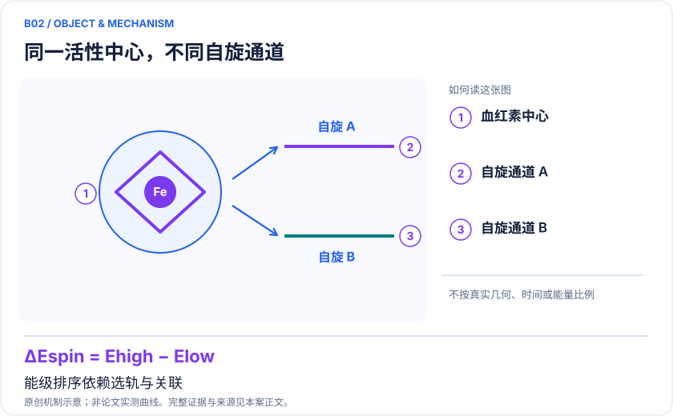
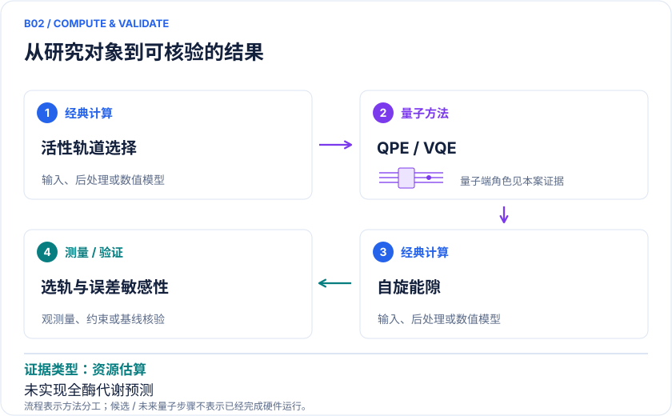

<!-- 由 release/tools/build_problems.py 自 tasks/B02-p450-spin-metabolism/README.md 与 tasks/catalog.json 生成，勿手改 -->

# B02 · P450：药物代谢自旋态与活性空间选择

> 开放题 · 生物医药 · 药物代谢 / 金属酶

## 题面

| 环节 | 内容 |
|---|---|
| 研究体系 | P450活性中心模型及反应中间体；附药物样分子选轨基准 |
| 可观测量 | 自旋态能隙、相对电子能、自然轨道占据、资源误差曲线 |
| 经典基线 | 同态DMRG、多参考微扰、CC方法适用性诊断、不同DFT泛函 |
| 量子方法的角色 | 容错QPE与SCDF；近期VQE用于选轨和硬件误差研究 |
| 研发决策 | 判断代谢氧化路径、自旋交叉和潜在反应性排序是否对电子关联敏感。 |

## 什么算解

一份解法满足以下五点即可提交审核。负结果同样接受，只要过程可复现、结论有依据。

1. **模型对应**：说明所用模型或数据如何对应「P450活性中心模型及反应中间体；附药物样分子选轨基准」，列出简化与近似。
2. **可观测量**：报告「自旋态能隙、相对电子能、自然轨道占据、资源误差曲线」，附单位与不确定度。
3. **经典对照**：在同一模型或数据上，与「同态DMRG、多参考微扰、CC方法适用性诊断、不同DFT泛函」中至少一种方法比较。
4. **可复现**：提供代码、环境、随机种子、输入来源与哈希，以及计算资源和成本；用到 QPU 时注明设备与 shots。
5. **研发决策**：说明结果能否支撑「判断代谢氧化路径、自旋交叉和潜在反应性排序是否对电子关联敏感。」，以及还缺什么证据。

本题的细化标准欢迎在 issue 中讨论；被采纳的讨论结论会写入后续版本。

## 现有参照

本项目已有数值执行记录（经典计算机上的计算与模拟），供对照与复用，不代表最优解。

- 原应用目标：未完成（incomplete）
- 最新研究报告：[REFERENCE.md](REFERENCE.md)
- 其余证据指针见 evidence.json（本地证据，未随题库发布）

### 原案例说明

### B02 · P450：药物代谢自旋态与活性空间选择

<!-- VISUALS:START -->
#### 可视化导读

**图 1 · 同一活性中心，不同自旋通道。** 能级排序依赖选轨与关联。自旋态能隙、相对电子能、自然轨道占据、资源误差曲线。图形为依据本案文献重绘的概念关系，不表示实际原子坐标、实测曲线或数值比例。

**图 2 · 计算与验证路径。** 容错QPE与SCDF；近期VQE用于选轨和硬件误差研究。**证据边界：** 尚无全P450药物代谢预测优势；docs所列P450-inspired dynamics标题/DOI本次未核实。

图解依据：[R1 · Reliably assessing the electronic structure of cytochrome P450 on today’s classical computers and tomorrow’s quantum computers](https://doi.org/10.1073/pnas.2203533119)；[R2 · Reducing the runtime of fault-tolerant quantum simulations in chemistry through symmetry-compressed double factorization](https://arxiv.org/abs/2403.03502)；[R3 · Benchmarking the Impact of Active Space Selection on the VQE Pipeline for Quantum Drug Discovery](https://arxiv.org/abs/2512.18203)。解释性连线与图形布局由本库整理，未复制论文原图。

[机制图 SVG](mechanism.svg) · [流程图 SVG](workflow.svg) · 机制图 PNG（本地证据，未随题库发布） · 流程图 PNG（本地证据，未随题库发布） · 图解说明 JSON（本地证据，未随题库发布）
<!-- VISUALS:END -->

> 更新：2026-10-04｜重点储备｜证据：资源估算
> 本文为文献研究与试点建议；未执行计算复现、硬件实验或生物实验。优先级是编辑判断。

**核心发现：** P450的关键任务是平衡静态与动态关联，资源估算必须以可信经典计算为对照。

| 维度 | 内容 |
|---|---|
| 研发决策 | 判断代谢氧化路径、自旋交叉和潜在反应性排序是否对电子关联敏感。 |
| 体系 | P450活性中心模型及反应中间体；附药物样分子选轨基准 |
| 规模口径 | 活性中心的电子/轨道模型与完整药物分子原子数分开；本例不宣称全酶上机 |
| 目标量 | 自旋态能隙、相对电子能、自然轨道占据、资源误差曲线 |
| 量子角色 | 容错QPE与SCDF；近期VQE用于选轨和硬件误差研究 |
| 经典基线 | 同态DMRG、多参考微扰、CC方法适用性诊断、不同DFT泛函 |
| 主要限制 | 尚无全P450药物代谢预测优势；docs所列P450-inspired dynamics标题/DOI本次未核实。 |

#### 决策与价值
对于药物代谢，不同氧化位点与反应通道的相对能垒比基态总能量更接近研发决策。P450含金属与配体自由基相关电子结构，自旋分支的排序是切入点。建议将任务限定为一个具体中间体的双重态/四重态等候选态比较，再决定是否扩大到氢抽提或氧反弹路径。不能凭一个自旋能隙直接预测人体代谢清除率。

#### 体系与来源核验
docs原B01指向SCDF资源研究，反应综述指向2022 PNAS。二者确实讨论P450相关活性中心及量子计算资源。[R1][R2] 原B02所列“Utility-scale quantum dynamics for a cytochrome P450-inspired active site”与s41534-025-01077-5，本次精确题名检索和出版页访问未确认，故这里只保留待核线索，不将其硬件动力学结论作为证据。原B10的药物样分子选轨基准已核实。[R3]

#### 数学目标与工作流
固定几何R下比较 ΔE_spin(R)=E_S₁(R)−E_S₂(R)，并扫描关键成断键坐标。经典部分负责QM/MM环境、轨道、积分和外围相关修正，量子部分仅求约定活性空间。若不同态用了不平衡的轨道或不同截断规则，即使各自能量收敛也可能得到错误能隙。自然轨道占据与自旋污染作为诊断量，不能自动替代实验谱。

#### 文献结果与相关子例
2022研究把高精度经典电子结构、DMRG与表面码量子资源联系起来，并公开几何、活性空间积分和资源程序，适合作为可重现基线。[R1] SCDF的主要收益是压缩哈密顿量与减少Toffoli需求，不是证明药物代谢快了同样倍数。[R2] 该基准的后续全文审计发现大药物主要为模拟，且跨CAS能量定义有待核口径，详见B19（本地证据，未随题库发布）。2025选轨基准涵盖洛伐他汀、奥司他韦、吗啡，比较UCCSD/硬件高效线路、模拟与QPU；它检验“哪些电子值得保留”，没有把这些已知药物重新发现。[R3]

#### 经典比较和不能跨越的边界
必须同时报告轨道截断误差、基组误差、关联修正和求解器误差。用小CAS上的FCI验证线路，只能说明该小CAS内正确；扩大到真实活性中心之后还需DMRG/选态CI对照。药物样分子大，并不意味着所选活性空间难；单参考占优的实例可能更适合普通CC或局域相关方法。模型还未包括底物结合与构象概率时，不应输出代谢速率或酶选择性承诺。

#### 建议试点与验收
1. 从论文数据仓取得确定版本几何和积分，明确电荷、自旋、轨道基及嵌入，保存所有常数能量项。
2. 选取两种自旋态，在至少三个嵌套活性空间上做经典收敛；以同一参考定义所有能差。
3. 在最小空间运行模拟器VQE与精确对角化；大型空间仅做资源估算，除非硬件预算与验证路径已经成立。
4. 对一个药物样分子重复选轨规则，比较能差与化学性质稳定性，而非只看总能量降低。
5. 验收为自旋排序在模型变化下稳定、误差清晰小于需要区分的能隙；若环境或选轨造成的差异占主导，停止增加shots。

#### 下一步
本例优先级为重点储备：先补齐可用模型和经典难度，再决定量子投入。尚未核实的P450动力学线索应独立回查作者、DOI与机构仓储，不影响已核实的静态电子结构结论。

#### 已核实来源与访问层级

- **[R1]** [Reliably assessing the electronic structure of cytochrome P450 on today’s classical computers and tomorrow’s quantum computers](https://doi.org/10.1073/pnas.2203533119)，2022，期刊论文。访问：`search_excerpt`。支持：P450经典多参考对照与表面码QPE资源分析；数据公开。

- **[R2]** [Reducing the runtime of fault-tolerant quantum simulations in chemistry through symmetry-compressed double factorization](https://arxiv.org/abs/2403.03502)，2024，期刊论文。访问：`abstract`。支持：FeMoco和P450的SCDF资源估算；不是硬件结果。

- **[R3]** [Benchmarking the Impact of Active Space Selection on the VQE Pipeline for Quantum Drug Discovery](https://arxiv.org/abs/2512.18203)，2025，预印本。访问：`abstract`。支持：洛伐他汀、奥司他韦、吗啡的活性空间基准；模拟与QPU。

`full_text`表示已访问正文并阅读相关段落，不代表补充材料已全部审计；`search_excerpt`表示仅取得原始出版方/作者来源的检索文本，不能当作全文验证。

#### 本地资料追溯

- 量子计算在材料计算与药物研发中的具体案例库.html: 原B01、B02、B10
- 量子计算与量子模拟研究生物和化学反应.md: 第5节P450
- 量子计算问题库_飞书多维表格导入版.xlsx: 问题库原B01 P450活性中心、自旋态与氧化选择性

资料中的原编号与本库案例编号属于不同命名空间，按题名及上述映射追溯。

## 如何提交

按 [CONTRIBUTING.md](../../../CONTRIBUTING.md) 把解法放在 `solutions/B02/<你的名字>-<短名>/`，格式见 [解法模板](../../../solutions/_template/SOLUTION.md)。被采纳的解法会按 [沉淀规则](../../../skills/README.md) 提炼为可复用的 skill。
