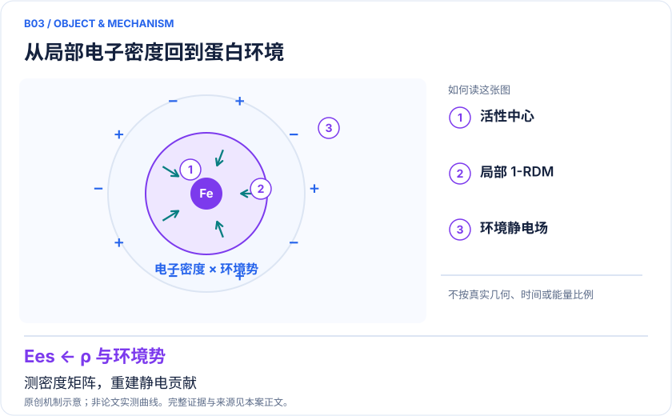
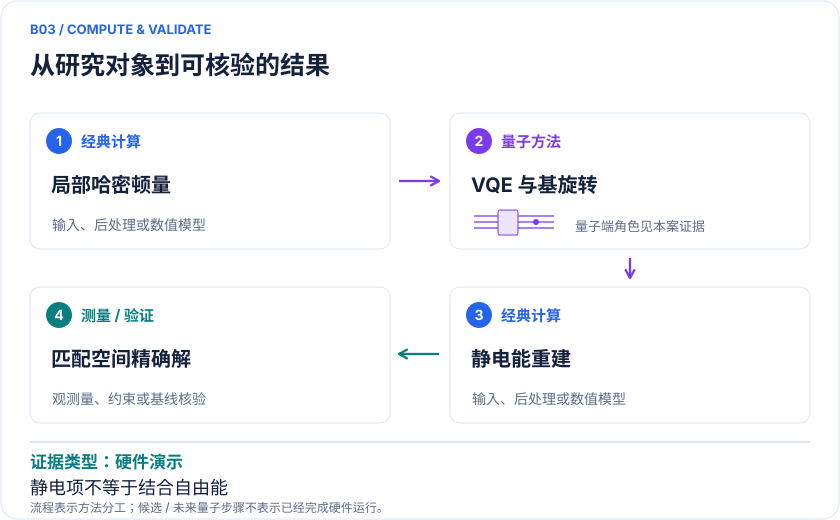

<!-- 由 release/tools/build_problems.py 自 tasks/B03-p450nor-electrostatics/README.md 与 tasks/catalog.json 生成，勿手改 -->

# B03 · P450nor：直接估计活性中心与环境的静电相互作用

> 开放题 · 生物医药 · 生物无机 / 相互作用能

## 题面

| 环节 | 内容 |
|---|---|
| 研究体系 | P450nor催化NO到N₂O的两个中间体及相互作用单元 |
| 可观测量 | 静电相互作用能、一粒子约化密度矩阵 |
| 经典基线 | 同一线路无噪声模拟、CASCI及经典SAPT分项 |
| 量子方法的角色 | VQE准备局部电子态，以费米基旋转测量密度矩阵，再经典重建静电能 |
| 研发决策 | 评估第二配位层、电荷环境改变是否足以改变NO还原中间体稳定性。 |

## 什么算解

一份解法满足以下五点即可提交审核。负结果同样接受，只要过程可复现、结论有依据。

1. **模型对应**：说明所用模型或数据如何对应「P450nor催化NO到N₂O的两个中间体及相互作用单元」，列出简化与近似。
2. **可观测量**：报告「静电相互作用能、一粒子约化密度矩阵」，附单位与不确定度。
3. **经典对照**：在同一模型或数据上，与「同一线路无噪声模拟、CASCI及经典SAPT分项」中至少一种方法比较。
4. **可复现**：提供代码、环境、随机种子、输入来源与哈希，以及计算资源和成本；用到 QPU 时注明设备与 shots。
5. **研发决策**：说明结果能否支撑「评估第二配位层、电荷环境改变是否足以改变NO还原中间体稳定性。」，以及还缺什么证据。

本题的细化标准欢迎在 issue 中讨论；被采纳的讨论结论会写入后续版本。

## 现有参照

本项目已有数值执行记录（经典计算机上的计算与模拟），供对照与复用，不代表最优解。

- 原应用目标：未完成（incomplete）
- 最新研究报告：[REFERENCE.md](REFERENCE.md)
- 其余证据指针见 evidence.json（本地证据，未随题库发布）

### 原案例说明

### B03 · P450nor：直接估计活性中心与环境的静电相互作用

<!-- VISUALS:START -->
#### 可视化导读

**图 1 · 从局部电子密度回到蛋白环境。** 测密度矩阵，重建静电贡献。静电相互作用能、一粒子约化密度矩阵。图形为依据本案文献重绘的概念关系，不表示实际原子坐标、实测曲线或数值比例。

**图 2 · 计算与验证路径。** VQE准备局部电子态，以费米基旋转测量密度矩阵，再经典重建静电能。**证据边界：** 这一一致性不代表完整相互作用能或实验结合自由能达到相同误差。

图解依据：[R1 · Estimation of electrostatic interaction energies on a trapped-ion quantum computer](https://arxiv.org/abs/2312.14739)；[R2 · Accurate non-covalent interaction energies on noisy intermediate-scale quantum computers via second-order symmetry-adapted perturbation theory](https://pubs.rsc.org/en/content/articlepdf/2023/sc/d2sc05896k)。解释性连线与图形布局由本库整理，未复制论文原图。

[机制图 SVG](mechanism.svg) · [流程图 SVG](workflow.svg) · 机制图 PNG（本地证据，未随题库发布） · 流程图 PNG（本地证据，未随题库发布） · 图解说明 JSON（本地证据，未随题库发布）
<!-- VISUALS:END -->

> 更新：2026-10-04｜近期验证｜证据：硬件演示
> 本文为文献研究与试点建议；未执行计算复现、硬件实验或生物实验。优先级是编辑判断。

**核心发现：** P450nor证明针对相互作用这一观测量设计测量，比粗暴相减大总能量更适合近期设备。

| 维度 | 内容 |
|---|---|
| 研发决策 | 评估第二配位层、电荷环境改变是否足以改变NO还原中间体稳定性。 |
| 体系 | P450nor催化NO到N₂O的两个中间体及相互作用单元 |
| 规模口径 | 有限活性空间单体上机；另一单体经典HF，非整酶完全关联 |
| 目标量 | 静电相互作用能、一粒子约化密度矩阵 |
| 量子角色 | VQE准备局部电子态，以费米基旋转测量密度矩阵，再经典重建静电能 |
| 经典基线 | 同一线路无噪声模拟、CASCI及经典SAPT分项 |
| 主要限制 | 这一一致性不代表完整相互作用能或实验结合自由能达到相同误差。 |

#### 价值与具体决策
许多生物活性中心的难点不是整个蛋白的电子结构，而是局域强关联中心如何响应环境。这个例子适合检验第二配位层或邻近电荷是否稳定某一中间体。面向研发，建议输出“环境修改使哪个中间体更稳定，以及证据可信区间”，不直接给出突变后酶活性排名。

#### 体系与 docs 关系
这是对docs中电子密度、相互作用能与环境嵌入路线的新增实证。对象是P450nor的NO还原模型，不能与通常用于药物氧化代谢的其他P450成员混同。量子设备只处理有限活性空间单体，另一部分用经典HF描述。[R1]

#### 目标与算法链
静电能可由单体电子密度与另一单体的静电势形成的期望值计算，形式上可写作 E_elst=Tr(γV)+核相关项。γ是一粒子约化密度矩阵，V由另一单体构造。直接围绕这一算符安排基旋转与测量，可避免把三个很大的超分子总能量分别算到极高绝对精度后再相减。经典部分仍负责分子积分、环境势和能量重建。

#### 已有结果
2024 ACS Central Science对应研究在离子阱设备上制备近似电子基态，使用费米基旋转读取所需量，并得到与同线路无噪声模拟一致的静电能；作者报告达到1 kcal/mol以内的化学精度范围。[R1] 2023 SAPT(VQE)研究为从单体波函数计算非共价相互作用分项提供了算法基础。[R2] 二者应按“直接测可观测量”的方法链阅读，而非视为独立完成的药效预测。

#### 对照、误差和资源
相互作用总能还包括交换、诱导、色散等；静电一项正确并不保证总结合正确。比较同线路无噪声结果用于诊断设备，比较CASCI用于诊断近似电子态，比较更完备基组和高阶SAPT用于诊断化学模型，三类误差不能合并。量子态近似对静电误差的敏感性也可能与总能误差不同，需以最终算符为中心分配shots。

#### 可复现试点建议
1. 固定两个中间体及分割方式，记录电荷、自旋、环境势和单位；先核对所有核—电子及核—核项的归属，防止重复计数。
2. 用经典波函数计算密度矩阵与静电能，独立用直接积分方式交叉检验。
3. 对同一线路比较理想模拟、噪声模拟与设备测量；粒子数后选择必须报告保留率及其偏差。
4. 只改变一个环境电荷或几何变量，检查预测能差在统计置信区间外是否稳定；其他SAPT分项在此阶段保持明确的计算层级。
5. 验收要求硬件偏差小于预注册的环境效应，并保持总体误差解释闭合。若诱导/色散或结构采样主导差异，应优先补这些模型，而不是继续优化静电采样。

#### 解读与下一步
这个例子可较早转为小规模可观测量基准。它的价值来自化学问题与测量设计相匹配，而不是器件比特数很大。下一步优先取得公开几何和算符定义；只有环境效应确实影响机制排序时才扩展到更大活性空间。

#### 已核实来源与访问层级

- **[R1]** [Estimation of electrostatic interaction energies on a trapped-ion quantum computer](https://arxiv.org/abs/2312.14739)，2024，期刊论文。访问：`abstract`。支持：P450nor两个中间体静电能硬件估计。

- **[R2]** [Accurate non-covalent interaction energies on noisy intermediate-scale quantum computers via second-order symmetry-adapted perturbation theory](https://pubs.rsc.org/en/content/articlepdf/2023/sc/d2sc05896k)，2023，期刊论文。访问：`search_excerpt`。支持：SAPT(VQE)以单体波函数估计非共价分项。

`full_text`表示已访问正文并阅读相关段落，不代表补充材料已全部审计；`search_excerpt`表示仅取得原始出版方/作者来源的检索文本，不能当作全文验证。

#### 本地资料追溯

- 量子计算与量子模拟研究生物和化学反应.md: 电子密度与嵌入
- 量子计算如何研究材料问题与药物研发_研究方法与应用综述.md: 局域活性区
- 量子计算问题库_飞书多维表格导入版.xlsx: 问题库原B13 金属酶抑制剂配位与自旋态；原B16 局部极化/电荷转移

资料中的原编号与本库案例编号属于不同命名空间，按题名及上述映射追溯。

## 如何提交

按 [CONTRIBUTING.md](../../../CONTRIBUTING.md) 把解法放在 `solutions/B03/<你的名字>-<短名>/`，格式见 [解法模板](../../../solutions/_template/SOLUTION.md)。被采纳的解法会按 [沉淀规则](../../../skills/README.md) 提炼为可复用的 skill。
