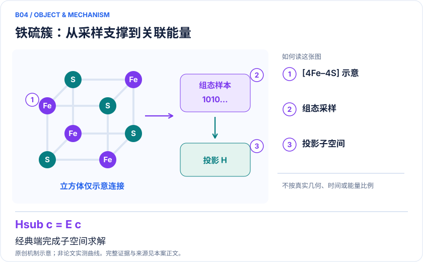
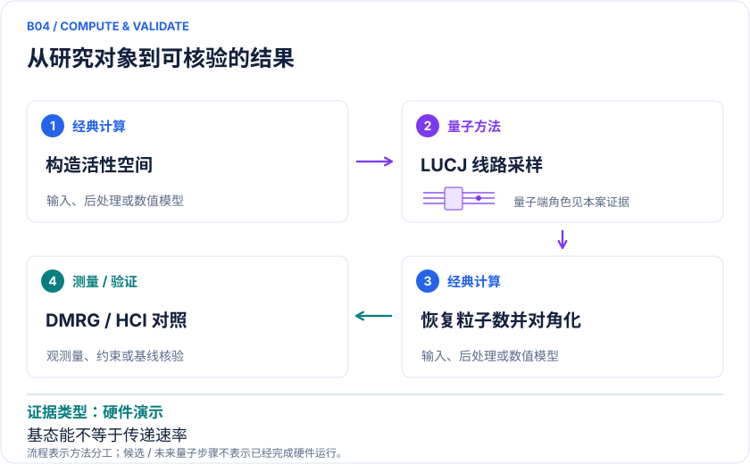

<!-- 由 release/tools/build_problems.py 自 tasks/B04-iron-sulfur-sqd/README.md 与 tasks/catalog.json 生成，勿手改 -->

# B04 · 铁硫簇：SQD与生物电子传递中心

> 开放题 · 生物医药 · 生物能量 / 多金属簇

## 题面

| 环节 | 内容 |
|---|---|
| 研究体系 | [2Fe–2S]和[4Fe–4S]局域簇模型；不等于呼吸链完整蛋白 |
| 可观测量 | 基态能、低能自旋关联；扩展可研究氧化还原能差 |
| 经典基线 | DMRG、HCI/SHCI、经典构型生成，同子空间大小与墙钟预算 |
| 量子方法的角色 | LUCJ等线路采样→粒子数恢复→经典子空间对角化 |
| 研发决策 | 决定是否用量子采样改善复杂铁硫活性中心低能态描述。 |

## 什么算解

一份解法满足以下五点即可提交审核。负结果同样接受，只要过程可复现、结论有依据。

1. **模型对应**：说明所用模型或数据如何对应「[2Fe–2S]和[4Fe–4S]局域簇模型；不等于呼吸链完整蛋白」，列出简化与近似。
2. **可观测量**：报告「基态能、低能自旋关联；扩展可研究氧化还原能差」，附单位与不确定度。
3. **经典对照**：在同一模型或数据上，与「DMRG、HCI/SHCI、经典构型生成，同子空间大小与墙钟预算」中至少一种方法比较。
4. **可复现**：提供代码、环境、随机种子、输入来源与哈希，以及计算资源和成本；用到 QPU 时注明设备与 shots。
5. **研发决策**：说明结果能否支撑「决定是否用量子采样改善复杂铁硫活性中心低能态描述。」，以及还缺什么证据。

本题的细化标准欢迎在 issue 中讨论；被采纳的讨论结论会写入后续版本。

## 现有参照

本项目已有数值执行记录（经典计算机上的计算与模拟），供对照与复用，不代表最优解。

- 原应用目标：未完成（incomplete）
- 最新研究报告：[REFERENCE.md](REFERENCE.md)
- 其余证据指针见 evidence.json（本地证据，未随题库发布）

### 原案例说明

### B04 · 铁硫簇：SQD与生物电子传递中心

<!-- VISUALS:START -->
#### 可视化导读

**图 1 · 铁硫簇：从采样支撑到关联能量。** 经典端完成子空间求解。基态能、低能自旋关联；扩展可研究氧化还原能差。图形为依据本案文献重绘的概念关系，不表示实际原子坐标、实测曲线或数值比例。

**图 2 · 计算与验证路径。** LUCJ等线路采样→粒子数恢复→经典子空间对角化。**证据边界：** 超过精确对角化规模不等于超过DMRG；基态能不等于电子传递速率。

图解依据：[R1 · Chemistry Beyond the Scale of Exact Diagonalization on a Quantum-Centric Supercomputer](https://arxiv.org/abs/2405.05068)；[R2 · Low-energy spectrum of iron-sulfur clusters directly from many-particle quantum mechanics](https://arxiv.org/abs/1408.5080)。解释性连线与图形布局由本库整理，未复制论文原图。

[机制图 SVG](mechanism.svg) · [流程图 SVG](workflow.svg) · 机制图 PNG（本地证据，未随题库发布） · 流程图 PNG（本地证据，未随题库发布） · 图解说明 JSON（本地证据，未随题库发布）
<!-- VISUALS:END -->

> 更新：2026-10-04｜近期验证｜证据：硬件演示
> 本文为文献研究与试点建议；未执行计算复现、硬件实验或生物实验。优先级是编辑判断。

**核心发现：** SQD在[2Fe–2S]/[4Fe–4S]上获得变分能量上界，量子采样的独立增益仍需强经典控制。

| 维度 | 内容 |
|---|---|
| 研发决策 | 决定是否用量子采样改善复杂铁硫活性中心低能态描述。 |
| 体系 | [2Fe–2S]和[4Fe–4S]局域簇模型；不等于呼吸链完整蛋白 |
| 规模口径 | 论文工作流最多77比特、10570门；最大值覆盖整项研究，不自动属于每个簇 |
| 目标量 | 基态能、低能自旋关联；扩展可研究氧化还原能差 |
| 量子角色 | LUCJ等线路采样→粒子数恢复→经典子空间对角化 |
| 经典基线 | DMRG、HCI/SHCI、经典构型生成，同子空间大小与墙钟预算 |
| 主要限制 | 超过精确对角化规模不等于超过DMRG；基态能不等于电子传递速率。 |

#### 决策与生物价值
铁硫中心广泛参与电子传递和氧化还原。研究上的具体价值是识别多个接近的自旋/电荷态，而不只给一个基态数字。建议先研究同一个簇的低能谱和价态变化，再评估是否能连接某个酶的电子传递机制。把原型簇结果推广到疾病或药物靶点，需要另行证明蛋白环境和动力学相关性。

#### docs 来源与精确范围
路线图把SQD列为“量子采样＋经典子空间求解”的重要步骤。本例延伸到铁硫簇应用，保留原文限制：全空间精确对角化不可行并不意味着强经典近似已失败。原论文在Heron处理器与Fugaku上研究N₂及两类簇，整个研究最大线路77比特、10570门；不要给每个模型都贴相同规模。[R1]

#### 计算目标与流程
设抽样构型张成空间S，经典求解 P_S H P_S 的最低本征值。若算符、粒子数与投影正确，获得的是原哈密顿量的变分上界；遗漏关键构型会使能量偏高。流程为固定轨道和积分、制备近似态、测量比特串、恢复或筛选构型、建立稀疏矩阵、迭代密度及重新选样。外围经典计算和矩阵对角化是成本的重要部分。

#### 文献事实与比较对象
2025发表的SQD工作给出硬件样本支持的电子结构计算和稀疏波函数近似。[R1] 早在2014年，经典多体量子化学已经研究铁硫簇低能电子谱，说明“quantum calculation”这个英文词在旧文献里通常指量子力学计算，而不必是量子计算机。[R2] 近期工作因此必须与已有DMRG/选态CI能力对照。

#### 关键证据限制
变分上界保证方向，不保证离精确解足够近；多个不同子空间的结果一致，也可能共同缺失一类自旋耦合构型。更低总能不一定改善自旋间隙，因为不同态可有不同截断偏差。对于反应或电子传递，还需自由能、耦合和重组能，不能用一个簇基态替代全部过程。

#### 建议试点
1. 选择[2Fe–2S]作为第一组，对几何、电荷、总自旋、轨道次序和FCIDUMP做完整记录。
2. 建立DMRG或SHCI收敛参考；若参考只能给区间，如实保存，不把未收敛值当真值。
3. 同预算比较QPU样本、理想线路样本、Hartree–Fock加随机激发、经典选态提案；固定最终子空间维数和对角化资源。
4. 记录粒子数恢复规则、原始/保留shots、支持集覆盖、能量方差、自旋期望值，以及CPU内存和总墙钟。
5. 验收是量子采样在独立重采样下持续改进目标能差或以更少总成本达到同精度。若优势只出现在没有经典控制的比较，结论只能是工作流演示；若模型或经典基线未收敛，停止优势宣称。

#### 下一步
最值得近期执行的是公平的构型生成消融试验。待同态比较成立后，再加入氧化态或蛋白电场，把结果与明确的氧化还原实验量连接。

#### 已核实来源与访问层级

- **[R1]** [Chemistry Beyond the Scale of Exact Diagonalization on a Quantum-Centric Supercomputer](https://arxiv.org/abs/2405.05068)，2025，期刊论文。访问：`abstract`。支持：SQD流程；氮分子及铁硫簇硬件实验；77比特上限。

- **[R2]** [Low-energy spectrum of iron-sulfur clusters directly from many-particle quantum mechanics](https://arxiv.org/abs/1408.5080)，2014，期刊论文。访问：`abstract`。支持：铁硫簇低能谱的经典多电子量子化学基线。

`full_text`表示已访问正文并阅读相关段落，不代表补充材料已全部审计；`search_excerpt`表示仅取得原始出版方/作者来源的检索文本，不能当作全文验证。

#### 本地资料追溯

- quantum_applications_roadmap_2021-2026.md: SQD
- 量子计算与量子模拟研究生物和化学反应.md: SQD与电子结构
- 量子计算问题库_飞书多维表格导入版.xlsx: 问题库原B02 Fe-S簇与FeMoco多金属电子结构；原B27 呼吸链与生物电子转移难核

资料中的原编号与本库案例编号属于不同命名空间，按题名及上述映射追溯。

## 如何提交

按 [CONTRIBUTING.md](../../../CONTRIBUTING.md) 把解法放在 `solutions/B04/<你的名字>-<短名>/`，格式见 [解法模板](../../../solutions/_template/SOLUTION.md)。被采纳的解法会按 [沉淀规则](../../../skills/README.md) 提炼为可复用的 skill。
