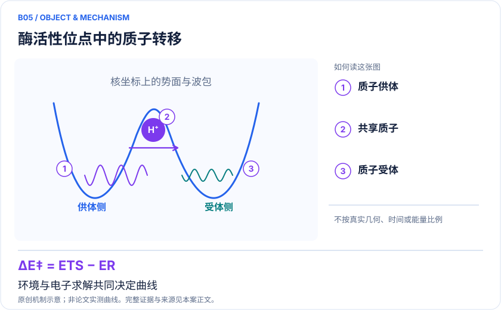
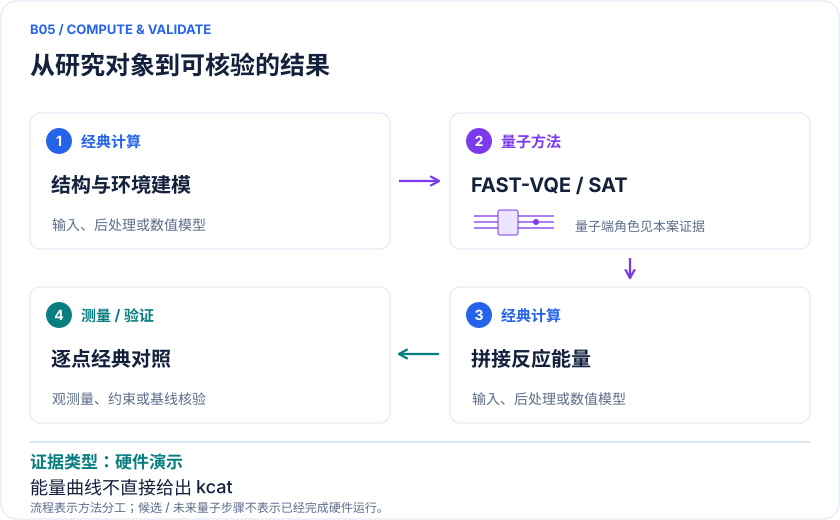

<!-- 由 release/tools/build_problems.py 自 tasks/B05-carbonic-anhydrase/README.md 与 tasks/catalog.json 生成，勿手改 -->

# B05 · 碳酸酐酶：量子硬件参与真实酶反应能量曲线

> 开放题 · 生物医药 · 酶反应 / 多尺度电子结构
> 难度：进阶（[分级说明](../../../starters/README.md#难度分级)） · 背景：量子化学

## 题面

| 环节 | 内容 |
|---|---|
| 研究体系 | 碳酸酐酶催化CO₂水合循环中的质子转移子步骤 |
| 可观测量 | 沿反应坐标的电子能曲线、相对势垒 |
| 经典基线 | 相同结构/活性空间的FCI、DFT、多参考电子结构及QM/MM基线 |
| 量子方法的角色 | FAST-VQE与SAT门约简；经典结构与环境处理 |
| 研发决策 | 判断量子电子结构修正是否改变水网络质子转移路径的势垒排序。 |

## 基准输入

解法默认使用下列输入，以便与现有参照和其他解法直接比较；改用其他输入时请说明理由。「原文」指作者或原论文公开的材料，「参照」指本项目参照运行自行冻结的选择。

| 项目 | 内容 | 出处 |
|---|---|---|
| 几何 | 官方 SI 十帧 178 原子封端 QM 区坐标（另有十帧 4108 原子完整酶坐标），电荷 +1、多重度 1 | [原文](https://doi.org/10.1021/acs.jctc.5c00022) |
| 模型设置 | 第 5 帧为质子转移过渡态参考；B3LYP/pcseg-1，CAS(6e,6o)，相关区为中央氧及两个移动氢 | [原文](https://arxiv.org/html/2408.11091v3) |

**尚未公开或需注意：**每帧的嵌入积分与能量常数未公开。

## 什么算解

一份解法满足以下五点即可提交审核。负结果同样接受，只要过程可复现、结论有依据。

1. **模型对应**：说明所用模型或数据如何对应「碳酸酐酶催化CO₂水合循环中的质子转移子步骤」，列出简化与近似。
2. **可观测量**：报告「沿反应坐标的电子能曲线、相对势垒」，附单位与不确定度。
3. **经典对照**：在同一模型或数据上，与「相同结构/活性空间的FCI、DFT、多参考电子结构及QM/MM基线」中至少一种方法比较。
4. **可复现**：提供代码、环境、随机种子、输入来源与哈希，以及计算资源和成本；用到 QPU 时注明设备与 shots。
5. **研发决策**：说明结果能否支撑「判断量子电子结构修正是否改变水网络质子转移路径的势垒排序。」，以及还缺什么证据。

本题的细化标准欢迎在 issue 中讨论；被采纳的讨论结论会写入后续版本。

## 现有参照

本项目已有数值执行记录（经典计算机上的计算与模拟），供对照与复用，不代表最优解。

- 原应用目标：未完成（incomplete）
- 最新研究报告：[REFERENCE.md](REFERENCE.md)
- 其余证据指针见 evidence.json（本地证据，未随题库发布）

### 原案例说明

### B05 · 碳酸酐酶：量子硬件参与真实酶反应能量曲线

<!-- VISUALS:START -->
#### 可视化导读

**图 1 · 酶活性位点中的质子转移。** 环境与电子求解共同决定曲线。沿反应坐标的电子能曲线、相对势垒。图形为依据本案文献重绘的概念关系，不表示实际原子坐标、实测曲线或数值比例。

**图 2 · 计算与验证路径。** FAST-VQE与SAT门约简；经典结构与环境处理。**证据边界：** 不能由曲线直接认定kcat、KIE或全酶动力学已被求解。

图解依据：[R1 · Calculating the energy profile of an enzymatic reaction on a quantum computer](https://arxiv.org/html/2408.11091v3)；[R2 · A Hybrid Quantum Computing Pipeline for Real World Drug Discovery](https://arxiv.org/abs/2401.03759)。解释性连线与图形布局由本库整理，未复制论文原图。

[机制图 SVG](mechanism.svg) · [流程图 SVG](workflow.svg) · 机制图 PNG（本地证据，未随题库发布） · 流程图 PNG（本地证据，未随题库发布） · 图解说明 JSON（本地证据，未随题库发布）
<!-- VISUALS:END -->

> 更新：2026-10-04｜近期验证｜证据：硬件演示
> 本文为文献研究与试点建议；未执行计算复现、硬件实验或生物实验。优先级是编辑判断。

**核心发现：** FAST-VQE被嵌入碳酸酐酶质子转移流程，完成能量曲线演示而非直接预测酶速率。

| 维度 | 内容 |
|---|---|
| 研发决策 | 判断量子电子结构修正是否改变水网络质子转移路径的势垒排序。 |
| 体系 | 碳酸酐酶催化CO₂水合循环中的质子转移子步骤 |
| 规模口径 | 整酶采用经典力场与DFT等分层；QPU只处理精选活性空间 |
| 目标量 | 沿反应坐标的电子能曲线、相对势垒 |
| 量子角色 | FAST-VQE与SAT门约简；经典结构与环境处理 |
| 经典基线 | 相同结构/活性空间的FCI、DFT、多参考电子结构及QM/MM基线 |
| 主要限制 | 不能由曲线直接认定kcat、KIE或全酶动力学已被求解。 |

#### 研发决策与价值
本例最有价值的地方是工作流的真实性：从酶环境出发，抽出与化学转化有关的电子子问题，再把计算放回反应路径。可支持的决策是选择哪一条质子转移路径继续做自由能与实验验证。对于药物和酶工程，研究对象可进一步转为抑制剂或突变造成的局域变化，但原论文并未因此完成这些扩展任务。

#### 体系与资料关系
docs反应综述明确强调，电子能、自由能与速率属于不同层级。本条保留这一边界：研究关注碳酸酐酶CO₂水合催化循环中的质子转移步骤，经典力场和量子化学共同处理环境，FAST-VQE处理所选电子活性部分。文献于2024年发布预印本，并于2025年发表。[R1]

#### 计算目标与流程
沿反应坐标q得到E(q)，以 E_TS−E_R 定义指定结构下电子能势垒。先由经典方法确定路径和嵌入，再逐点生成一致的活性空间哈密顿量；量子求解器估计能量，经典合并外围贡献。所有路径点必须使用可追踪的轨道规则与同一能量零点，否则曲线出现的不连续可能是模型伪影。

#### 已有结果与相关应用
Ettenhuber等将FAST-VQE、基于可满足性的门数约简与多尺度模型结合，演示酶反应能量剖面。[R1] 另一项药物研发流程研究针对前药活化断键和共价相互作用，说明类似分层计算可以用于药物反应性问题，但那是独立体系，不应把其自由能表述移植到碳酸酐酶的全部结果。[R2]

原文方法还明确采用无构象采样的路径方案，讨论反应焓而非完整自由能，并忽略质子隧穿；路径包含10个结构点。这进一步限定了本例与实验动力学的连接范围。[R1]

#### 如何比较经典方法
第一层比较相同CAS的精确或高精度解，以隔离量子求解器误差。第二层扩大CAS、基组与QM区，判断是否丢失反应中电子重排。第三层比较构象与水网络采样，检查同一几何是否具有统计代表性。最终若要与实验速率比对，还需热力学修正、隧穿、重穿越和反应网络；即使质子转移通常被讨论为关键步骤，也不能在任意条件下把它等同于整体kcat。

#### 建议试点及可观察验收
1. 从原文或作者数据取得反应物、过渡态、产物和必要中间路径点，记录质子化、边界原子、环境电荷与结构约束。
2. 对三个关键点分别核对轨道占据和自旋，构造同规范的积分与核排斥常数；保持活性空间变化可审计。
3. 以理想模拟器复核原CAS能差，再在冻结参数下评估噪声/采样误差；禁止以只复现单点总能宣称整条路径复现。
4. 用替代水网络或至少另一代表构象检查模型敏感性，报告势垒变化与设备误差哪个更大。
5. 验收为能量曲线连续、关键能差对采样重复稳定且在预注册化学容差内。若结构或环境不确定性更大，则暂停扩大硬件实验；若无过渡态连通性证据，只称“路径点能量比较”。

#### 下一步与研究判断
建议近期验证，因为目标有限且有原论文工作流可跟随。第一件事是检查原始结构与积分是否可取得；未取得之前，本库仅提供文献梳理和试点设计，不代表复现完成。

#### 已核实来源与访问层级

- **[R1]** [Calculating the energy profile of an enzymatic reaction on a quantum computer](https://arxiv.org/html/2408.11091v3)，2025，期刊论文。访问：`full_text`。支持：碳酸酐酶质子转移的FAST-VQE多尺度能量曲线。

- **[R2]** [A Hybrid Quantum Computing Pipeline for Real World Drug Discovery](https://arxiv.org/abs/2401.03759)，2024，期刊论文。访问：`abstract`。支持：前药活化断键与共价相互作用的混合流程。

`full_text`表示已访问正文并阅读相关段落，不代表补充材料已全部审计；`search_excerpt`表示仅取得原始出版方/作者来源的检索文本，不能当作全文验证。

#### 本地资料追溯

- 量子计算与量子模拟研究生物和化学反应.md: 第5节
- 量子计算如何研究材料问题与药物研发_研究方法与应用综述.md: 酶反应
- 量子计算问题库_飞书多维表格导入版.xlsx: 问题库原B09 碳酸酐酶质子线与质子传递

资料中的原编号与本库案例编号属于不同命名空间，按题名及上述映射追溯。

## 如何提交

按 [CONTRIBUTING.md](../../../CONTRIBUTING.md) 把解法放在 `solutions/B05/<你的名字>-<短名>/`，格式见 [解法模板](../../../solutions/_template/SOLUTION.md)。被采纳的解法会按 [沉淀规则](../../../skills/README.md) 提炼为可复用的 skill。
