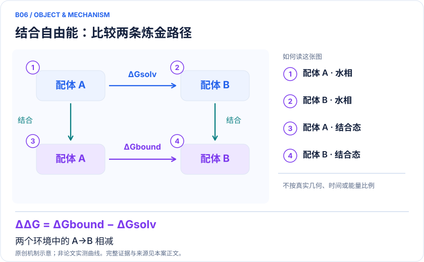
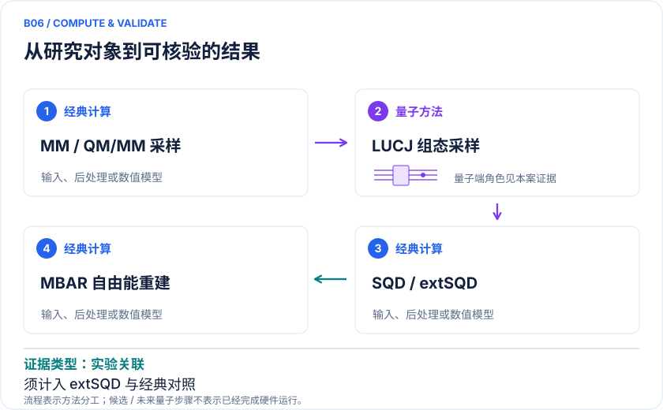

<!-- 由 release/tools/build_problems.py 自 tasks/B06-thermolysin-free-energy/README.md 与 tasks/catalog.json 生成，勿手改 -->

# B06 · Thermolysin：量子修正相对结合自由能

> 开放题 · 生物医药 · 先导优化 / 结合自由能

## 题面

| 环节 | 内容 |
|---|---|
| 研究体系 | Thermolysin与0PJ/0PI两个抑制剂；氮/氧替换导致氢键差异 |
| 可观测量 | 相对结合自由能ΔΔG，统计误差及与实验偏差 |
| 经典基线 | 同数据HCI、RHF、MM-FEP；需要相同扩展策略及总成本 |
| 量子方法的角色 | AMBER/QUICK→QM/MM book-ending→LUCJ采样→SQD/extSQD→MBAR |
| 研发决策 | 检验替换一个氢键供体/受体后，能否更可靠决定优先合成哪一个类似物。 |

## 基准输入

原文输入没有公开，也没有可直接运行的替代输入，解法需要自建模型并写明来源与哈希。下表只列出已知的公开材料。「原文」指作者或原论文公开的材料，「参照」指本项目参照运行自行冻结的选择。

| 项目 | 内容 | 出处 |
|---|---|---|
| 蛋白结构 | PDB 5TMN（含 0PJ）与 6TMN（含 0PI） | [原文](https://www.rcsb.org/structure/5TMN) |
| 模型设置 | 作者公布活性空间 0PJ (26e,19o)、0PI (26e,18o)，RHF 闭壳层，LUCJ + SQD | [原文](https://arxiv.org/abs/2604.09857v2) |

**尚未公开或需注意：**积分、能量 offset 与 bookending 采样数据未公开，作者接口按请求提供。

## 什么算解

一份解法满足以下五点即可提交审核。负结果同样接受，只要过程可复现、结论有依据。

1. **模型对应**：说明所用模型或数据如何对应「Thermolysin与0PJ/0PI两个抑制剂；氮/氧替换导致氢键差异」，列出简化与近似。
2. **可观测量**：报告「相对结合自由能ΔΔG，统计误差及与实验偏差」，附单位与不确定度。
3. **经典对照**：在同一模型或数据上，与「同数据HCI、RHF、MM-FEP；需要相同扩展策略及总成本」中至少一种方法比较。
4. **可复现**：提供代码、环境、随机种子、输入来源与哈希，以及计算资源和成本；用到 QPU 时注明设备与 shots。
5. **研发决策**：说明结果能否支撑「检验替换一个氢键供体/受体后，能否更可靠决定优先合成哪一个类似物。」，以及还缺什么证据。

本题的细化标准欢迎在 issue 中讨论；被采纳的讨论结论会写入后续版本。

## 现有参照

本项目已有数值执行记录（经典计算机上的计算与模拟），供对照与复用，不代表最优解。

- 原应用目标：未完成（incomplete）
- 最新研究报告：[REFERENCE.md](REFERENCE.md)
- 其余证据指针见 evidence.json（本地证据，未随题库发布）

### 原案例说明

### B06 · Thermolysin：量子修正相对结合自由能

<!-- VISUALS:START -->
#### 可视化导读

**图 1 · 结合自由能：比较两条炼金路径。** 两个环境中的 A→B 相减。相对结合自由能ΔΔG，统计误差及与实验偏差。图形为依据本案文献重绘的概念关系，不表示实际原子坐标、实测曲线或数值比例。

**图 2 · 计算与验证路径。** AMBER/QUICK→QM/MM book-ending→LUCJ采样→SQD/extSQD→MBAR。**证据边界：** Fig5排除extSQD约40分钟/步；缺少ext-HCI匹配；接口需向作者索取。

图解依据：[R1 · Protein-Ligand Free Energy Perturbation on Quantum Hardware](https://arxiv.org/html/2604.09857v2)；[R2 · Chemistry Beyond the Scale of Exact Diagonalization on a Quantum-Centric Supercomputer](https://arxiv.org/abs/2405.05068)。解释性连线与图形布局由本库整理，未复制论文原图。

[机制图 SVG](mechanism.svg) · [流程图 SVG](workflow.svg) · 机制图 PNG（本地证据，未随题库发布） · 流程图 PNG（本地证据，未随题库发布） · 图解说明 JSON（本地证据，未随题库发布）
<!-- VISUALS:END -->

> 更新：2026-10-04｜近期验证｜证据：实验关联
> 本文为文献研究与试点建议；未执行计算复现、硬件实验或生物实验。优先级是编辑判断。

**核心发现：** 两个thermolysin抑制剂的SQD-extSQD端点修正更接近实验，但仍有2.54 kcal/mol偏差且计时对照不完整。

| 维度 | 内容 |
|---|---|
| 研发决策 | 检验替换一个氢键供体/受体后，能否更可靠决定优先合成哪一个类似物。 |
| 体系 | Thermolysin与0PJ/0PI两个抑制剂；氮/氧替换导致氢键差异 |
| 规模口径 | 活性空间26电子、18或19空间轨道；全蛋白/水由经典采样 |
| 目标量 | 相对结合自由能ΔΔG，统计误差及与实验偏差 |
| 量子角色 | AMBER/QUICK→QM/MM book-ending→LUCJ采样→SQD/extSQD→MBAR |
| 经典基线 | 同数据HCI、RHF、MM-FEP；需要相同扩展策略及总成本 |
| 主要限制 | Fig5排除extSQD约40分钟/步；缺少ext-HCI匹配；接口需向作者索取。 |

#### 决策与价值
先导优化往往要决定一个小结构替换是否改善亲和力。这个案例直接对准该决策，比较Thermolysin的0PJ和0PI抑制剂，改变氢键相关的氮/氧连接。它比静态结合电子能更接近药化问题，但目前证据只支持一个局部变换，不能据此宣称适用于所有配体系列。[R1]

#### 输入、规模与 docs 来源
本例扩展docs的蛋白—配体主题。原文v2确认活性空间为26电子、18或19轨道，全体系仍由经典MM/QM/MM处理。题摘要使用series表述，正文计算明确是两个抑制剂的相对变换。不能把空间轨道数当原子数，也不能把蛋白规模当QPU规模。[R1]

#### 数学目标和混合流程
热力学循环要求 ΔΔG_bind=ΔG_bound(A→B)−ΔG_water(A→B)。经典AMBER先做MM自由能采样，再对各端点进行QM/MM book-ending修正；QUICK提供电子结构接口，LUCJ量子样本进入SQD/extSQD子空间求解，最后用MBAR组合自由能。量子设备参与电子构型生成，而自由能还依赖经典轨迹分布及重加权。[R1][R2]

#### 实际结果及关键校正
正文相对实验偏差为MM 6.05、HCI 6.18、SQD-extSQD 2.54 kcal/mol。最后一项较接近实验，但不属于常用1 kcal/mol级别误差。Fig5计时排除了约40分钟/步的extSQD部分，作者还指出更公平的ext-HCI比较尚待实现。因此“接近HCI运行时间”应限定到所比步骤，不能写成端到端量子加速。[R1]

#### 经典比较和证据层次
同一能量的高精度改善不保证自由能改善：样本重叠不足、短轨迹或不一致的力可能产生偏差。这个研究体系也未被描述为强关联主导，所以不能用强关联难题来默认其量子必要性。应依次比较MM、HF、HCI、SQD和与extSQD同等的经典扩展，并保持轨迹、力、窗口和精度一致。一次变换偶然接近实验还可能来自误差抵消。

#### 建议试点与接受标准
1. 优先向作者获取AMBER/QUICK接口和原始输入；原文称接口需索取，因此本次不声称完整开源闭包。
2. 固定配体质子化、金属配位、PDB结构和水模型，复核每个端点的电荷、单位和能量项。
3. 独立检查MM-FEP窗口重叠、MBAR有效样本量和往返/重复轨迹一致性，避免把采样不足交给电子求解器掩盖。
4. 冻结一组构象，同预算比较HCI、ext-HCI可行替代与SQD/extSQD，计入QPU、网络、后处理和内存总成本。
5. 验收优先看盲测新增类似物的ΔΔG误差及排序，并对误差条预注册；只有单个公开变换时，结果只能作为复现。
6. 若重加权重叠或界面输入不完整，停止量子性能比较；若误差主要来自基组或力场，则先修正化学模型。

#### 下一步
这是值得近期复核的真实工作流结合点，但优先完成接口可得性、采样和公平比较。现有证据支持“可嵌入FEP流程”，尚不足支持日常项目中的量子优势。

#### 已核实来源与访问层级

- **[R1]** [Protein-Ligand Free Energy Perturbation on Quantum Hardware](https://arxiv.org/html/2604.09857v2)，2026，预印本。访问：`full_text`。支持：两个thermolysin抑制剂；误差、时间排除项、HCI基线和接口开放边界。

- **[R2]** [Chemistry Beyond the Scale of Exact Diagonalization on a Quantum-Centric Supercomputer](https://arxiv.org/abs/2405.05068)，2025，期刊论文。访问：`abstract`。支持：SQD流程；氮分子及铁硫簇硬件实验；77比特上限。

`full_text`表示已访问正文并阅读相关段落，不代表补充材料已全部审计；`search_excerpt`表示仅取得原始出版方/作者来源的检索文本，不能当作全文验证。

#### 本地资料追溯

- quantum_applications_roadmap_2021-2026.md: 蛋白质—配体工作流
- 量子计算与量子模拟研究生物和化学反应.md: 电子能和自由能区别
- 量子计算问题库_飞书多维表格导入版.xlsx: 问题库原B17 结合自由能的局部量子校正

资料中的原编号与本库案例编号属于不同命名空间，按题名及上述映射追溯。

## 如何提交

按 [CONTRIBUTING.md](../../../CONTRIBUTING.md) 把解法放在 `solutions/B06/<你的名字>-<短名>/`，格式见 [解法模板](../../../solutions/_template/SOLUTION.md)。被采纳的解法会按 [沉淀规则](../../../skills/README.md) 提炼为可复用的 skill。
