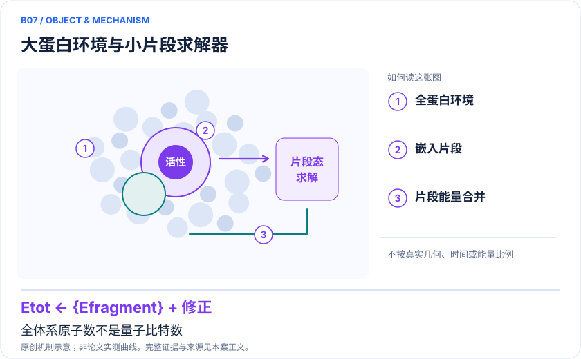
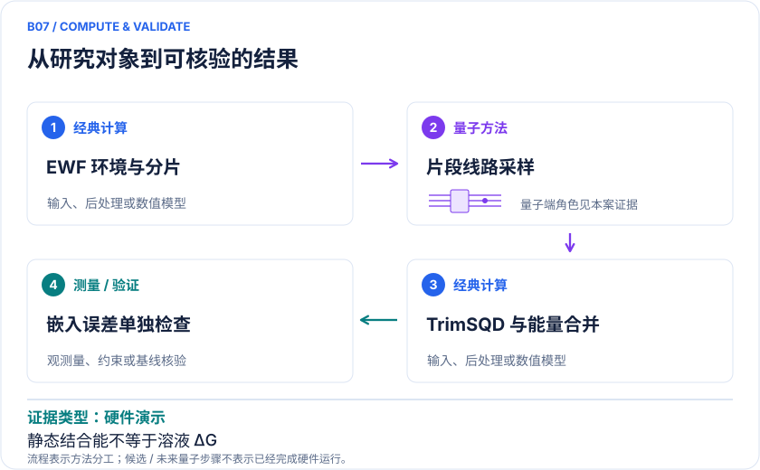

<!-- 由 release/tools/build_problems.py 自 tasks/B07-protein-ligand-embedding/README.md 与 tasks/catalog.json 生成，勿手改 -->

# B07 · 蛋白—配体嵌入：万原子规模与凝血酶分片

> 开放题 · 生物医药 · 药物结合 / 异构高性能计算

## 题面

| 环节 | 内容 |
|---|---|
| 研究体系 | T4溶菌酶与胰蛋白酶复合体；相关子例为凝血酶和5个配体 |
| 可观测量 | 片段能量、静态结合能、嵌入与基组收敛 |
| 经典基线 | EWF-CCSD、同轨道经典选态CI；DMET-VQE/CCSD对应分片基线 |
| 量子方法的角色 | EWF嵌入→片段QPU采样→超算TrimSQD→能量合并 |
| 研发决策 | 决定哪些结合口袋片段值得高精度处理，以及混合基础设施是否产生净收益。 |

## 基准输入

原文输入没有公开，也没有可直接运行的替代输入，解法需要自建模型并写明来源与哈希。下表只列出已知的公开材料。「原文」指作者或原论文公开的材料，「参照」指本项目参照运行自行冻结的选择。

| 项目 | 内容 | 出处 |
|---|---|---|
| 蛋白结构 | 初始晶体 PDB 3PTB（胰蛋白酶）与 4W57（T4 溶菌酶） | [原文](https://files.rcsb.org/download/3PTB.pdb) |
| 凝血酶子例 | 五配体坐标与 ESP 点电荷（同 B15） | [原文](https://ndownloader.figshare.com/files/66481841) |
| 论文 | arXiv:2605.01138v2 | [原文](https://arxiv.org/html/2605.01138v2) |

**尚未公开或需注意：**作者含水体系（11608/12635 原子）、EWF 片段与 bath、积分均未公开。

## 什么算解

一份解法满足以下五点即可提交审核。负结果同样接受，只要过程可复现、结论有依据。

1. **模型对应**：说明所用模型或数据如何对应「T4溶菌酶与胰蛋白酶复合体；相关子例为凝血酶和5个配体」，列出简化与近似。
2. **可观测量**：报告「片段能量、静态结合能、嵌入与基组收敛」，附单位与不确定度。
3. **经典对照**：在同一模型或数据上，与「EWF-CCSD、同轨道经典选态CI；DMET-VQE/CCSD对应分片基线」中至少一种方法比较。
4. **可复现**：提供代码、环境、随机种子、输入来源与哈希，以及计算资源和成本；用到 QPU 时注明设备与 shots。
5. **研发决策**：说明结果能否支撑「决定哪些结合口袋片段值得高精度处理，以及混合基础设施是否产生净收益。」，以及还缺什么证据。

本题的细化标准欢迎在 issue 中讨论；被采纳的讨论结论会写入后续版本。

## 现有参照

本项目已有数值执行记录（经典计算机上的计算与模拟），供对照与复用，不代表最优解。

- 原应用目标：未完成（incomplete）
- 最新研究报告：[REFERENCE.md](REFERENCE.md)
- 其余证据指针见 evidence.json（本地证据，未随题库发布）

### 原案例说明

### B07 · 蛋白—配体嵌入：万原子规模与凝血酶分片

<!-- VISUALS:START -->
#### 可视化导读

**图 1 · 大蛋白环境与小片段求解器。** 全体系原子数不是量子比特数。片段能量、静态结合能、嵌入与基组收敛。图形为依据本案文献重绘的概念关系，不表示实际原子坐标、实测曲线或数值比例。

**图 2 · 计算与验证路径。** EWF嵌入→片段QPU采样→超算TrimSQD→能量合并。**证据边界：** 40倍规模/210倍精度是特定前作比较；静态结合能非溶液结合自由能，部分复现组件不公开。

图解依据：[R1 · Crossing the 12,000-atom barrier with heterogeneous quantum-classical supercomputing: quantum chemistry of protein-ligand complexes](https://arxiv.org/html/2605.01138v2)；[R2 · Quantum Computing Calculations of Protein–Ligand Binding Energies Using Decomposition Methods on Simulated and Real Quantum Hardware](https://pubs.acs.org/doi/10.1021/acs.jcim.6c00544)；[R3 · Chemistry Beyond the Scale of Exact Diagonalization on a Quantum-Centric Supercomputer](https://arxiv.org/abs/2405.05068)。解释性连线与图形布局由本库整理，未复制论文原图。

[机制图 SVG](mechanism.svg) · [流程图 SVG](workflow.svg) · 机制图 PNG（本地证据，未随题库发布） · 流程图 PNG（本地证据，未随题库发布） · 图解说明 JSON（本地证据，未随题库发布）
<!-- VISUALS:END -->

> 更新：2026-10-04｜近期验证｜证据：硬件演示
> 本文为文献研究与试点建议；未执行计算复现、硬件实验或生物实验。优先级是编辑判断。

**核心发现：** 万原子工作流把大环境与小量子片段相接；片段精度不能替代可靠结合能。

| 维度 | 内容 |
|---|---|
| 研发决策 | 决定哪些结合口袋片段值得高精度处理，以及混合基础设施是否产生净收益。 |
| 体系 | T4溶菌酶与胰蛋白酶复合体；相关子例为凝血酶和5个配体 |
| 规模口径 | 整体11608/12635原子；两台156比特设备中最多用94比特；并非万原子直接映射QPU |
| 目标量 | 片段能量、静态结合能、嵌入与基组收敛 |
| 量子角色 | EWF嵌入→片段QPU采样→超算TrimSQD→能量合并 |
| 经典基线 | EWF-CCSD、同轨道经典选态CI；DMET-VQE/CCSD对应分片基线 |
| 主要限制 | 40倍规模/210倍精度是特定前作比较；静态结合能非溶液结合自由能，部分复现组件不公开。 |

#### 决策与价值
高价值问题不是能否宣称模拟了更多原子，而是能否在完整环境中把最昂贵电子关联计算集中到影响配体排序的区域。该案例可帮助选择量子片段、超算架构和误差预算。只有结合区的改进传递到正确能差，才可能减少先导化合物筛选试错。

#### 体系与规模拆分
万原子研究处理两个11608/12635原子的复合体，使用两台156比特设备，单线路最多94比特；其余结构、嵌入和线性代数由经典系统负责。v2报告累计超过239小时QPU运行及约30亿测量。必须分别写整体原子规模、片段轨道规模与实际量子比特规模。[R1]

#### 计算目标与混合路线
固定结构的结合电子能可以写为 E_complex−E_protein−E_ligand，但须使用匹配基组、环境、电子数和碎片拼接规则。EWF把电子问题分解为嵌入片段，量子设备给出构型样本，超算执行子空间对角化后合并。最终误差同时来自片段求解、浴截断、轨道基和带电体系处理。

#### 论文完成了什么
万原子v2在片段层面与CCSD达到一致性，但最小基组的结合能偏正；T4溶菌酶加入混合基组和更严格浴阈值后才得到负结合能。[R1] 这说明高精度片段不是整体预测充分条件。相关凝血酶研究使用5配体、每配体3片段，VQE处理其中部分、CCSD处理其他片段，蛋白表示为点电荷；涉及理想模拟与受限硬件实验。[R2]

#### 不可直接推出的结论
大型研究相对前作的规模和精度倍数采用特定参考，不能外推成相对所有经典方法的加速。凝血酶研究的硬件优化受比特数和机器时间限制，不能视为完整5配体端到端流程均在真机独立收敛；其部分转译器为商业秘密，原始几何可用也不等于全链完全开放。[R2] 静态电子结合能与结合自由能、IC50还隔着溶剂、熵、构象和测量机制。

#### 建议试点
1. 先选择一个公开复合体，并将配体电荷、口袋质子化、水和离子定义冻结；配体移除后的电荷变化尤其要核对。
2. 对一个代表口袋片段同时做CCSD、HCI和SQD，严格使用相同积分与浴；记录基组和片段边界。
3. 在经典求解器上先扫描浴阈值与混合基组，确认结合能符号和排序稳定，再谈QPU替换。
4. 将统计误差传播到结合能差，同时记录所有片段数、CPU/GPU时间、QPU时间与重复采样成本。
5. 验收分成“片段求解正确”“合并能量收敛”“新增配体排序有效”三关；前一关通过不能替代后一关。若总能差由基组或嵌入主导，暂停增加QPU规模。

#### 下一步
近期最可执行的是片段与嵌入误差审计，而不是直接复制整项万原子运行。最终交付应包含一个可核验口袋案例和完整成本表，帮助判断是否值得扩展到药化系列。

#### 已核实来源与访问层级

- **[R1]** [Crossing the 12,000-atom barrier with heterogeneous quantum-classical supercomputing: quantum chemistry of protein-ligand complexes](https://arxiv.org/html/2605.01138v2)，2026，预印本。访问：`full_text`。支持：两个万原子复合体、94比特、片段求解和基组导致的结合能限制。

- **[R2]** [Quantum Computing Calculations of Protein–Ligand Binding Energies Using Decomposition Methods on Simulated and Real Quantum Hardware](https://pubs.acs.org/doi/10.1021/acs.jcim.6c00544)，2026，期刊论文。访问：`search_excerpt`。支持：凝血酶5配体、3片段DMET/VQE与CCSD；硬件受限和部分transpiler不公开。

- **[R3]** [Chemistry Beyond the Scale of Exact Diagonalization on a Quantum-Centric Supercomputer](https://arxiv.org/abs/2405.05068)，2025，期刊论文。访问：`abstract`。支持：SQD流程；氮分子及铁硫簇硬件实验；77比特上限。

`full_text`表示已访问正文并阅读相关段落，不代表补充材料已全部审计；`search_excerpt`表示仅取得原始出版方/作者来源的检索文本，不能当作全文验证。

#### 本地资料追溯

- 量子计算在材料计算与药物研发中的具体案例库.html: 原B03、B04
- quantum_applications_roadmap_2021-2026.md: 12000原子
- 量子计算问题库_飞书多维表格导入版.xlsx: 问题库原B16 蛋白-配体局部极化/电荷转移

资料中的原编号与本库案例编号属于不同命名空间，按题名及上述映射追溯。

## 如何提交

按 [CONTRIBUTING.md](../../../CONTRIBUTING.md) 把解法放在 `solutions/B07/<你的名字>-<短名>/`，格式见 [解法模板](../../../solutions/_template/SOLUTION.md)。被采纳的解法会按 [沉淀规则](../../../skills/README.md) 提炼为可复用的 skill。
