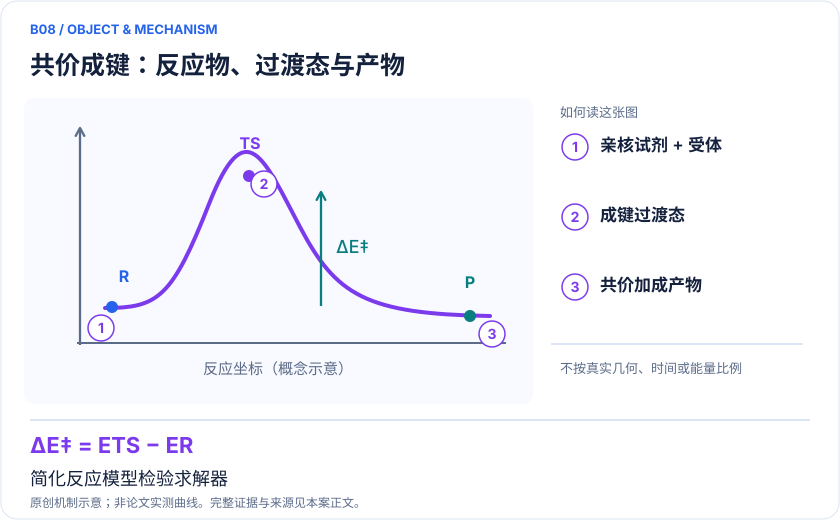
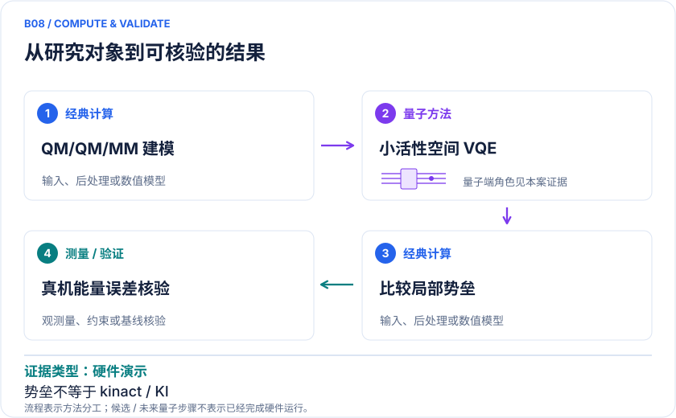

<!-- 由 release/tools/build_problems.py 自 tasks/B08-covalent-btk/README.md 与 tasks/catalog.json 生成，勿手改 -->

# B08 · 共价抑制剂：BTK反应势垒与磺酰氟反应性

> 开放题 · 生物医药 · 共价药 / 化学反应性

## 题面

| 环节 | 内容 |
|---|---|
| 研究体系 | 扎努布替尼–BTK Michael加成；简化丙烯酰胺+甲硫醇负离子；磺酰氟warhead子例 |
| 可观测量 | 反应电子能剖面、势垒、动力学特征及实验反应性proxy |
| 经典基线 | 同几何FCI/CC、多参考；经典QM/MM、纯经典特征ML与同预算模型 |
| 量子方法的角色 | QM/QM/MM嵌入与VQE；哈密顿量演化特征配经典ML |
| 研发决策 | 区分结合姿态合适但反应慢的候选物，平衡目标共价反应与脱靶反应性。 |

## 什么算解

一份解法满足以下五点即可提交审核。负结果同样接受，只要过程可复现、结论有依据。

1. **模型对应**：说明所用模型或数据如何对应「扎努布替尼–BTK Michael加成；简化丙烯酰胺+甲硫醇负离子；磺酰氟warhead子例」，列出简化与近似。
2. **可观测量**：报告「反应电子能剖面、势垒、动力学特征及实验反应性proxy」，附单位与不确定度。
3. **经典对照**：在同一模型或数据上，与「同几何FCI/CC、多参考；经典QM/MM、纯经典特征ML与同预算模型」中至少一种方法比较。
4. **可复现**：提供代码、环境、随机种子、输入来源与哈希，以及计算资源和成本；用到 QPU 时注明设备与 shots。
5. **研发决策**：说明结果能否支撑「区分结合姿态合适但反应慢的候选物，平衡目标共价反应与脱靶反应性。」，以及还缺什么证据。

本题的细化标准欢迎在 issue 中讨论；被采纳的讨论结论会写入后续版本。

## 现有参照

本项目已有数值执行记录（经典计算机上的计算与模拟），供对照与复用，不代表最优解。

- 原应用目标：未完成（incomplete）
- 最新研究报告：[REFERENCE.md](REFERENCE.md)
- 其余证据指针见 evidence.json（本地证据，未随题库发布）

### 原案例说明

### B08 · 共价抑制剂：BTK反应势垒与磺酰氟反应性

<!-- VISUALS:START -->
#### 可视化导读

**图 1 · 共价成键：反应物、过渡态与产物。** 简化反应模型检验求解器。反应电子能剖面、势垒、动力学特征及实验反应性proxy。图形为依据本案文献重绘的概念关系，不表示实际原子坐标、实测曲线或数值比例。

**图 2 · 计算与验证路径。** QM/QM/MM嵌入与VQE；哈密顿量演化特征配经典ML。**证据边界：** CovAngelo Table2真机能量误差2.943/2.058 Ha远大于化学精度；20倍仅为未来FTQC T门估算缩减；静态能垒、ML proxy与kinact/KI不同。

图解依据：[R1 · CovAngelo: A hybrid quantum-classical computing platform for accurate and scalable drug discovery](https://arxiv.org/html/2604.10487v1)；[R2 · Circuit Depth Reduction for Executable Hamiltonian Dynamics of Covalent Inhibitor Reactivity on Quantum Hardware](https://arxiv.org/abs/2412.15804v4)；[R3 · A Hybrid Quantum Computing Pipeline for Real World Drug Discovery](https://arxiv.org/abs/2401.03759)。解释性连线与图形布局由本库整理，未复制论文原图。

[机制图 SVG](mechanism.svg) · [流程图 SVG](workflow.svg) · 机制图 PNG（本地证据，未随题库发布） · 流程图 PNG（本地证据，未随题库发布） · 图解说明 JSON（本地证据，未随题库发布）
<!-- VISUALS:END -->

> 更新：2026-10-04｜近期验证｜证据：硬件演示
> 本文为文献研究与试点建议；未执行计算复现、硬件实验或生物实验。优先级是编辑判断。

**核心发现：** 共价药已有多尺度反应工作流和小模型硬件演示，但大体系势垒与设备执行范围必须分开。

| 维度 | 内容 |
|---|---|
| 研发决策 | 区分结合姿态合适但反应慢的候选物，平衡目标共价反应与脱靶反应性。 |
| 体系 | 扎努布替尼–BTK Michael加成；简化丙烯酰胺+甲硫醇负离子；磺酰氟warhead子例 |
| 规模口径 | CovAngelo在20比特Garnet设备上实际使用8比特简化TS线路；不能称20比特全BTK |
| 目标量 | 反应电子能剖面、势垒、动力学特征及实验反应性proxy |
| 量子角色 | QM/QM/MM嵌入与VQE；哈密顿量演化特征配经典ML |
| 经典基线 | 同几何FCI/CC、多参考；经典QM/MM、纯经典特征ML与同预算模型 |
| 主要限制 | CovAngelo Table2真机能量误差2.943/2.058 Ha远大于化学精度；20倍仅为未来FTQC T门估算缩减；静态能垒、ML proxy与kinact/KI不同。 |

#### 研发决策
共价抑制剂需要先结合再成键。高价值任务是比较同系列分子的化学反应性与靶点环境效应，避免只用对接分数选择反应过慢或非特异性过强的warhead。这里讨论的计算量分别是反应势垒和可用于统计学习的反应性特征，二者不应混成同一个指标。

#### 体系与 docs 追溯
原案例库B05引用2412.15804，本次核实v4已在2026年8月28日改题，明确聚焦磺酰氟warhead。原B06的前药活化和共价相互作用流程保留为相关文献。新增CovAngelo围绕扎努布替尼与BTK的Michael加成，并用简化丙烯酰胺/甲硫醇负离子模型检验设备。[R1][R2][R3]

#### 可计算量与路线
电子能势垒 ΔE‡=E_TS−E_R 用于机理比较；实验 kinact/KI 还包括结合、反应自由能和动力学，因此不能由ΔE‡直接推出。CovAngelo用MD、QM/QM/MM和DMET相关轨道处理环境与关联，量子求解器只接收片段。另一条路线用哈密顿量时间演化生成特征，再由经典机器学习预测反应性，最终表现必须独立验证特征的贡献。

#### 已发表或预印本实际结果
CovAngelo全文区分了平台支持、经典大体系计算和硬件验证：20比特Garnet设备上的示例实际上是8比特简化过渡态线路；“20倍”指FTQC算法T门估算改进。[R1] 磺酰氟论文v4展示8比特硬件哈密顿量动力学，通过项截断与线路分解降低深度，形成化学反应性预测流程。[R2] 前药论文覆盖共价断键与相互作用；后续全文核验和具体β-lapachone独立案例见B16（本地证据，未随题库发布），避免与本条BTK模型混用。[R3]

此外，CovAngelo正文§2.4.2 Table2列出化学选轨与优化选轨的真机VQE相对FCI能量偏差幅度分别为 **2.943 Ha和2.058 Ha**，远未达到化学精度。表注写ΔE=E_FCI−E_VQE，但表中正值对应相反相减的幅度，故这里按绝对偏差解读；不能将平台集成与高精度反应势垒的经典结果误认为真机已实现同等精度。[R1]

#### 经典基线与限制
小反应模型先用FCI或可靠CC方法验证；蛋白环境比较则使用相同QM区的QM/MM。机器学习路线应加入同样训练集的分子指纹、DFT特征和理想量子线路特征，检验信号是来自量子硬件、特征设计还是数据集。前药活化还依赖pH、酶和溶剂条件，不能用一个真空断键能概括释放速度。

#### 建议试点与停止门
1. 冻结反应式、底物电荷和硫亲核体质子化，确认TS具有正确不稳定模式并沿IRC连接R/P。
2. 分别计算连续介质、小水簇和蛋白点电荷环境，量化环境差异是否大于求解器差异。
3. 对最小模型做FCI/CC参考，再比较DMET选轨、理想VQE和受噪声VQE；把本征误差与几何误差拆开。
4. 对磺酰氟系列预先锁定按骨架或时间划分的训练/盲测集合，保持经典和量子特征模型相同调参预算。
5. 验收为势垒排序在合理模型变化下稳定，且独立实验反应性预测优于匹配经典基线。若只有训练集提高或简化模型与蛋白差异过大，停止“药物发现优势”表述。

#### 下一步
优先做可公开复核的最小成键反应和同系列盲测。现有文献足以说明流程可接入，但不足以证明BTK候选筛选已在量子硬件上获得端到端速度或药效优势。

#### 已核实来源与访问层级

- **[R1]** [CovAngelo: A hybrid quantum-classical computing platform for accurate and scalable drug discovery](https://arxiv.org/html/2604.10487v1)，2026，预印本。访问：`full_text`。支持：BTK工作流、简化过渡态8比特演示、20倍T门估算边界。

- **[R2]** [Circuit Depth Reduction for Executable Hamiltonian Dynamics of Covalent Inhibitor Reactivity on Quantum Hardware](https://arxiv.org/abs/2412.15804v4)，2026，预印本。访问：`abstract`。支持：磺酰氟反应性特征、8比特硬件、深度压缩；v1首发2024。

- **[R3]** [A Hybrid Quantum Computing Pipeline for Real World Drug Discovery](https://arxiv.org/abs/2401.03759)，2024，期刊论文。访问：`abstract`。支持：前药活化断键与共价相互作用的混合流程。

`full_text`表示已访问正文并阅读相关段落，不代表补充材料已全部审计；`search_excerpt`表示仅取得原始出版方/作者来源的检索文本，不能当作全文验证。

#### 本地资料追溯

- 量子计算在材料计算与药物研发中的具体案例库.html: 原B05、B06
- 量子计算与量子模拟研究生物和化学反应.md: 反应能与速率
- 量子计算问题库_飞书多维表格导入版.xlsx: 问题库原B12 共价药物形成/解离的化学势垒

资料中的原编号与本库案例编号属于不同命名空间，按题名及上述映射追溯。

## 如何提交

按 [CONTRIBUTING.md](../../../CONTRIBUTING.md) 把解法放在 `solutions/B08/<你的名字>-<短名>/`，格式见 [解法模板](../../../solutions/_template/SOLUTION.md)。被采纳的解法会按 [沉淀规则](../../../skills/README.md) 提炼为可复用的 skill。
