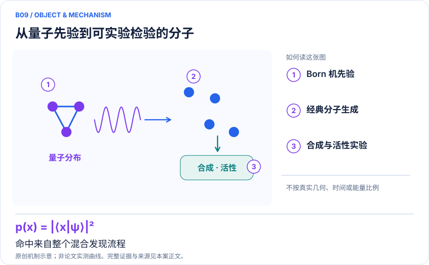
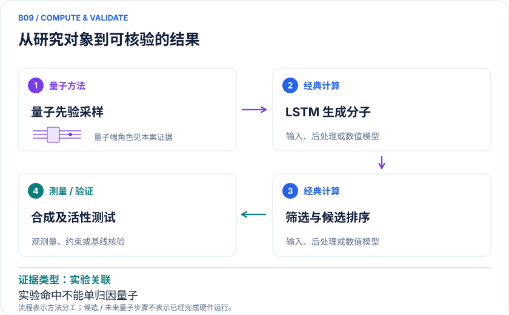

<!-- 由 release/tools/build_problems.py 自 tasks/B09-kras-generative/README.md 与 tasks/catalog.json 生成，勿手改 -->

# B09 · KRAS：量子生成模型连接合成与活性测试

> 开放题 · 生物医药 · 分子生成 / 肿瘤靶点

## 题面

| 环节 | 内容 |
|---|---|
| 研究体系 | KRAS相关小分子生成与筛选；非模拟整个KRAS蛋白电子结构 |
| 可观测量 | 候选有效性、新颖性、合成成功率、独立活性与结合读数 |
| 经典基线 | 同数据LSTM、其他生成模型、随机/经典先验替换、相同oracle预算 |
| 量子方法的角色 | 量子线路Born机产生先验/样本，经典LSTM生成，经典筛选与湿实验验证 |
| 研发决策 | 在相同合成和筛选预算内获得更多新颖、可制备、有活性的候选化学系列。 |

## 基准输入

原文输入没有公开，也没有可直接运行的替代输入，解法需要自建模型并写明来源与哈希。下表只列出已知的公开材料。「原文」指作者或原论文公开的材料，「参照」指本项目参照运行自行冻结的选择。

| 项目 | 内容 | 出处 |
|---|---|---|
| 代码与数据 | 作者仓库与唯一 release 1.0.0-beta.1（Zenodo 11137638） | [原文](https://github.com/the-matter-lab/quantum-generative-models) |
| 论文 | Nature Biotechnology | [原文](https://www.nature.com/articles/s41587-024-02526-3) |

**尚未公开或需注意：**16 比特拟合参数、门序列、硬件 counts、训练权重与划分索引未公开。

## 什么算解

一份解法满足以下五点即可提交审核。负结果同样接受，只要过程可复现、结论有依据。

1. **模型对应**：说明所用模型或数据如何对应「KRAS相关小分子生成与筛选；非模拟整个KRAS蛋白电子结构」，列出简化与近似。
2. **可观测量**：报告「候选有效性、新颖性、合成成功率、独立活性与结合读数」，附单位与不确定度。
3. **经典对照**：在同一模型或数据上，与「同数据LSTM、其他生成模型、随机/经典先验替换、相同oracle预算」中至少一种方法比较。
4. **可复现**：提供代码、环境、随机种子、输入来源与哈希，以及计算资源和成本；用到 QPU 时注明设备与 shots。
5. **研发决策**：说明结果能否支撑「在相同合成和筛选预算内获得更多新颖、可制备、有活性的候选化学系列。」，以及还缺什么证据。

本题的细化标准欢迎在 issue 中讨论；被采纳的讨论结论会写入后续版本。

## 现有参照

本项目已有数值执行记录（经典计算机上的计算与模拟），供对照与复用，不代表最优解。

- 原应用目标：未完成（incomplete）
- 最新研究报告：[REFERENCE.md](REFERENCE.md)
- 其余证据指针见 evidence.json（本地证据，未随题库发布）

### 原案例说明

### B09 · KRAS：量子生成模型连接合成与活性测试

<!-- VISUALS:START -->
#### 可视化导读

**图 1 · 从量子先验到可实验检验的分子。** 命中来自整个混合发现流程。候选有效性、新颖性、合成成功率、独立活性与结合读数。图形为依据本案文献重绘的概念关系，不表示实际原子坐标、实测曲线或数值比例。

**图 2 · 计算与验证路径。** 量子线路Born机产生先验/样本，经典LSTM生成，经典筛选与湿实验验证。**证据边界：** 命中结果属于整个混合流程；无法把发现全部归因于量子部分，尚非获批药物。

图解依据：[R1 · Quantum-computing-enhanced algorithm unveils potential KRAS inhibitors](https://www.nature.com/articles/s41587-024-02526-3)；[R2 · Tartarus: A Benchmarking Platform for Realistic And Practical Inverse Molecular Design](https://arxiv.org/abs/2209.12487)。解释性连线与图形布局由本库整理，未复制论文原图。

[机制图 SVG](mechanism.svg) · [流程图 SVG](workflow.svg) · 机制图 PNG（本地证据，未随题库发布） · 流程图 PNG（本地证据，未随题库发布） · 图解说明 JSON（本地证据，未随题库发布）
<!-- VISUALS:END -->

> 更新：2026-10-04｜近期验证｜证据：实验关联
> 本文为文献研究与试点建议；未执行计算复现、硬件实验或生物实验。优先级是编辑判断。

**核心发现：** KRAS研究把QCBM-LSTM生成与15个候选合成测试相接，但未证明严格量子优势。

| 维度 | 内容 |
|---|---|
| 研发决策 | 在相同合成和筛选预算内获得更多新颖、可制备、有活性的候选化学系列。 |
| 体系 | KRAS相关小分子生成与筛选；非模拟整个KRAS蛋白电子结构 |
| 规模口径 | 生成模型使用16比特相关实验；量子变量表示生成分布，不是一比特对应一原子 |
| 目标量 | 候选有效性、新颖性、合成成功率、独立活性与结合读数 |
| 量子角色 | 量子线路Born机产生先验/样本，经典LSTM生成，经典筛选与湿实验验证 |
| 经典基线 | 同数据LSTM、其他生成模型、随机/经典先验替换、相同oracle预算 |
| 主要限制 | 命中结果属于整个混合流程；无法把发现全部归因于量子部分，尚非获批药物。 |

#### 价值与决策
KRAS方向的价值在于产生可以实验验证的新化学假设，而不是把传统筛选分数优化得更漂亮。适合问：在固定合成数量和总计算预算下，量子生成先验能否增加结构新颖且确有靶标作用的分子。实验命中、结合、细胞表型和最终疗效处于不同证据层，必须逐层验证。

#### 体系与来源
docs路线图介绍2025 Nature Biotechnology的KRAS案例。本次核实论文题名、年份及出版信息，出版社检索结果可读，直接打开及PMC全文多次遇访问限制，因此不将这条标为完整全文审阅。已知工作流包含QCBM与经典LSTM、Tartarus比较以及15个候选的合成/评价；其化合物仅是潜在抑制剂，不是临床成功药物。[R1]

#### 计算对象和算法位置
量子线路产生概率分布 pθ(z)=|⟨z|Uθ|0⟩|²，作为经典生成器的先验或额外输入。LSTM负责化学字符串生成，后续药化过滤、结构评价、筛选和合成是经典或实验步骤。这里的量子寄存器不是蛋白波函数，也不直接计算结合自由能。因而本例与B06/B07是不同路线。

#### 已有成果与评价框架
研究建立了从混合生成到实验候选的闭环，是应用证据强于纯离线分数的部分；然而作者保留未能严格证明量子优势的边界。[R1] Tartarus提供与真实设计任务更接近的评价，并发现不同算法排名依任务而变，支持在同样目标和预算下做局部比较，而不是挑一个指标宣称普遍胜出。[R2]

#### 经典比较的关键
至少要替换量子先验为参数量接近的经典分布，保持训练数据、药化过滤、oracle调用数及人工筛选标准不变。若只有混合模型有额外实验反馈，命中率提高不能归因于量子采样。生成分子还应与训练集及已知KRAS化合物做相似性审计，避免以已知骨架近邻冒充全新探索。统计评价应以独立候选系列为单位，不能用高度相似分子数量虚增样本量。

#### 建议试点
1. 明确KRAS变体、结合位点和实验读数，冻结训练集截止日期及独立验证集。
2. 设置纯LSTM、经典先验LSTM、理想QCBM-LSTM和硬件QCBM-LSTM，统一预算并保留全部失败输出。
3. 对相同oracle预算比较有效结构、骨架新颖性、可合成性和目标分数分布；多随机种子报告置信区间。
4. 将候选匿名化交给药化评价，预先锁定进入实验的选择规则；后续合成与活性实验须有相同对照规模。
5. 验收为独立筛选后的新骨架命中率或单位成功候选成本改善，并经重复实验排除非特异信号。若优势在移除人工筛选差异后消失，应记录为负结果。

#### 下一步
首先复核原论文补充材料的生成候选归属和经典消融，再决定是否开展新目标实验。此例适合作为有实验闭环的研究计划，不适合作为量子AI已能系统替代药物发现的证据。

#### 已核实来源与访问层级

- **[R1]** [Quantum-computing-enhanced algorithm unveils potential KRAS inhibitors](https://www.nature.com/articles/s41587-024-02526-3)，2025，期刊论文。访问：`search_excerpt`。支持：QCBM–LSTM、Tartarus对照及KRAS候选；网页检索摘录可用，直开受限。

- **[R2]** [Tartarus: A Benchmarking Platform for Realistic And Practical Inverse Molecular Design](https://arxiv.org/abs/2209.12487)，2023，期刊论文。访问：`abstract`。支持：实际分子逆向设计benchmark；算法表现依赖任务领域。

`full_text`表示已访问正文并阅读相关段落，不代表补充材料已全部审计；`search_excerpt`表示仅取得原始出版方/作者来源的检索文本，不能当作全文验证。

#### 本地资料追溯

- quantum_applications_roadmap_2021-2026.md: KRAS生成模型
- 量子计算问题库_飞书多维表格导入版.xlsx: 问题库原X01 分子生成与虚拟筛选

资料中的原编号与本库案例编号属于不同命名空间，按题名及上述映射追溯。

## 如何提交

按 [CONTRIBUTING.md](../../../CONTRIBUTING.md) 把解法放在 `solutions/B09/<你的名字>-<短名>/`，格式见 [解法模板](../../../solutions/_template/SOLUTION.md)。被采纳的解法会按 [沉淀规则](../../../skills/README.md) 提炼为可复用的 skill。
