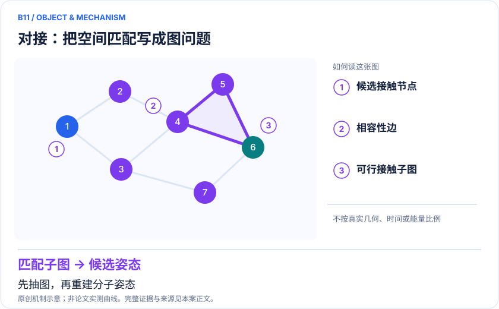
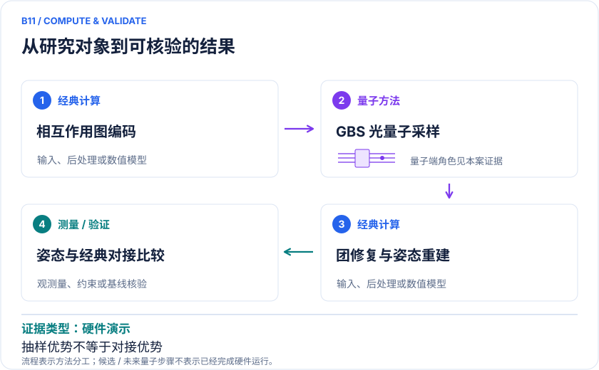

<!-- 由 release/tools/build_problems.py 自 tasks/B11-docking-gbs/README.md 与 tasks/catalog.json 生成，勿手改 -->

# B11 · 分子对接：光量子采样加权团搜索

> 开放题 · 生物医药 · 虚拟筛选 / 姿态搜索

## 题面

| 环节 | 内容 |
|---|---|
| 研究体系 | TNF-α converting enzyme受体与小分子配体的相互作用图；GBS药物平台 |
| 可观测量 | 最大权重团、pose RMSD、top-k成功率、全流程成本 |
| 经典基线 | 强加权团求解器、经典GBS近似、同评分对接和相同样本数 |
| 量子方法的角色 | 相互作用图编码→可编程GBS→经典团修复与姿态重建 |
| 研发决策 | 在同样评分模型下提高正确结合姿态被发现的概率，减少后续精化数量。 |

## 基准输入

解法默认使用下列输入，以便与现有参照和其他解法直接比较；改用其他输入时请说明理由。「原文」指作者或原论文公开的材料，「参照」指本项目参照运行自行冻结的选择。

| 项目 | 内容 | 出处 |
|---|---|---|
| 图 | TACE-AS 24 顶点二元邻接矩阵 TACE-AS_A.npz（162 条边）与 50,000 条阈值样本，Strawberry Fields 固定 commit | [原文](https://github.com/XanaduAI/strawberryfields/tree/162125d8ad5fd5488322a30c520253189596adf5/strawberryfields/apps/data) |
| 论文 | Banchi 等，arXiv:1902.00462，附录 C | [原文](https://arxiv.org/abs/1902.00462) |

**尚未公开或需注意：**顶点标签、势能权重与 PDB 2OI0 构图规则未公开；原图按已知晶体姿态选点。

## 什么算解

一份解法满足以下五点即可提交审核。负结果同样接受，只要过程可复现、结论有依据。

1. **模型对应**：说明所用模型或数据如何对应「TNF-α converting enzyme受体与小分子配体的相互作用图；GBS药物平台」，列出简化与近似。
2. **可观测量**：报告「最大权重团、pose RMSD、top-k成功率、全流程成本」，附单位与不确定度。
3. **经典对照**：在同一模型或数据上，与「强加权团求解器、经典GBS近似、同评分对接和相同样本数」中至少一种方法比较。
4. **可复现**：提供代码、环境、随机种子、输入来源与哈希，以及计算资源和成本；用到 QPU 时注明设备与 shots。
5. **研发决策**：说明结果能否支撑「在同样评分模型下提高正确结合姿态被发现的概率，减少后续精化数量。」，以及还缺什么证据。

本题的细化标准欢迎在 issue 中讨论；被采纳的讨论结论会写入后续版本。

## 现有参照

本项目已有数值执行记录（经典计算机上的计算与模拟），供对照与复用，不代表最优解。

- 原应用目标：未完成（incomplete）
- 最新研究报告：[REFERENCE.md](REFERENCE.md)
- 其余证据指针见 evidence.json（本地证据，未随题库发布）

### 原案例说明

### B11 · 分子对接：光量子采样加权团搜索

<!-- VISUALS:START -->
#### 可视化导读

**图 1 · 对接：把空间匹配写成图问题。** 先抽图，再重建分子姿态。最大权重团、pose RMSD、top-k成功率、全流程成本。图形为依据本案文献重绘的概念关系，不表示实际原子坐标、实测曲线或数值比例。

**图 2 · 计算与验证路径。** 相互作用图编码→可编程GBS→经典团修复与姿态重建。**证据边界：** 更高抽样成功概率对特定经典采样基线成立，不证明超越最佳对接程序。

图解依据：[R1 · Molecular Docking with Gaussian Boson Sampling](https://arxiv.org/abs/1902.00462)；[R2 · A universal programmable Gaussian Boson Sampler for drug discovery](https://arxiv.org/abs/2210.14877v3)。解释性连线与图形布局由本库整理，未复制论文原图。

[机制图 SVG](mechanism.svg) · [流程图 SVG](workflow.svg) · 机制图 PNG（本地证据，未随题库发布） · 流程图 PNG（本地证据，未随题库发布） · 图解说明 JSON（本地证据，未随题库发布）
<!-- VISUALS:END -->

> 更新：2026-10-04｜探索观察｜证据：硬件演示
> 本文为文献研究与试点建议；未执行计算复现、硬件实验或生物实验。优先级是编辑判断。

**核心发现：** GBS可以偏向采样高权重相互作用团，已出现对接原型，但不等于端到端筛选加速。

| 维度 | 内容 |
|---|---|
| 研发决策 | 在同样评分模型下提高正确结合姿态被发现的概率，减少后续精化数量。 |
| 体系 | TNF-α converting enzyme受体与小分子配体的相互作用图；GBS药物平台 |
| 规模口径 | 图顶点/光学模式不是原子或门模型比特；32节点团搜索是平台基准非完整蛋白 |
| 目标量 | 最大权重团、pose RMSD、top-k成功率、全流程成本 |
| 量子角色 | 相互作用图编码→可编程GBS→经典团修复与姿态重建 |
| 经典基线 | 强加权团求解器、经典GBS近似、同评分对接和相同样本数 |
| 主要限制 | 更高抽样成功概率对特定经典采样基线成立，不证明超越最佳对接程序。 |

#### 决策和价值
对接通常需要在巨大候选空间中搜索几何姿态。这个例子将搜索问题转成相互作用图的加权团：优先找到彼此兼容且得分高的接触集合，然后重建姿态。如果能稳定提高top-k正确姿态率，可能减少后续昂贵打分或自由能精化；但分数本身不准确时，更快优化仍会选错配体。

#### 体系和建模范围
2020工作以TNF-α converting enzyme相关配体作为例子，构造顶点带权的结合相互作用图。[R1] 可编程GBS平台论文在32节点图上展示团搜索并实现对接与RNA折叠原型。[R2] 这些节点是编码后的相互作用候选，既不是整个蛋白原子，也不是电子轨道，必须在规模表中单独列出。

#### 数学目标与工作流
目标为在相容图G中求 max Σᵢ∈C wᵢ，且C内任意两节点兼容。GBS的光子计数分布与图结构相关，可用来提高某些稠密高权重子图的抽样概率；经典程序仍负责把样本修复成团、局部搜索和几何姿态重建。编码、光路标定、后选择和经典后处理均属于总成本。

#### 证据强度
方法论文说明GBS怎样参与对接并提供模型实例。[R1] 可编程平台在其32节点测试中相对指定经典采样基线有更高最大权重团命中概率。[R2] 这不是对最佳分支定界、成熟组合优化器或最强对接程序的普遍优势结论；研究中“drug discovery platform”也不能解释为已经得到实验验证新药。

#### 经典比较与风险
需要两个层次的基线：同一张图上的强团算法用于检验搜索器，真实坐标上的标准对接用于检验整个表示。若图省略受体柔性、溶剂水或金属配位，对图的全局最优并不等于真实正确姿态。GBS采样分布本身难以精确经典模拟，与从分布中提取实用最优解困难，是两项不同复杂性问题。

#### 建议试点
1. 从公开共晶结构构造受体和配体，隐藏真实pose用于最终评价；冻结药效团、距离容差与权重。
2. 保存图顶点到化学接触的完整映射，确保所有算法接受相同图和相同后处理。
3. 比较精确团求解器、启发式团搜索、均匀采样、经典GBS模拟和硬件样本，禁止只与均匀采样比较。
4. 报告top-k姿态RMSD成功率、不同受体复合物上的泛化和全部墙钟，区分光学模式数、点击数与保留率。
5. 验收为独立复合物上在同成本下提高可精化正确pose比例；若收益仅来自图权重调优或经典局部搜索，则不能归因于量子部分。

#### 下一步
以可审计图编码和公平搜索比较为第一阶段。由于相互作用评分与构象复杂性仍占主导，本例列为探索观察；商业收益必须通过真实筛选任务而非单图命中概率来验证。

#### 已核实来源与访问层级

- **[R1]** [Molecular Docking with Gaussian Boson Sampling](https://arxiv.org/abs/1902.00462)，2020，期刊论文。访问：`abstract`。支持：TACE相互作用图、加权团与GBS对接算法。

- **[R2]** [A universal programmable Gaussian Boson Sampler for drug discovery](https://arxiv.org/abs/2210.14877v3)，2024，预印本。访问：`abstract`。支持：可编程GBS、32节点图基准及对接/RNA应用；预印本始于2022。

`full_text`表示已访问正文并阅读相关段落，不代表补充材料已全部审计；`search_excerpt`表示仅取得原始出版方/作者来源的检索文本，不能当作全文验证。

#### 本地资料追溯

- 量子计算问题库_飞书多维表格导入版.xlsx: 问题库原X02 普通分子对接和构象优化

资料中的原编号与本库案例编号属于不同命名空间，按题名及上述映射追溯。

## 如何提交

按 [CONTRIBUTING.md](../../../CONTRIBUTING.md) 把解法放在 `solutions/B11/<你的名字>-<短名>/`，格式见 [解法模板](../../../solutions/_template/SOLUTION.md)。被采纳的解法会按 [沉淀规则](../../../skills/README.md) 提炼为可复用的 skill。
