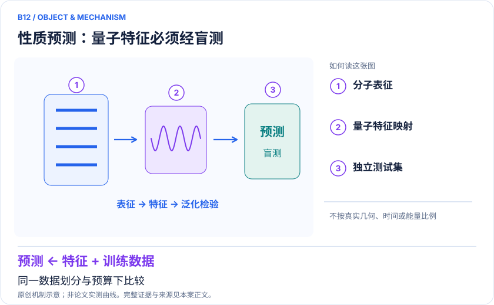
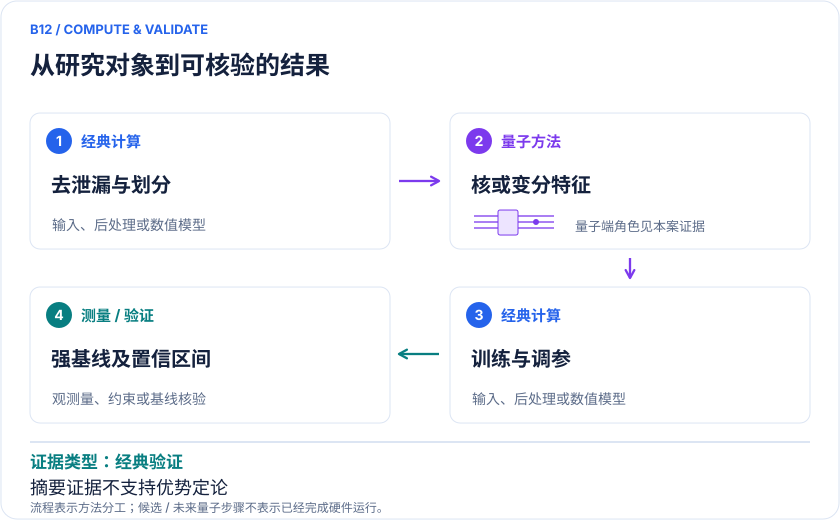

<!-- 由 release/tools/build_problems.py 自 tasks/B12-drug-properties-qml/README.md 与 tasks/catalog.json 生成，勿手改 -->

# B12 · 药物性质与活性：QML必须跨过强经典基线

> 开放题 · 生物医药 · ADMET / 活性预测
> 难度：进阶（[分级说明](../../../starters/README.md#难度分级)） · 背景：量子机器学习

## 题面

| 环节 | 内容 |
|---|---|
| 研究体系 | MoleculeNet BBBP和多个治疗靶点的性质/活性数据 |
| 可观测量 | ROC-AUC、PR-AUC、校准、外部骨架泛化、误差与成本 |
| 经典基线 | RF/XGBoost、GNN、SMILES Transformer、匹配参数MLP、经典核 |
| 量子方法的角色 | 经典表征压缩→量子核或变分层→经典训练预测 |
| 研发决策 | 在有限实验标签下选择可靠的活性或血脑屏障预测器，并控制漏掉优质候选的风险。 |

## 基准输入

解法默认使用下列输入，以便与现有参照和其他解法直接比较；改用其他输入时请说明理由。「原文」指作者或原论文公开的材料，「参照」指本项目参照运行自行冻结的选择。

| 项目 | 内容 | 出处 |
|---|---|---|
| 十靶点数据与代码 | 作者公开 data.csv 与代码（固定 commit） | [原文](https://github.com/shiv2158/potency_prediction_model_evaluation/tree/41b6d7fa641f0fc26b91bbc65e4a2de113072f76) |
| 论文 | 十靶点比较全文 | [原文](https://pmc.ncbi.nlm.nih.gov/articles/PMC13488102/) |

**尚未公开或需注意：**BBBP 原预处理、标签规则、骨架划分索引与逐样本预测未公开。

## 什么算解

一份解法满足以下五点即可提交审核。负结果同样接受，只要过程可复现、结论有依据。

1. **模型对应**：说明所用模型或数据如何对应「MoleculeNet BBBP和多个治疗靶点的性质/活性数据」，列出简化与近似。
2. **可观测量**：报告「ROC-AUC、PR-AUC、校准、外部骨架泛化、误差与成本」，附单位与不确定度。
3. **经典对照**：在同一模型或数据上，与「RF/XGBoost、GNN、SMILES Transformer、匹配参数MLP、经典核」中至少一种方法比较。
4. **可复现**：提供代码、环境、随机种子、输入来源与哈希，以及计算资源和成本；用到 QPU 时注明设备与 shots。
5. **研发决策**：说明结果能否支撑「在有限实验标签下选择可靠的活性或血脑屏障预测器，并控制漏掉优质候选的风险。」，以及还缺什么证据。

本题的细化标准欢迎在 issue 中讨论；被采纳的讨论结论会写入后续版本。

## 现有参照

本项目已有数值执行记录（经典计算机上的计算与模拟），供对照与复用，不代表最优解。

- 原应用目标：未完成（incomplete）
- 最新研究报告：[REFERENCE.md](REFERENCE.md)
- 其余证据指针见 evidence.json（本地证据，未随题库发布）

### 原案例说明

### B12 · 药物性质与活性：QML必须跨过强经典基线

<!-- VISUALS:START -->
#### 可视化导读

**图 1 · 性质预测：量子特征必须经盲测。** 同一数据划分与预算下比较。ROC-AUC、PR-AUC、校准、外部骨架泛化、误差与成本。图形为依据本案文献重绘的概念关系，不表示实际原子坐标、实测曲线或数值比例。

**图 2 · 计算与验证路径。** 经典表征压缩→量子核或变分层→经典训练预测。**证据边界：** 本次仅取得出版方检索摘要；未独立核验数据泄漏、划分实现或统计显著性。

图解依据：[R1 · A Benchmarking Study of Classical and Quantum Machine Learning Approaches for Blood–Brain Barrier Permeability Prediction](https://ieeexplore.ieee.org/abstract/document/11596174)；[R2 · Benchmarking Classical and Quantum Machine Learning for Potency Prediction across Ten Therapeutically Relevant Targets](https://pubs.acs.org/doi/10.1021/acsmedchemlett.5c00724)；[R3 · MoleculeNet: a benchmark for molecular machine learning](https://doi.org/10.1039/C7SC02664A)。解释性连线与图形布局由本库整理，未复制论文原图。

[机制图 SVG](mechanism.svg) · [流程图 SVG](workflow.svg) · 机制图 PNG（本地证据，未随题库发布） · 流程图 PNG（本地证据，未随题库发布） · 图解说明 JSON（本地证据，未随题库发布）
<!-- VISUALS:END -->

> 更新：2026-10-04｜探索观察｜证据：经典验证
> 本文为文献研究与试点建议；未执行计算复现、硬件实验或生物实验。优先级是编辑判断。

**核心发现：** 2026比较研究显示QML收益依任务，血脑屏障基准中经典Transformer更强，不能按量子标签选模型。

| 维度 | 内容 |
|---|---|
| 研发决策 | 在有限实验标签下选择可靠的活性或血脑屏障预测器，并控制漏掉优质候选的风险。 |
| 体系 | MoleculeNet BBBP和多个治疗靶点的性质/活性数据 |
| 规模口径 | 输入是SMILES/指纹/图描述符；量子电路宽度是压缩特征维度，不代表分子电子规模 |
| 目标量 | ROC-AUC、PR-AUC、校准、外部骨架泛化、误差与成本 |
| 量子角色 | 经典表征压缩→量子核或变分层→经典训练预测 |
| 经典基线 | RF/XGBoost、GNN、SMILES Transformer、匹配参数MLP、经典核 |
| 主要限制 | 本次仅取得出版方检索摘要；未独立核验数据泄漏、划分实现或统计显著性。 |

#### 决策与价值
ADMET和活性预测的价值是减少无效合成与实验，而不是把一个经典分类器换成量子线路。针对中枢神经系统候选，血脑屏障通透性是可明确评价的目标；针对药化系列，活性预测则需要统一测量条件与靶点定义。建议优先选择能改善独立项目决策的模型，不预设量子方案应胜出。

#### 数据与 docs 来源
本例补充docs机器学习方向的对照证据。MoleculeNet为不同性质规定数据集、指标和适当划分，提醒表征与数据结构对结果影响很大。[R3] BBBP包含经典分子标签，量子模型对其编码属于量子机器学习；数据集里另有QM性质标签并不说明它们原先由量子硬件计算。

#### 数学对象与流程
典型量子核为K(x,x′)=|⟨φ(x)|φ(x′)⟩|²，或用参数线路测期望值作为预测层。化学指纹常需压缩为低维特征，再上传线路。最终要评估分类或回归误差、校准以及新骨架上的表现；量子核表现变化可能来自编码，也可能来自压缩本身，因此必须设置相同压缩的经典基线。

#### 已有文献与证据边界
2026 IEEE BBBP基准比较多类经典与量子增强架构，摘要报告轻量SMILES Transformer最强，量子增强模型受降维和编码制约。[R1] 同年的十治疗靶点活性比较强调按靶点选择方法，并未支持某一类普遍领先。[R2] 这两项本次取得的是出版方检索摘要，网页直开受限；故不直接采用未核实的数据拆分代码、置信区间或强优势结论。

#### 强经典基线应怎样设定
必须同时包含传统指纹RF/梯度提升、经典核、图网络和合适的预训练模型；所有模型用相同训练数据可见性和调参预算。分子相似性高时，随机划分会高估新骨架泛化，建议同时报告scaffold或时间划分。AUROC高也可能掩盖低阳性率下的假阳性，应加入PR-AUC、校准和实验预算下的top-k富集。

#### 可复现试点
1. 冻结数据下载日期、化合物标准化、重复/盐/立体化学处理与实验终点；对冲突标签保留来源。
2. 将所有预处理和特征降维只拟合在训练集；保存划分清单，避免同系列跨集合泄漏。
3. 先建立RF、XGBoost与简单神经网络，再加入QML；量子和经典模型均重复多个种子。
4. 对相同压缩特征比较经典核与量子核，并记录训练、shots、内核矩阵、硬件排队及推理成本。
5. 验收为预注册的外部集指标、校准或每个实验命中的成本有稳定改善，且消融能定位量子层贡献。若收益只来自更多调参或数据泄漏，停止扩张。

#### 解读与下一步
这个方向容易执行，但现有“高价值”主要是业务目标高价值，不等于量子技术已有高价值增量。将它列为探索观察，并把经典胜出的负结果作为正常交付；先完成资料与划分审计，再决定是否值得购买硬件时间。

#### 已核实来源与访问层级

- **[R1]** [A Benchmarking Study of Classical and Quantum Machine Learning Approaches for Blood–Brain Barrier Permeability Prediction](https://ieeexplore.ieee.org/abstract/document/11596174)，2026，期刊论文。访问：`search_excerpt`。支持：六架构统一BBBP对照；经典Transformer优于量子增强方法。

- **[R2]** [Benchmarking Classical and Quantum Machine Learning for Potency Prediction across Ten Therapeutically Relevant Targets](https://pubs.acs.org/doi/10.1021/acsmedchemlett.5c00724)，2026，期刊论文。访问：`search_excerpt`。支持：十治疗靶点活性benchmark；无统一获胜方法。

- **[R3]** [MoleculeNet: a benchmark for molecular machine learning](https://doi.org/10.1039/C7SC02664A)，2018，期刊论文。访问：`search_excerpt`。支持：性质数据集、划分和评价指标；是经典分子机器学习基准。

`full_text`表示已访问正文并阅读相关段落，不代表补充材料已全部审计；`search_excerpt`表示仅取得原始出版方/作者来源的检索文本，不能当作全文验证。

#### 本地资料追溯

- quantum_applications_roadmap_2021-2026.md: 药物生成与量子机器学习边界
- 量子计算问题库_飞书多维表格导入版.xlsx: 问题库原X09 经典分子/材料特征的QML性质预测

资料中的原编号与本库案例编号属于不同命名空间，按题名及上述映射追溯。

## 如何提交

按 [CONTRIBUTING.md](../../../CONTRIBUTING.md) 把解法放在 `solutions/B12/<你的名字>-<短名>/`，格式见 [解法模板](../../../solutions/_template/SOLUTION.md)。被采纳的解法会按 [沉淀规则](../../../skills/README.md) 提炼为可复用的 skill。
