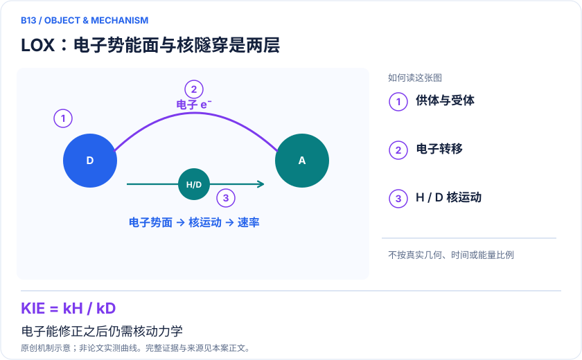
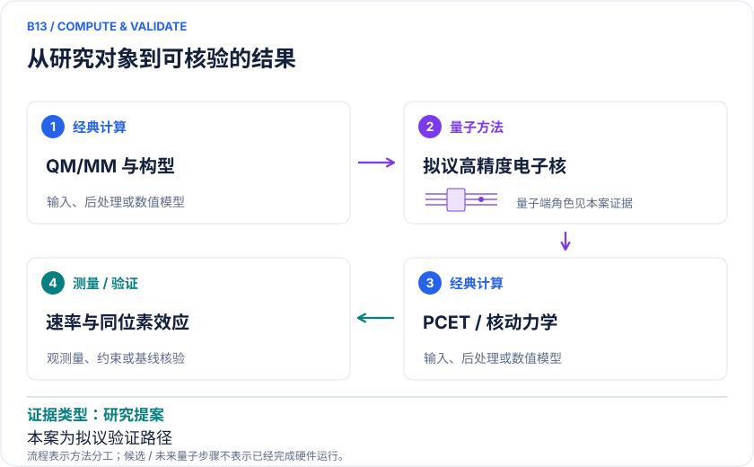

<!-- 由 release/tools/build_problems.py 自 tasks/B13-lipoxygenase-pcet/README.md 与 tasks/catalog.json 生成，勿手改 -->

# B13 · 脂氧合酶：PCET、氢隧穿与同位素效应

> 开放题 · 生物医药 · 酶设计 / 核量子效应

## 题面

| 环节 | 内容 |
|---|---|
| 研究体系 | 大豆脂氧合酶WT及L546A/L754A双突变；亚油酸氢转移与铁中心 |
| 可观测量 | PCET驱动力、重组能、供受体距离分布、kH/kD及温度依赖 |
| 经典基线 | QM/MM自由能、经典多参考、路径积分或非绝热PCET动力学 |
| 量子方法的角色 | 拟以高精度电子求解器修正局部PES，再用核动力学/PCET理论求KIE |
| 研发决策 | 判断突变改变的是供受体距离分布、电子能面还是耦合，避免误归因酶活性变化。 |

## 什么算解

一份解法满足以下五点即可提交审核。负结果同样接受，只要过程可复现、结论有依据。

1. **模型对应**：说明所用模型或数据如何对应「大豆脂氧合酶WT及L546A/L754A双突变；亚油酸氢转移与铁中心」，列出简化与近似。
2. **可观测量**：报告「PCET驱动力、重组能、供受体距离分布、kH/kD及温度依赖」，附单位与不确定度。
3. **经典对照**：在同一模型或数据上，与「QM/MM自由能、经典多参考、路径积分或非绝热PCET动力学」中至少一种方法比较。
4. **可复现**：提供代码、环境、随机种子、输入来源与哈希，以及计算资源和成本；用到 QPU 时注明设备与 shots。
5. **研发决策**：说明结果能否支撑「判断突变改变的是供受体距离分布、电子能面还是耦合，避免误归因酶活性变化。」，以及还缺什么证据。

本题的细化标准欢迎在 issue 中讨论；被采纳的讨论结论会写入后续版本。

## 现有参照

本项目已有数值执行记录（经典计算机上的计算与模拟），供对照与复用，不代表最优解。

- 原应用目标：未完成（incomplete）
- 最新研究报告：[REFERENCE.md](REFERENCE.md)
- 其余证据指针见 evidence.json（本地证据，未随题库发布）

### 原案例说明

### B13 · 脂氧合酶：PCET、氢隧穿与同位素效应

<!-- VISUALS:START -->
#### 可视化导读

**图 1 · LOX：电子势能面与核隧穿是两层。** 电子能修正之后仍需核动力学。PCET驱动力、重组能、供受体距离分布、kH/kD及温度依赖。图形为依据本案文献重绘的概念关系，不表示实际原子坐标、实测曲线或数值比例。

**图 2 · 计算与验证路径。** 拟以高精度电子求解器修正局部PES，再用核动力学/PCET理论求KIE。**证据边界：** EWF/SQD电子能不自动提供核隧穿、KIE或速率；malonaldehyde原型不能当真实LOX证据。

图解依据：[R1 · Fundamental Insights into Proton-Coupled Electron Transfer in Soybean Lipoxygenase from Quantum Mechanical/Molecular Mechanical Free Energy Simulations](https://pubmed.ncbi.nlm.nih.gov/29392938/)；[R2 · Temporal and spatial resolution of distal protein motions that activate hydrogen tunneling in soybean lipoxygenase](https://pmc.ncbi.nlm.nih.gov/articles/PMC10013837/)；[R3 · Nonadiabatic nuclear-electron dynamics: a quantum computing approach](https://arxiv.org/abs/2306.01671)；[R4 · Approximate quantum circuit compilation for proton-transfer kinetics on quantum processors](https://doi.org/10.1039/D5CP04097C)。解释性连线与图形布局由本库整理，未复制论文原图。

[机制图 SVG](mechanism.svg) · [流程图 SVG](workflow.svg) · 机制图 PNG（本地证据，未随题库发布） · 流程图 PNG（本地证据，未随题库发布） · 图解说明 JSON（本地证据，未随题库发布）
<!-- VISUALS:END -->

> 更新：2026-10-04｜重点储备｜证据：研究提案
> 本文为文献研究与试点建议；未执行计算复现、硬件实验或生物实验。优先级是编辑判断。

**核心发现：** LOX的KIE与结构机制有经典QM/MM和实验支持；量子电子求解器扩展仍是需验证的提案。

| 维度 | 内容 |
|---|---|
| 研发决策 | 判断突变改变的是供受体距离分布、电子能面还是耦合，避免误归因酶活性变化。 |
| 体系 | 大豆脂氧合酶WT及L546A/L754A双突变；亚油酸氢转移与铁中心 |
| 规模口径 | 全蛋白经典采样；局部电子活性区和质子自由度分层；本例无LOX量子硬件结果 |
| 目标量 | PCET驱动力、重组能、供受体距离分布、kH/kD及温度依赖 |
| 量子角色 | 拟以高精度电子求解器修正局部PES，再用核动力学/PCET理论求KIE |
| 经典基线 | QM/MM自由能、经典多参考、路径积分或非绝热PCET动力学 |
| 主要限制 | EWF/SQD电子能不自动提供核隧穿、KIE或速率；malonaldehyde原型不能当真实LOX证据。 |

#### 机制问题和研发价值
脂氧合酶的氢转移把电子重排、核隧穿和蛋白构象连接在一起。对酶工程而言，高价值决策是突变为什么改变速率或同位素效应，并据此选择下一批突变。这里必须先区分活性中心电子势能、供受体几何分布与核波函数重叠，避免把所有效应归到一个更低电子能上。

#### 体系和已有证据
2018研究用经典计算机上的QM/MM自由能模拟与PCET理论讨论大豆LOX WT及L546A/L754A双突变。文献引用实验KIE约80与700，并把双突变供受体距离约增大0.2 Å等结构变化与差异联系起来。[R1] 2023生物物理研究进一步用室温结构与动力学测量分析远端运动的关联。[R2] 这些是量子效应的实验/经典证据，不是量子计算机的结果。

#### 分层计算目标
建议先求自由能F(R_DA,q)，其中R_DA是供受体距离、q是质子坐标；再评价电子/振动耦合与核重叠，求温度依赖k_H、k_D及其比值。量子电子求解器可以成为固定几何PES的一部分，但不能只改变电子求解器就声称得到KIE。H/D主要改变核质量，固定核电子能本身不能承担完整同位素效应。

#### 与量子算法文献的正确连接
2023丙二醛工作提出非绝热电子—核时间演化算法；2026 NEО与近似线路编译研究在理想和硬件噪声模型中估计质子转移势垒及密度。[R3][R4] 后者出版版本使用的噪声模型设备与早期预印本表述有变化，不能把“为某处理器转译”当作“已在该处理器运行”。这些原型提供工具线索，但分子大小、环境与PCET机制均不同于LOX。

#### 经典基线与推论边界
经典QM/MM、路径积分、即时子或PCET理论本来就能描述核量子效应。必须先证明电子结构误差妨碍了当前机制判别，再判断量子求解器的价值。一个巨大KIE不独立证明特定隧穿模型，需同时检查温度、构象和同位素替换引起的反应控制步骤变化。文献中的WT/双突变数值也不能无条件移植到不同温度或不同底物。

#### 建议试点与停止条件
1. 冻结WT和双突变结构、底物定位、铁氧化态、自旋与质子化；保存QM/MM分区和边界电荷。
2. 在完全经典流程中复核供受体距离分布和自由能采样，至少进行独立重复并检查稀有近距离构象覆盖。
3. 选取R/TS/P及代表性供受体距离，比较DFT、多参考/嵌入高精度能量，确认电子修正是否超出统计与模型误差。
4. 只有电子差异显著时才将固定哈密顿量交给SQD/VQE，并保持参考态、自旋和积分一致。
5. 将修正PES送回同一核动力学模型，分别预测H/D，盲比实验温度趋势；验收不是总能量下降，而是机制判别和KIE不确定性改善。
6. 若电子结构不是主误差、支持集漏掉目标态或采样不收敛，停止量子扩展，保留经典结果和明确负结论。

#### 下一步
本例列为重点储备中的研究提案，适合做证据链清楚的跨尺度课题。当前优先行动是输入闭包和经典自由能核验，不能以NEO小分子或SQD静态成果替代LOX速率证明。

#### 已核实来源与访问层级

- **[R1]** [Fundamental Insights into Proton-Coupled Electron Transfer in Soybean Lipoxygenase from Quantum Mechanical/Molecular Mechanical Free Energy Simulations](https://pubmed.ncbi.nlm.nih.gov/29392938/)，2018，期刊论文。访问：`search_excerpt`。支持：WT/双突变PCET自由能、KIE与供受体距离；经典QM/MM。

- **[R2]** [Temporal and spatial resolution of distal protein motions that activate hydrogen tunneling in soybean lipoxygenase](https://pmc.ncbi.nlm.nih.gov/articles/PMC10013837/)，2023，期刊论文。访问：`search_excerpt`。支持：室温X射线和生物物理实验关联蛋白运动与隧穿。

- **[R3]** [Nonadiabatic nuclear-electron dynamics: a quantum computing approach](https://arxiv.org/abs/2306.01671)，2023，期刊论文。访问：`abstract`。支持：丙二醛电子-核动力学算法原型。

- **[R4]** [Approximate quantum circuit compilation for proton-transfer kinetics on quantum processors](https://doi.org/10.1039/D5CP04097C)，2026，期刊论文。访问：`search_excerpt`。支持：NEO与线路压缩；理想/硬件噪声模型模拟，不是确认真机执行。

`full_text`表示已访问正文并阅读相关段落，不代表补充材料已全部审计；`search_excerpt`表示仅取得原始出版方/作者来源的检索文本，不能当作全文验证。

#### 本地资料追溯

- 量子计算与量子模拟研究生物和化学反应.md: 4.2、参考12
- 量子计算在材料计算与药物研发中的具体案例库.html: 原B07、B08
- 量子计算问题库_飞书多维表格导入版.xlsx: 问题库原B08 PCET、多维隧穿与动力学同位素效应

资料中的原编号与本库案例编号属于不同命名空间，按题名及上述映射追溯。

## 如何提交

按 [CONTRIBUTING.md](../../../CONTRIBUTING.md) 把解法放在 `solutions/B13/<你的名字>-<短名>/`，格式见 [解法模板](../../../solutions/_template/SOLUTION.md)。被采纳的解法会按 [沉淀规则](../../../skills/README.md) 提炼为可复用的 skill。
