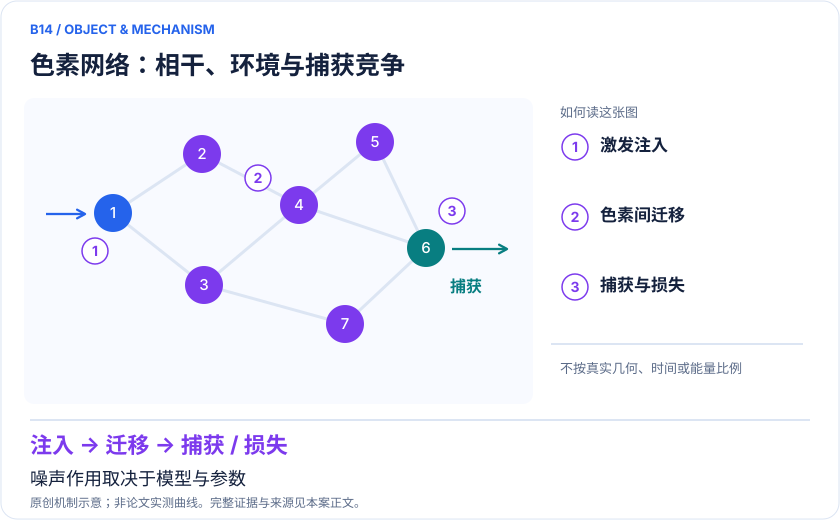
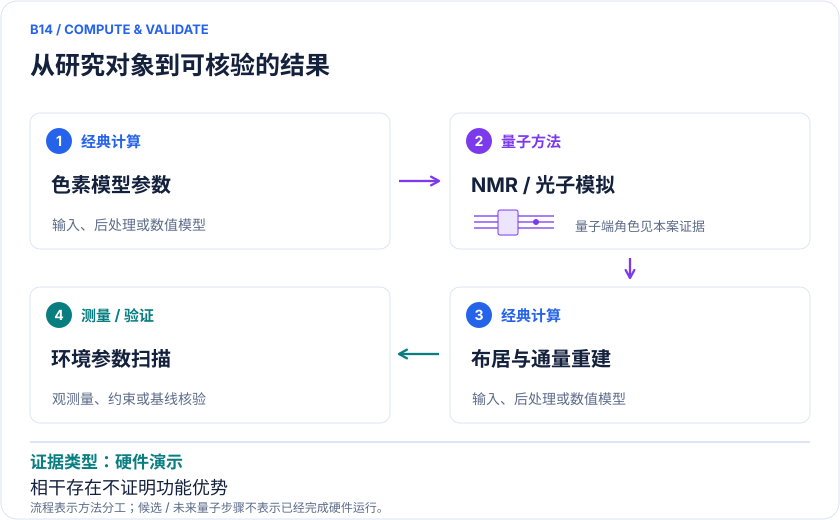

<!-- 由 release/tools/build_problems.py 自 tasks/B14-photosynthetic-exciton/README.md 与 tasks/catalog.json 生成，勿手改 -->

# B14 · 光合能量传递：色素网络与环境辅助输运

> 开放题 · 生物医药 · 光生物学 / 生物启发材料

## 题面

| 环节 | 内容 |
|---|---|
| 研究体系 | 四色素Frenkel激子模型与FMO启发的光子网络；跨到人工捕光材料 |
| 可观测量 | 时间依赖位点布居、转移概率、到达率、相干与损耗 |
| 经典基线 | HEOM、Redfield/Lindblad适用区间、张量网络及同模型精确演化 |
| 量子方法的角色 | 把激子哈密顿量映射到NMR/光子网络，以可控噪声表示环境 |
| 研发决策 | 检验色素间耦合、能级排列和环境噪声如何改变能量到达反应中心的效率。 |

## 什么算解

一份解法满足以下五点即可提交审核。负结果同样接受，只要过程可复现、结论有依据。

1. **模型对应**：说明所用模型或数据如何对应「四色素Frenkel激子模型与FMO启发的光子网络；跨到人工捕光材料」，列出简化与近似。
2. **可观测量**：报告「时间依赖位点布居、转移概率、到达率、相干与损耗」，附单位与不确定度。
3. **经典对照**：在同一模型或数据上，与「HEOM、Redfield/Lindblad适用区间、张量网络及同模型精确演化」中至少一种方法比较。
4. **可复现**：提供代码、环境、随机种子、输入来源与哈希，以及计算资源和成本；用到 QPU 时注明设备与 shots。
5. **研发决策**：说明结果能否支撑「检验色素间耦合、能级排列和环境噪声如何改变能量到达反应中心的效率。」，以及还缺什么证据。

本题的细化标准欢迎在 issue 中讨论；被采纳的讨论结论会写入后续版本。

## 现有参照

本项目已有数值执行记录（经典计算机上的计算与模拟），供对照与复用，不代表最优解。

- 原应用目标：未完成（incomplete）
- 最新研究报告：[REFERENCE.md](REFERENCE.md)
- 其余证据指针见 evidence.json（本地证据，未随题库发布）

### 原案例说明

### B14 · 光合能量传递：色素网络与环境辅助输运

<!-- VISUALS:START -->
#### 可视化导读

**图 1 · 色素网络：相干、环境与捕获竞争。** 噪声作用取决于模型与参数。时间依赖位点布居、转移概率、到达率、相干与损耗。图形为依据本案文献重绘的概念关系，不表示实际原子坐标、实测曲线或数值比例。

**图 2 · 计算与验证路径。** 把激子哈密顿量映射到NMR/光子网络，以可控噪声表示环境。**证据边界：** 环境映射和单激发近似限制外推；相干存在不等于功能优势或端到端生物效率提高。

图解依据：[R1 · Efficient quantum simulation of photosynthetic light harvesting](https://www.nature.com/articles/s41534-018-0102-2)；[R2 · Simulating photosynthetic energy transport on a photonic network](https://www.nature.com/articles/s41534-024-00824-x)。解释性连线与图形布局由本库整理，未复制论文原图。

[机制图 SVG](mechanism.svg) · [流程图 SVG](workflow.svg) · 机制图 PNG（本地证据，未随题库发布） · 流程图 PNG（本地证据，未随题库发布） · 图解说明 JSON（本地证据，未随题库发布）
<!-- VISUALS:END -->

> 更新：2026-10-04｜探索观察｜证据：硬件演示
> 本文为文献研究与试点建议；未执行计算复现、硬件实验或生物实验。优先级是编辑判断。

**核心发现：** NMR和光子网络可实现光合激子有效模型，帮助检验环境与结构作用；模型演示不证明天然光合作用量子优势。

| 维度 | 内容 |
|---|---|
| 研发决策 | 检验色素间耦合、能级排列和环境噪声如何改变能量到达反应中心的效率。 |
| 体系 | 四色素Frenkel激子模型与FMO启发的光子网络；跨到人工捕光材料 |
| 规模口径 | 2018 NMR实验以2比特表示4个单激发态；不是全叶绿素电子结构或完整光合作用 |
| 目标量 | 时间依赖位点布居、转移概率、到达率、相干与损耗 |
| 量子角色 | 把激子哈密顿量映射到NMR/光子网络，以可控噪声表示环境 |
| 经典基线 | HEOM、Redfield/Lindblad适用区间、张量网络及同模型精确演化 |
| 主要限制 | 环境映射和单激发近似限制外推；相干存在不等于功能优势或端到端生物效率提高。 |

#### 价值与适用边界
光生物学的高价值问题是哪些微观结构与环境参数真正提高能量捕获，而不是只检测相干振荡。该用例最接近生物启发捕光和光功能材料设计，与药物研发的联系较间接。若用于光敏剂或光生物调控，需要另建对应分子与耗散模型，不能把天然FMO的结果直接套用。

#### 体系、模型与 docs 来源
本例扩展docs的电子/激子转移动力学路线。2018 NMR实验使用四色素原型、两个核自旋比特表示四个单激发态；文中讨论FMO及其他光合体系作为动机，但实际NMR演示不等于完整FMO全原子计算。[R1] 2024论文研究光子网络中的光合能量输运，提供另一硬件平台的模型模拟实例。[R2]

#### 数学目标和量子实现
Frenkel模型可写为 H=Σᵢεᵢ|i⟩⟨i|+Σᵢ≠ⱼJᵢⱼ|i⟩⟨j|。环境通过谱密度、退相干和耗散进入动力学，输出Pᵢ(t)以及陷阱或反应中心的累计捕获概率。二进制编码对单激发空间压缩只说明状态表示所需比特较少，仍须计入制备、控制和读出成本。

#### 文献结果的实际层级
NMR工作在可控系统中重现模型的布居演化与环境调节，讨论结构化环境下传统HEOM计算成本。[R1] 光子网络工作把模型耦合映射到可实现的网络，提供物理模拟平台。[R2] 两者服务模型检验；并非直接优化真实植物产量，也不能从模拟器观测到相干就推断自然进化选择了可带来计算加速的机制。

#### 经典对照与可识别性
小网络必须用精确主方程或HEOM对照，并扫描截断和时间步长。若实际模拟的是经典随机相位噪声，需明确其是否能表示目标温度下非对称吸收/发射与详细平衡；单纯匹配一个谱密度不自动匹配所有量子浴效应。对于光子网络，损耗、非均匀耦合与测量归一化也可能伪造“更高输运效率”。

#### 建议试点
1. 采用文献四位点参数并保存单位转换，明确初始激发位点、陷阱率、复合率和环境模型。
2. 用精确闭系统演化核验无噪声极限，再加入简单Markov环境，与HEOM或可控精确结果比较。
3. 只扫描一个物理维度，例如色素能级失谐或环境耦合强度，区分增加捕获概率与加快瞬时转移。
4. 将测量误差、损耗、环境实现误差与模型参数不确定性分别报告；完整检查概率守恒或明确流向损耗通道。
5. 验收为动力学曲线和捕获指标在预注册容差内复现，且所提出的结构改变在环境参数扰动下仍有效。若结论依赖无法实现的环境或只改归一化，停止设计建议。

#### 下一步
适合探索物理机制与构建可交互实验基准。要形成高价值材料设计建议，应接入具体色素参数和独立超快光谱；要连接药物，应重新定义真实光敏反应体系。

#### 已核实来源与访问层级

- **[R1]** [Efficient quantum simulation of photosynthetic light harvesting](https://www.nature.com/articles/s41534-018-0102-2)，2018，期刊论文。访问：`full_text`。支持：四叶绿素原型、2比特NMR和环境谱密度控制。

- **[R2]** [Simulating photosynthetic energy transport on a photonic network](https://www.nature.com/articles/s41534-024-00824-x)，2024，期刊论文。访问：`search_excerpt`。支持：光子网络光合能量输运模型。

`full_text`表示已访问正文并阅读相关段落，不代表补充材料已全部审计；`search_excerpt`表示仅取得原始出版方/作者来源的检索文本，不能当作全文验证。

#### 本地资料追溯

- 量子计算与量子模拟研究生物和化学反应.md: 电子/激子转移动力学
- 量子计算问题库_飞书多维表格导入版.xlsx: 问题库原B26 光合激子迁移和环境耦合

资料中的原编号与本库案例编号属于不同命名空间，按题名及上述映射追溯。

## 如何提交

按 [CONTRIBUTING.md](../../../CONTRIBUTING.md) 把解法放在 `solutions/B14/<你的名字>-<短名>/`，格式见 [解法模板](../../../solutions/_template/SOLUTION.md)。被采纳的解法会按 [沉淀规则](../../../skills/README.md) 提炼为可复用的 skill。
