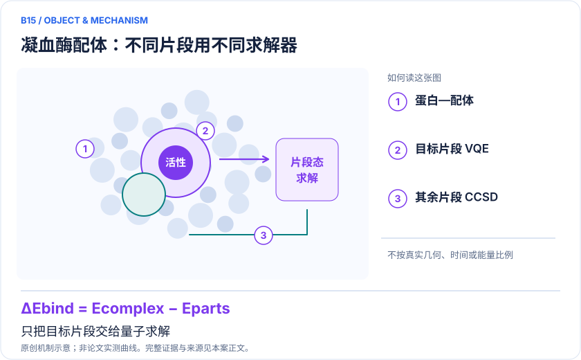
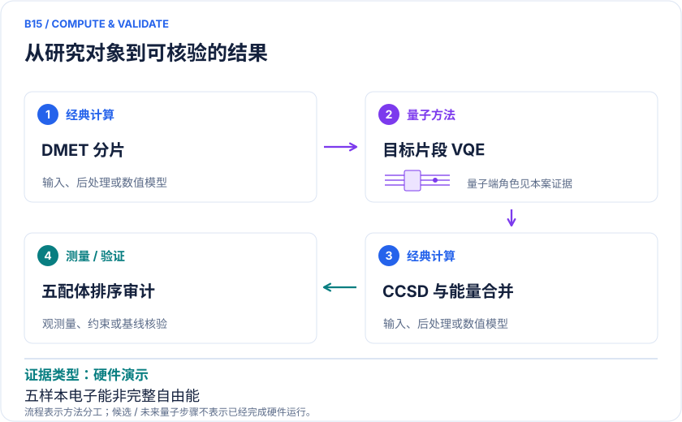

# B15 · 凝血酶五配体：DMET/VQE结合能分解

<!-- VISUALS:START -->
## 可视化导读

**图 1 · 凝血酶配体：不同片段用不同求解器。** 只把目标片段交给量子求解。片段能量、蛋白/真空能差与实验相关性。图形为依据本案文献重绘的概念关系，不表示实际原子坐标、实测曲线或数值比例。

**图 2 · 计算与验证路径。** DMET划分→目标片段VQE→其他片段CCSD→经典能量合并。**证据边界：** 静态结合电子能不是自由能；5样本相关性不稳；部分transpiler不公开。

图解依据：[R1 · Quantum Computing Calculations of Protein–Ligand Binding Energies Using Decomposition Methods on Simulated and Real Quantum Hardware](https://pubs.acs.org/doi/10.1021/acs.jcim.6c00544)；[R2 · Crossing the 12,000-atom barrier with heterogeneous quantum-classical supercomputing: quantum chemistry of protein-ligand complexes](https://arxiv.org/html/2605.01138v2)。解释性连线与图形布局由本库整理，未复制论文原图。

[机制图 SVG](mechanism.svg) · [流程图 SVG](workflow.svg)
<!-- VISUALS:END -->

> 更新：2026-10-04｜近期验证｜证据：硬件演示
> 本文为文献研究与试点建议；未执行计算复现、硬件实验或生物实验。优先级是编辑判断。

**核心发现：** 凝血酶五配体研究将一个片段交给VQE，其余用CCSD；硬件阶段受到4比特和机器时间限制。

| 维度 | 内容 |
|---|---|
| 研发决策 | 检验同系列抑制剂结合能排序能否从局部关联修正受益。 |
| 体系 | Thrombin与5个配体；蛋白用点电荷表示，每个配体分为3片段 |
| 规模口径 | 整体蛋白不在QPU；实际硬件限制4比特，完整5配体独立优化不应默认已完成 |
| 目标量 | 片段能量、蛋白/真空能差与实验相关性 |
| 量子角色 | DMET划分→目标片段VQE→其他片段CCSD→经典能量合并 |
| 经典基线 | 理想UCCSD/CCSD、同片段CASCI、噪声模拟与未分片参考 |
| 主要限制 | 静态结合电子能不是自由能；5样本相关性不稳；部分transpiler不公开。 |

## 决策与价值
本例独立保留docs原B03，因为凝血酶抑制剂排序与万原子EWF扩展不是同一个任务。研发目标是判断局部电子关联是否改变同系列配体的优先次序。可以提出一个很具体的决策：在几何和点电荷一致时，替换哪个分子的哪个片段能改善结合能判别。

## 体系与方法边界
2026论文选择凝血酶及5个配体，每个配体分成3片段，目标片段由VQE处理，其余用CCSD；蛋白则是原子位置上的点电荷。[R1] 因而这里不是整蛋白电子结构，也没有显式传播蛋白与水的完整构象集合。不同片段能量合并时需核对bath、相关势、粒子数与双计数规则。

## 计算目标
需要先定义研究比较的是配体在蛋白环境和真空中的电子能差，还是加上独立蛋白能后的相互作用能。只有保持相同参考零点、边界和环境项，才能解释 ΔE_bind。实验IC50受测量条件和抑制机制影响，不能在没有机制条件时直接用其线性换算为结合自由能。

## 文献实际完成范围
作者先以理想模拟检验UCCSD分片，再研究适合NISQ的线路、优化器和活性空间近似，并在RIKEN-Fujitsu超导平台实验。[R1] 出版方可检索文本明确硬件受4比特和机时限制，不能把所有五配体、真空和蛋白环境的完整优化均视为真机独立收敛。分片规模扩大也可参考EWF研究，但不能混用两者的精度与资源数字。[R2]

## 经典比较与开放性
小片段精确CASCI是必要基准，未分片或更大bath的经典计算检验嵌入误差。仅5个配体的相关系数可能被单点驱动，应报告逐点残差和留一法敏感性。论文公开XYZ结构，但Tangelo到Qulacs相关转译器部分被描述为商业秘密；复现可重建等价公开实现，必须说明与原实现不同。[R1]

## 建议试点与验收
1. 获取结构、点电荷和实验终点，核对配体的质子化与立体化学，保存数据校验值。
2. 从一个配体开始，分别构造真空和蛋白环境的相同轨道/片段定义，以经典方法验证能量闭合。
3. 对目标片段比较CASCI、理想VQE与噪声VQE，检查误差在相减时是抵消还是放大。
4. 再扩到原5配体并加新的盲测类似物；所有参数选择只能使用训练或原公开集合。
5. 验收为新增配体的排序或误差稳定改善，且环境与分片误差不主导结果；若原私有组件导致无法复现，明确停在等价流程而非原论文复现。

## 下一步
近期优先复核输入闭包和结合能定义。把一个可公开复现片段做透，比直接追求五配体相关系数更有价值。

## 已核实来源与访问层级

- **[R1]** [Quantum Computing Calculations of Protein–Ligand Binding Energies Using Decomposition Methods on Simulated and Real Quantum Hardware](https://pubs.acs.org/doi/10.1021/acs.jcim.6c00544)，2026，期刊论文。访问：`search_excerpt`。支持：五配体三片段、静电蛋白、硬件限制与数据开放范围。

- **[R2]** [Crossing the 12,000-atom barrier with heterogeneous quantum-classical supercomputing: quantum chemistry of protein-ligand complexes](https://arxiv.org/html/2605.01138v2)，2026，预印本。访问：`full_text`。支持：两个万原子复合体、94比特、片段求解和基组导致的结合能限制。

`full_text`表示已访问正文并阅读相关段落，不代表补充材料已全部审计；`search_excerpt`表示仅取得原始出版方/作者来源的检索文本，不能当作全文验证。

## 本地资料追溯

- 量子计算在材料计算与药物研发中的具体案例库.html: 原B03
- 量子计算问题库_飞书多维表格导入版.xlsx: 问题库原B16 蛋白-配体局部极化/电荷转移

资料中的原编号与本库案例编号属于不同命名空间，按题名及上述映射追溯。
