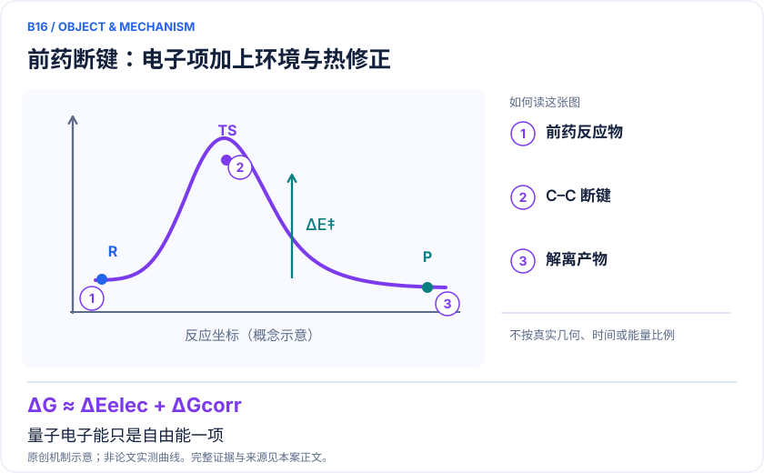
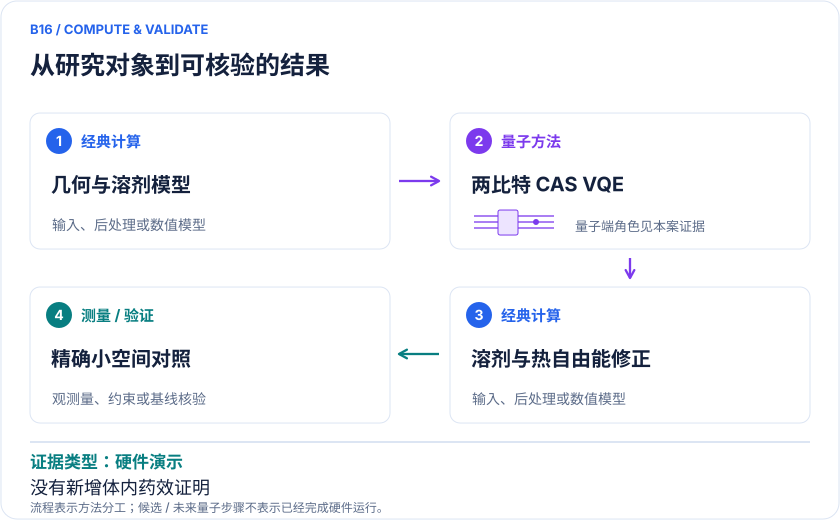

<!-- 由 release/tools/build_problems.py 自 tasks/B16-prodrug-cleavage/README.md 与 tasks/catalog.json 生成，勿手改 -->

# B16 · β-拉帕醌前药：碳碳断键与溶剂化自由能

> 开放题 · 生物医药 · 前药设计 / 活化反应
> 难度：热身（[分级说明](../../../starters/README.md#难度分级)） · 背景：量子化学

## 从这里开始

这是一道热身题。装好 [入门轨道](../../../starters/README.md) 的环境后运行：

```bash
python starters/B16/run.py
```

笔记本约 40 秒（--all 另需数小时）。复现的内容：H2O 与产物 5 的 CAS(2e,2o) 能量和两比特 VQE 能量。脚本逐项对照参照数字并打印 ✓ 或 ✗；之后可以从 [starters/B16/README.md](../../../starters/B16/README.md) 里的「下一步」挑一个方向往下做。

## 题面

| 环节 | 内容 |
|---|---|
| 研究体系 | β-lapachone前药的C–C断裂关键分子；关联KRAS共价键力计算 |
| 可观测量 | 反应自由能与活化自由能的混合估计、溶剂效应 |
| 经典基线 | HF、同CAS CASCI、DFT及更大活性空间；原药物化学实验 |
| 量子方法的角色 | 经典几何/频率→PCM/ddCOSMO→小CAS VQE→经典热校正 |
| 研发决策 | 选择能在目标环境释放母药、在非目标环境保持稳定的触发和连接策略。 |

## 基准输入

原文输入没有完全公开。下表是参照运行实际使用的替代输入，解法可以沿用以便直接比较；取得原文输入或改用其他输入时请说明理由。「原文」指作者或原论文公开的材料，「参照」指本项目参照运行自行冻结的选择。

| 项目 | 内容 | 出处 |
|---|---|---|
| 几何 | 作者公开仓库（commit 1f9e425）中 4、TS、5、6、H₂O 的笛卡尔坐标（B3LYP-D3/6-31+G(d)、SMD 优化） | [原文](https://arxiv.org/html/2401.03759v3) |
| 参照所用模型 | 真空 RHF/6-311G(d,p)，canonical HOMO–LUMO 的 CAS(2e,2o)，另以 CAS(4e,4o) 检查 | 参照 |

**尚未公开或需注意：**溶剂、热修正、原频率与过渡态虚频未闭合，真空 ΔE 不能当作溶液 ΔG‡。

## 什么算解

一份解法满足以下五点即可提交审核。负结果同样接受，只要过程可复现、结论有依据。

1. **模型对应**：说明所用模型或数据如何对应「β-lapachone前药的C–C断裂关键分子；关联KRAS共价键力计算」，列出简化与近似。
2. **可观测量**：报告「反应自由能与活化自由能的混合估计、溶剂效应」，附单位与不确定度。
3. **经典对照**：在同一模型或数据上，与「HF、同CAS CASCI、DFT及更大活性空间；原药物化学实验」中至少一种方法比较。
4. **可复现**：提供代码、环境、随机种子、输入来源与哈希，以及计算资源和成本；用到 QPU 时注明设备与 shots。
5. **研发决策**：说明结果能否支撑「选择能在目标环境释放母药、在非目标环境保持稳定的触发和连接策略。」，以及还缺什么证据。

本题的细化标准欢迎在 issue 中讨论；被采纳的讨论结论会写入后续版本。

## 现有参照

本项目已有数值执行记录（经典计算机上的计算与模拟），供对照与复用，不代表最优解。

- 原应用目标：未完成（incomplete）
- 最新研究报告：[REFERENCE.md](REFERENCE.md)
- 其余证据指针见 evidence.json（本地证据，未随题库发布）

### 原案例说明

### B16 · β-拉帕醌前药：碳碳断键与溶剂化自由能

<!-- VISUALS:START -->
#### 可视化导读



**图 1 · 前药断键：电子项加上环境与热修正。** 量子电子能只是自由能一项。反应自由能与活化自由能的混合估计、溶剂效应。图形为依据本案文献重绘的概念关系，不表示实际原子坐标、实测曲线或数值比例。



**图 2 · 计算与验证路径。** 经典几何/频率→PCM/ddCOSMO→小CAS VQE→经典热校正。**证据边界：** 两比特化学可经典精确解；量子论文未新证明药效或体内选择性。

图解依据：[R1 · A Hybrid Quantum Computing Pipeline for Real World Drug Discovery](https://arxiv.org/html/2401.03759v3)；[R2 · A Carbon-Carbon Bond Cleavage-Based Prodrug Activation Strategy Applied to β-Lapachone for Cancer-Specific Targeting](https://onlinelibrary.wiley.com/doi/10.1002/anie.202210001)。解释性连线与图形布局由本库整理，未复制论文原图。

[机制图 SVG](mechanism.svg) · [流程图 SVG](workflow.svg) · 机制图 PNG（本地证据，未随题库发布） · 流程图 PNG（本地证据，未随题库发布） · 图解说明 JSON（本地证据，未随题库发布）
<!-- VISUALS:END -->


> 更新：2026-10-04｜近期验证｜证据：硬件演示
> 本文为文献研究与试点建议；未执行计算复现、硬件实验或生物实验。优先级是编辑判断。

**核心发现：** β-lapachone前药活化被缩减到2电子2轨道并用2比特演示，药理实验来自先前独立研究。

| 维度 | 内容 |
|---|---|
| 研发决策 | 选择能在目标环境释放母药、在非目标环境保持稳定的触发和连接策略。 |
| 体系 | β-lapachone前药的C–C断裂关键分子；关联KRAS共价键力计算 |
| 规模口径 | CAS(2e,2o)经parity约化到2比特；环境和热G修正经典完成 |
| 目标量 | 反应自由能与活化自由能的混合估计、溶剂效应 |
| 量子角色 | 经典几何/频率→PCM/ddCOSMO→小CAS VQE→经典热校正 |
| 经典基线 | HF、同CAS CASCI、DFT及更大活性空间；原药物化学实验 |
| 主要限制 | 两比特化学可经典精确解；量子论文未新证明药效或体内选择性。 |

#### 研发决策与实际价值
前药的关键不是最大结合亲和力，而是在正确位置、正确时间释放活性母药。C–C断裂策略能服务缺少传统可修饰官能团的分子，本例以β-拉帕醌为对象。计算任务应明确区分触发反应、连接体自消除和母药释放，不能把一个化学步骤的低势垒等同于完整体内选择性。

#### 原始实验与量子研究的关系
2022化学研究提出ROS响应的β-lapachone前药策略，并报道与NQO1相关的细胞和体内效应。[R2] 2024量子流程选择这一已存在的化学问题做计算示范。实验并非由量子论文首次发现，不能把原前药药效归功于量子设计。[R1]

#### 计算链与规模
量子部分选取C–C断裂关键物种，经典优化结构后在CAS(2电子,2轨道)计算，parity映射及约化后为2比特。水溶剂由ddCOSMO等连续介质处理，热G校正取自HF层级。[R1] 因此“量子自由能”实际是多来源项组合，而不是量子设备直接测量溶液配分函数。

#### 如何解释目标量
建议把总估计逐项展开：G≈E_el+ΔG_solv+G_thermal，并标明哪个项由QPU贡献、哪个由经典方法提供。ΔG决定热力学驱动，ΔG‡决定在相应动力学模型下的反应快慢；低势垒本身不决定反应自发性。实际药物释放还包括触发剂浓度、竞争反应、转运和清除。

#### 文献结果与资源边界
这项流程证明小CAS的反应电子计算可以和溶剂化、热修正及药物应用衔接。[R1] 两比特实例有精确经典对照，现有结果适合验证接口而非优势。论文还包含KRAS共价相互作用/力的另一分支，应与本例C–C活化分开评价；不能将其动态轨迹误差或计时直接当成本例性能。

#### 建议试点
1. 提取全部反应物种、过渡态与质子化，检查原子守恒、电荷守恒以及溶液标准态。
2. 在同基组上复核HF、CASCI与VQE电子能，单独列溶剂和热校正，并检查势垒的参考物种。
3. 对参与断键的轨道做逐步扩空间，检查2e/2o是否遗漏重要重排或电荷转移。
4. 改变合理介电环境及代表构象，观察活化排序是否稳定；任何环境敏感性都要与电子求解误差并列。
5. 验收为混合自由能算账闭合、原型能差可重复且结论经模型扩大仍成立。若扩空间或显式溶剂改变主结论，应停止把两比特结果用于药化决策。

#### 下一步
优先完成反应路径、溶剂和热力学一致性审计。这个案例能培训真实药物问题如何拆成量子子任务，但商业前药效果必须由独立化学与生物实验验证。

#### 已核实来源与访问层级

- **[R1]** [A Hybrid Quantum Computing Pipeline for Real World Drug Discovery](https://arxiv.org/html/2401.03759v3)，2024，期刊论文。访问：`full_text`。支持：β-lapachone、CAS(2e,2o)、2比特、ddCOSMO和HF热G修正。

- **[R2]** [A Carbon-Carbon Bond Cleavage-Based Prodrug Activation Strategy Applied to β-Lapachone for Cancer-Specific Targeting](https://onlinelibrary.wiley.com/doi/10.1002/anie.202210001)，2022，期刊论文。访问：`search_excerpt`。支持：ROS响应触发、C–C释放β-lapachone与独立药理实验。

`full_text`表示已访问正文并阅读相关段落，不代表补充材料已全部审计；`search_excerpt`表示仅取得原始出版方/作者来源的检索文本，不能当作全文验证。

#### 本地资料追溯

- 量子计算在材料计算与药物研发中的具体案例库.html: 原B06
- 量子计算问题库_飞书多维表格导入版.xlsx: 问题库原B12 共价药物形成/解离的化学势垒；原B18 溶剂化困难能量差

资料中的原编号与本库案例编号属于不同命名空间，按题名及上述映射追溯。

## 如何提交

按 [CONTRIBUTING.md](../../../CONTRIBUTING.md) 把解法放在 `solutions/B16/<你的名字>-<短名>/`，格式见 [解法模板](../../../solutions/_template/SOLUTION.md)。被采纳的解法会按 [沉淀规则](../../../skills/README.md) 提炼为可复用的 skill。
