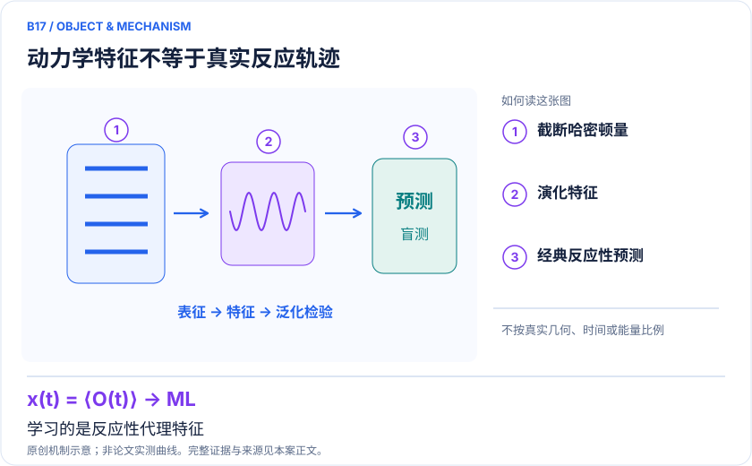
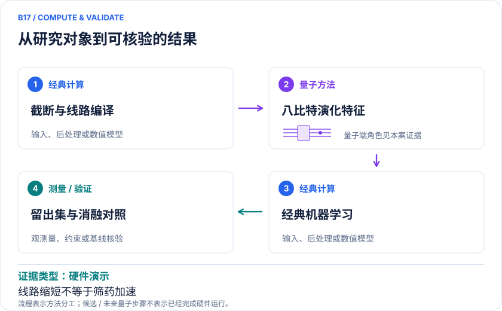

<!-- 由 release/tools/build_problems.py 自 tasks/B17-sulfonyl-fluoride-dynamics/README.md 与 tasks/catalog.json 生成，勿手改 -->

# B17 · 磺酰氟共价药：哈密顿量动力学作为反应性特征

> 开放题 · 生物医药 · 反应性预测 / 量子特征
> 难度：进阶（[分级说明](../../../starters/README.md#难度分级)） · 背景：凝聚态与动力学

## 题面

| 环节 | 内容 |
|---|---|
| 研究体系 | 含sulfonyl fluoride的药用共价抑制剂片段 |
| 可观测量 | 时间相关特征、下游反应性预测误差、截断误差界 |
| 经典基线 | 完整理想动力学、经典量化特征、相同ML/数据划分 |
| 量子方法的角色 | 哈密顿量项截断→Clifford分解与变换→硬件转译→经典ML |
| 研发决策 | 在warhead结构修改时筛掉反应性过低或潜在非特异反应过强的分子。 |

## 基准输入

解法默认使用下列输入，以便与现有参照和其他解法直接比较；改用其他输入时请说明理由。「原文」指作者或原论文公开的材料，「参照」指本项目参照运行自行冻结的选择。

| 项目 | 内容 | 出处 |
|---|---|---|
| 几何 | 作者公开 268 个结构的 XYZ 坐标（固定 commit） | [原文](https://github.com/Kowalikov/efficient_hamiltonian_simulation_2025_data/tree/2ce40d9875afe63c7d2c08e51c87a17931728d45) |
| 论文 | arXiv:2412.15804v4 | [原文](https://arxiv.org/abs/2412.15804v4) |
| 参照所用模型 | Mol_009（31 原子、138 电子），全电子 6-31+G**（380 AO），中性单重态 | 参照 |

**尚未公开或需注意：**DMET 哈密顿量、观测量系数、初态与 GSK 保密子集未公开，仅凭 XYZ 不能唯一重建原模型。

## 什么算解

一份解法满足以下五点即可提交审核。负结果同样接受，只要过程可复现、结论有依据。

1. **模型对应**：说明所用模型或数据如何对应「含sulfonyl fluoride的药用共价抑制剂片段」，列出简化与近似。
2. **可观测量**：报告「时间相关特征、下游反应性预测误差、截断误差界」，附单位与不确定度。
3. **经典对照**：在同一模型或数据上，与「完整理想动力学、经典量化特征、相同ML/数据划分」中至少一种方法比较。
4. **可复现**：提供代码、环境、随机种子、输入来源与哈希，以及计算资源和成本；用到 QPU 时注明设备与 shots。
5. **研发决策**：说明结果能否支撑「在warhead结构修改时筛掉反应性过低或潜在非特异反应过强的分子。」，以及还缺什么证据。

本题的细化标准欢迎在 issue 中讨论；被采纳的讨论结论会写入后续版本。

## 现有参照

本项目已有数值执行记录（经典计算机上的计算与模拟），供对照与复用，不代表最优解。

- 原应用目标：未完成（incomplete）
- 最新研究报告：[REFERENCE.md](REFERENCE.md)
- 其余证据指针见 evidence.json（本地证据，未随题库发布）

### 原案例说明

### B17 · 磺酰氟共价药：哈密顿量动力学作为反应性特征

<!-- VISUALS:START -->
#### 可视化导读

**图 1 · 动力学特征不等于真实反应轨迹。** 学习的是反应性代理特征。时间相关特征、下游反应性预测误差、截断误差界。图形为依据本案文献重绘的概念关系，不表示实际原子坐标、实测曲线或数值比例。

**图 2 · 计算与验证路径。** 哈密顿量项截断→Clifford分解与变换→硬件转译→经典ML。**证据边界：** 不是量子模拟真实成键过程的完整动力学；深度倍数不是药物筛选加速倍数。

图解依据：[R1 · Circuit Depth Reduction for Executable Hamiltonian Dynamics of Covalent Inhibitor Reactivity on Quantum Hardware](https://arxiv.org/abs/2412.15804v4)；[R2 · CovAngelo: A hybrid quantum-classical computing platform for accurate and scalable drug discovery](https://arxiv.org/html/2604.10487v1)。解释性连线与图形布局由本库整理，未复制论文原图。

[机制图 SVG](mechanism.svg) · [流程图 SVG](workflow.svg) · 机制图 PNG（本地证据，未随题库发布） · 流程图 PNG（本地证据，未随题库发布） · 图解说明 JSON（本地证据，未随题库发布）
<!-- VISUALS:END -->

> 更新：2026-10-04｜探索观察｜证据：硬件演示
> 本文为文献研究与试点建议；未执行计算复现、硬件实验或生物实验。优先级是编辑判断。

**核心发现：** 降低线路深度使8比特动力学子线路可执行，但ML预测收益与线路压缩收益是两项独立结论。

| 维度 | 内容 |
|---|---|
| 研发决策 | 在warhead结构修改时筛掉反应性过低或潜在非特异反应过强的分子。 |
| 体系 | 含sulfonyl fluoride的药用共价抑制剂片段 |
| 规模口径 | 代表性8比特哈密顿量动力学；大设备名称不等于用满设备 |
| 目标量 | 时间相关特征、下游反应性预测误差、截断误差界 |
| 量子角色 | 哈密顿量项截断→Clifford分解与变换→硬件转译→经典ML |
| 经典基线 | 完整理想动力学、经典量化特征、相同ML/数据划分 |
| 主要限制 | 不是量子模拟真实成键过程的完整动力学；深度倍数不是药物筛选加速倍数。 |

#### 决策与价值
磺酰氟warhead的反应性影响共价标记或抑制剂应用。与B08直接求反应路径不同，本例把量子哈密顿量演化得到的信号用作下游预测特征。价值判断应针对“相同数据与预算下能否更好预测实验反应性”，不能只看线路压缩幅度。

#### 来源版本与对象
原docs采用早期题名“Efficient Hamiltonian Simulation: A Utility Scale Perspective for Covalent Inhibitor Reactivity Prediction”。截至2026-10-04，arXiv同编号最新v4于8月28日改为现列题名，明确为磺酰氟相关化合物。保留同编号便于追溯，但方法和数字应按v4解释。[R1]

#### 数学与算法目标
从电子哈密顿量H生成 U(t)=exp(−iHt)，提取某些观测量的时间序列，再训练经典回归器。这里的时间演化是所选哈密顿量及初态的动力学特征；若没有真实反应核自由度和环境，它不是实验成键反应的直接轨迹。截断H的项可以减少深度，但必须同时控制所需观测量误差。

#### 实际结果
v4在全连接与Heron连接条件下分别报告最多28.5和15.5倍深度降低；8比特示例的转译ISA深度1330经过中间件分解后执行更浅子线路，最大子线路深度371、双比特门216。[R1] 这些数字属于线路实现。CovAngelo提供另一种直接反应模型路线，可作为任务区分参照，而不是替本研究增加药物实验支持。[R2]

#### 经典比较与风险
原始片段很小，理想演化可在经典计算机上比较，适合评估硬件误差。经典电子特征和指纹也可训练反应性预测器，因此必须比较“信息增益”而非只比线路是否跑通。若训练和测试包含相似warhead骨架，性能可能来自系列记忆。项截断优化若使用了测试集标签，会把硬件调参变成数据泄漏。

#### 建议试点
1. 冻结片段几何、基组、初态、时间网格和观测量，同时保存实验反应性定义、条件与单位。
2. 在理想模拟中逐级截断Hamiltonian，验证观测量误差界与预测误差之间的关系，避免用态保真度替代目标量。
3. 对同一数据划分比较指纹、DFT描述符、理想量子特征及硬件特征；使用相同回归器和调参上限。
4. 完整计入子线路数量、重构采样开销和后处理；浅子线路不必然意味着总shots或总墙钟下降。
5. 验收为骨架外独立反应性预测有稳定增益，且量子硬件噪声不会反转候选排序。若只减少深度却无决策增益，作为编译成果交付，不升级为应用优势。

#### 下一步
先实施可公开验证的特征消融；真实药用选择性还需蛋白环境及脱靶实验。本例列探索观察，因为编译可执行性证据强于端到端药物价值证据。

#### 已核实来源与访问层级

- **[R1]** [Circuit Depth Reduction for Executable Hamiltonian Dynamics of Covalent Inhibitor Reactivity on Quantum Hardware](https://arxiv.org/abs/2412.15804v4)，2026，预印本。访问：`abstract`。支持：磺酰氟反应性特征、8比特硬件、深度压缩；v1首发2024。

- **[R2]** [CovAngelo: A hybrid quantum-classical computing platform for accurate and scalable drug discovery](https://arxiv.org/html/2604.10487v1)，2026，预印本。访问：`full_text`。支持：BTK工作流、简化过渡态8比特演示、20倍T门估算边界。

`full_text`表示已访问正文并阅读相关段落，不代表补充材料已全部审计；`search_excerpt`表示仅取得原始出版方/作者来源的检索文本，不能当作全文验证。

#### 本地资料追溯

- 量子计算在材料计算与药物研发中的具体案例库.html: 原B05
- 量子计算问题库_飞书多维表格导入版.xlsx: 问题库原B12 共价药物形成/解离的化学势垒

资料中的原编号与本库案例编号属于不同命名空间，按题名及上述映射追溯。

## 如何提交

按 [CONTRIBUTING.md](../../../CONTRIBUTING.md) 把解法放在 `solutions/B17/<你的名字>-<短名>/`，格式见 [解法模板](../../../solutions/_template/SOLUTION.md)。被采纳的解法会按 [沉淀规则](../../../skills/README.md) 提炼为可复用的 skill。
