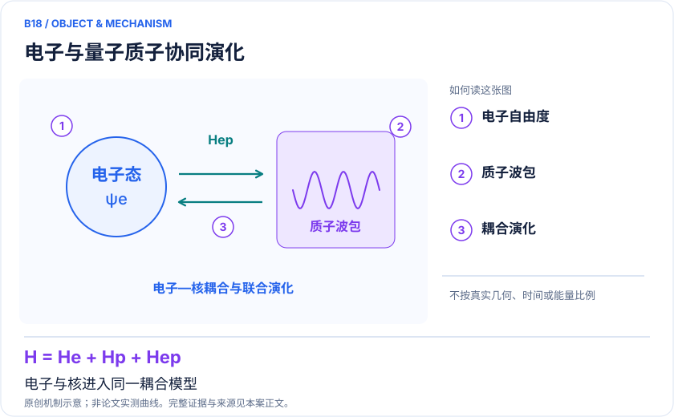
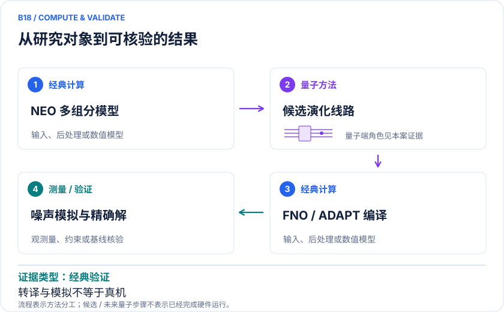

<!-- 由 release/tools/build_problems.py 自 tasks/B18-malonaldehyde-proton/README.md 与 tasks/catalog.json 生成，勿手改 -->

# B18 · 丙二醛：电子—质子动力学与NEO线路编译

> 开放题 · 生物医药 · 质子转移 / 非绝热模型

## 题面

| 环节 | 内容 |
|---|---|
| 研究体系 | Malonaldehyde质子转移模型；没有真实蛋白或药物结合环境 |
| 可观测量 | 质子密度、转移布居、电子—核纠缠、势垒与近似动力学量 |
| 经典基线 | 同截断多组分经典精确解、DVR/波包法、Born–Oppenheimer与非绝热对照 |
| 量子方法的角色 | NEO多组分哈密顿量、二次量子化演化；FNO/ADAPT与近似编译 |
| 研发决策 | 判断显式处理质子量子态能否改变势垒、离域及动力学解释，并验证可压缩线路。 |

## 基准输入

原文输入没有完全公开。下表是参照运行实际使用的替代输入，解法可以沿用以便直接比较；取得原文输入或改用其他输入时请说明理由。「原文」指作者或原论文公开的材料，「参照」指本项目参照运行自行冻结的选择。

| 项目 | 内容 | 出处 |
|---|---|---|
| 哈密顿量 | 作者公开 Left、Right（各 5,229 项）与 Middle（3,607 项）三个 18 比特哈密顿量（固定 commit） | [原文](https://github.com/stfc/quantum-neo-dynamics/tree/11bbce067a250eb7dc7b91994dc9fd5f4d483566) |
| 论文 | PCCP，arXiv:2507.08996 | [原文](https://doi.org/10.1039/D5CP04097C) |

**尚未公开或需注意：**22 比特 Jordan–Wigner 到 18 比特的模式顺序、Clifford 变换与电子/质子数算符未公开，比特 0 不对应质子占据。

## 什么算解

一份解法满足以下五点即可提交审核。负结果同样接受，只要过程可复现、结论有依据。

1. **模型对应**：说明所用模型或数据如何对应「Malonaldehyde质子转移模型；没有真实蛋白或药物结合环境」，列出简化与近似。
2. **可观测量**：报告「质子密度、转移布居、电子—核纠缠、势垒与近似动力学量」，附单位与不确定度。
3. **经典对照**：在同一模型或数据上，与「同截断多组分经典精确解、DVR/波包法、Born–Oppenheimer与非绝热对照」中至少一种方法比较。
4. **可复现**：提供代码、环境、随机种子、输入来源与哈希，以及计算资源和成本；用到 QPU 时注明设备与 shots。
5. **研发决策**：说明结果能否支撑「判断显式处理质子量子态能否改变势垒、离域及动力学解释，并验证可压缩线路。」，以及还缺什么证据。

本题的细化标准欢迎在 issue 中讨论；被采纳的讨论结论会写入后续版本。

## 现有参照

本项目已有数值执行记录（经典计算机上的计算与模拟），供对照与复用，不代表最优解。

- 原应用目标：未完成（incomplete）
- 最新研究报告：[REFERENCE.md](REFERENCE.md)
- 其余证据指针见 evidence.json（本地证据，未随题库发布）

### 原案例说明

### B18 · 丙二醛：电子—质子动力学与NEO线路编译

<!-- VISUALS:START -->
#### 可视化导读

**图 1 · 电子与量子质子协同演化。** 电子与核进入同一耦合模型。质子密度、转移布居、电子—核纠缠、势垒与近似动力学量。图形为依据本案文献重绘的概念关系，不表示实际原子坐标、实测曲线或数值比例。

**图 2 · 计算与验证路径。** NEO多组分哈密顿量、二次量子化演化；FNO/ADAPT与近似编译。**证据边界：** 为处理器转译和噪声模拟不等于真实设备运行；2025预印本与2026期刊设备模型不同。

图解依据：[R1 · Nonadiabatic nuclear-electron dynamics: a quantum computing approach](https://arxiv.org/abs/2306.01671)；[R2 · Approximate quantum circuit compilation for proton-transfer kinetics on quantum processors](https://doi.org/10.1039/D5CP04097C)；[R3 · Approximate quantum circuit compilation for proton-transfer kinetics on quantum processors](https://arxiv.org/abs/2507.08996)。解释性连线与图形布局由本库整理，未复制论文原图。

[机制图 SVG](mechanism.svg) · [流程图 SVG](workflow.svg) · 机制图 PNG（本地证据，未随题库发布） · 流程图 PNG（本地证据，未随题库发布） · 图解说明 JSON（本地证据，未随题库发布）
<!-- VISUALS:END -->

> 更新：2026-10-04｜重点储备｜证据：经典验证
> 本文为文献研究与试点建议；未执行计算复现、硬件实验或生物实验。优先级是编辑判断。

**核心发现：** 同一质子转移原型连接2023多组分动力学算法与2026噪声模型编译研究，尚不能称真实酶真机模拟。

| 维度 | 内容 |
|---|---|
| 研发决策 | 判断显式处理质子量子态能否改变势垒、离域及动力学解释，并验证可压缩线路。 |
| 体系 | Malonaldehyde质子转移模型；没有真实蛋白或药物结合环境 |
| 规模口径 | 电子与质子采用多组分轨道截断；2026出版版以18比特对应硬件噪声模型为线索 |
| 目标量 | 质子密度、转移布居、电子—核纠缠、势垒与近似动力学量 |
| 量子角色 | NEO多组分哈密顿量、二次量子化演化；FNO/ADAPT与近似编译 |
| 经典基线 | 同截断多组分经典精确解、DVR/波包法、Born–Oppenheimer与非绝热对照 |
| 主要限制 | 为处理器转译和噪声模拟不等于真实设备运行；2025预印本与2026期刊设备模型不同。 |

#### 决策与应用价值
本例是生物质子转移研究的方法前哨：先在可验证的小分子上弄清电子与质子如何共同演化，再考虑酶活性中心。它直接服务于方法选择，而不直接筛选候选药物。适合比较绝热与非绝热模型是否给出不同质子密度、转移布居或能垒。

#### 两项研究对应的不同任务
2023论文提出多组分二次量子化的电子—核时间演化算法，并以丙二醛质子转移为例讨论电子不能瞬时跟随核移动时的纠缠。[R1] 2026论文则关注NEO下的态制备和线路压缩，在理想与现实噪声模型中检查势垒和质子离域密度。[R2] 两者共享分子原型，但一个偏动力学算法、一个偏可执行线路，不应合成“已完整真机预测转移速率”。

#### 数学与建模范围
NEO把选定质子也量子化，哈密顿量包含电子、质子及电子—质子相互作用。其他核可能仍固定或经典处理，因此必须列出被量子化的核、质子轨道基、电子活性空间和总粒子数。输出的密度是所选模型的ρ_p(r)，不同基组下的密度和势垒变化同样属于模型误差。

#### 版本核验与事实边界
2025 arXiv版本写明为ibm_fez转译并使用硬件噪声模型，报告压缩后势垒与参考相差13%范围。[R3] 2026出版方可检索正文改用ibm_pittsburgh的噪声模型并区分理想和低保真线路。[R2] 本次不把早期版本的13%直接当出版最终值，也不将设备噪声参数当实际真机测量。原docs“在量子处理器上”应据此收紧。

#### 经典比较
小空间可用多组分精确对角化或波包法给出严格验证。还应比较同一势能面的绝热核动力学，辨认差异来自非绝热物理还是电子/质子基的不同。计算核量子效应并不强制需要量子硬件；传统DVR、MCTDH和路径积分在适用条件下是实质性竞争者。

#### 建议试点与验收
1. 固定一个版本及其所有截断，记录被量子化质子的质量与轨道，确保H/D替换只改变适当质量项。
2. 在同一模型用经典精确求解建立基态、质子密度和短时演化参照，检查归一化、粒子数与能量守恒。
3. 扫描编译压缩率，分别报告态保真度、目标势垒误差和密度偏差；不能以高保真自动保证小能差准确。
4. 在同一参数下比较理想、噪声模拟和未来可获得的真机，三类结果分开保存。
5. 验收是目标观测量稳定收敛且能解释非绝热差异；若基组/时间步误差大于线路误差，先改经典模型。

#### 下一步
优先做小分子的完整模型核验。只有电子—质子算法与环境接口分别可验证，才有理由转向B13的LOX等酶体系；目前本例不证明真实酶的KIE、隧穿增强因子或量子优势。

#### 已核实来源与访问层级

- **[R1]** [Nonadiabatic nuclear-electron dynamics: a quantum computing approach](https://arxiv.org/abs/2306.01671)，2023，期刊论文。访问：`abstract`。支持：多组分时间演化与丙二醛模型。

- **[R2]** [Approximate quantum circuit compilation for proton-transfer kinetics on quantum processors](https://doi.org/10.1039/D5CP04097C)，2026，期刊论文。访问：`search_excerpt`。支持：期刊版NEO线路压缩；理想及ibm_pittsburgh噪声模型。

- **[R3]** [Approximate quantum circuit compilation for proton-transfer kinetics on quantum processors](https://arxiv.org/abs/2507.08996)，2025，预印本。访问：`abstract`。支持：早期预印本ibm_fez噪声模型和13%势垒偏差。

`full_text`表示已访问正文并阅读相关段落，不代表补充材料已全部审计；`search_excerpt`表示仅取得原始出版方/作者来源的检索文本，不能当作全文验证。

#### 本地资料追溯

- 量子计算在材料计算与药物研发中的具体案例库.html: 原B07、B08
- 量子计算问题库_飞书多维表格导入版.xlsx: 问题库原B07 酶中质子转移势能面（原型映射）；原B08 核量子效应

资料中的原编号与本库案例编号属于不同命名空间，按题名及上述映射追溯。

## 如何提交

按 [CONTRIBUTING.md](../../../CONTRIBUTING.md) 把解法放在 `solutions/B18/<你的名字>-<短名>/`，格式见 [解法模板](../../../solutions/_template/SOLUTION.md)。被采纳的解法会按 [沉淀规则](../../../skills/README.md) 提炼为可复用的 skill。
