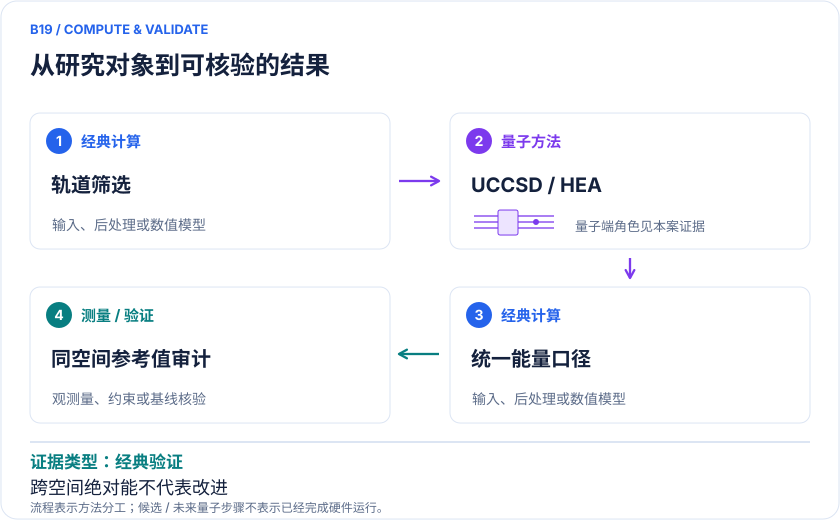

<!-- 由 release/tools/build_problems.py 自 tasks/B19-druglike-active-space/README.md 与 tasks/catalog.json 生成，勿手改 -->

# B19 · 药物样分子：选轨基准及能量定义审计

> 开放题 · 生物医药 · 量子化学选题 / 活性空间

## 题面

| 环节 | 内容 |
|---|---|
| 研究体系 | 水、苯、阿司匹林、奥司他韦、吗啡、洛伐他汀、伊马替尼 |
| 可观测量 | 轨道占据、相关能/相对能、选轨误差、线路资源 |
| 经典基线 | 同CAS CASCI、CASSCF扩大空间、适用时CCSD/DFT |
| 量子方法的角色 | 化学选轨→UCCSD/HEA→理想/硬件分级验证 |
| 研发决策 | 判断哪类药物电子子问题值得交给量子求解器，并避免“大分子小CAS”的虚假规模叙事。 |

## 什么算解

一份解法满足以下五点即可提交审核。负结果同样接受，只要过程可复现、结论有依据。

1. **模型对应**：说明所用模型或数据如何对应「水、苯、阿司匹林、奥司他韦、吗啡、洛伐他汀、伊马替尼」，列出简化与近似。
2. **可观测量**：报告「轨道占据、相关能/相对能、选轨误差、线路资源」，附单位与不确定度。
3. **经典对照**：在同一模型或数据上，与「同CAS CASCI、CASSCF扩大空间、适用时CCSD/DFT」中至少一种方法比较。
4. **可复现**：提供代码、环境、随机种子、输入来源与哈希，以及计算资源和成本；用到 QPU 时注明设备与 shots。
5. **研发决策**：说明结果能否支撑「判断哪类药物电子子问题值得交给量子求解器，并避免“大分子小CAS”的虚假规模叙事。」，以及还缺什么证据。

本题的细化标准欢迎在 issue 中讨论；被采纳的讨论结论会写入后续版本。

## 现有参照

本项目已有数值执行记录（经典计算机上的计算与模拟），供对照与复用，不代表最优解。

- 原应用目标：未完成（incomplete）
- 最新研究报告：[REFERENCE.md](REFERENCE.md)
- 其余证据指针见 evidence.json（本地证据，未随题库发布）

### 原案例说明

### B19 · 药物样分子：选轨基准及能量定义审计

<!-- VISUALS:START -->
#### 可视化导读

**图 1 · 药物样分子：先统一轨道与能量定义。** 同一活性空间内比较误差。轨道占据、相关能/相对能、选轨误差、线路资源。图形为依据本案文献重绘的概念关系，不表示实际原子坐标、实测曲线或数值比例。

**图 2 · 计算与验证路径。** 化学选轨→UCCSD/HEA→理想/硬件分级验证。**证据边界：** Table3/4能量定义与尺度、Fig4/Table2分类需解释；不采纳跨空间能量改善或量子优势。

图解依据：[R1 · Benchmarking the Impact of Active Space Selection on the VQE Pipeline for Quantum Drug Discovery](https://arxiv.org/html/2512.18203v1)；[R2 · Reliably assessing the electronic structure of cytochrome P450 on today’s classical computers and tomorrow’s quantum computers](https://doi.org/10.1073/pnas.2203533119)。解释性连线与图形布局由本库整理，未复制论文原图。

[机制图 SVG](mechanism.svg) · [流程图 SVG](workflow.svg) · 机制图 PNG（本地证据，未随题库发布） · 流程图 PNG（本地证据，未随题库发布） · 图解说明 JSON（本地证据，未随题库发布）
<!-- VISUALS:END -->

> 更新：2026-10-04｜探索观察｜证据：经典验证
> 本文为文献研究与试点建议；未执行计算复现、硬件实验或生物实验。优先级是编辑判断。

**核心发现：** 药样分子选轨基准提供可审计问题，但全文能量/分类口径出现疑点，不能直接采纳其效率与优势结论。

| 维度 | 内容 |
|---|---|
| 研发决策 | 判断哪类药物电子子问题值得交给量子求解器，并避免“大分子小CAS”的虚假规模叙事。 |
| 体系 | 水、苯、阿司匹林、奥司他韦、吗啡、洛伐他汀、伊马替尼 |
| 规模口径 | 模拟表列CAS(2e,2o)/(4e,4o)；实际QPU段为水/苯/阿司匹林2比特HEA |
| 目标量 | 轨道占据、相关能/相对能、选轨误差、线路资源 |
| 量子角色 | 化学选轨→UCCSD/HEA→理想/硬件分级验证 |
| 经典基线 | 同CAS CASCI、CASSCF扩大空间、适用时CCSD/DFT |
| 主要限制 | Table3/4能量定义与尺度、Fig4/Table2分类需解释；不采纳跨空间能量改善或量子优势。 |

#### 决策与价值
药物分子原子多，不意味着量子部分难；只挑两个电子的可解模型也不能说明处理了整分子的相关难点。这个基准应服务选题：哪些轨道真正控制目标化学性质，哪些实例用经典CC/DFT已经足够。近期价值主要是建立筛选与审计规范。

#### docs 与研究范围
原docs B10引用2025预印本。本次读到全文表格后，需更严格区分：奥司他韦、吗啡、洛伐他汀和伊马替尼列在模拟部分；硬件部分明确水、苯、阿司匹林使用2比特HEA。13/60比特是设备规模，不是该分子的量子寄存器规模。[R1]

#### 数学目标与正确比较方式
对于不同活性空间，只有加回冻结核、非活性轨道、核排斥和其他常数后，总能量才可直接比较；比较相关能时还必须确认HF参考与积分定义相同。选轨的真正验收对象应是构象能差、反应性或目标性质，不是某一个部分能量越负越好。不同CAS能量差既可能含物理关联，也可能只是改变了零点。

#### 文献观察与待核疑点
论文提供选轨、UCCSD/HEA和不同执行后端的实验矩阵。[R1] 但Table3给水CASSCF(6,6)相关能约16 mHa，Table4又将较小CAS扩张产生4.931 Ha变化标为相对HF相关能；在不同定义澄清之前，两者不能组成可信的效率排名。Fig4把吗啡放在较适宜区域，而Table2以其占据数分类为弱多参考。这些是本次阅读发现的口径疑点，不是已完成的代码复现或造假判断。[R1]

#### 经典基线与资源边界
2e/2o和4e/4o空间应能用CASCI精确解验证，不能以分子全体系电子数暗示这些小空间超出经典能力。P450经典—量子评估提供更合理思路：先验证关联难度及化学问题，再估资源。[R2] 本条因此不采用预印本的“量子优势窗口”或单位能量降低/时间排名作为成熟结论。

#### 建议试点与停止标准
1. 索取或下载几何、选轨脚本、积分与能量常数；没有输入闭包则只开展文献审计。
2. 从水开始，逐个CAS重构HF参考，验证VQE变分能量不低于同空间精确基态，并确认相同全分子零点。
3. 对阿司匹林和一个大药物重复检查，记录哪些轨道被保留及其空间局域性。
4. 用扩大CAS/CASSCF或合适CC方法评估遗漏关联，比较至少一个化学能差而非仅总能。
5. 将模拟、噪声模拟和真机结果分开；验收要求每个数字可由同版输入重算，所有单位和零点无歧义。
6. 若Table3/4差异无法解释，停止使用其效率结论；仍可保留分子集和选轨问题作为独立新基准。

#### 下一步
先做能量定义审计，再判断研究结论。这个案例本身提醒：覆盖文献不意味着无条件接受文献的每项应用宣传，详细整理应把可用方法与尚待核实的数值分开。

#### 已核实来源与访问层级

- **[R1]** [Benchmarking the Impact of Active Space Selection on the VQE Pipeline for Quantum Drug Discovery](https://arxiv.org/html/2512.18203v1)，2025，预印本。访问：`full_text`。支持：Table1/2/3/4和硬件段落的模型、执行级别及待核不一致。

- **[R2]** [Reliably assessing the electronic structure of cytochrome P450 on today’s classical computers and tomorrow’s quantum computers](https://doi.org/10.1073/pnas.2203533119)，2022，期刊论文。访问：`search_excerpt`。支持：P450经典多参考对照与表面码QPE资源分析；数据公开。

`full_text`表示已访问正文并阅读相关段落，不代表补充材料已全部审计；`search_excerpt`表示仅取得原始出版方/作者来源的检索文本，不能当作全文验证。

#### 本地资料追溯

- 量子计算在材料计算与药物研发中的具体案例库.html: 原B10
- 量子计算问题库_飞书多维表格导入版.xlsx: 问题库原B16 局部电子结构（方法映射）；原B01 活性空间选取（方法映射）

资料中的原编号与本库案例编号属于不同命名空间，按题名及上述映射追溯。

## 如何提交

按 [CONTRIBUTING.md](../../../CONTRIBUTING.md) 把解法放在 `solutions/B19/<你的名字>-<短名>/`，格式见 [解法模板](../../../solutions/_template/SOLUTION.md)。被采纳的解法会按 [沉淀规则](../../../skills/README.md) 提炼为可复用的 skill。
