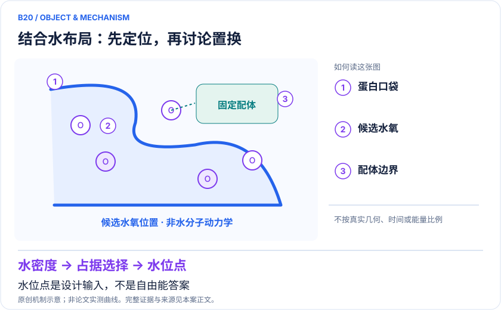
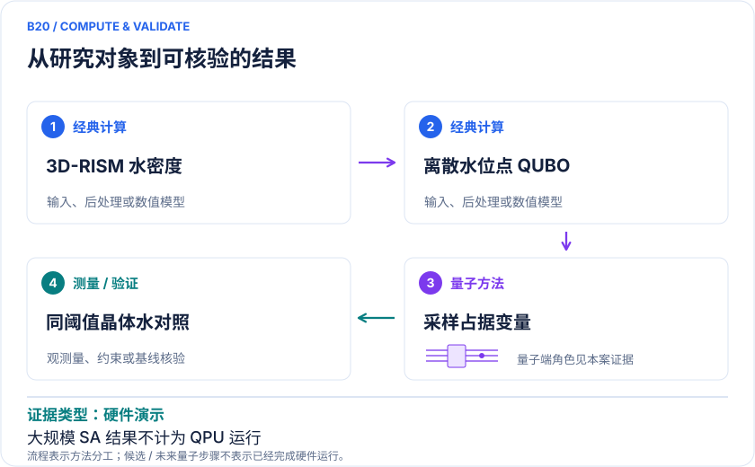

<!-- 由 release/tools/build_problems.py 自 tasks/B20-pocket-hydration-sites/README.md 与 tasks/catalog.json 生成，勿手改 -->

# B20 · 蛋白口袋水合位点：决定保留还是置换结合水

> 开放题 · 生物医药 · 溶剂构型与先导优化

## 题面

| 环节 | 内容 |
|---|---|
| 研究体系 | 五个药物—蛋白复合物及同一蛋白的apo补充结构；水的候选氧位置，不是完整水分子量子动力学 |
| 可观测量 | 离散目标函数、最优样本概率、晶体水覆盖、位置偏差和每个晶体水对应的预测水簇大小 |
| 经典基线 | CPLEX、同QUBO模拟退火SA、贪心局部解；应用层另对照GCMC/3D-RISM水位点预测，使用相同距离阈值 |
| 量子方法的角色 | 经典3D-RISM→高斯密度拟合QUBO→门式量子优化→经典解码氧位置与晶体水比较 |
| 研发决策 | 在设计配体取代基前，识别可能桥接蛋白和配体的水位点，为保水/排水假设提供结构输入。 |

## 什么算解

一份解法满足以下五点即可提交审核。负结果同样接受，只要过程可复现、结论有依据。

1. **模型对应**：说明所用模型或数据如何对应「五个药物—蛋白复合物及同一蛋白的apo补充结构；水的候选氧位置，不是完整水分子量子动力学」，列出简化与近似。
2. **可观测量**：报告「离散目标函数、最优样本概率、晶体水覆盖、位置偏差和每个晶体水对应的预测水簇大小」，附单位与不确定度。
3. **经典对照**：在同一模型或数据上，与「CPLEX、同QUBO模拟退火SA、贪心局部解；应用层另对照GCMC/3D-RISM水位点预测，使用相同距离阈值」中至少一种方法比较。
4. **可复现**：提供代码、环境、随机种子、输入来源与哈希，以及计算资源和成本；用到 QPU 时注明设备与 shots。
5. **研发决策**：说明结果能否支撑「在设计配体取代基前，识别可能桥接蛋白和配体的水位点，为保水/排水假设提供结构输入。」，以及还缺什么证据。

本题的细化标准欢迎在 issue 中讨论；被采纳的讨论结论会写入后续版本。

## 现有参照

本项目已有数值执行记录（经典计算机上的计算与模拟），供对照与复用，不代表最优解。

- 原应用目标：状态未记录
- 最新研究报告：[REFERENCE.md](REFERENCE.md)
- 其余证据指针见 evidence.json（本地证据，未随题库发布）

### 原案例说明

### B20 · 蛋白口袋水合位点：决定保留还是置换结合水

<!-- VISUALS:START -->
#### 可视化导读

**图 1 · 结合水布局：先定位，再讨论置换。** 水位点是设计输入，不是自由能答案。离散目标函数、最优样本概率、晶体水覆盖、位置偏差和每个晶体水对应的预测水簇大小。图形为依据本案文献重绘的概念关系，不表示实际原子坐标、实测曲线或数值比例。

**图 2 · 计算与验证路径。** 经典3D-RISM→高斯密度拟合QUBO→门式量子优化→经典解码氧位置与晶体水比较。**证据边界：** 900变量结果为经典SA；位置覆盖依赖阈值与密度离散；水位点匹配不是水置换自由能，也没有端到端量子优势。

图解依据：[R1 · Practical protein-pocket hydration-site prediction for drug discovery on a quantum computer](https://arxiv.org/html/2512.08390v1)；[R2 · Leveraging analog quantum computing with neutral atoms for solvent configuration prediction in drug discovery](https://journals.aps.org/prresearch/abstract/10.1103/PhysRevResearch.6.043020)；[R3 · Water Networks in Complexes between Proteins and FDA-Approved Drugs](https://pmc.ncbi.nlm.nih.gov/articles/PMC9832485/)；[R4 · Practical protein-pocket hydration-site prediction for drug discovery on a quantum computer](https://journals.aps.org/prresearch/abstract/10.1103/gyqr-mv1h)。解释性连线与图形布局由本库整理，未复制论文原图。

[机制图 SVG](mechanism.svg) · [流程图 SVG](workflow.svg) · 机制图 PNG（本地证据，未随题库发布） · 流程图 PNG（本地证据，未随题库发布） · 图解说明 JSON（本地证据，未随题库发布）
<!-- VISUALS:END -->

> 更新：2026-10-04｜近期验证｜证据：硬件演示
> 本轮新增；文献核查与验证建议，不是本地数值复现。

**核心发现：** 从经典3D-RISM水密度构造离散水位点QUBO，量子硬件解到123变量；真实用途是水位点布局，强经典启发式仍有竞争力。

| 维度 | 内容 |
|---|---|
| 研发决策 | 在设计配体取代基前，识别可能桥接蛋白和配体的水位点，为保水/排水假设提供结构输入。 |
| 研究对象 | 五个药物—蛋白复合物及同一蛋白的apo补充结构；水的候选氧位置，不是完整水分子量子动力学 |
| 规模口径 | 常规测试41–116变量；另含123变量实例；运行于IBM Heron设备。更大如900变量分析使用经典SA，不能算作量子执行。 |
| 可观测量 | 离散目标函数、最优样本概率、晶体水覆盖、位置偏差和每个晶体水对应的预测水簇大小 |
| 量子分工 | 经典3D-RISM→高斯密度拟合QUBO→门式量子优化→经典解码氧位置与晶体水比较 |
| 经典基线 | CPLEX、同QUBO模拟退火SA、贪心局部解；应用层另对照GCMC/3D-RISM水位点预测，使用相同距离阈值 |
| 不能外推 | 900变量结果为经典SA；位置覆盖依赖阈值与密度离散；水位点匹配不是水置换自由能，也没有端到端量子优势。 |

#### 去重说明：为什么是新案例

B06直接估计两配体的相对结合自由能；B11对接优化配体接触图；B15分解结合电子能。本案固定蛋白/配体结构，优化口袋中的水位置，输出给后续先导优化使用，既不改配体姿态也不直接计算结合自由能。2024中性原子二维工作和2025/2026三维门式工作按同一水位点任务合并，不拆成两案。

最近相关旧案：B06、B11、B15。本案决策键：`protein-pocket/hydration-site-occupancy/water-displacement-input`。

#### 应用价值与必要的决策接口

药化团队常需要判断一个取代基是否应该伸入原有水位点。第一步是定位可能稳定存在的水；下一步才是评估置换后相互作用与熵的净变化。本文的量子接口只完成第一步的离散优化。高价值来自可接入真实结构设计流程，而非认定每个口袋都需要量子资源。晶体水遗漏、占据率和网络协同性也会影响实验参照。[R1][R3]

#### 模型与计算链

先在经典端处理蛋白、质子化和配体，求3D-RISM连续水密度；将其表示为候选中心的高斯函数组合，二元变量决定是否在某点放置一个水氧，目标是在重构密度与原密度之间减小误差。线路测量比特串后，取占据变量对应坐标，再用经典程序统计位置匹配。QPU没有求解蛋白电子结构，也没有采样真实水分子的全部取向。[R1]

可把量子求解器视为接口 `QUBO → 候选水氧坐标`。同一输入能直接送入SA和精确优化器，便于做模块替换实验。水密度模型与求解器必须分别检查：即使QUBO全局最优，若密度模型或网格有偏，药化判断仍可能错误。

#### 实际结果与反优势证据

论文的116变量示例中，量子与SA的最优采样概率分别约9%和2%；不能将这个单例写成整体胜出。对123变量困难实例，经典CPLEX未在所设截止时间内证明最优，但SA与量子解具有相同最佳目标值，而且SA取得该值的概率更高。作者对常规小测试集也明确表示，精确经典求解足够快，不会实际部署量子资源。[R1]

更大问题的水位点改善依赖经典SA放大实验，不是更大QPU的实测结果。2024二维中性原子研究与后续三维门式研究构成方法演进，而不构成两条相互独立的产业收益证明。[R1][R2]

#### 评价口径：位置匹配不是结合自由能

量子论文使用晶体水附近3 Å内是否存在预测水来定义一种覆盖指标，并额外报告位置与簇大小。经典GCMC工作在另一数据集、1.4 Å阈值下报告81.4%预测率。阈值、结构集和是否保留配体都不同，不能直接用两项百分比排名。[R1][R3]

真正的公平对照需要统一PDB准备、是否holo/apo、评价半径、晶体水质量过滤及误差条。多放水可能提高召回，却同时制造假阳性；因此还要检查每个位点对应的预测水数量和整体精确率。

#### 建议试点、验收与停止条件

1. 冻结一个公开PDB的有配体/去配体两套输入，保留原子及水编号；验证3D-RISM密度和网格单位。
2. 导出完全相同的QUBO，记录变量数、网格间距、阈值和高斯宽度，以经典精确解建立可验收小问题。
3. 同时间或同采样预算比较SA、局部解和量子解；同时记录排队、训练、编译、采样及经典后处理。
4. 使用预注册的距离阈值和晶体水过滤规则，报告召回、假阳性、位置误差及置信区间；留出其他蛋白验证泛化。
5. 再把候选水网交给独立GCMC或自由能流程，检验其是否改变配体设计决策。
6. 若优化器差异小于密度模型/网格误差，或SA在同预算下保持优势，停止“量子加速”论证，保留模型研究结论。

#### 数据闭包与风险

本轮确认可读作者正文和出版记录，但没有下载并复运行作者全部输入、Fire Opal配置或设备原始作业。供应商优化器细节、参数选择与QPU校准条件是复现时需要补齐的内容。原论文的硬件结果支持可执行性，不足以把未来硬件预测写成当前性能保证。

#### 原始来源与访问深度

- **[R1]** [Practical protein-pocket hydration-site prediction for drug discovery on a quantum computer](https://arxiv.org/html/2512.08390v1)（2025，预印本作者全文；`full_text`）。支持：表1/2的结构和变量规模、116/123变量的SA比较、900变量经典放大、晶体水指标定义。

- **[R2]** [Leveraging analog quantum computing with neutral atoms for solvent configuration prediction in drug discovery](https://journals.aps.org/prresearch/abstract/10.1103/PhysRevResearch.6.043020)（2024，期刊论文；`abstract`）。支持：中性原子水位点方法前驱；不据摘要扩大硬件系统或全三维精度结论。

- **[R3]** [Water Networks in Complexes between Proteins and FDA-Approved Drugs](https://pmc.ncbi.nlm.nih.gov/articles/PMC9832485/)（2023，期刊论文；2022在线，2023卷期；`full_text`）。支持：108个复合物的经典GCMC水位点基准及评价阈值敏感性，支持应用价值与强基线。

- **[R4]** [Practical protein-pocket hydration-site prediction for drug discovery on a quantum computer](https://journals.aps.org/prresearch/abstract/10.1103/gyqr-mv1h)（2026，期刊正式版；`abstract`）。支持：正式版2026-09-21发表于PRResearch 8,033344，DOI 10.1103/gyqr-mv1h；与R1同一工作。已核查正式摘要，具体表格数值以读到的作者v1为准。

来源年份按所链接版本标注；正式版与预印本若属于同一 work_id，不计为独立证据。全文访问只表示阅读了相关正文，不表示所有补充材料已审计。

#### 本地资料与下一步

由docs蛋白—配体与自由能主题延伸；本轮新检索的独立溶剂布局决策，未重编号原始问题。

先公开固定PDB与3D-RISM/QUBO输入，以相同水位点匹配阈值复核QPU、SA和CPLEX；把水位点误差与优化器误差分开。

## 如何提交

按 [CONTRIBUTING.md](../../../CONTRIBUTING.md) 把解法放在 `solutions/B20/<你的名字>-<短名>/`，格式见 [解法模板](../../../solutions/_template/SOLUTION.md)。被采纳的解法会按 [沉淀规则](../../../skills/README.md) 提炼为可复用的 skill。
