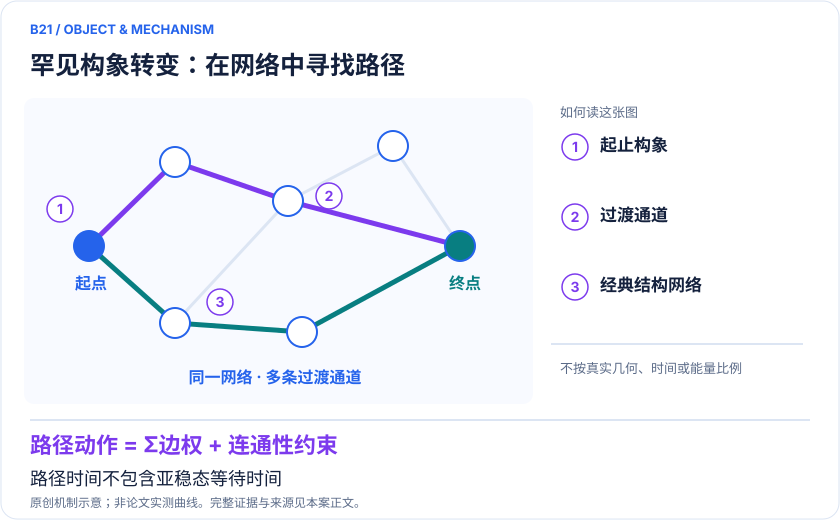
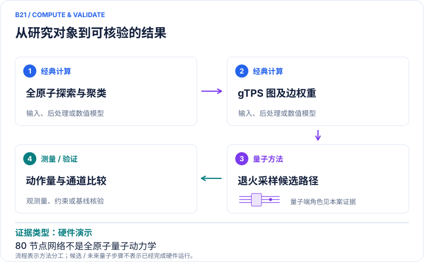

<!-- 由 release/tools/build_problems.py 自 tasks/B21-bpti-transition-paths/README.md 与 tasks/catalog.json 生成，勿手改 -->

# B21 · BPTI 罕见构象转变：在构象网络上采样反应路径

> 开放题 · 生物医药 · 构象动力学与路径采样
> 难度：进阶（[分级说明](../../../starters/README.md#难度分级)） · 背景：优化与算法

## 题面

| 环节 | 内容 |
|---|---|
| 研究体系 | 显式溶剂中的BPTI原生态罕见重排；较早方法工作使用丙氨酸二肽 |
| 可观测量 | 有效路径比例、路径动作量、通道多样性、投影结构分布与单势垒过渡路径时间下界 |
| 经典基线 | 同网络Dijkstra最小动作路径、经典SA、路径蒙特卡洛/增强采样；应用层使用Anton长轨迹作参照 |
| 量子方法的角色 | 经典iMapD/Polar Star探索→gTPS加权图→量子退火候选路径→经典动作量与全原子轨迹核验 |
| 研发决策 | 为构象选择与隐蔽口袋研究生成多条可比较的过渡路径，判断关键中间状态是否被探索到。 |

## 基准输入

原文输入没有公开，也没有可直接运行的替代输入，解法需要自建模型并写明来源与哈希。下表只列出已知的公开材料。「原文」指作者或原论文公开的材料，「参照」指本项目参照运行自行冻结的选择。

| 项目 | 内容 | 出处 |
|---|---|---|
| SI | 构图规则（RMSD 阈值连边、主文式 (15) 赋权） | [原文](https://doi.org/10.1021/acs.jctc.3c01174.s001) |

**尚未公开或需注意：**80 节点网络的邻接表、边权、代表构象坐标与退火样本未公开。

## 什么算解

一份解法满足以下五点即可提交审核。负结果同样接受，只要过程可复现、结论有依据。

1. **模型对应**：说明所用模型或数据如何对应「显式溶剂中的BPTI原生态罕见重排；较早方法工作使用丙氨酸二肽」，列出简化与近似。
2. **可观测量**：报告「有效路径比例、路径动作量、通道多样性、投影结构分布与单势垒过渡路径时间下界」，附单位与不确定度。
3. **经典对照**：在同一模型或数据上，与「同网络Dijkstra最小动作路径、经典SA、路径蒙特卡洛/增强采样；应用层使用Anton长轨迹作参照」中至少一种方法比较。
4. **可复现**：提供代码、环境、随机种子、输入来源与哈希，以及计算资源和成本；用到 QPU 时注明设备与 shots。
5. **研发决策**：说明结果能否支撑「为构象选择与隐蔽口袋研究生成多条可比较的过渡路径，判断关键中间状态是否被探索到。」，以及还缺什么证据。

本题的细化标准欢迎在 issue 中讨论；被采纳的讨论结论会写入后续版本。

## 现有参照

本项目已有数值执行记录（经典计算机上的计算与模拟），供对照与复用，不代表最优解。

- 原应用目标：状态未记录
- 最新研究报告：[REFERENCE.md](REFERENCE.md)
- 其余证据指针见 evidence.json（本地证据，未随题库发布）

### 原案例说明

### B21 · BPTI 罕见构象转变：在构象网络上采样反应路径

<!-- VISUALS:START -->
#### 可视化导读

**图 1 · 罕见构象转变：在网络中寻找路径。** 路径时间不包含亚稳态等待时间。有效路径比例、路径动作量、通道多样性、投影结构分布与单势垒过渡路径时间下界。图形为依据本案文献重绘的概念关系，不表示实际原子坐标、实测曲线或数值比例。

**图 2 · 计算与验证路径。** 经典iMapD/Polar Star探索→gTPS加权图→量子退火候选路径→经典动作量与全原子轨迹核验。**证据边界：** gTPS不包含亚稳态等待时间，不能由路径跨越时间推断完整反应速率或毫秒级全程量子MD；混合求解收益不能完全归因QPU。

图解依据：[R1 · Sampling a rare protein transition with a hybrid classical-quantum computing algorithm](https://arxiv.org/html/2311.15891v1)；[R2 · Sampling rare conformational transitions with a quantum computer](https://pmc.ncbi.nlm.nih.gov/articles/PMC9522734/)；[R3 · Sampling a Rare Protein Transition Using Quantum Annealing](https://pubs.acs.org/doi/10.1021/acs.jctc.3c01174)。解释性连线与图形布局由本库整理，未复制论文原图。

[机制图 SVG](mechanism.svg) · [流程图 SVG](workflow.svg) · 机制图 PNG（本地证据，未随题库发布） · 流程图 PNG（本地证据，未随题库发布） · 图解说明 JSON（本地证据，未随题库发布）
<!-- VISUALS:END -->

> 更新：2026-10-04｜近期验证｜证据：硬件演示
> 本轮新增；文献核查与验证建议，不是本地数值复现。

**核心发现：** 经典全原子探索构造BPTI状态网络，D-Wave混合求解器采样过渡路径；路径与Anton轨迹比较，但未计算完整毫秒等待时间或完整反应速率。

| 维度 | 内容 |
|---|---|
| 研发决策 | 为构象选择与隐蔽口袋研究生成多条可比较的过渡路径，判断关键中间状态是否被探索到。 |
| 研究对象 | 显式溶剂中的BPTI原生态罕见重排；较早方法工作使用丙氨酸二肽 |
| 规模口径 | BPTI网络80个代表构象，原文报告使用207 qubits；全原子环境与6744个水分子在经典端，量子端编码图节点/边而非原子。 |
| 可观测量 | 有效路径比例、路径动作量、通道多样性、投影结构分布与单势垒过渡路径时间下界 |
| 量子分工 | 经典iMapD/Polar Star探索→gTPS加权图→量子退火候选路径→经典动作量与全原子轨迹核验 |
| 经典基线 | 同网络Dijkstra最小动作路径、经典SA、路径蒙特卡洛/增强采样；应用层使用Anton长轨迹作参照 |
| 不能外推 | gTPS不包含亚稳态等待时间，不能由路径跨越时间推断完整反应速率或毫秒级全程量子MD；混合求解收益不能完全归因QPU。 |

#### 去重说明：为什么是新案例

B10求给定短肽的格点低能构象；B06求平衡相对结合自由能；C06是少维量子质子波包。本案在全原子经典结构构成的粗粒化网络上生成跨势垒路径，关键输出是路径集合与中间态，而非单一结构、电子势垒或结合自由能。2022二肽方法验证和2023/2024 BPTI扩展合并为一个任务族。

最近相关旧案：B10、B06、C06。本案决策键：`protein-conformation/transition-path-ensemble/rare-events`。

#### 研究价值与适用范围

即使静态蛋白结构已知，药物研究仍可能需要了解不同构象之间如何连通：哪些中间态能形成隐蔽口袋，哪些结构转换可能影响结合。这是本案可迁移的价值判断，不是原论文已经做了特定药物的隐蔽口袋预测。原工作直接对象为BPTI原生态重排，选它是因为有独立的长时间经典轨迹可比。[R1]

#### 模型与流程

经典端先做无预定集体变量的构象探索，用iMapD及Polar Star策略扩展已访问区域；随后聚类得到代表构象，通过短MD估计局部寿命与图权重。gTPS把连接指定起终点的路径写成受约束二元优化，退火候选再交经典端评估动作量和结构一致性。[R1][R2]

示意目标是 `路径动作 = Σ边权重 + 连通性/端点约束`。最小动作路径可用Dijkstra等经典算法找到，但完整低动作路径集合、统计采样公平性和多通道覆盖是另一个任务。不能用“可能路径数量指数增长”直接推导实际量子优势。

#### 量子尺度与全体系尺度

80个代表构象构成的网络与207个报告比特服务于路径编码，不能理解为207个原子或207条全原子MD轨道。BPTI的溶剂化和短动力学仍在经典端进行；显式水和力场提供化学模型，量子线路不求电子能或水分子波函数。[R1]

复现时还应区分逻辑二元变量、物理嵌入与混合服务内部子问题，不能把论文给出的单个比特数自动换算成完整硬件资源成本。

#### 文献结果能支持到哪里

作者将所获路径与Anton长轨迹的构象分布进行比较，展示混合方案能生成与已知景观相容的过渡路径。论文报告的单路径混合求解时间属于局部阶段，不能与生成整个Anton轨迹的壁钟时间直接相除来声称端到端加速。构象探索、图权重估计和原子级恢复仍有经典成本。[R1]

更关键的是，gTPS不刻画体系在亚稳态中长时间等待的过程。单势垒过渡路径时间的下界与完整等待时间不是同一个物理量。因此不能写“量子计算在数秒内复现全部毫秒动力学”，也不能由该下界直接得到构象转换速率。[R1]

#### 公平经典比较与采样风险

需要分别比较最优路径与路径集合。前者用图算法核查，后者应加入同图路径Monte Carlo或增强采样，报告路径重叠、自相关、通道多样性与目标分布偏差。每次退火重新初始化不自动保证设备噪声下公平抽样，更不能替代对混合求解器输出分布的实测统计检查。

BPTI以往未访问的构象仍可能被经典探索遗漏。若图中根本不存在某通道，再强的量子优化器也无法生成它。这是模型覆盖问题，不能算作量子求解精度问题。

#### 建议试点与接受标准

1. 取得原作者的节点坐标、边权重、端点与动作量定义，以经典Dijkstra复核至少一条最小动作路径。
2. 验证力场、溶剂、温度和聚类尺度，检查变更网络分辨率后通道是否稳定。
3. 同一网络上运行经典SA、路径采样和可选量子混合求解器，记录完整提交预算及重复样本。
4. 比较有效路径率、动作量分布和通道多样性，而非只保留一条漂亮路径。
5. 对重要中间态做独立短MD与结构合理性检查；如用于隐蔽口袋，应另做口袋体积或可结合性验证。
6. 若网络构建不收敛、无法取得原始权重、或改用强经典路径算法后收益消失，则停止优势宣称。

#### 数据可得性与本轮边界

本轮阅读了相关作者全文以及方法前驱。2022论文数据说明为合理请求后由作者提供，不应把可读论文当作已具备一键复现闭包。本案尚未运行D-Wave、复算BPTI轨迹或审核补充文件中的全部嵌入参数；列出的步骤是后续可执行试点。

#### 原始来源与访问深度

- **[R1]** [Sampling a rare protein transition with a hybrid classical-quantum computing algorithm](https://arxiv.org/html/2311.15891v1)（2023，预印本作者全文；`full_text`）。支持：BPTI 80节点与207比特、iMapD/Polar Star、混合计时、gTPS动力学限制与Anton对照；期刊题名为Sampling a Rare Protein Transition Using Quantum Annealing。

- **[R2]** [Sampling rare conformational transitions with a quantum computer](https://pmc.ncbi.nlm.nih.gov/articles/PMC9522734/)（2022，期刊论文；`full_text`）。支持：丙氨酸二肽上的方法前驱、图路径采样及数据需向作者索取的边界。

- **[R3]** [Sampling a Rare Protein Transition Using Quantum Annealing](https://pubs.acs.org/doi/10.1021/acs.jctc.3c01174)（2024，期刊正式版出版记录；`search_excerpt`）。支持：出版页直接访问403，已核查原站检索摘要：2024-04-08正式发表；与R1同一研究。本文方法数值以已读取的作者v1为依据，不宣称已审计付费正文。

来源年份按所链接版本标注；正式版与预印本若属于同一 work_id，不计为独立证据。全文访问只表示阅读了相关正文，不表示所有补充材料已审计。

#### 本地资料与下一步

由docs蛋白动力学主题延伸；新增过渡路径分布任务，和原有折叠最低能任务分开。

先固定80节点图与权重，在同图上比较Dijkstra、SA和混合求解器，再复核原子回映射及统计权重；索取原始输入与作业记录。

## 如何提交

按 [CONTRIBUTING.md](../../../CONTRIBUTING.md) 把解法放在 `solutions/B21/<你的名字>-<短名>/`，格式见 [解法模板](../../../solutions/_template/SOLUTION.md)。被采纳的解法会按 [沉淀规则](../../../skills/README.md) 提炼为可复用的 skill。
