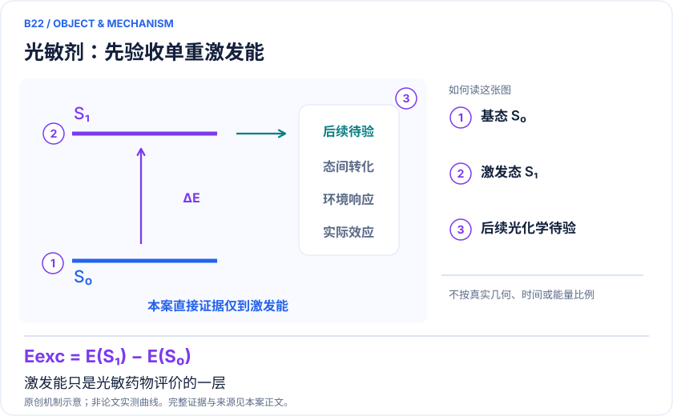
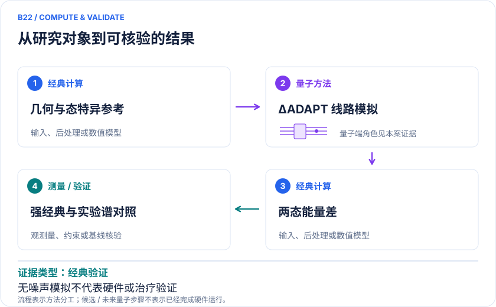

<!-- 由 release/tools/build_problems.py 自 tasks/B22-bodipy-photodynamic/README.md 与 tasks/catalog.json 生成，勿手改 -->

# B22 · BODIPY 光敏剂：用态特异激发能辅助光谱筛选

> 开放题 · 生物医药 · 光敏药物与激发态

## 题面

| 环节 | 内容 |
|---|---|
| 研究体系 | 六种BODIPY衍生物的最低单重垂直激发；不是完整光动力治疗过程 |
| 可观测量 | S₁垂直激发能、平均绝对误差、活性空间和线路收敛 |
| 经典基线 | ΔCCSD、TDDFT、EOM-CCSD、CASPT2；保持几何、溶剂和实验参照口径 |
| 量子方法的角色 | 经典轨道与基态/激发态参考→态特异ΔADAPT线路模拟→两态能量差→光谱基准 |
| 研发决策 | 判断候选光敏剂的电子激发能计算是否足以支持吸收窗口筛选。 |

## 基准输入

解法默认使用下列输入，以便与现有参照和其他解法直接比较；改用其他输入时请说明理由。「原文」指作者或原论文公开的材料，「参照」指本项目参照运行自行冻结的选择。

| 项目 | 内容 | 出处 |
|---|---|---|
| 几何 | 六个 BODIPY 衍生物坐标，取自 2019 JCTC 官方 SI（2024 编号 1–6 对应 2019 编号 13、5、4、7、11、25，由参照推定） | [原文](https://ndownloader.figshare.com/files/20156816) |
| 论文 | arXiv:2404.16149v1；结构来源 JCTC 2019 | [原文](https://doi.org/10.1021/acs.jctc.9b00559) |
| 参照所用模型 | 不重新优化几何；真空 RHF/cc-pVDZ，前沿 CAS(4e,4o)，另以 CAS6/CAS8 检查 | 参照 |

**尚未公开或需注意：**作者未提供 2024 与 2019 编号的对应表。

## 什么算解

一份解法满足以下五点即可提交审核。负结果同样接受，只要过程可复现、结论有依据。

1. **模型对应**：说明所用模型或数据如何对应「六种BODIPY衍生物的最低单重垂直激发；不是完整光动力治疗过程」，列出简化与近似。
2. **可观测量**：报告「S₁垂直激发能、平均绝对误差、活性空间和线路收敛」，附单位与不确定度。
3. **经典对照**：在同一模型或数据上，与「ΔCCSD、TDDFT、EOM-CCSD、CASPT2；保持几何、溶剂和实验参照口径」中至少一种方法比较。
4. **可复现**：提供代码、环境、随机种子、输入来源与哈希，以及计算资源和成本；用到 QPU 时注明设备与 shots。
5. **研发决策**：说明结果能否支撑「判断候选光敏剂的电子激发能计算是否足以支持吸收窗口筛选。」，以及还缺什么证据。

本题的细化标准欢迎在 issue 中讨论；被采纳的讨论结论会写入后续版本。

## 现有参照

本项目已有数值执行记录（经典计算机上的计算与模拟），供对照与复用，不代表最优解。

- 原应用目标：未完成（incomplete）
- 最新研究报告：[REFERENCE.md](REFERENCE.md)
- 其余证据指针见 evidence.json（本地证据，未随题库发布）

### 原案例说明

### B22 · BODIPY 光敏剂：用态特异激发能辅助光谱筛选

<!-- VISUALS:START -->
#### 可视化导读

**图 1 · 光敏剂：先验收单重激发能。** 激发能只是光敏药物评价的一层。S₁垂直激发能、平均绝对误差、活性空间和线路收敛。图形为依据本案文献重绘的概念关系，不表示实际原子坐标、实测曲线或数值比例。

**图 2 · 计算与验证路径。** 经典轨道与基态/激发态参考→态特异ΔADAPT线路模拟→两态能量差→光谱基准。**证据边界：** 不是QPU实测；仅S₁能差不含系间窜越、ROS产率或临床疗效。

图解依据：[R1 · ΔADAPT-VQE: Toward Accurate Calculation of Excitation Energies on Quantum Computers for BODIPY Molecules With Application in Photodynamic Therapy](https://arxiv.org/html/2404.16149v1)；[R2 · Why do TD-DFT excitation energies of BODIPY/aza-BODIPY families largely deviate from experiment? Answers from electron correlated and multireference methods](https://pubmed.ncbi.nlm.nih.gov/26575559/)。解释性连线与图形布局由本库整理，未复制论文原图。

[机制图 SVG](mechanism.svg) · [流程图 SVG](workflow.svg) · 机制图 PNG（本地证据，未随题库发布） · 流程图 PNG（本地证据，未随题库发布） · 图解说明 JSON（本地证据，未随题库发布）
<!-- VISUALS:END -->

> 更新：2026-10-04｜重点储备｜证据：经典验证
> 本轮新增；文献核查与验证建议，不是本地数值复现。

**核心发现：** ΔADAPT-VQE在六种BODIPY衍生物上做无噪声激发能验证；强经典ΔCCSD仍更准确，光谱精度不能外推治疗效果。

| 维度 | 内容 |
|---|---|
| 研发决策 | 判断候选光敏剂的电子激发能计算是否足以支持吸收窗口筛选。 |
| 研究对象 | 六种BODIPY衍生物的最低单重垂直激发；不是完整光动力治疗过程 |
| 规模口径 | 最大活性空间(8电子,8轨道)；无噪声态矢模拟；70/583 CNOT为编译资源估计 |
| 可观测量 | S₁垂直激发能、平均绝对误差、活性空间和线路收敛 |
| 量子分工 | 经典轨道与基态/激发态参考→态特异ΔADAPT线路模拟→两态能量差→光谱基准 |
| 经典基线 | ΔCCSD、TDDFT、EOM-CCSD、CASPT2；保持几何、溶剂和实验参照口径 |
| 不能外推 | 不是QPU实测；仅S₁能差不含系间窜越、ROS产率或临床疗效。 |

#### 去重说明：为什么是新案例

本案服务光敏药物的吸收窗口筛选，区别于B03酶电子态、F07圆锥交叉几何和M14光伏裂分竞争。求解器相近不等于任务相同；同类光敏剂算法更新应回填本案，不逐个拆分。

最近相关旧案：B03、F07、M14。本案决策键：`photosensitizer/vertical-excitation/absorption-screening`。

#### 应用接口与证据

光敏剂研发需要同时考虑吸收、激发态转化和环境影响。本案聚焦最前面的光谱量，量子方法承担两电子态能量的估计。已读论文使用经典计算机模拟量子线路，不能写成硬件已经筛选出有效药物。六分子验证与资源分析属于方法可行性证据。[R1]

#### 方法为什么值得研究

态特异方法分别优化基态与激发态，利用能量差构造激发能。ΔADAPT逐步选择算符，目标是在精度与线路复杂度之间取得更合适的平衡。其物理问题是相关效应在两态之间能否充分抵消，而不是单独把某个总能压得很低。经典研究已说明BODIPY族不能只依赖一个流行泛函来确定准确性。[R1][R2]

#### 结果的正确读法

0.131 eV和0.054 eV分别属于论文中ΔUCCSD与经典ΔCCSD的平均误差；ΔADAPT与前者相近。对某些常用方法更准，不意味着超过全部经典方法。CNOT计数是指定编译假设下的资源描述，不包括真实器件连接、噪声、测量与优化全部费用。[R1]

#### 建议验证：把化学模型与求解器分开

以下是本库提出的验证设计，尚未执行。首先冻结公开的分子标识、几何、基组和溶剂口径，保留活性轨道及参考态。两套算法必须求解同一个哈密顿量；若几何、轨道或基组不同，应列为模型敏感性，而非算法胜负。

第二步使用同空间的精确对角化或收敛多参考计算核验两态能量和态特征。需要确认激发态没有塌回基态，也没有在参数优化过程中换根。只比较最终能量差可能掩盖两个大误差的偶然抵消；应同时保留每态总能误差与状态识别信息。

第三步再扩展活性空间，检查省略轨道带来的系统误差。如果更大的经典模型改变候选排序，则应优先解决模型缺口。较小量子模型恰好吻合实验，不足以证明大模型不必要。

#### 面向应用的验收口径

建议把验收分成三层。求解层检查同哈密顿量精度和重复运行的离散程度；光谱层检查参考数据的实验条件与误差；决策层检查是否稳定改变候选排序。三个层次都应事先定义，不能发现某项好看后临时换指标。

垂直激发能、吸收峰位置和振动包络不是同一个量。溶剂、热构象与振动效应可能改变实验谱；需要经典模型提供这些修正并独立报告不确定性。若只给单点能量，应把用途限定为初步光谱筛选，不能延伸到细胞或临床结果。

#### 公平比较与停止条件

经典基线必须包含论文里表现强的ΔCCSD及适当多参考方法，而非仅选择误差大的泛函。完整成本应包括轨道生成、算符筛选、梯度或能量估计、优化重启、采样和后处理。对量子线路模拟器的时间不能当成未来硬件运行时间。

建议留出未参与方法选择的分子，按预设误差阈值盲测。若优势只在训练分子出现，或者量子求解误差已经小于溶剂和几何误差，就不应继续放大量子资源以追逐不影响决策的数字。若强经典方法同时更准更快，应保留负结果并降低部署优先级。

#### 研究资料交付边界

本案是公开文献研究和后续验证设计，没有生成药物配方、医疗建议或实验操作方案。图解只显示S₀与S₁以及后续待验证接口，不把三重态形成或活性氧生成绘成已验证结果。建议复现时保存输入哈希、软件版本、收敛记录和逐分子误差，以便追踪哪一项改进实际来自求解器。

#### 原始来源与访问深度

- **[R1]** [ΔADAPT-VQE: Toward Accurate Calculation of Excitation Energies on Quantum Computers for BODIPY Molecules With Application in Photodynamic Therapy](https://arxiv.org/html/2404.16149v1)（2024，预印本作者全文；`full_text`）。支持：六分子、无噪声方法、(8e,8o)、误差和线路资源；0.054 eV强经典比较。

- **[R2]** [Why do TD-DFT excitation energies of BODIPY/aza-BODIPY families largely deviate from experiment? Answers from electron correlated and multireference methods](https://pubmed.ncbi.nlm.nih.gov/26575559/)（2015，原始经典基准；DOI 10.1021/ct500775r；`search_excerpt`）。支持：原站与PubMed检索核对经典多参考基准的书目信息；直接打开PubMed本次未返回正文，不宣称读取全文。

来源年份按所链接版本标注；正式版与预印本若属于同一 work_id，不计为独立证据。全文访问只表示阅读了相关正文，不表示所有补充材料已审计。

#### 本地资料与下一步

由docs生物医药计算主题延伸；本轮独立原始论文检索，不改动原始问题编号。

先完成同输入、同预算的经典基准和误差归因，再判断是否值得接入量子资源；本轮未执行数值复现。

## 如何提交

按 [CONTRIBUTING.md](../../../CONTRIBUTING.md) 把解法放在 `solutions/B22/<你的名字>-<短名>/`，格式见 [解法模板](../../../solutions/_template/SOLUTION.md)。被采纳的解法会按 [沉淀规则](../../../skills/README.md) 提炼为可复用的 skill。
