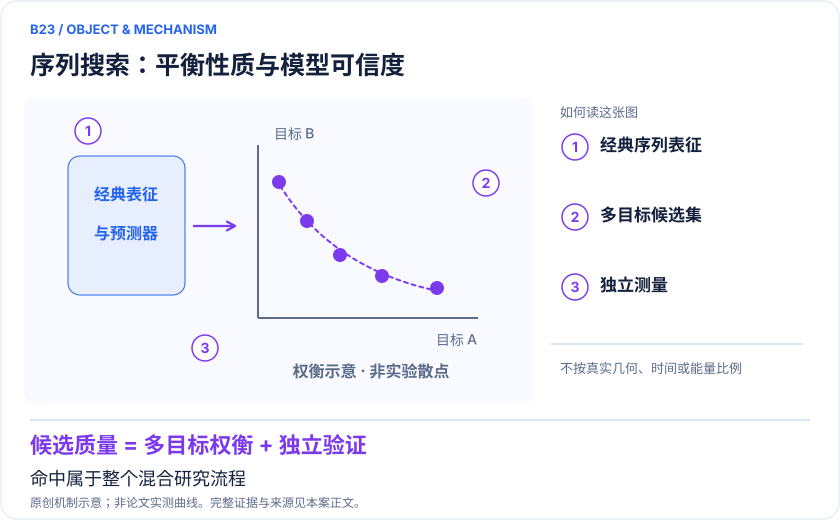
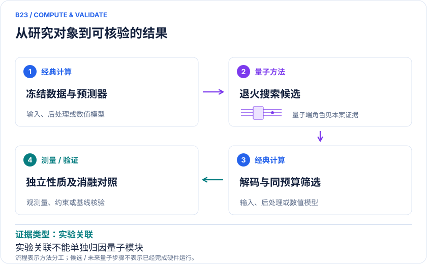

<!-- 由 release/tools/build_problems.py 自 tasks/B23-therapeutic-sequence-design/README.md 与 tasks/catalog.json 生成，勿手改 -->

# B23 · 治疗性肽与抗体：序列空间的多目标候选搜索

> 开放题 · 生物医药 · 治疗性序列设计

## 题面

| 环节 | 内容 |
|---|---|
| 研究体系 | 治疗性肽和抗体序列候选；固定研发任务下的多目标搜索，非全蛋白电子结构 |
| 可观测量 | 候选多样性、可行率、预测不确定性、独立结合与可开发性读数 |
| 经典基线 | 相同数据的经典多目标优化、SA、随机/贝叶斯搜索、直接序列模型；冻结实验候选预算 |
| 量子方法的角色 | 经典编码/预测器→离散多目标优化与退火→经典解码及排序→独立实验或结构比较 |
| 研发决策 | 在候选预算有限时，平衡预测结合、模型不确定性与可开发性，挑选值得独立验证的序列候选。 |

## 什么算解

一份解法满足以下五点即可提交审核。负结果同样接受，只要过程可复现、结论有依据。

1. **模型对应**：说明所用模型或数据如何对应「治疗性肽和抗体序列候选；固定研发任务下的多目标搜索，非全蛋白电子结构」，列出简化与近似。
2. **可观测量**：报告「候选多样性、可行率、预测不确定性、独立结合与可开发性读数」，附单位与不确定度。
3. **经典对照**：在同一模型或数据上，与「相同数据的经典多目标优化、SA、随机/贝叶斯搜索、直接序列模型；冻结实验候选预算」中至少一种方法比较。
4. **可复现**：提供代码、环境、随机种子、输入来源与哈希，以及计算资源和成本；用到 QPU 时注明设备与 shots。
5. **研发决策**：说明结果能否支撑「在候选预算有限时，平衡预测结合、模型不确定性与可开发性，挑选值得独立验证的序列候选。」，以及还缺什么证据。

本题的细化标准欢迎在 issue 中讨论；被采纳的讨论结论会写入后续版本。

## 现有参照

本项目已有数值执行记录（经典计算机上的计算与模拟），供对照与复用，不代表最优解。

- 原应用目标：未完成（incomplete）
- 最新研究报告：[REFERENCE.md](REFERENCE.md)
- 其余证据指针见 evidence.json（本地证据，未随题库发布）

### 原案例说明

### B23 · 治疗性肽与抗体：序列空间的多目标候选搜索

<!-- VISUALS:START -->
#### 可视化导读

**图 1 · 序列搜索：平衡性质与模型可信度。** 命中属于整个混合研究流程。候选多样性、可行率、预测不确定性、独立结合与可开发性读数。图形为依据本案文献重绘的概念关系，不表示实际原子坐标、实测曲线或数值比例。

**图 2 · 计算与验证路径。** 经典编码/预测器→离散多目标优化与退火→经典解码及排序→独立实验或结构比较。**证据边界：** 预测器偏差、数据泄漏、候选筛选和湿实验共同决定结果；退火参与不等于端到端量子优势。

图解依据：[R1 · Extensive antibody search with whole spectrum black-box optimization](https://pmc.ncbi.nlm.nih.gov/articles/PMC10767033/)；[R2 · Quantum Annealing Designs Nonhemolytic Antimicrobial Peptides in a Discrete Latent Space](https://pmc.ncbi.nlm.nih.gov/articles/PMC10184305/)；[R3 · De Novo Design of Protein-Binding Peptides by Quantum Computing](https://arxiv.org/abs/2503.05458)。解释性连线与图形布局由本库整理，未复制论文原图。

[机制图 SVG](mechanism.svg) · [流程图 SVG](workflow.svg) · 机制图 PNG（本地证据，未随题库发布） · 流程图 PNG（本地证据，未随题库发布） · 图解说明 JSON（本地证据，未随题库发布）
<!-- VISUALS:END -->

> 更新：2026-10-04｜重点储备｜证据：实验关联
> 本轮新增；文献核查与验证建议，不是本地数值复现。

**核心发现：** 量子退火参与离散潜空间与多目标候选搜索；已有抗体和肽实验关联，但命中属于整个模型、筛选与实验流程。

| 维度 | 内容 |
|---|---|
| 研发决策 | 在候选预算有限时，平衡预测结合、模型不确定性与可开发性，挑选值得独立验证的序列候选。 |
| 研究对象 | 治疗性肽和抗体序列候选；固定研发任务下的多目标搜索，非全蛋白电子结构 |
| 规模口径 | WS-MOQA使用12,737条已标注序列；产生19,778个候选，选择5个测试，其中1个满足所需特异结合表现 |
| 可观测量 | 候选多样性、可行率、预测不确定性、独立结合与可开发性读数 |
| 量子分工 | 经典编码/预测器→离散多目标优化与退火→经典解码及排序→独立实验或结构比较 |
| 经典基线 | 相同数据的经典多目标优化、SA、随机/贝叶斯搜索、直接序列模型；冻结实验候选预算 |
| 不能外推 | 预测器偏差、数据泄漏、候选筛选和湿实验共同决定结果；退火参与不等于端到端量子优势。 |

#### 去重说明：为什么是新案例

B09是小分子生成；B10在给定氨基酸序列上寻找构象；B11优化给定配体的对接。这里修改候选氨基酸序列并平衡多种性质。MOQA肽、WS-MOQA抗体与物理驱动结合肽路线按同一研发决策归并。

最近相关旧案：B09、B10、B11。本案决策键：`therapeutic-sequence/multiobjective-candidate-search/developability`。

#### 应用价值与研究链

研发搜索需要同时考虑目标性质、候选多样性与模型可信度。仅对单个预测分数做极值搜索，可能选出模型并不了解的区域。WS-MOQA将这类问题写成多目标搜索，并接入独立实验检查；早期MOQA肽工作提供了离散潜空间与退火结合的另一条方法证据。[R1][R2]

#### 已知结果与因果边界

抗体研究从已标注数据建立多个预测器，优化预测结合、模型间差异及溶解性代理，形成候选集并挑选少量实验。12,737条输入、19,778个候选、5个测试和1个符合所需表现，是不同阶段的数量，不能混作量子硬件处理规模或临床成功率。[R1]

物理驱动的结合肽研究是另一种入口：从结构能量与候选空间组织搜索。本轮只核查到其摘要，不据此声称完成了新的实验筛选或审计了全部求解器数据。[R3]

#### 本库建议的评价设计

以下属于研究设计建议，尚未执行。第一步冻结公开数据的划分方式，并按序列相似性或实验批次检查训练与测试之间的关系。随机分割可能留下高度相近的样本；这类泄漏会使任何优化器看似具有很强发现能力。应把分布外候选和插值候选分开报告。

第二步固定编码器、解码器和所有代理预测器，仅替换优化器。让经典SA、多目标搜索与退火访问相同目标函数，并使用相同查询预算。每个方法交付全部候选及筛选轨迹，而不是只呈现最佳结果。这样才可能定位收益来自表示、目标函数还是求解器。

#### 为什么需要多目标而非一个分数

预测结合与溶解性代理之间可能存在冲突，模型不确定性也不等于真实实验方差。建议保留每个目标的原始定义、单位或标准化方式，展示候选的非支配关系。多目标图中的点只是候选评价，不代表已经观测到实验性能。

权重选择也会影响结论。如果只展示某一组权重下的最佳候选，可能遗漏其他合理决策偏好。应预先规定权重敏感性分析，并检查候选集合是否稳定。图解中的帕累托关系仅作概念解释，不以虚构散点冒充论文数据。

#### 验收层次与独立验证

算法层先验收有效候选比例、重复率、目标值分布和运行预算。模型层验收预测校准与分布外稳定性。应用层应使用与训练数据独立的实验或原始测量资料，报告候选选择规则与失败样本。没有独立实验的路线应保留计算证据等级。

若要评估量子增益，还需采用同预算的优化器替换对照。候选进入实验之前冻结名单和筛选规则，避免结果出来后改变成功定义。混合系统中的编码器和人工筛选可能贡献更大，故单个阳性结果只能证明整条流程存在命中，不能证明量子模块不可替代。

#### 成本、风险与停止条件

建议分别统计训练、生成、目标查询、退火调用与后处理成本。商业混合服务若不公开QPU占比，应按混合服务报告，不能把全部时间缩短归因量子退火。实验候选数量也必须保持一致，否则更多实验自然可能增加命中。

若经典求解器在相同目标查询数下得到相当的非支配集合，或模型的不确定性使排名不稳定，应停止优势叙述。对序列本身，本案只研究公开方法与证据，不生成具体治疗性序列或实验操作条件。可复现交付应保存数据许可、划分、目标定义、候选编号及版本记录。

#### 资料与后续入口

R1给出代码和数据仓库入口，但可见入口不等于本轮已执行代码。下一步适合做公开基准上的求解器消融和数据泄漏检查；只有这两层通过，再讨论昂贵实验或硬件验证的价值。本轮未运行量子设备，也未推断任何候选的临床可用性。

#### 原始来源与访问深度

- **[R1]** [Extensive antibody search with whole spectrum black-box optimization](https://pmc.ncbi.nlm.nih.gov/articles/PMC10767033/)（2024，期刊全文；DOI 10.1038/s41598-023-51095-z；`full_text`）。支持：数据规模、候选及五选一实验结果、多目标预测器和代码入口。

- **[R2]** [Quantum Annealing Designs Nonhemolytic Antimicrobial Peptides in a Discrete Latent Space](https://pmc.ncbi.nlm.nih.gov/articles/PMC10184305/)（2023，期刊全文；DOI 10.1021/acsmedchemlett.2c00487；`full_text`）。支持：离散潜空间和退火参与的肽设计工作流；本案只作方法与证据分层。

- **[R3]** [De Novo Design of Protein-Binding Peptides by Quantum Computing](https://arxiv.org/abs/2503.05458)（2025，作者预印本摘要；`abstract`）。支持：物理驱动结合肽设计的独立路线；不据摘要补充未核验硬件或湿实验数值。

来源年份按所链接版本标注；正式版与预印本若属于同一 work_id，不计为独立证据。全文访问只表示阅读了相关正文，不表示所有补充材料已审计。

#### 本地资料与下一步

由docs生物医药计算主题延伸；本轮独立原始论文检索，不改动原始问题编号。

先完成同输入、同预算的经典基准和误差归因，再判断是否值得接入量子资源；本轮未执行数值复现。

## 如何提交

按 [CONTRIBUTING.md](../../../CONTRIBUTING.md) 把解法放在 `solutions/B23/<你的名字>-<短名>/`，格式见 [解法模板](../../../solutions/_template/SOLUTION.md)。被采纳的解法会按 [沉淀规则](../../../skills/README.md) 提炼为可复用的 skill。
