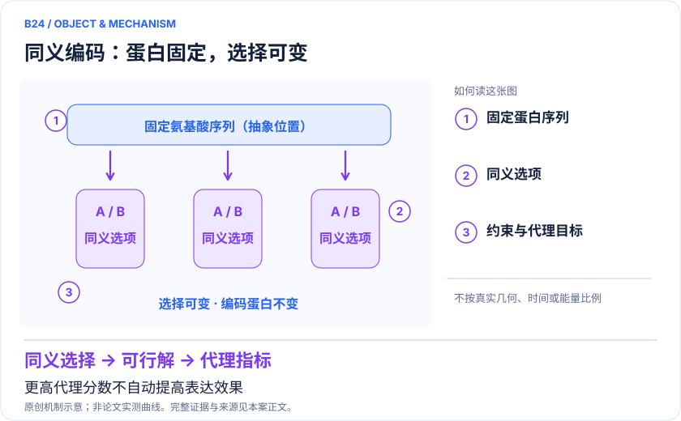
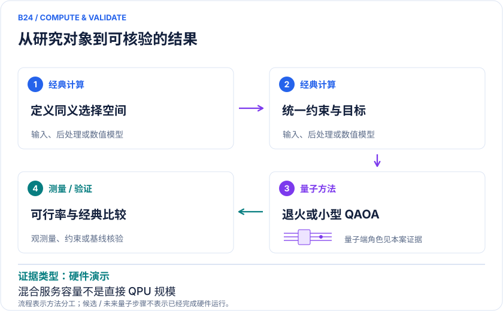

<!-- 由 release/tools/build_problems.py 自 tasks/B24-mrna-codon-optimization/README.md 与 tasks/catalog.json 生成，勿手改 -->

# B24 · mRNA 同义密码子：固定蛋白序列的多约束优化

> 开放题 · 生物医药 · 核酸序列优化

## 题面

| 环节 | 内容 |
|---|---|
| 研究体系 | 编码同一蛋白的同义选择；不是改变蛋白功能的氨基酸设计，也不是RNA折叠求解 |
| 可观测量 | 目标值、同义约束可行率、重复样本、完整求解时间；表达效果须另行独立验证 |
| 经典基线 | 同目标遗传算法、SA、动态规划或整数优化（视耦合结构）；同时间与同可行解预算 |
| 量子方法的角色 | 经典定义同义选择及代理指标→QUBO/Ising→退火或QAOA小模型→经典约束核验 |
| 研发决策 | 在固定氨基酸序列条件下，评价同义密码子选择能否平衡预设序列代理指标。 |

## 什么算解

一份解法满足以下五点即可提交审核。负结果同样接受，只要过程可复现、结论有依据。

1. **模型对应**：说明所用模型或数据如何对应「编码同一蛋白的同义选择；不是改变蛋白功能的氨基酸设计，也不是RNA折叠求解」，列出简化与近似。
2. **可观测量**：报告「目标值、同义约束可行率、重复样本、完整求解时间；表达效果须另行独立验证」，附单位与不确定度。
3. **经典对照**：在同一模型或数据上，与「同目标遗传算法、SA、动态规划或整数优化（视耦合结构）；同时间与同可行解预算」中至少一种方法比较。
4. **可复现**：提供代码、环境、随机种子、输入来源与哈希，以及计算资源和成本；用到 QPU 时注明设备与 shots。
5. **研发决策**：说明结果能否支撑「在固定氨基酸序列条件下，评价同义密码子选择能否平衡预设序列代理指标。」，以及还缺什么证据。

本题的细化标准欢迎在 issue 中讨论；被采纳的讨论结论会写入后续版本。

## 现有参照

本项目已有数值执行记录（经典计算机上的计算与模拟），供对照与复用，不代表最优解。

- 原应用目标：未完成（incomplete）
- 最新研究报告：[REFERENCE.md](REFERENCE.md)
- 其余证据指针见 evidence.json（本地证据，未随题库发布）

### 原案例说明

### B24 · mRNA 同义密码子：固定蛋白序列的多约束优化

<!-- VISUALS:START -->
#### 可视化导读

**图 1 · 同义编码：蛋白固定，选择可变。** 更高代理分数不自动提高表达效果。目标值、同义约束可行率、重复样本、完整求解时间；表达效果须另行独立验证。图形为依据本案文献重绘的概念关系，不表示实际原子坐标、实测曲线或数值比例。

**图 2 · 计算与验证路径。** 经典定义同义选择及代理指标→QUBO/Ising→退火或QAOA小模型→经典约束核验。**证据边界：** 代理分数不等于表达产量、稳定性或治疗效果；无本案优化候选的湿实验表达验证。

图解依据：[R1 · mRNA codon optimization with quantum computers](https://journals.plos.org/plosone/article?id=10.1371/journal.pone.0259101)；[R2 · Computational codon optimization of synthetic gene for protein expression](https://pubmed.ncbi.nlm.nih.gov/23083100/)。解释性连线与图形布局由本库整理，未复制论文原图。

[机制图 SVG](mechanism.svg) · [流程图 SVG](workflow.svg) · 机制图 PNG（本地证据，未随题库发布） · 流程图 PNG（本地证据，未随题库发布） · 图解说明 JSON（本地证据，未随题库发布）
<!-- VISUALS:END -->

> 更新：2026-10-04｜重点储备｜证据：硬件演示
> 本轮新增；文献核查与验证建议，不是本地数值复现。

**核心发现：** 2021原始研究比较退火、混合求解和小规模QAOA模拟；可优化代理目标，但没有证明量子优势或实际表达改善。

| 维度 | 内容 |
|---|---|
| 研发决策 | 在固定氨基酸序列条件下，评价同义密码子选择能否平衡预设序列代理指标。 |
| 研究对象 | 编码同一蛋白的同义选择；不是改变蛋白功能的氨基酸设计，也不是RNA折叠求解 |
| 规模口径 | 直接退火约180候选密码子变量；资源较重映射约30氨基酸。约1000氨基酸属于混合服务；门式主比较为小规模经典模拟 |
| 可观测量 | 目标值、同义约束可行率、重复样本、完整求解时间；表达效果须另行独立验证 |
| 量子分工 | 经典定义同义选择及代理指标→QUBO/Ising→退火或QAOA小模型→经典约束核验 |
| 经典基线 | 同目标遗传算法、SA、动态规划或整数优化（视耦合结构）；同时间与同可行解预算 |
| 不能外推 | 代理分数不等于表达产量、稳定性或治疗效果；无本案优化候选的湿实验表达验证。 |

#### 去重说明：为什么是新案例

C08求给定RNA的二级结构，B23改变候选氨基酸序列。本案保持蛋白序列不变，选择不同同义编码，输出与物理问题均不同。直接退火、混合服务与QAOA同属一个任务，不拆分案例。

最近相关旧案：C08、B23。本案决策键：`fixed-protein/synonymous-codon-choice/proxy-objectives`。

#### 任务定义与价值

遗传密码的简并性使同一个氨基酸序列对应多个核酸编码。原始研究把这种选择写成受约束离散优化，涉及使用偏好、GC和重复等代理指标。研究价值在于提供一个明确的经典—量子优化接口；应用收益则取决于代理目标是否与所需表达体系相符。[R1][R2]

#### 文献规模应如何阅读

直接退火约180个候选密码子变量，不等于180个氨基酸；较重编码实例约30氨基酸。混合服务处理更长序列，而门式方案主要在小规模经典模拟器上比较。三个层次必须分别列出，不能把混合服务容量写成直接量子寄存器规模。[R1]

#### 结果与限制

论文没有给出现阶段量子算法超过经典方法的结论，也没有把计算分数接到独立湿实验表达验证。其门式数据有可行性筛选，因此比较时必须保留无效样本比例。作者当年的硬件路线图预测不能当成2026年已实现的事实。[R1]

#### 建议验证：冻结任务接口

以下为本库建议的计算验证设计，尚未执行。首先固定公开、用途明确的基准对象和氨基酸序列标识，避免在比较中改变任务。第二步记录每项代理指标的方向、约束条件和归一化方式。两套算法若优化不同目标，即使都叫密码子优化，所得分数也不能直接排序。

第三步把可行性与目标质量分开。有效输出必须保持同义关系并满足规定约束；无效输出既消耗采样也消耗运行预算，应纳入成功率分母。先过滤后只报告最优分数，会掩盖量子方法可能出现的约束违反成本。这里不提供具体优化序列、目标权重或实验表达操作。

#### 强经典基线与公平比较

建议从同一离散目标出发选择经典求解器。若目标具有可分或短程结构，应考虑动态规划等利用问题结构的方法；一般耦合目标可以比较整数优化、SA与遗传算法。不能因为通用二元优化有困难实例，就直接认定每个生物序列目标都难以经典处理。

比较时同时给出同壁钟预算与同目标调用预算。经典预处理、嵌入、排队、重复提交、可行性修复和混合后处理都属于成本。若混合服务只返回总时间，报告服务整体性能即可，不应自行拆分成量子加速比例。

#### 应用指标不能跨层替代

代理目标的改善属于计算结果。表达量、RNA寿命和实际可开发性还受宿主环境、结构与实验条件影响，不能由某个优化分数直接推断。甚至两个代理指标方向一致，也不意味着真实测量一定改善。

建议把后续证据分成代理一致性、独立计算评估、独立实验关联三个层次。每前进一层，都需要新的对照资料。任何未做的验证应保留为空缺，而非在路线图中绘成已完成步骤。现有论文支持将其列为可研究的接口，尚不足以认定产业部署优先级高于成熟经典流程。

#### 验收与停止条件

计算验收应包括输入一致性、可行解比例、目标值分布、不同随机种子的离散程度，以及选择结果对目标权重的敏感性。还应保留所有失败和修复样本，避免只交付最漂亮的候选。图解只用抽象选项A/B/C表示同义选择，不呈现具体生物序列。

若经典基线在相同成本下提供相当或更优目标值，保留这一负结果。如果目标的小变动就导致候选选择完全不同，先评估指标合理性。如果缺少与应用效果相连的独立证据，就停留在算法可行性，不使用“提高治疗效果”等结论。

#### 复现资料与交付界限

下一步应获取原始目标实现、问题实例、随机种子和设备/服务版本，建立可重复的纯计算基准。硬件代际变化应作为新版本试验，不回写成旧论文曾经使用的新设备。本案整理的是原理、评价与证据边界，没有执行QPU作业、合成序列或生物实验。

#### 原始来源与访问深度

- **[R1]** [mRNA codon optimization with quantum computers](https://journals.plos.org/plosone/article?id=10.1371/journal.pone.0259101)（2021，期刊全文；`full_text`）。支持：直接退火/混合/模拟规模区别、遗传算法比较、可行解筛选与无优势边界。

- **[R2]** [Computational codon optimization of synthetic gene for protein expression](https://pubmed.ncbi.nlm.nih.gov/23083100/)（2012，原始经典方法；`abstract`）。支持：经典多约束密码子优化基线；本轮未审计其全部实现。

来源年份按所链接版本标注；正式版与预印本若属于同一 work_id，不计为独立证据。全文访问只表示阅读了相关正文，不表示所有补充材料已审计。

#### 本地资料与下一步

由docs生物医药计算主题延伸；本轮独立原始论文检索，不改动原始问题编号。

先完成同输入、同预算的经典基准和误差归因，再判断是否值得接入量子资源；本轮未执行数值复现。

## 如何提交

按 [CONTRIBUTING.md](../../../CONTRIBUTING.md) 把解法放在 `solutions/B24/<你的名字>-<短名>/`，格式见 [解法模板](../../../solutions/_template/SOLUTION.md)。被采纳的解法会按 [沉淀规则](../../../skills/README.md) 提炼为可复用的 skill。
