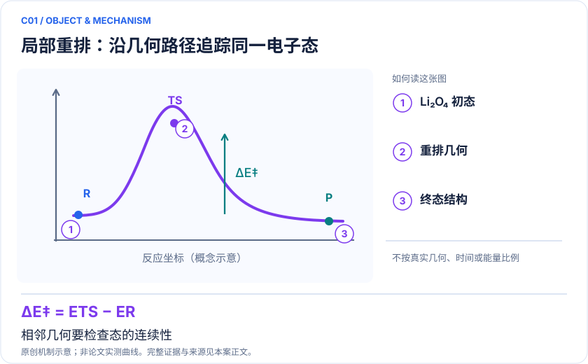

# C01 · Li₂O₄ 重排：电池局部反应曲线与跨几何态跟踪

<!-- VISUALS:START -->
## 可视化导读

**图 1 · 局部重排：沿几何路径追踪同一电子态。** 相邻几何要检查态的连续性。相对电子能、电子势垒、反应能、自旋与自然占据。图形为依据本案文献重绘的概念关系，不表示实际原子坐标、实测曲线或数值比例。

**图 2 · 计算与验证路径。** VQE/ADAPT 或采样子空间求解指定几何的相关电子问题。**证据边界：** 局部气相电子势垒不能直接给出电解液中的反应速率、电池循环寿命或催化效果。

图解依据：[R1 · Computational Investigations of the Lithium Superoxide Dimer Rearrangement on Noisy Quantum Devices](https://arxiv.org/abs/1906.10675)；[R2 · Quantum simulation of molecular response properties](https://arxiv.org/abs/2301.06260)。解释性连线与图形布局由本库整理，未复制论文原图。

[机制图 SVG](mechanism.svg) · [流程图 SVG](workflow.svg)
<!-- VISUALS:END -->

更新：2026-10-04｜领域：材料计算｜证据类型：硬件演示｜建议优先级：近期验证

> 小活性空间 VQE 已用于超氧化锂二聚体重排；实机偏差仍需控制。

## 研究对象与范围

气相 (LiO₂)₂ / Li₂O₄，六原子局部模型。论文为受限活性空间；PDF 拟定 CAS(6,6)/CAS(8,8) 与12/16系统比特，非原论文参数。

## 来源与文档关系

晓梦_Quantum_Science_Challenge_六方向赛题说明书.pdf: 5–7页 CAT-LiO。原文档的任务阈值按提案保留，不视为论文结果。

## 问题定义与研发价值

价值在于建立可迁移的反应曲线组件：新构型加入后，态身份和共同能量零点必须保持一致。对于锂氧体系，可用它判断后续更复杂环境建模需要在哪些构型投入高精度计算。这是本库的应用判断，不等于论文已改善电池。

## 计算目标与分工

定义 ΔEᵢ=Eᵢ−E_R，B=E_TS−E_R；所有冻结核与轨道常数必须保留。经典侧确认驻点和反应路径，生成积分；量子侧在相同扇区给能量或RDM；经典侧做能差及误差传播。共享测量产生的协方差应计入势垒方差。任意插值最高点不是自动成立的过渡态。

## 文献证据解读

[R1] 支持一个真实的早期分子化学演示，同时记录了硬件不准确的事实。采用变分线路并不保证缓解后的实验估计仍是严格上界。[R2] 可作为以后扩展响应性质的方法参考，未在此证明Li₂O₄动力学。

## 试点输入与执行建议

先获取几何、基组、活性轨道和粒子/自旋标签；用独立 CASCI 生成 R、TS、P 参考；再扩展到PDF规定的11点。比较逐点冷启动与跨几何参数迁移，保持总shots、优化重启和经典后处理预算一致。输出 profile.csv、轨道跟踪、每点 S²、原始计数及失败点。

## 验收与停止条件

PDF建议同冻结空间相对能MAE与TS势垒误差均≤1 mHartree，是拟定比赛门槛。正式试点前应校准参考收敛并锁定。若轨道交换导致错误态、TS连接关系不明，或扩大空间改变路径排序，应停止性能排名并修正模型。

## 资源与可迁移边界

PDF CAS(6,6) 的 M_s=0 行列式数为400，可在经典机精确对照；该小模型不构成量子优势。只有扩大活性空间后化学排序稳定，才有理由把局部量子修正送入电化学模型。

## 核心判断与下一步

**已报告结果：**Gao 等报告模拟器能量接近同模型精确结果，实机经读出缓解后仍有能量低估。[R1]

**边界：**局部气相电子势垒不能直接给出电解液中的反应速率、电池循环寿命或催化效果。

**下一步建议：**取得并校验文献 R/TS/P 坐标与轨道，再冻结小空间曲线。

本轮完成的是文献整理；没有执行本案例的数值、硬件或湿实验复现。

## 文献与访问深度

- [R1] [Computational Investigations of the Lithium Superoxide Dimer Rearrangement on Noisy Quantum Devices](https://arxiv.org/abs/1906.10675)，2019，预印本。访问：`abstract`。支持：有限活性空间、模拟器与实机差异；预印本2019，关联期刊 DOI 10.1021/acs.jpca.0c09530。

- [R2] [Quantum simulation of molecular response properties](https://arxiv.org/abs/2301.06260)，2023，预印本。访问：`abstract`。支持：qLR/qEOM 响应方法及无噪模拟；不支持本题甲醛反演已在硬件完成。
