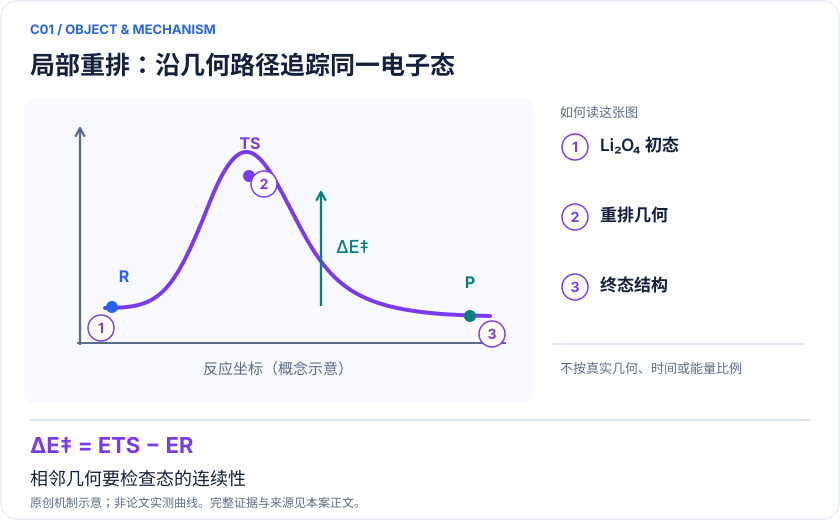
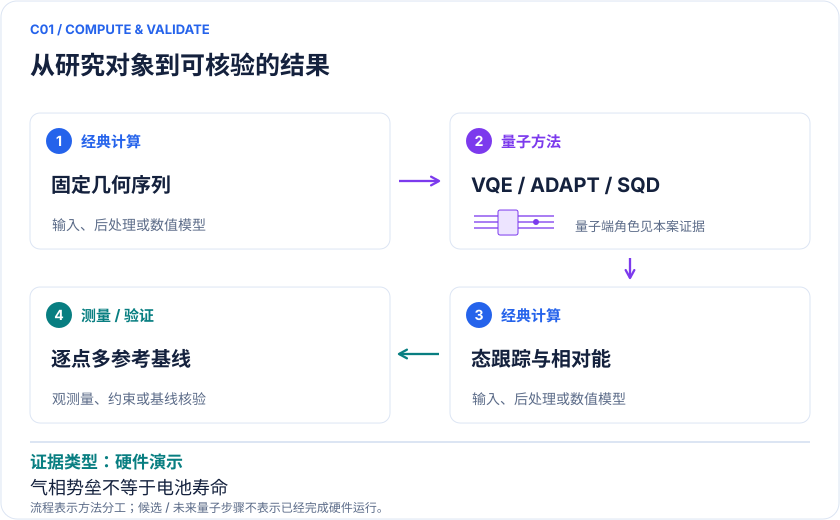

<!-- 由 release/tools/build_problems.py 自 tasks/C01-lithium-superoxide/README.md 与 tasks/catalog.json 生成，勿手改 -->

# C01 · Li₂O₄ 重排：电池局部反应曲线与跨几何态跟踪

> 开放题 · 交叉方向与算法 · 电池与电化学

## 题面

| 环节 | 内容 |
|---|---|
| 研究体系 | 气相 (LiO₂)₂ / Li₂O₄，六原子局部模型 |
| 可观测量 | 相对电子能、电子势垒、反应能、自旋与自然占据 |
| 经典基线 | 同空间 CASCI；扩大空间的多参考方法；经典 selected-CI |
| 量子方法的角色 | VQE/ADAPT 或采样子空间求解指定几何的相关电子问题 |
| 研发决策 | 判断求解器能否稳定分辨局部重排的反应物、过渡态和产物能差。 |

## 基准输入

解法默认使用下列输入，以便与现有参照和其他解法直接比较；改用其他输入时请说明理由。「原文」指作者或原论文公开的材料，「参照」指本项目参照运行自行冻结的选择。

| 项目 | 内容 | 出处 |
|---|---|---|
| 几何 | Li₂O₄ 反应物 R 与产物 P 原坐标（官方 SI） | [原文](https://api.figshare.com/v2/articles/14128697) |
| 模型设置 | 气相中性单重态，6-311++G(d,p)，作者指定 CAS(2,2) 与 CAS(4,3) | [原文](https://doi.org/10.1021/acs.jpca.0c09530) |

**尚未公开或需注意：**SI 中过渡态的 O2/O3 坐标完全重合，过渡态不能直接使用。

## 什么算解

一份解法满足以下五点即可提交审核。负结果同样接受，只要过程可复现、结论有依据。

1. **模型对应**：说明所用模型或数据如何对应「气相 (LiO₂)₂ / Li₂O₄，六原子局部模型」，列出简化与近似。
2. **可观测量**：报告「相对电子能、电子势垒、反应能、自旋与自然占据」，附单位与不确定度。
3. **经典对照**：在同一模型或数据上，与「同空间 CASCI；扩大空间的多参考方法；经典 selected-CI」中至少一种方法比较。
4. **可复现**：提供代码、环境、随机种子、输入来源与哈希，以及计算资源和成本；用到 QPU 时注明设备与 shots。
5. **研发决策**：说明结果能否支撑「判断求解器能否稳定分辨局部重排的反应物、过渡态和产物能差。」，以及还缺什么证据。

本题的细化标准欢迎在 issue 中讨论；被采纳的讨论结论会写入后续版本。

## 现有参照

本项目已有数值执行记录（经典计算机上的计算与模拟），供对照与复用，不代表最优解。

- 原应用目标：未完成（incomplete）
- 最新研究报告：[REFERENCE.md](REFERENCE.md)
- 其余证据指针见 evidence.json（本地证据，未随题库发布）

### 原案例说明

### C01 · Li₂O₄ 重排：电池局部反应曲线与跨几何态跟踪

<!-- VISUALS:START -->
#### 可视化导读

**图 1 · 局部重排：沿几何路径追踪同一电子态。** 相邻几何要检查态的连续性。相对电子能、电子势垒、反应能、自旋与自然占据。图形为依据本案文献重绘的概念关系，不表示实际原子坐标、实测曲线或数值比例。

**图 2 · 计算与验证路径。** VQE/ADAPT 或采样子空间求解指定几何的相关电子问题。**证据边界：** 局部气相电子势垒不能直接给出电解液中的反应速率、电池循环寿命或催化效果。

图解依据：[R1 · Computational Investigations of the Lithium Superoxide Dimer Rearrangement on Noisy Quantum Devices](https://arxiv.org/abs/1906.10675)；[R2 · Quantum simulation of molecular response properties](https://arxiv.org/abs/2301.06260)。解释性连线与图形布局由本库整理，未复制论文原图。

[机制图 SVG](mechanism.svg) · [流程图 SVG](workflow.svg) · 机制图 PNG（本地证据，未随题库发布） · 流程图 PNG（本地证据，未随题库发布） · 图解说明 JSON（本地证据，未随题库发布）
<!-- VISUALS:END -->

更新：2026-10-04｜领域：材料计算｜证据类型：硬件演示｜建议优先级：近期验证

> 小活性空间 VQE 已用于超氧化锂二聚体重排；实机偏差仍需控制。

#### 研究对象与范围

气相 (LiO₂)₂ / Li₂O₄，六原子局部模型。论文为受限活性空间；PDF 拟定 CAS(6,6)/CAS(8,8) 与12/16系统比特，非原论文参数。

#### 来源与文档关系

晓梦_Quantum_Science_Challenge_六方向赛题说明书.pdf: 5–7页 CAT-LiO。原文档的任务阈值按提案保留，不视为论文结果。

#### 问题定义与研发价值

价值在于建立可迁移的反应曲线组件：新构型加入后，态身份和共同能量零点必须保持一致。对于锂氧体系，可用它判断后续更复杂环境建模需要在哪些构型投入高精度计算。这是本库的应用判断，不等于论文已改善电池。

#### 计算目标与分工

定义 ΔEᵢ=Eᵢ−E_R，B=E_TS−E_R；所有冻结核与轨道常数必须保留。经典侧确认驻点和反应路径，生成积分；量子侧在相同扇区给能量或RDM；经典侧做能差及误差传播。共享测量产生的协方差应计入势垒方差。任意插值最高点不是自动成立的过渡态。

#### 文献证据解读

[R1] 支持一个真实的早期分子化学演示，同时记录了硬件不准确的事实。采用变分线路并不保证缓解后的实验估计仍是严格上界。[R2] 可作为以后扩展响应性质的方法参考，未在此证明Li₂O₄动力学。

#### 试点输入与执行建议

先获取几何、基组、活性轨道和粒子/自旋标签；用独立 CASCI 生成 R、TS、P 参考；再扩展到PDF规定的11点。比较逐点冷启动与跨几何参数迁移，保持总shots、优化重启和经典后处理预算一致。输出 profile.csv、轨道跟踪、每点 S²、原始计数及失败点。

#### 验收与停止条件

PDF建议同冻结空间相对能MAE与TS势垒误差均≤1 mHartree，是拟定比赛门槛。正式试点前应校准参考收敛并锁定。若轨道交换导致错误态、TS连接关系不明，或扩大空间改变路径排序，应停止性能排名并修正模型。

#### 资源与可迁移边界

PDF CAS(6,6) 的 M_s=0 行列式数为400，可在经典机精确对照；该小模型不构成量子优势。只有扩大活性空间后化学排序稳定，才有理由把局部量子修正送入电化学模型。

#### 核心判断与下一步

**已报告结果：**Gao 等报告模拟器能量接近同模型精确结果，实机经读出缓解后仍有能量低估。[R1]

**边界：**局部气相电子势垒不能直接给出电解液中的反应速率、电池循环寿命或催化效果。

**下一步建议：**取得并校验文献 R/TS/P 坐标与轨道，再冻结小空间曲线。

本轮完成的是文献整理；没有执行本案例的数值、硬件或湿实验复现。

#### 文献与访问深度

- [R1] [Computational Investigations of the Lithium Superoxide Dimer Rearrangement on Noisy Quantum Devices](https://arxiv.org/abs/1906.10675)，2019，预印本。访问：`abstract`。支持：有限活性空间、模拟器与实机差异；预印本2019，关联期刊 DOI 10.1021/acs.jpca.0c09530。

- [R2] [Quantum simulation of molecular response properties](https://arxiv.org/abs/2301.06260)，2023，预印本。访问：`abstract`。支持：qLR/qEOM 响应方法及无噪模拟；不支持本题甲醛反演已在硬件完成。

## 如何提交

按 [CONTRIBUTING.md](../../../CONTRIBUTING.md) 把解法放在 `solutions/C01/<你的名字>-<短名>/`，格式见 [解法模板](../../../solutions/_template/SOLUTION.md)。被采纳的解法会按 [沉淀规则](../../../skills/README.md) 提炼为可复用的 skill。
