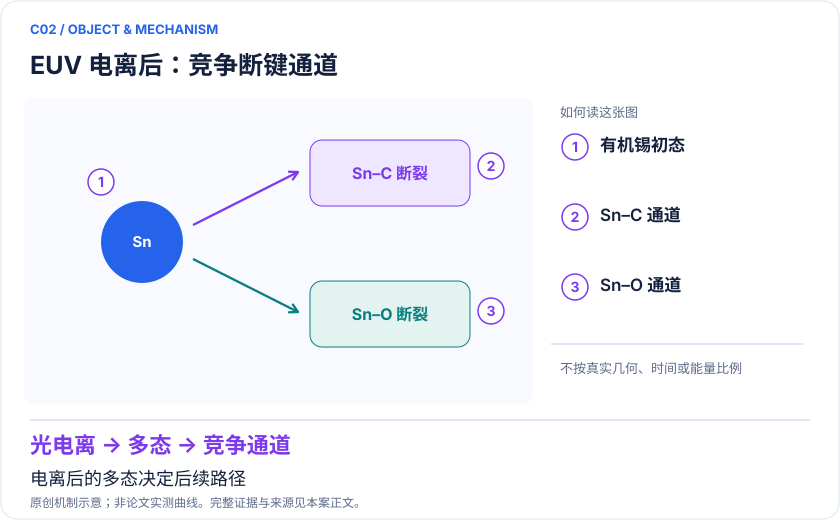

<!-- 由 release/tools/build_problems.py 自 tasks/C02-euv-tin-photoresist/README.md 与 tasks/catalog.json 生成，勿手改 -->

# C02 · 有机锡 EUV 光刻胶：电离后断键通道与多态势能面

> 开放题 · 交叉方向与算法 · 光刻与辐照化学
> 难度：进阶（[分级说明](../../../starters/README.md#难度分级)） · 背景：量子化学

## 题面

| 环节 | 内容 |
|---|---|
| 研究体系 | CH₃Sn(OH)₃ 与相关 (CH₃)₃SnOH 小分子；非完整锡氧笼薄膜 |
| 可观测量 | 垂直电离能、指定键的多态势能切片、自旋和占据 |
| 经典基线 | FOMO-CASCI+surface hopping；多态CASCI/CASSCF并检查动态关联 |
| 量子方法的角色 | 多态VQE/QSE或容错求解为电子态与态间矩阵元提供接口 |
| 研发决策 | 比较 Sn–C 与 Sn–O 激活倾向，为光刻胶局部化学模型选择提供依据。 |

## 基准输入

原文输入没有公开，也没有可直接运行的替代输入，解法需要自建模型并写明来源与哈希。下表只列出已知的公开材料。「原文」指作者或原论文公开的材料，「参照」指本项目参照运行自行冻结的选择。

| 项目 | 内容 | 出处 |
|---|---|---|
| 体系 | TMTH Sn(CH₃)₃OH（15 原子）与 THMS Sn(OH)₃CH₃（11 原子） | [原文](https://doi.org/10.1016/j.chemphys.2018.06.009) |

**尚未公开或需注意：**原 FOMO 电子模型、坐标与基组设置未公开；作者开源代码不含本体系输入。

## 什么算解

一份解法满足以下五点即可提交审核。负结果同样接受，只要过程可复现、结论有依据。

1. **模型对应**：说明所用模型或数据如何对应「CH₃Sn(OH)₃ 与相关 (CH₃)₃SnOH 小分子；非完整锡氧笼薄膜」，列出简化与近似。
2. **可观测量**：报告「垂直电离能、指定键的多态势能切片、自旋和占据」，附单位与不确定度。
3. **经典对照**：在同一模型或数据上，与「FOMO-CASCI+surface hopping；多态CASCI/CASSCF并检查动态关联」中至少一种方法比较。
4. **可复现**：提供代码、环境、随机种子、输入来源与哈希，以及计算资源和成本；用到 QPU 时注明设备与 shots。
5. **研发决策**：说明结果能否支撑「比较 Sn–C 与 Sn–O 激活倾向，为光刻胶局部化学模型选择提供依据。」，以及还缺什么证据。

本题的细化标准欢迎在 issue 中讨论；被采纳的讨论结论会写入后续版本。

## 现有参照

本项目已有数值执行记录（经典计算机上的计算与模拟），供对照与复用，不代表最优解。

- 原应用目标：未完成（incomplete）
- 最新研究报告：[REFERENCE.md](REFERENCE.md)
- 其余证据指针见 evidence.json（本地证据，未随题库发布）

### 原案例说明

### C02 · 有机锡 EUV 光刻胶：电离后断键通道与多态势能面

<!-- VISUALS:START -->
#### 可视化导读

**图 1 · EUV 电离后：竞争断键通道。** 电离后的多态决定后续路径。垂直电离能、指定键的多态势能切片、自旋和占据。图形为依据本案文献重绘的概念关系，不表示实际原子坐标、实测曲线或数值比例。

**图 2 · 计算与验证路径。** 多态VQE/QSE或容错求解为电子态与态间矩阵元提供接口。**证据边界：** 静态切片不足以给出真实碎裂分支、曝光剂量、分辨率或线边粗糙度。

图解依据：[R1 · Ab initio photodynamics of model EUV photoresists](https://www.sciencedirect.com/science/article/pii/S0301010418304312)；[R2 · Quantum simulation of molecular response properties](https://arxiv.org/abs/2301.06260)。解释性连线与图形布局由本库整理，未复制论文原图。

[机制图 SVG](mechanism.svg) · [流程图 SVG](workflow.svg) · 机制图 PNG（本地证据，未随题库发布） · 流程图 PNG（本地证据，未随题库发布） · 图解说明 JSON（本地证据，未随题库发布）
<!-- VISUALS:END -->

更新：2026-10-04｜领域：材料计算｜证据类型：研究提案｜建议优先级：重点储备

> 经典非绝热动力学支持多通道竞争；PDF的量子任务尚是规格草案。

#### 研究对象与范围

CH₃Sn(OH)₃ 与相关 (CH₃)₃SnOH 小分子；非完整锡氧笼薄膜。PDF拟定11原子，中性CAS(6,6)/阳离子CAS(5,6)，12系统比特。

#### 来源与文档关系

晓梦_Quantum_Science_Challenge_六方向赛题说明书.pdf: 8–10页 EUV-Sn。原文档的任务阈值按提案保留，不视为论文结果。

#### 问题定义与研发价值

EUV光刻的材料决策需要知道辐照后哪些结构变化导致交联或挥发。局部金属有机分子的多电子态是可审查的计算入口，但必须经过动力学与薄膜环境连接才能进入配方优化。本案定位为高价值的科学问题加量子组件提案。

#### 计算目标与分工

垂直IP=E₊₁(R₀)−E₀(R₀)，同一电荷态的每条切片以R₀为零点。中性、阳离子共用ECP和常数约定；经典侧提供坐标与轨道，量子侧求目标多态，经典侧以重叠、自旋和占据跟踪根身份。按能量顺序连接曲线会在交叉附近出错。

#### 文献证据解读

[R1] 的摘要与导言确认非绝热跃迁和初始电离态影响结果；它支持“需要多态动力学”，不支持当前量子硬件改善光刻胶。[R2] 提供响应求解方法背景，仍需为锡的相对论、动态关联与多态耦合设计专用验证。

#### 试点输入与执行建议

从PDF指定中性平衡构型冻结两条键扫描，记录Sn的ECP标识、显式电子数及目标自旋。逐点保存态重叠和远端电荷归属。先用CASCI跑完整电荷/坐标网格，再比较守粒子数多态线路的能差及错误态比例。

#### 验收与停止条件

PDF提出IP和曲线误差0.05 eV，属于待校准阈值；必须决定使用最大误差还是平均误差。只要更大空间使通道倾向翻转、切片未达到渐近解离、或根身份无法确认，就不输出材料通道排名。需要产率时应另立有耦合和核运动的模型。

#### 资源与可迁移边界

主档12比特不包含辅助比特。重金属有效芯势、多个电荷扇区及多态测量都增加模型与成本负担。近期价值更可能是检验多态算法和活性空间，而非吞吐量超越经典计算。

#### 核心判断与下一步

**已报告结果：**2018年原始工作使用经典GPU加速的FOMO-CASCI与表面跳跃，研究电离后弛豫和CH₃/OH解离；不是QPU实验。[R1]

**边界：**静态切片不足以给出真实碎裂分支、曝光剂量、分辨率或线边粗糙度。

**下一步建议：**先用经典多态计算审查两条断键路径是否能由同一活性空间描述。

本轮完成的是文献整理；没有执行本案例的数值、硬件或湿实验复现。

#### 文献与访问深度

- [R1] [Ab initio photodynamics of model EUV photoresists](https://www.sciencedirect.com/science/article/pii/S0301010418304312)，2018，期刊论文。访问：`publisher_summary`。支持：经典SH+FOMO-CASCI对两种有机锡模型的电离动力学。

- [R2] [Quantum simulation of molecular response properties](https://arxiv.org/abs/2301.06260)，2023，预印本。访问：`abstract`。支持：qLR/qEOM 响应方法及无噪模拟；不支持本题甲醛反演已在硬件完成。

## 如何提交

按 [CONTRIBUTING.md](../../../CONTRIBUTING.md) 把解法放在 `solutions/C02/<你的名字>-<短名>/`，格式见 [解法模板](../../../solutions/_template/SOLUTION.md)。被采纳的解法会按 [沉淀规则](../../../skills/README.md) 提炼为可复用的 skill。
