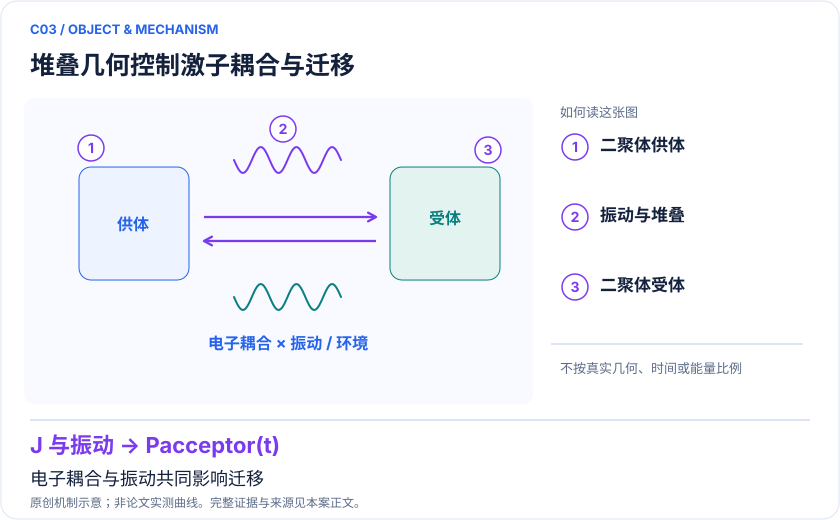
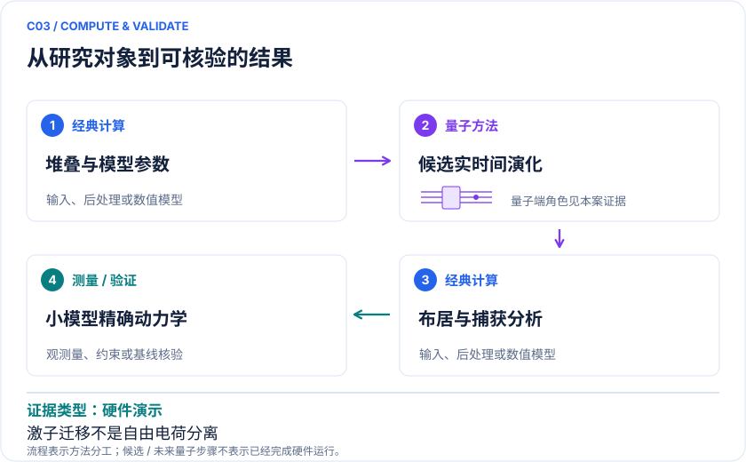

# C03 · 联噻吩二聚体：堆叠与振动如何改变激子迁移

<!-- VISUALS:START -->
## 可视化导读

**图 1 · 堆叠几何控制激子耦合与迁移。** 电子耦合与振动共同影响迁移。受体布居、累计捕获概率、相干与振动敏感性。图形为依据本案文献重绘的概念关系，不表示实际原子坐标、实测曲线或数值比例。

**图 2 · 计算与验证路径。** 变分实时间演化/Trotter或量子通道模拟。**证据边界：** 激子迁移不是自由电荷分离；模型布居不是太阳能电池功率转换效率。

图解依据：[R1 · Simulating Energy Transfer in Molecular Systems with Digital Quantum Computers](https://arxiv.org/html/2101.06879v3)；[R2 · Quantum algorithms for quantum dynamics](https://www.nature.com/articles/s43588-022-00374-2)。解释性连线与图形布局由本库整理，未复制论文原图。

[机制图 SVG](mechanism.svg) · [流程图 SVG](workflow.svg)
<!-- VISUALS:END -->

更新：2026-10-04｜领域：材料计算｜证据类型：硬件演示｜建议优先级：近期验证

> 已有数字量子设备给出激子动力学定性行为；准确度和环境模型仍限制设计应用。

## 研究对象与范围

2,2′-联噻吩二聚体的激子/振动有效模型。论文含单激发与多激发计算；PDF另拟6/8系统比特模型，不能混作论文原设置。

## 来源与文档关系

晓梦_Quantum_Science_Challenge_六方向赛题说明书.pdf: 11–13页 OPTO-T2。原文档的任务阈值按提案保留，不视为论文结果。

## 问题定义与研发价值

有机光电中的几何变化会改变局部激发能、电子耦合和振动作用。相比只计算一个最低能量，本任务直接检查能量能否抵达受体。九个理想堆叠是可复核的计算测试集；其商业意义要在稳定晶型、加工与器件环境中再验证。

## 计算目标与分工

有效电子哈密顿量含局域ε_A、ε_B与耦合J；与振动模和损失通道组合后传播ρ(t)。输出P_B(t)=Tr[ρ(t)|B⟩⟨B|]和累计捕获量。经典前处理决定参数；量子设备只模拟冻结模型，经典后处理负责可观测量、置信区间和排序。

## 文献证据解读

本次读取R1 HTML正文并以其摘要和方法口径约束结论。不能因多尺度前处理使用了真实分子就把全部轨道/全部振动都视为QPU自由度。PDF额外规定几何网格、环境和捕获评分，属于后续任务设计。

## 试点输入与执行建议

提供单体坐标、分子局域坐标轴、九组耦合/振动参数和单位。先比较无振动、单模与扩展截断；再分别运行闭系统和给定损失通道。固定0–200 fs窗口与初态，提交布居曲线、总概率账本、积分捕获及计算成本。

## 验收与停止条件

建议先要求总概率（含吸收通道）守恒、布居非负及时间步收敛；精度阈值在参考曲线生成后冻结。若构型排名随振动截断或环境参数微调翻转，应输出“不稳定排序”，而非从噪声中选最佳结构。

## 资源与可迁移边界

少数局域态模型经典很好求解；量子增量应在多激发、多振动或非马尔可夫区域证明。比较包含参数训练、测量、缓解和后处理总成本，并对量子采样与经典可采样替代做消融。

## 核心判断与下一步

**已报告结果：**原始研究把经典分子动力学、量子化学与量子实时间算法连接；IBM Q结果呈定性动力学且有显著误差，组合缓解改善结果。[R1]

**边界：**激子迁移不是自由电荷分离；模型布居不是太阳能电池功率转换效率。

**下一步建议：**先核验耦合、振动截断和损失通道，再比较构型排序稳定性。

本轮完成的是文献整理；没有执行本案例的数值、硬件或湿实验复现。

## 文献与访问深度

- [R1] [Simulating Energy Transfer in Molecular Systems with Digital Quantum Computers](https://arxiv.org/html/2101.06879v3)，2021，预印本。访问：`full_text`。支持：多尺度工作流、变分/Trotter动力学及实机误差；期刊版本 DOI 10.1021/acs.jctc.1c01296。

- [R2] [Quantum algorithms for quantum dynamics](https://www.nature.com/articles/s43588-022-00374-2)，2023，综述。访问：`abstract`。支持：本地综述已引用的方法综述；本案直接结果以R1为依据。
