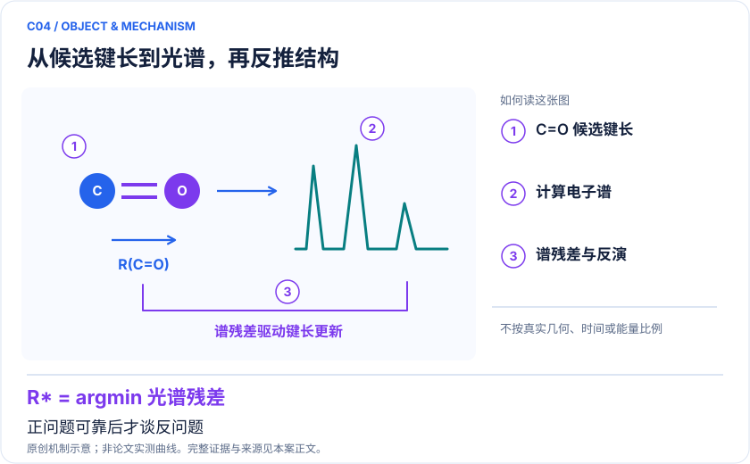
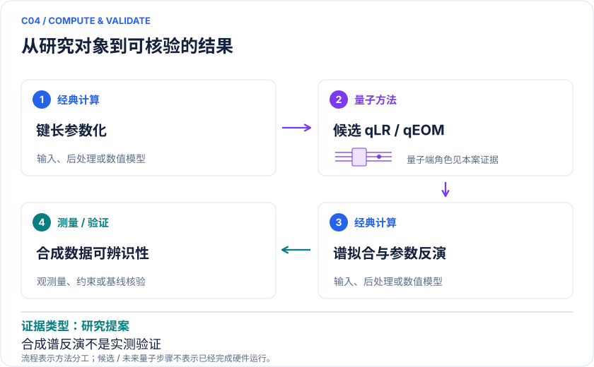

# C04 · 甲醛电子谱与键长反演：可验收的光谱求解器原型

<!-- VISUALS:START -->
## 可视化导读

**图 1 · 从候选键长到光谱，再反推结构。** 正问题可靠后才谈反问题。前三个激发单重态的能隙、取向平均偶极强度、C=O键长区间。图形为依据本案文献重绘的概念关系，不表示实际原子坐标、实测曲线或数值比例。

**图 2 · 计算与验证路径。** qLR、qEOM、多态VQE或相关函数计算谱，经典外层反演。**证据边界：** 合成谱上的可辨识性不等于真实光谱可反演，更不能自动迁移到复杂分子。

图解依据：[R1 · Quantum simulation of molecular response properties](https://arxiv.org/abs/2301.06260)；[R2 · Reduced density matrix formulation of quantum linear response](https://arxiv.org/abs/2404.16586)。解释性连线与图形布局由本库整理，未复制论文原图。

[机制图 SVG](mechanism.svg) · [流程图 SVG](workflow.svg)
<!-- VISUALS:END -->

更新：2026-10-04｜领域：材料计算｜证据类型：研究提案｜建议优先级：近期验证

> 适合作为谱计算和不确定性验证任务；甲醛本身不是已证实的高商业价值量子应用。

## 研究对象与范围

H₂CO有限活性空间，理想化C₂v几何族。PDF拟定CAS(4,3)/CAS(6,5)，6/10系统比特；非已完成硬件规模。

## 来源与文档关系

晓梦_Quantum_Science_Challenge_六方向赛题说明书.pdf: 14–16页 SPEC-H2CO。原文档的任务阈值按提案保留，不视为论文结果。

## 问题定义与研发价值

把方法验证和产业价值分开：甲醛用于构建可信裁判，实际需求是从谱学识别结构或反应中间体。前向谱中能量与跃迁矩都正确，反演仍可能存在多解，因此本案尤其适合检验“量子结果是否改变决策”。

## 计算目标与分工

按PDF取w_k=(|μ_x|²+|μ_y|²+|μ_z|²)/3，使用固定展宽叠加Lorentzian；w_k不是无量纲振子强度。反演模型y=K[S(r)]+ε中显式给出仪器响应K与噪声。量子求解前向谱，经典推断键长及区间。

## 文献证据解读

[R1]研究qLR/qEOM与响应性质的无噪模拟；[R2]把RDM驱动qLR扩展到较大基组的分子谱。这两篇支持方法选择，不支持“甲醛隐藏键长在QPU上已经准确恢复”。本库将它单列为提案，防止混淆。

## 试点输入与执行建议

保存每个几何的电子积分、常数、轨道顺序和三个偶极算符；提供可受控生成网格间几何的前向接口。先核对暗态与强度归一化，再在固定预算下比较固定采样与自适应时间/频率采样。留出网格间键长而不是仅记忆11个公开点。

## 验收与停止条件

PDF建议激发能≤0.03 eV、非暗峰谱重相对误差≤5%、可辨识实例键长误差≤0.02 Å；均为任务拟定阈值。不可分辨实例评价区间覆盖率和拒判。出现模型失配仍给极窄区间应判失败。

## 资源与可迁移边界

CAS(6,5)的M_s=0扇区仅100维；适合建立软件基准，不适合宣称算力优势。迁移到真实光谱时需补溶剂、振动、Rydberg态与实验校准，且不应沿用未经确认的误差门槛。

## 核心判断与下一步

**已报告结果：**量子线性响应与RDM方法已有论文支持，但PDF定义的H₂CO谱→键长任务本轮未找到直接完成证据。[R1][R2]

**边界：**合成谱上的可辨识性不等于真实光谱可反演，更不能自动迁移到复杂分子。

**下一步建议：**先生成含仪器响应和失配压力测试的独立合成数据。

本轮完成的是文献整理；没有执行本案例的数值、硬件或湿实验复现。

## 文献与访问深度

- [R1] [Quantum simulation of molecular response properties](https://arxiv.org/abs/2301.06260)，2023，预印本。访问：`abstract`。支持：qLR/qEOM 响应方法及无噪模拟；不支持本题甲醛反演已在硬件完成。

- [R2] [Reduced density matrix formulation of quantum linear response](https://arxiv.org/abs/2404.16586)，2024，预印本。访问：`abstract`。支持：RDM 路线计算分子谱，示例苯、R-methyloxirane、水；不把这些对象冒充甲醛。
